# Stat Arb for Non Quant

*จากแนวคิดและกรณีศึกษา สู่การออกแบบและทดสอบกลยุทธ์*

ฉบับ 0.9 ภาค 1–2: พื้นฐานและคู่สินทรัพย์หนึ่งคู่ \| 11 พฤศจิกายน 2026

หนังสือสำหรับเรียนด้วยตัวเอง ทบทวน และนำแนวคิดไปทดลองต่อ โดยเชื่อมคำถามทางการซื้อขายกับข้อมูล สมการ สถานะ และบัญชีเงินสด

ฉบับนี้เขียนให้มือใหม่ที่สนใจตลาดคริปโต บท 0–10 ซึ่งเป็นภาค 1 และภาค 2 เขียนแล้ว ครอบคลุมพื้นฐานตลาด แหล่งกำไร การเลือกตัวแปร บัญชีสถานะ การ hedge แผนที่วิธีสร้างกลยุทธ์ คู่ที่ผูกกันด้วยสัญญาและด้วยสถิติ กฎเข้า–ออก mean reversion และการพักระบบ ส่วนบท 11–20 ยังเป็นแผนที่อยู่ท้ายเล่ม ฉบับ 0.9 เขียนบท 6 และ 7 ทั้งบท รายการเปลี่ยนแปลงอยู่ใน [CHANGELOG_v0_9.md](CHANGELOG_v0_9.md)

## เริ่มอ่านชุดนี้อย่างไร

มือใหม่เริ่มที่บท 0 เพื่อให้ศัพท์และกลไกตลาดตรงกันก่อน แล้วอ่านบท 1–10 ตามลำดับ ในการอ่านรอบแรก ข้ามหัวข้อที่มีป้าย “ลงลึก” ได้ ลองทำโจทย์ก่อนเปิดเฉลย และใช้โค้ดตรวจตัวเลข

| **ส่วน** | **สิ่งที่ได้** |
|---|---|
| บท 0 | ศัพท์และกลไกตลาดคริปโตที่ทั้งเล่มใช้ |
| บท 1–4 | แหล่งกำไร ตัวแปร บัญชี และการ hedge พร้อมโจทย์และเฉลย |
| บท 5 | แผนที่วิธีสร้างกลยุทธ์ ตั้งแต่ replication ถึง market making |
| บท 6–7 | คู่ที่ผูกด้วยสัญญาและด้วยสถิติ: ผลตอบแทนของทุน funding การเลือกคู่ และทะเบียนคู่ |
| บท 8–10 | กฎเข้า–ออก หลักฐาน mean reversion และการพักหรือเปลี่ยนแนวทาง |
| แผนและแม่แบบ | แผนเต็ม 21 บท (บท 0–20) กรณีศึกษา 14 ชุด และแม่แบบบท |
| เอกสารประกอบ | คำศัพท์ สัญลักษณ์ แหล่งอ่านต่อ และโค้ดสำหรับตรวจตัวอย่างสมมติ |

สามแกนที่ใช้กับทุกกรณีศึกษากลยุทธ์คือ Asset Selection, Workflow และ Position Management เพื่อให้การเรียนเชื่อมตั้งแต่เหตุผลที่เลือกสินทรัพย์ไปจนถึงสิ่งที่ถือจริง

<a id="positioning"></a>

## เล่มนี้เขียนให้ใคร และใช้คู่กับเล่มเดิมอย่างไร

เล่มนี้เขียนให้มือใหม่ที่สนใจตลาดคริปโตและอยากเข้าใจ stat arb ตั้งแต่เหตุผลจนถึงเงินในบัญชี คุณไม่จำเป็นต้องเขียนโค้ดเป็น และไม่จำเป็นต้องอ่านเล่ม Quant for Non-Quant จบก่อน เส้นทางหลักของทุกบทใช้เพียงบวก ลบ คูณ หาร เปอร์เซ็นต์ และการอ่านกราฟ

| คำถาม | คำตอบของเล่มนี้ |
| --- | --- |
| ต้องรู้อะไรมาก่อน | รู้ว่าซื้อขายเหรียญบน exchange เป็นอย่างไร ส่วนศัพท์และกลไกที่ต้องใช้ทั้งหมดอยู่ในบท 0 |
| ตลาดที่ใช้เป็นตัวอย่าง | คริปโต โดยใช้ BTC spot, dated futures และ perp เป็นกรณีต่อเนื่อง ส่วนสินทรัพย์สมมติ A และ B ใช้เมื่อต้องการฝึกเลขให้ง่าย |
| เล่มนี้ต่างจากเล่มเดิมอย่างไร | เล่มเดิมสอนเครื่องมือ เช่น สถิติ regression และ cointegration เล่มนี้สอนการตัดสินใจ: จะถืออะไร เท่าไร เมื่อไร และเงินในบัญชีเปลี่ยนอย่างไร |
| เมื่อเจอเครื่องมือที่ไม่คุ้น | กล่องเปิดบทบอกภาคของเล่มเดิมที่ควรเปิดทวน อ่านเฉพาะภาคนั้นแล้วกลับมาต่อได้ |
| หัวข้อที่มีป้าย “ลงลึก” | ใช้คณิตศาสตร์หรือเครื่องมือเกินเส้นทางหลัก ข้ามได้ในการอ่านรอบแรก โดยเก็บประโยคสรุปใต้ป้ายไว้ |
| อ่านจบแล้วควรทำอะไรได้ | อธิบายว่ากลยุทธ์หนึ่งคาดกำไรจากอะไร คำนวณกำไรขาดทุนและเงินสดของสถานะหลายขาได้เอง และบอกได้ว่าต้องเห็นหลักฐานอะไรก่อนเชื่อผลทดสอบ |

<a id="conventions"></a>

## ข้อตกลงของเล่ม

ข้อตกลงหกข้อนี้ใช้กับทุกบท เพื่อไม่ต้องกล่าวซ้ำทุกครั้งที่มีตัวอย่าง

1\. ตัวเลขทุกตัวเป็นสถานการณ์สมมติที่ตั้งขึ้นเพื่อสอน เว้นแต่ระบุว่าเป็นผลจากต้นฉบับหรือผลที่ทดลองเอง จึงไม่ใช่ผลตลาดและไม่ใช่หลักฐานว่ากลยุทธ์ทำกำไร

2\. กำไรขาดทุนที่แสดงเป็นค่าก่อนต้นทุน เว้นแต่ระบุว่าสุทธิ ต้นทุนแต่ละรายการถูกนับครั้งเดียว

3\. จำนวนที่ถือมีเครื่องหมาย ค่าบวกคือ long และค่าลบคือ short กำไรจากราคาเท่ากับจำนวนที่ถือคูณราคาที่เปลี่ยน

4\. การ hedge บอกว่าลดความเสี่ยงอะไร ไม่ได้บอกว่าจะได้กำไร ทั้งสองเรื่องต้องมีหลักฐานของตัวเอง

5\. หลักฐานจากแหล่งภายนอกมีสี่ระดับ คืออ่านวิธีแล้ว ตรวจโค้ดแล้ว รันตัวอย่างแล้ว และทำซ้ำผลได้แล้ว เล่มนี้ระบุระดับทุกครั้งที่อ้าง

6\. กติกาของ exchange เช่น อัตราหลักประกัน รอบ funding และค่าธรรมเนียม เปลี่ยนได้และต่างกันในแต่ละที่ ตัวเลขในเล่มเป็นค่าสมมติ ก่อนใช้จริงต้องอ่านเอกสารของสัญญานั้น เนื้อหาทั้งเล่มมีไว้เพื่อการเรียนรู้ ไม่ใช่คำแนะนำการลงทุน

<a id="notation"></a>

## สัญลักษณ์ที่ใช้ทั้งเล่ม

ตารางนี้ตรึงความหมายหลักของสัญลักษณ์แต่ละตัว คอลัมน์สุดท้ายบอกจุดที่ตัวอักษรเดียวกันถูกใช้ในความหมายอื่น เพื่อให้อ่านตามบริบทได้ถูก ฉบับ 0.6 เปลี่ยนสัญลักษณ์ของ spread ในบท 3 และหัวข้อ 10.01 จาก S เป็น X และเปลี่ยนราคา fill จาก F เป็น $P^{\mathrm{fill}}$ เพื่อไม่ให้ชนกับราคา spot และ futures

| สัญลักษณ์ | ความหมายหลัก | หน่วย | ความหมายอื่นที่ต้องอ่านตามบริบท |
| --- | --- | --- | --- |
| $P_i$ | ราคาของสินทรัพย์ i | เงินต่อหน่วยสินทรัพย์ | $P_T$ ใน 05.03 คือ payoff ของ put |
| $S$, $F$ | ราคา spot และราคา futures ของสินทรัพย์เดียวกัน | เงินต่อหน่วยสินทรัพย์ | $S_T$ ใน 05.03 คือราคาสินทรัพย์อ้างอิงวันหมดอายุ |
| $P^{\mathrm{fill}}_i$ | ราคาที่ซื้อขายสำเร็จจริง | เงินต่อหน่วยสินทรัพย์ | — |
| $X$ | ค่าที่สร้างขึ้นเพื่อ plot หรือราคา spread เช่น $P_A-hP_B$ | ตามนิยามของตัวแปรนั้น | ใน 04.02 เป็น residual ของ regression ระดับราคา |
| $b$ | Monetary basis $F-S$ (บท 2) | เงินต่อหน่วยสินทรัพย์ | slope ของ regression ผลตอบแทนใน 04.02; $b_t(q)$ ใน 08.01 คือส่วนเผื่อความไม่แน่นอน |
| $h$ | Hedge ratio จากระดับราคา | หน่วย B ต่อหนึ่งหน่วย A | horizon ใน 02.08; $h_{U\mid V}$ ใน 05.08 คือ conditional CDF |
| $H$ | จำนวนช่วงที่ถือหรือประเมิน | จำนวนช่วง | เมทริกซ์ข้อกำหนด exposure ใน 04.05 |
| $q_i$ | จำนวนที่ถือจริง บวกคือ long ลบคือ short | หน่วยสินทรัพย์หรือสัญญา | — |
| $d_i$, $w_i$ | มูลค่าสถานะ $q_iP_i$ และสัดส่วนต่อฐานทุน $d_i/K$ | เงิน และไม่มีหน่วย | — |
| $C$ | เงินสดในบัญชี | เงิน | $C_T$ คือ payoff ของ call; $\widehat C$ คือต้นทุนที่ประมาณ; $C(u,v)$ คือ copula |
| $M$ | ยอดบัญชีหลักประกันหลังชำระกำไรขาดทุน | เงิน | ตัวคูณสัญญาใน 05.05; ตัวห้อย M ใน $R_M$ หมายถึงตลาด |
| $V$ | Equity ของบัญชี | เงิน | $V$ ใน 05.08 คือ percentile ของสินทรัพย์ตัวที่สอง |
| $\Pi$ | กำไรขาดทุน ตัวยกบอกชนิด เช่น price หรือ net | เงิน | — |
| $K$ | ฐานทุนที่ใช้คำนวณ weights | เงิน | $K_t$ ใน 03.08 คือต้นทุนของช่วง |
| $R_i$, $R_M$, $R_G$ | Simple return ของสินทรัพย์ ตลาด และ factor G | ไม่มีหน่วย | — |
| $\beta_i$, $\gamma_i$ | ความไวต่อตลาดและต่อ factor G ตามโมเดล | ไม่มีหน่วย | factor G ไม่เกี่ยวกับ gamma ของ options ใน 05.05 |
| $r^{\mathrm{impl}}$, $\tau$ | Implied carry และเวลาที่เหลือถึงหมดอายุ | ต่อปี และปี | $\tau=1/\kappa$ ใน 10.04 คือเวลาปรับกลับของ Avellaneda–Lee |
| $\mu$, $\kappa$, $\sigma$, $\phi$ | ระดับสมดุล ความเร็วปรับกลับ ขนาด noise และสัมประสิทธิ์ AR(1) | ตามหัวข้อ 09.02 | $\widehat\mu$ ใน 04.06 คือผลตอบแทนที่คาด |
| $\mathcal I_t$ | ข้อมูลที่รู้ได้จริงถึงเวลา t | — | — |

<a id="contents"></a>

## สารบัญ

บท 0–5 และ 8–10 เป็นเนื้อหาที่เขียนแล้ว บท 6–7 และ 11–20 เป็นแผน ลิงก์ด้านล่างเชื่อมไปยังหัวข้อในไฟล์นี้

- [เล่มนี้เขียนให้ใคร และใช้คู่กับเล่มเดิมอย่างไร](#positioning)
- [ข้อตกลงของเล่ม](#conventions)
- [สัญลักษณ์ที่ใช้ทั้งเล่ม](#notation)
- ภาค 1 เข้าใจว่าเรากำลังซื้อขายอะไร
  - [บท 0 ก่อนเริ่ม: stat arb และตลาดคริปโต](#primer)
  - [บท 1 กำไรของกลยุทธ์นี้ควรมาจากไหน](#strategy_reasoning)
  - [บท 2 เลือกค่าอะไรมา plot และใช้ตัดสินใจอย่างไร](#signal_design)
  - [บท 3 จากสัญญาณสู่สถานะและกำไรขาดทุน](#pilot)
  - [บท 4 เรา hedge อะไร และยังเหลือความเสี่ยงอะไร](#hedging)
  - [บท 5 แผนที่วิธีสร้างกลยุทธ์](#strategy_map)
- ภาค 2 หนึ่งคู่ให้ครบ ตั้งแต่เลือกจนถึงหยุด
  - [บท 6 คู่ที่ผูกกันด้วยสัญญา: carry, basis และ funding](#contract_pairs)
  - [บท 7 คู่ที่ผูกกันด้วยสถิติ: ทำไมจึงควรสัมพันธ์กัน](#statistical_pairs)
  - [บท 8 จากค่าที่ plot สู่กฎเข้า ถือ ออก](#decision_rules)
  - [บท 9 Mean reversion ใช้ได้เมื่อไร](#mean_reversion)
  - [บท 10 เมื่อความสัมพันธ์เปลี่ยน: ปรับ พัก หรือหยุด](#regime_change)
- ภาค 3–5 บท 11–20 (แผน): [ภาค 3](#part_3) · [ภาค 4](#part_4) · [ภาค 5](#part_5)
- [คำศัพท์สำหรับทบทวน](#glossary)
- [โค้ดคำนวณประกอบบท](#code)
- [แผนหนังสือและเป้าหมายการเรียน](#blueprint)
- [กรณีศึกษาที่ใช้เป็นแกนของเล่ม](#cases)
- [แม่แบบเนื้อหาและการจัดหน้า](#template)
- [แหล่งอ้างอิงและทางอ่านต่อ](#references)

<a id="primer"></a>

## บท 0 ก่อนเริ่ม: stat arb และตลาดคริปโตในระดับที่ต้องใช้

ศัพท์ กลไก และเลขพื้นฐานที่ทุกบทถัดไปใช้

> **ก่อนอ่าน:** ไม่ต้องมีพื้นฐานเพิ่ม ถ้าเคยซื้อขายเหรียญมาแล้วจะอ่านได้เร็ว
>
> **เมื่อจบบท คุณควรทำได้:** คำนวณกำไรขาดทุนของ long และ short บอกความต่างของ spot, dated futures และ perp และคำนวณต้นทุนของการซื้อแล้วขายหนึ่งรอบ
>
> **ตัวอย่างหลักของบท:** BTC ราคา 100,000 ที่ bid 99,990 และ ask 100,010

<a id="primer_00_01"></a>

### 00.01 Stat arb คืออะไร

Stat arb ย่อมาจาก statistical arbitrage เป็นชื่อรวมของกลยุทธ์ที่ถือหลายสถานะพร้อมกัน โดยมากคือซื้อสิ่งหนึ่งและขายอีกสิ่งหนึ่งที่เกี่ยวข้องกัน เพื่อรับผลจากความต่างของราคาที่คาดว่าจะเปลี่ยนไปในทางที่เป็นประโยชน์ แทนการเดาว่าตลาดทั้งหมดจะขึ้นหรือลง ตัวอย่างเช่น ซื้อ BTC ในตลาด spot พร้อมกับขาย BTC futures เมื่อราคา futures สูงกว่า

คำสองคำในชื่อต้องอ่านให้ถูกครับ คำว่า statistical บอกว่าความคาดหวังมาจากหลักฐานเชิงสถิติ จึงมีทั้งครั้งที่ได้และครั้งที่เสีย ส่วนคำว่า arbitrage ในชื่อนี้ไม่ได้แปลว่าไม่มีความเสี่ยง สถานะสองขาลดความเสี่ยงบางอย่างได้ แต่ยังเหลือความเสี่ยงอื่น และยังต้องใช้เงินทุนรองรับระหว่างทาง ทั้งเล่มจะถามสามคำถามซ้ำกับทุกกลยุทธ์: คาดกำไรจากอะไร ถืออะไรจริง และเงินในบัญชีเปลี่ยนอย่างไร

<a id="primer_00_02"></a>

### 00.02 Long, short และกำไรขาดทุน

Long คือถือสินทรัพย์ไว้และได้ประโยชน์เมื่อราคาขึ้น Short คือสถานะที่ได้ประโยชน์เมื่อราคาลง ในตลาด spot การ short ต้องยืมเหรียญมาขายก่อนแล้วซื้อคืนภายหลัง ส่วนในตลาด futures เราเปิดสถานะขายได้โดยวางหลักประกัน

| สถานะ | ราคาเปิด | ราคาปัจจุบัน | การคำนวณ | กำไรขาดทุน |
| --- | --- | --- | --- | --- |
| Long 0.1 BTC | 100,000 | 102,000 | +0.1 × 2,000 | +200 |
| Short 0.1 BTC | 100,000 | 102,000 | −0.1 × 2,000 | −200 |

สูตรเดียวใช้ได้ทั้งสองทิศ คือจำนวนที่ถือแบบมีเครื่องหมาย คูณราคาที่เปลี่ยน ถ้าถือทั้งสองแถวพร้อมกัน ผลรวมจากราคาเป็นศูนย์ นี่คือแนวคิดตั้งต้นของการ hedge บท 3 จะขยายสูตรนี้เป็นบัญชีเต็มรูปแบบ

<a id="primer_00_03"></a>

### 00.03 Spot, dated futures และ perp

ตลาดคริปโตมีเครื่องมือสามชนิดที่เล่มนี้ใช้ ราคาของทั้งสามมักอยู่ใกล้กันแต่ไม่เท่ากัน ความต่างนั้นเป็นวัตถุดิบของหลายกลยุทธ์

| เครื่องมือ | จ่ายเงินอย่างไร | มีวันหมดอายุหรือไม่ | สิ่งที่ต้องรู้เพิ่ม |
| --- | --- | --- | --- |
| Spot | จ่ายเต็มมูลค่าและได้เหรียญจริง | ไม่มี | การ short ต้องยืมเหรียญและมีค่ายืม |
| Dated futures | วางหลักประกันบางส่วน | มี เมื่อหมดอายุจะชำระด้วยราคาอ้างอิงที่สัญญากำหนด | ราคาต่างจาก spot ได้ระหว่างทาง ส่วนต่างนี้เรียกว่า basis |
| Perpetual futures (perp) | วางหลักประกันบางส่วน | ไม่มี | มี funding เป็นเงินจ่ายระหว่างฝั่ง long กับ short ตามรอบ เพื่อดึงราคาให้อยู่ใกล้ราคาอ้างอิง |

สัญญา futures ยังแบ่งตามสกุลที่ใช้คิดกำไรขาดทุน สัญญาแบบ linear คิดกำไรขาดทุนเป็นสกุลเงินอ้างอิง เช่น ดอลลาร์หรือ stablecoin ส่วนแบบ inverse คิดเป็นเหรียญ ตัวอย่างทั้งเล่มใช้แบบ linear เพราะสูตรจำนวนคูณราคาที่เปลี่ยนใช้ได้ตรง ถ้าใช้แบบ inverse ต้องใช้สูตรของสัญญานั้น

<a id="primer_00_04"></a>

### 00.04 หลักประกัน leverage และการถูกบังคับปิด

เมื่อวางหลักประกัน 1,000 เพื่อถือสถานะ futures มูลค่า 10,000 เราใช้ leverage 10 เท่า กำไรขาดทุนคิดจากมูลค่าสถานะเต็ม 10,000 ไม่ได้คิดจากหลักประกัน ถ้าราคาเดินสวนทาง 5% เราขาดทุน 500 หรือครึ่งหนึ่งของหลักประกัน ถ้าสวนทาง 10% ขาดทุนเท่ากับหลักประกันทั้งก้อน

ในทางปฏิบัติ exchange จะบังคับปิดสถานะก่อนถึงจุดนั้น คือเมื่อหลักประกันเหลือต่ำกว่าระดับขั้นต่ำที่กำหนด สำหรับ stat arb เรื่องนี้สำคัญมากครับ สถานะสองขาอาจมีกำไรขาดทุนรวมใกล้ศูนย์ แต่ขาที่ขาดทุนยังถูกเรียกหลักประกันเพิ่มหรือถูกบังคับปิดได้ หัวข้อ 03.09 แสดงตัวอย่างนี้ทีละวัน

<a id="primer_00_05"></a>

### 00.05 Order book, bid–ask, maker และ taker

ราคาที่เห็นบนกราฟเป็นราคาเดียว แต่ตอนซื้อขายมีสองราคา Bid คือราคาสูงสุดที่มีคนรอซื้อ Ask คือราคาต่ำสุดที่มีคนรอขาย ส่วนต่างเรียกว่า bid–ask spread และค่ากลางเรียกว่า mid สมมติ bid อยู่ที่ 99,990 และ ask อยู่ที่ 100,010 จะได้ spread 20 และ mid 100,000

คำสั่งแบบ taker ซื้อขายทันทีกับราคาที่รออยู่ จึงซื้อที่ ask และขายที่ bid คำสั่งแบบ maker วางราคารอไว้ใน order book เช่น วางซื้อที่ 99,990 ได้ราคาดีกว่า แต่จะได้ซื้อก็ต่อเมื่อมีคนมาขายให้ ซึ่งอาจไม่เกิดขึ้น หรือเกิดในจังหวะที่ราคากำลังลงต่อ หลาย exchange คิดค่าธรรมเนียม maker ต่ำกว่า taker

| ซื้อแล้วขายทันที 1 BTC แบบ taker โดย mid ไม่เปลี่ยน | เงิน |
| --- | --- |
| ซื้อที่ ask 100,010 แล้วขายที่ bid 99,990 | −20 |
| ค่าธรรมเนียมสมมติ 0.05% ของมูลค่า ทั้งขาซื้อและขาขาย | −100 |
| รวมต้นทุนหนึ่งรอบ | −120 |

ต้นทุน 120 เท่ากับ 0.12% ของราคา กลยุทธ์ที่คาดกำไรต่อรอบน้อยกว่านี้จึงขาดทุนตั้งแต่ยังไม่เริ่ม และ stat arb มีอย่างน้อยสองขา ต้นทุนจึงเกิดกับทุกขา เล่มนี้ใช้แนวทาง maker เป็นหลักเพื่อลดต้นทุนส่วนนี้ ซึ่งแลกมากับความไม่แน่นอนว่าจะได้ซื้อขายครบทุกขาหรือไม่

<a id="primer_00_06"></a>

### 00.06 Funding ของ perp

Funding คือเงินที่ฝั่งหนึ่งจ่ายให้อีกฝั่งตามรอบที่ exchange กำหนด เมื่ออัตราเป็นบวก ฝั่ง long จ่ายให้ฝั่ง short เมื่ออัตราเป็นลบจะกลับกัน ถ้าเรา short perp 1 BTC ที่ราคา mark 100,000 และอัตราของรอบนั้นเท่ากับ +0.01% เราได้รับ 100,000 × 0.01% = 10

เงินก้อนนี้ดูเล็ก แต่เกิดซ้ำทุกรอบ จึงเป็นทั้งแหล่งรายรับของบางกลยุทธ์และเป็นต้นทุนของบางกลยุทธ์ สิ่งที่ต้องจำตั้งแต่ตอนนี้คืออัตราเปลี่ยนได้ทุกรอบและกลับเครื่องหมายได้ หัวข้อ 03.09 ลงบัญชี funding สามรอบพร้อมค่าธรรมเนียมให้ดู

<a id="primer_00_07"></a>

### 00.07 ตรวจตัวเองก่อนไปบท 1

ลองตอบห้าข้อนี้โดยไม่เปิดย้อนครับ ถ้าตอบได้ครบ คุณมีพื้นพอสำหรับทั้งเล่ม

ข้อ 1 — Short 0.5 BTC ที่ 100,000 ต่อมาราคาเป็น 98,000 กำไรหรือขาดทุนเท่าไร?

ข้อ 2 — วางหลักประกัน 2,000 ด้วย leverage 5 เท่า มูลค่าสถานะเท่าไร? ถ้าราคาเดินสวนทาง 4% ขาดทุนเท่าไร และคิดเป็นกี่เปอร์เซ็นต์ของหลักประกัน?

ข้อ 3 — Bid อยู่ที่ 49,995 และ ask อยู่ที่ 50,005 ถ้าซื้อแล้วขายทันทีแบบ taker หนึ่งหน่วยโดยราคาไม่เปลี่ยน เสียเท่าไรก่อนค่าธรรมเนียม?

ข้อ 4 — Long perp 2 BTC ที่ราคา mark 100,000 อัตรา funding ของรอบนี้เท่ากับ +0.01% เราจ่ายหรือรับ และเท่าไร?

ข้อ 5 — Spot ราคา 100,000 และ dated futures ราคา 103,000 ค่า basis เท่าไร?

เฉลย: ข้อ 1 ได้กำไร 1,000 เพราะ −0.5 × (98,000 − 100,000) = +1,000 ข้อ 2 มูลค่าสถานะ 10,000 ขาดทุน 400 หรือ 20% ของหลักประกัน ข้อ 3 เสีย 10 ข้อ 4 เราเป็นฝั่ง long จึงจ่าย 2 × 100,000 × 0.01% = 20 ข้อ 5 basis เท่ากับ 3,000 ซึ่งเป็นจุดเริ่มของตัวอย่างในบท 1 และ 2

<a id="strategy_reasoning"></a>

## บท 1 กำไรของกลยุทธ์นี้ควรมาจากไหน

ตั้งสมมติฐานกำไร ตรวจความเสี่ยง และวินิจฉัยผลทดสอบ

> **ก่อนอ่าน:** บท 0 ถ้าคำว่าค่าคาดหมายยังไม่คุ้น ให้เปิดภาค I–II ของ Quant for Non-Quant ประกอบ
>
> **เมื่อจบบท คุณควรทำได้:** เขียนสมมติฐานกลยุทธ์หนึ่งหน้า ระบุความเสี่ยงที่รับและหลักฐานที่จะทำให้เลิกเชื่อ แล้วไล่ความต่างระหว่างสิ่งที่คาดกับผลจริงทีละชั้น
>
> **ตัวอย่างหลักของบท:** BTC spot 100,000 กับ futures 103,000 และสะพานจาก forecast 12 ไปสู่กำไรสุทธิ 2

<a id="strategy_reasoning_01_01"></a>

### 01.01 เขียนให้ได้ว่าทำไมจึงคาดหวังกำไร

สมมติคุณเปิดหน้าจอแล้วเห็น BTC spot ราคา 100,000 ขณะที่ futures ซึ่งหมดอายุในอีก 90 วันราคา 103,000 ส่วนต่าง 3,000 ดูเหมือนเงินที่วางอยู่บนโต๊ะ ถ้าซื้อ spot แล้วขาย futures พร้อมกัน จะได้ส่วนต่างนี้ใช่ไหมครับ? คำตอบคือได้ ถ้าเงื่อนไขหลายข้อเป็นจริง บทนี้จะฝึกให้เขียนเงื่อนไขเหล่านั้นออกมาก่อนลงมือ

ก่อนเลือกเหรียญ สูตร หรือ indicator ให้ลองเขียนหนึ่งย่อหน้าว่า “เราคาดว่าจะได้เงินจากอะไร ภายใต้เงื่อนไขใด และต้องรับความเสี่ยงอะไรระหว่างรอ” ถ้ายังเขียนไม่ได้ ก็ยังไม่ควรทดสอบ เพราะเราจะไม่รู้ว่าผลทดสอบกำลังยืนยันหรือหักล้างอะไร

ชื่อ stat arb หรือคำว่า market neutral ยังไม่ใช่คำตอบ การ long คู่กับ short เป็นวิธีสร้างสถานะ ส่วนชื่อโมเดลบอกเครื่องมือที่ใช้ คำตอบจริงคือกลไกที่ทำให้เงินในบัญชีเพิ่มหลังหักต้นทุน ซึ่งแบ่งได้สี่กลุ่ม

| กลไก | ตัวอย่างในคริปโต | สิ่งที่ต้องเป็นจริง |
| --- | --- | --- |
| ความสัมพันธ์ตามสัญญา | spot กับ dated futures ที่ราคาต้องมาบรรจบกันวันหมดอายุ | สองขาอ้างอิงสิ่งเดียวกัน ถือได้ครบถึงวันนั้น และทำธุรกรรมได้ทุกขา |
| การพยากรณ์ | ส่วนต่างราคาของสองเหรียญที่ห่างผิดปกติอาจแคบลง | ข้อมูลใหม่ยังสนับสนุนการพยากรณ์ และขนาดผลคุ้มต้นทุน |
| Carry และการรับความเสี่ยง | รับ funding ของ perp ขณะถือ spot ไว้ hedge | รายรับต่อเนื่องพอ และความเสี่ยงที่รับไว้ไม่ทำลายทุนก่อน |
| การให้สภาพคล่อง | วาง maker order ทั้งฝั่งซื้อและขายเพื่อเก็บ bid–ask | ได้ fill จริง และราคาไม่วิ่งสวนหลัง fill จนกินส่วนต่าง |

กลยุทธ์หนึ่งใช้หลายกลไกพร้อมกันได้ เช่น เปิด spot คู่ futures เมื่อส่วนต่างสูง ซึ่งเป็นกลไกตามสัญญา แล้วส่งคำสั่งแบบ maker เพื่อลดต้นทุน ซึ่งเป็นกลไกสภาพคล่อง เราต้องรู้ว่ากำลังซ้อนชั้นไหนเข้าไป และแต่ละชั้นมีหลักฐานของตัวเองหรือไม่

บันทึกตั้งต้นที่ดีมีห้าหัวข้อ ตารางนี้เติมไว้แล้วสำหรับกรณี BTC ข้างบน ซึ่งเราจะใช้ต่อในบท 2 และ 3

| หัวข้อในบันทึก | สิ่งที่เขียนสำหรับกรณีนี้ |
| --- | --- |
| แหล่งกำไรที่คาดหวัง | ส่วนต่าง 3,000 ต่อ BTC ที่กำหนดได้ตอนเปิด ถ้าถือครบและสองขาชำระด้วยราคาอ้างอิงเดียวกัน |
| เหตุการณ์หรือเวลา | วันหมดอายุของ futures ในอีก 90 วัน ก่อนถึงวันนั้นกำไรขาดทุนขึ้นกับ basis |
| สถานะที่ต้องถือ | long spot 1 BTC และ short futures เทียบ 1 BTC จำนวนคงที่จนหมดอายุ |
| เงื่อนไขที่จำเป็น | มีเงินสดพอเติมหลักประกันเมื่อราคาขึ้น ราคาชำระของ futures ตรงกับราคาที่ขาย spot ได้ และต้นทุนรวมต่ำกว่า 3,000 |
| หลักฐานที่จะทำให้เลิกเชื่อ | ต้นทุนเงินและค่าธรรมเนียมที่เปิดได้จริงเกินส่วนต่าง การทดสอบเงินสดตามหัวข้อ 03.09 ไม่ผ่าน หรือราคาอ้างอิงสองขาต่างกันอย่างเป็นระบบ |

การเขียนแบบนี้ไม่ได้ทำให้กลยุทธ์ถูก แต่ทำให้รู้ว่าต้องหาข้อมูลอะไรมาทดสอบ และเมื่อผลออกมาไม่ดี คำว่า “กลยุทธ์ไม่ทำงาน” จะแคบพอให้แก้ได้ หัวข้อ 01.02–01.05 จะดูกลไกทีละกลุ่ม

<a id="strategy_reasoning_01_02"></a>

### 01.02 ความสัมพันธ์ตามสัญญาต้องตรวจสิทธิและภาระให้ครบ

กลไกกลุ่มแรกเริ่มจากสิ่งที่สัญญากำหนด ไม่ได้เริ่มจากกราฟย้อนหลัง ลองเริ่มจากตัวอย่างที่ง่ายที่สุดครับ สินทรัพย์ A และ B จ่ายเงินให้ผู้ถือเหมือนกันทุกงวด ในสกุลเงินเดียวกัน ภายใต้เงื่อนไขเดียวกัน ถ้าซื้อ A ได้ที่ 99 และขายชอร์ต B ได้ที่ 101 เราได้เงินตั้งต้น 2 และภาระของสองขาหักล้างกันจนจบ

ฟังดูเหมือนกำไรฟรี แต่ยังมีคำถามที่ต้องตอบ ยืม B มาขายชอร์ตได้จริงไหม ค่ายืมเท่าไร ต้องวางหลักประกันเท่าไร และซื้อขายครบทั้งสองขาพร้อมกันได้ไหม ถ้าค่ายืมกับค่าธรรมเนียมรวมเกิน 2 ส่วนต่างบนหน้าจอก็ไม่เหลือเป็นกำไร โจทย์ข้อ 1 ท้ายบทใช้ตัวเลขชุดนี้

ต้องตรวจด้วยว่าสองสิ่งที่เทียบกันมี payoff เหมือนกันจริง ชื่อคล้ายกันไม่ได้แปลว่าสิทธิเหมือนกัน ในคริปโต เหรียญเดียวกันบนสอง exchange อาจถอนออกได้ไม่เท่ากัน futures สองสัญญาอาจใช้ราคาอ้างอิงคนละดัชนี หรือคิดกำไรขาดทุนด้วย stablecoin คนละตัว

กลับมาที่ BTC: long spot คู่ short dated futures ขนาดเท่ากัน ถ้าถือถึงวันหมดอายุ และ futures ชำระด้วยราคาเดียวกับที่เราขาย spot ได้ ราคาปลายงวดจะหักล้างกันพอดี

$$
\Pi^{\mathrm{price}}_T=(S_T-S_0)+(F_0-S_T)=F_0-S_0
$$

อ่านสมการ: S คือราคา spot และ F คือราคา futures ขา spot ได้ $S_T-S_0$ ขา short futures ได้ $F_0-S_T$ พอบวกกัน $S_T$ หายไป เหลือส่วนต่างตอนเปิด ในตัวอย่างคือ 103,000 − 100,000 = 3,000 ไม่ว่า BTC จะไปอยู่ที่ราคาไหน นี่เป็นผลจากราคาเท่านั้น ยังไม่รวมค่าธรรมเนียม ต้นทุนเงิน และความคลาดเคลื่อนของราคาอ้างอิง

สมการนี้พูดถึงวันสุดท้าย ไม่ได้พูดถึงระหว่างทาง ถ้าราคาขึ้นแรง ขา futures ขาดทุนและถูกเรียกหลักประกันเพิ่ม ขณะที่กำไรของ spot ยังเป็นเหรียญที่ไม่ได้ขาย ถ้าเงินสดไม่พอจนขา futures ถูกบังคับปิดก่อนวันหมดอายุ ผลที่ได้จะไม่ใช่ 3,000 อีกต่อไป หัวข้อ 03.09 ลงบัญชีกรณีนี้ทีละวัน ส่วนการคิด fair value ของ futures ต้องรวมต้นทุนและประโยชน์ของการถือสินทรัพย์ตามผลิตภัณฑ์ [R21](#ref-r21) [R22](#ref-r22) บท 2 จะใช้กรณีนี้ย้อนหาอัตรา implied carry

หลักเดียวกันใช้กับกลยุทธ์หลายขา เช่น put-call parity ที่ชุด options กับเงินสดให้ payoff เท่าสินทรัพย์ หรือ triangular arbitrage ที่แปลงเหรียญวนสามคู่กลับมาที่เดิม ยิ่งขามาก ยิ่งต้องตรวจราคาฝั่งที่ซื้อขายได้จริง เวลา ปริมาณ และโอกาสทำครบชุด ถ้าทำได้แค่บางขา สิ่งที่ถือจริงจะกลายเป็นการเดาทิศทางราคาทันที

สรุปเกณฑ์หักล้างของกลุ่มนี้: payoff ที่คิดว่าเท่ากันเท่ากันจริงไหม กลไกชำระราคายังใช้ได้ไหม ต้นทุนที่เปิดได้จริงกินส่วนต่างหมดหรือยัง และมีเงินพอถือจนถึงจุดที่เหตุผลนั้นใช้ได้หรือไม่

<a id="strategy_reasoning_01_03"></a>

### 01.03 การพยากรณ์ให้ความได้เปรียบแบบมีความไม่แน่นอน

กลไกกลุ่มที่สองต่างจากกลุ่มแรกตรงที่ไม่มีสัญญามาบังคับ เราใช้ข้อมูลที่รู้แล้วเดาผลที่ยังไม่เกิด เช่น ส่วนต่างราคาของสองเหรียญที่ห่างจากระดับปกติอาจแคบลง หรือเหรียญที่ขึ้นแรงในสัปดาห์ก่อนอาจขึ้นต่อ ทั้งสองเป็นสมมติฐาน ต้องกำหนดตัวแปร ระยะเวลา สถานะ และต้นทุนให้ชัด แล้วดูว่าข้อมูลที่ไม่ได้ใช้ตอนคิดสูตรสนับสนุนหรือไม่

ระวังประโยค “มันเคยกลับทุกครั้ง” ครับ ครั้งที่ไม่กลับอาจยังไม่อยู่ในช่วงข้อมูลที่ดู และระหว่างรอให้กลับ ทุนก็ถูกผูกไว้ ต่างจาก dated futures ตรงที่ไม่มีวันหมดอายุใดรับรองว่าส่วนต่างของสองเหรียญจะกลับภายในเวลาที่เราต้องการ แนวคิด mean reversion มีหลายรูปแบบ และต้องแยกจากการเลือกแบบจำลองเฉพาะ [R12](#ref-r12) บท 9 จะลงรายละเอียดเรื่องนี้

สิ่งที่การพยากรณ์ให้ได้คือค่าเฉลี่ย ไม่ใช่คำรับรองรายครั้ง

$$
\mathbb{E}[\Pi^{\mathrm{net}}\mid X_t,\mathcal{I}_t]
$$

อ่านสมการ: เมื่อรู้ตัวแปร X และข้อมูลทั้งหมดที่ใช้ได้ถึงเวลา t แล้ว กำไรสุทธิของกฎที่เลือกเฉลี่ยแล้วเป็นเท่าไร ค่านี้เป็นบวกได้ แม้หลายครั้งจะขาดทุน

ใส่ตัวเลขให้เห็นภาพ สมมติการเทรดหนึ่งครั้งมีโอกาสครึ่งหนึ่งได้ 4 และอีกครึ่งหนึ่งเสีย 2 ก่อนต้นทุน ค่าคาดหมายคือ 0.5 × 4 + 0.5 × (−2) = 1 หักต้นทุนครั้งละ 0.5 เหลือ 0.5 ต่อครั้ง เป็นบวกก็จริง แต่ครั้งที่เสียยังเสียสุทธิ 2.5 ได้ ความน่าจะเป็นชุดนี้เรากำหนดเอง ในงานจริงต้องประมาณจากข้อมูล ซึ่งเป็นส่วนที่ยากที่สุด

ในทางกลับกัน การชนะติดกันหลายครั้งก็ยังไม่พิสูจน์ว่าค่าคาดหมายเป็นบวก โดยเฉพาะเมื่อครั้งที่แพ้อาจแพ้หนัก หรือเมื่อเลือกช่วงข้อมูลหลังเห็นผลแล้ว win rate และกราฟ equity ที่เรียบจึงไม่ใช่คำตอบทั้งหมด ต้องดูขนาดของกำไรและขาดทุน ความถี่ และผลบนข้อมูลที่ไม่ได้ใช้ตอนพัฒนาด้วย

ระยะเวลาก็เป็นส่วนหนึ่งของสมมติฐาน สัญญาณที่ช่วยเดาราคาในอีกหนึ่งนาทีอาจไม่ช่วยการถือสี่ชั่วโมง และสัญญาณระยะยาวอาจถูกค่าธรรมเนียมกินหมดถ้าเทรดถี่เกินไป ก่อนเขียนกฎเข้าออก ให้ตอบสามข้อ: รู้ข้อมูลเมื่อไร ส่งคำสั่งได้เมื่อไร และคาดว่าผลจะเกิดภายในช่วงไหน

<a id="strategy_reasoning_01_04"></a>

### 01.04 Carry และเงินสดที่รับระหว่างถือยังต้องดูผลรวม

กลไกกลุ่มที่สามคือรายรับหรือรายจ่ายที่เกิดจากการถือสถานะผ่านเวลา ในคริปโต ตัวอย่างที่เห็นบ่อยคือ funding ของ perp ซึ่งบท 0 อธิบายไว้ และส่วนต่างของ dated futures ที่หดลงเมื่อใกล้หมดอายุ คำว่า carry ต้องบอกเสมอว่าเป็นอัตราที่รู้แน่นอน อัตราที่เปลี่ยนได้ทุกรอบ หรืออัตราที่คำนวณย้อนจากราคาตลาด

Implied carry ของ dated futures คือการสรุปส่วนต่างราคาเทียบกับเวลาที่เหลือเป็นอัตราต่อปี เครื่องมือของ CME แสดงทั้ง basis และอัตรานี้ [R20](#ref-r20) แต่อัตรานั้นไม่ใช่ดอกเบี้ยสุทธิที่บัญชีเราได้ ต้องเทียบกับต้นทุนเงินและทุนที่ใช้จริง ส่วน funding ของ perp ต้องลงบัญชีเป็นกระแสเงินตามรอบที่เกิด จะยกเหตุผลเรื่องวันหมดอายุของ dated futures มาใช้กับ perp ไม่ได้ เพราะ perp ไม่มีวันนั้น

เงินที่รับระหว่างถือเป็นแค่ส่วนหนึ่งของผลรวม สมมติได้ funding รวม 5 แต่เหรียญที่ถือราคาลดลง 7 ผลรวมคือ −2 ก่อนต้นทุนอื่น เราจึงต้องรายงานเงินที่รับคู่กับการเปลี่ยนมูลค่าของสถานะเสมอ การถอนเงินที่รับมาออกไปใช้ไม่ได้ทำให้ขาดทุนของสถานะที่ยังถือหายไป

ถ้ารายรับชดเชยการรับความเสี่ยงบางอย่าง เราอาจเรียกมันว่า risk premium แต่ต้องบอกให้ได้ว่ารับความเสี่ยงอะไร ใครอยู่อีกฝั่ง และทำไมค่าชดเชยจึงยังอยู่ การเรียกผลตอบแทนสูงว่า premium หลังเห็นกำไรแล้วไม่พอ ต้องดูผลในช่วงที่ความเสี่ยงนั้นเกิดขึ้นจริงด้วย

ความเสี่ยงที่อันตรายที่สุดในกลุ่มนี้คือการรับเงินเล็กสม่ำเสมอ แลกกับความเสียหายใหญ่นาน ๆ ครั้ง ลองใส่ตัวเลข สมมติแต่ละช่วงมีโอกาส 99% ได้ 1 และโอกาส 1% เสีย 120 โดยแต่ละช่วงเป็นอิสระกัน ค่าคาดหมายต่อช่วงคือ 0.99 × 1 − 0.01 × 120 = −0.21 แปลว่าโดยเฉลี่ยขาดทุน แต่โอกาสที่ข้อมูล 50 ช่วงจะไม่มีครั้งที่เสียเลยคือ 0.99 ยกกำลัง 50 หรือประมาณ 60.5% ในกรณีนั้นผลทดสอบจะแสดงกำไร +50 และชนะทุกช่วง ทั้งที่ค่าคาดหมายของ 50 ช่วงคือ −10.5 ดูยาวถึง 100 ช่วงก็ยังมีโอกาสราว 36.6% ที่ไม่เห็นความเสียหายเลย

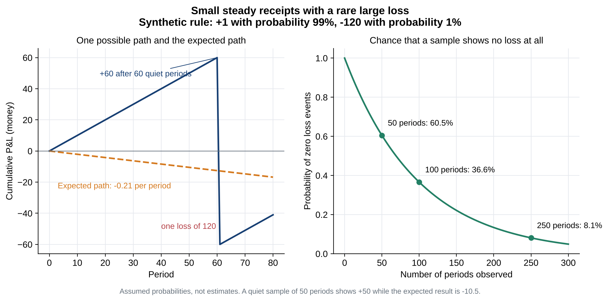

**ภาพ 1.1 รายรับสม่ำเสมอกับความเสียหายที่อาจยังไม่ปรากฏในช่วงข้อมูล**

อ่านภาพด้วยกัน: ด้านซ้ายเทียบเส้นทางหนึ่งที่ได้ +1 ติดกัน 60 ช่วงแล้วเสีย 120 ในช่วงเดียว กับเส้นค่าคาดหมายที่ลดลงช่วงละ 0.21 ด้านขวาแสดงโอกาสที่ช่วงข้อมูลยาว N ช่วงจะไม่มีครั้งที่เสียเลย ที่ 50 ช่วงคือ 60.5% ที่ 100 ช่วงคือ 36.6% และที่ 250 ช่วงคือ 8.1%

บทเรียนจากภาพนี้คือ รายรับที่สม่ำเสมอไม่ใช่หลักฐานว่าความเสี่ยงต่ำ ต้องถามว่าในช่วงข้อมูลนั้นเหตุการณ์ร้ายเคยเกิดหรือยัง และถ้าเกิด ทุนของเราจะรอดไหม

เรื่องสุดท้ายของกลุ่มนี้คือต้นทุนของเงินที่ใช้ ถ้าใช้เงินตัวเอง ต้นทุนคือโอกาสที่เสียไปจากการไม่เอาเงินไปใช้ทางอื่น ซึ่งไม่ปรากฏเป็นรายการในบัญชี แต่ควรใช้เป็นเกณฑ์เทียบ ถ้ายืมเงินมา ดอกเบี้ยเป็นรายจ่ายจริงที่ต้องลงบัญชี ระวังอย่าหักต้นทุนก้อนเดียวกันซ้ำสองครั้ง

<a id="strategy_reasoning_01_05"></a>

### 01.05 การให้สภาพคล่องต้องนับสิ่งที่เกิดหลัง fill

กลไกกลุ่มที่สี่ใกล้ตัวที่สุดสำหรับเล่มนี้ เพราะเราใช้คำสั่งแบบ maker เป็นหลัก การวางซื้อที่ bid และวางขายที่ ask ดูเหมือนเก็บส่วนต่างได้ฟรี แต่กำไรจะเกิดก็ต่อเมื่อได้ fill ทั้งสองฝั่งตามจำนวนที่ต้องการ ก่อนราคาจะเปลี่ยน

ลองดูตัวอย่างครับ วางซื้อที่ 99.9 และวางขายที่ 100.1 ถ้าได้ทั้งสองฝั่งหนึ่งหน่วย กำไร 0.2 ก่อนค่าธรรมเนียม แต่ถ้าได้แค่ฝั่งซื้อ แล้วราคาลดลงเหลือ 99.5 เราถือของที่ขาดทุน 0.4 ส่วนคำสั่งขายที่ยังไม่ fill ไม่ใช่กำไรที่เอามาหักล้างได้

ทำไมเหตุการณ์แบบหลังจึงเกิดบ่อย? เพราะคนที่มาขายให้เราตอนนั้นอาจรู้อะไรบางอย่าง หรือมีแรงขายต่อเนื่องที่จะดันราคาลงต่อ ปรากฏการณ์นี้เรียกว่า adverse selection เราจึงต้องวัดว่าหลัง fill ราคาไปทางไหน เทียบกับราคาอ้างอิงในช่วงเวลาที่กำหนด รวมทั้งต้นทุนในการขายของที่ค้างออกไป

สำหรับแนวทาง maker-only กฎเรื่องคิว การ fill บางส่วน การยกเลิกคำสั่ง และการได้แค่ขาเดียว เป็นส่วนหนึ่งของกลยุทธ์ อย่าสมมติใน backtest ว่า maker order ทุกตัวได้ราคาดีทันที และอย่าแก้ผลที่ไม่ดีด้วยการสมมติว่า “ถ้าไม่ fill ก็ส่งแบบ taker แทน” โดยไม่ได้เขียนกฎนั้นไว้ตั้งแต่แรก

การปรับวิธีส่งคำสั่งลดต้นทุนของสัญญาณที่ดีอยู่แล้วได้ แต่ไม่ทำให้สัญญาณที่ไม่มีข้อมูลกลายเป็นสัญญาณที่ดี ในทางกลับกัน สัญญาณที่ดูดีเมื่อคิดด้วยราคา mid อาจไม่เหลือกำไรเมื่อจำลองการซื้อขายจริง เราจึงต้องเทียบผลที่ราคาอ้างอิงกับผลจากกฎ fill ที่ชัดเจนเสมอ

สุดท้าย ต้องบอกให้ชัดว่าการให้สภาพคล่องเป็นกลยุทธ์หลัก หรือเป็นแค่วิธีส่งคำสั่งของกลยุทธ์อื่น ถ้าอ้างว่ากำไรมาจาก mean reversion ก็ต้องพิสูจน์การพยากรณ์นั้นแยกจากประสิทธิภาพของคำสั่ง

<a id="strategy_reasoning_01_06"></a>

### 01.06 แยกแหล่งกำไร exposure และทุนที่ต้องรองรับ

พอร์ต long–short ลดความเสี่ยงบางชนิด แต่ไม่ได้ลดทุกชนิด คำว่า hedge จึงต้องตามด้วยว่า hedge อะไร เช่น มูลค่าเงิน ความไวต่อตลาดรวม หรือ payoff ปลายงวด ตัวอย่างในคริปโต: long เหรียญเล็กหนึ่งตัวคู่กับ short BTC มูลค่าเท่ากัน มูลค่าสุทธิเป็นศูนย์ก็จริง แต่เมื่อตลาดลงแรง เหรียญเล็กมักลงแรงกว่า BTC พอร์ตนี้จึงยังขาดทุนได้ บท 4 จะคำนวณเรื่องนี้ด้วยตัวเลข

ให้แยกสองคำถามเสมอ คือ “พอร์ตยังรับความเสี่ยงอะไร” กับ “หลังหักความเสี่ยงนั้นแล้ว คาดกำไรจากอะไร” โมเดลปัจจัยช่วยแบ่งส่วนที่อธิบายได้ด้วยการเคลื่อนไหวร่วมของตลาดออกจากส่วนที่เหลือ แต่ส่วนที่เหลือไม่ได้กลายเป็นกำไรเอง งาน Avellaneda–Lee เป็นกรณีศึกษาที่ใช้ทั้งโมเดลปัจจัยและการตรวจพฤติกรรมของส่วนที่เหลือ [R5](#ref-r5) คำว่า alpha ในรายงานจึงต้องอ่านคู่กับโมเดลที่ใช้ ถ้าเปลี่ยนโมเดล ส่วนที่อธิบายไม่ได้ก็เปลี่ยนตาม

ทุนที่ต้องเตรียมไม่เท่ากับหลักประกันขั้นต่ำ เราอาจต้องจ่ายซื้อ spot เต็มมูลค่า วางหลักประกันของ futures เผื่อเงินไว้เติมเมื่อราคาวิ่งสวน และรองรับช่วงที่เงินของสองขาไม่ได้เข้าออกพร้อมกัน กำไรปลายงวดที่เป็นบวกไม่ได้รับรองว่าเงินสดพอผ่านเส้นทางก่อนถึงวันนั้น บท 3 จะติดตามเรื่องนี้ในบัญชี

เงินที่ได้จากการขายชอร์ตหรือเงินที่ยืมมาไม่ใช่กำไร เพราะมีภาระต้องคืน การโอนเงินเข้าบัญชีหลักประกันก็ไม่ใช่ค่าใช้จ่าย เงินยังเป็นของเรา เพียงแต่ถูกผูกไว้ ถ้าแยกสิ่งเหล่านี้ผิดตั้งแต่ต้น ผลตอบแทนที่คำนวณได้จะผิดตามไปทั้งหมด

เวลารายงานผลตอบแทน ให้บอกตัวหารทุกครั้ง ว่าใช้เงินทุนที่จัดสรร เงินที่ใช้จริง หรือทุนรวมเงินสำรอง ตัวหารต่างกันตอบคนละคำถาม และระบบที่ไม่นับเงินสำรองจะดูมีประสิทธิภาพเกินจริง

<a id="strategy_reasoning_01_07"></a>

### 01.07 เชื่อมสิ่งที่คาดหวังกับผลที่ได้จริง

ถึงตรงนี้เรามีสี่กลไกและรู้แล้วว่าต้องถามอะไร หัวข้อนี้ตอบคำถามที่ตามมาเสมอหลังทดสอบ: ทำไมผลจริงไม่เท่ากับที่คาด? เราจะไล่ทีละชั้นด้วยตัวอย่างเดียว คือ long A 10 หน่วยและ short B 20 หน่วย โดยกำหนดจำนวนและระยะเวลาถือไว้ก่อน

| รายการ | ราคา A | ราคา B | กำไรก่อนต้นทุน |
| --- | --- | --- | --- |
| ราคา mid ณ เวลาตัดสินใจ | 100 | 50 | ฐานอ้างอิง |
| ราคาปลายงวดที่โมเดลคาด | 102 | 50.4 | 12 |
| ราคาปลายงวดที่เกิดจริง | 102 | 50.6 | 8 ถ้าเข้าที่ราคาอ้างอิง |
| ราคาที่ซื้อขายได้จริงตอนเข้า | 100.2 | 49.95 | 5 เมื่อออกที่ราคาปลายงวดจริง |

ลองคำนวณตามครับ โมเดลคาดว่าจะได้ 10 × (102 − 100) − 20 × (50.4 − 50) = 20 − 8 = 12 แต่ B ขึ้นไปถึง 50.6 ผลที่ราคาอ้างอิงจึงเป็น 20 − 12 = 8 จากนั้นใช้ราคาที่ซื้อขายได้จริงตอนเข้า ขา A ได้ 10 × (102 − 100.2) = 18 ขา B ได้ −20 × (50.6 − 49.95) = −13 รวมเป็น 5 ราคาเข้าที่แย่กว่าราคาอ้างอิงทำให้ขา A เสีย 2 และขา B เสีย 1 ตัวอย่างนี้ให้ปิดที่ราคาปลายงวดจริงและได้จำนวนครบทั้งสองขา

ข้อสังเกตเล็ก ๆ คือ ราคา fill ที่แย่กว่า mid ตอนตัดสินใจไม่ได้แปลว่าเป็นคำสั่ง taker เสมอ คำสั่ง maker ที่ได้ fill หลังราคาขยับไปแล้วก็ให้ผลแบบนี้ได้

| ชั้นที่ตรวจ | กำไรในชั้นนั้น | ความหมาย |
| --- | --- | --- |
| ค่าคาดหมายก่อนต้นทุน | 12 | สิ่งที่โมเดลคาดสำหรับสถานะที่ตั้งใจ ที่ราคาอ้างอิง |
| ผลจริงของสถานะที่ตั้งใจ ที่ราคา mid | 8 | ใช้ราคาที่เกิดจริงแล้ว แต่ยังสมมติว่าซื้อขายที่ราคาอ้างอิง |
| ผลจริงจากราคา fill | 5 | ใช้จำนวน เวลา และราคาที่ซื้อขายได้จริง |
| หลังค่าธรรมเนียม 2 | 3 | หักค่าธรรมเนียมที่ยังไม่อยู่ในราคา fill |
| หลังค่าใช้จ่ายระหว่างถือ 1 | 2 | หักค่าใช้จ่ายระหว่างถือที่ยังไม่ได้ลงบัญชี |

$$
\Pi_{\mathrm{net}}=8-3-2-1=2
$$

อ่านสมการ: เริ่มจากผลจริงที่ราคาอ้างอิง 8 หักผลของราคาเข้าที่แย่กว่า 3 ค่าธรรมเนียม 2 และค่าใช้จ่ายระหว่างถือ 1 เหลือกำไรสุทธิ 2 ส่วน forecast 12 ใช้เทียบความคาดหวังกับผลจริง จึงไม่อยู่ในสมการนี้

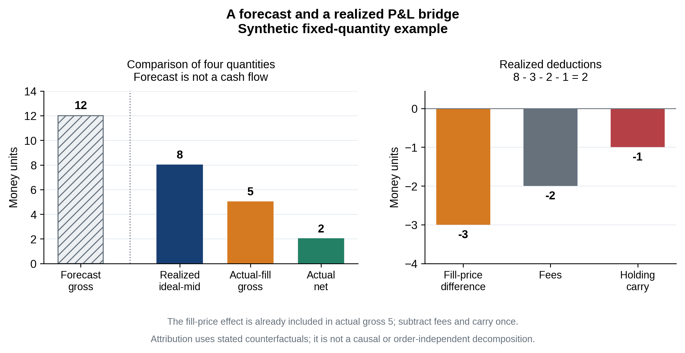

**ภาพ 1.2 จากค่าคาดหมายไปสู่กำไรสุทธิของตัวอย่างเดียวกัน**

อ่านภาพด้วยกัน: ด้านซ้ายเรียงตัวเลข 12 → 8 → 5 → 2 ด้านขวาแยกรายการที่หักออกหลังผลจากราคา fill คือ −3, −2 และ −1 ส่วนต่าง 12 − 8 = −4 ไม่อยู่ในด้านขวา เพราะเป็นความคลาดเคลื่อนของการพยากรณ์ ไม่ใช่เงินที่จ่ายออกไป ภาพนี้เป็นการกระทบยอด ไม่ใช่การพิสูจน์ว่าแต่ละชั้นเป็นสาเหตุ

ความต่าง 8 − 12 = −4 คือ forecast error ของเหตุการณ์ครั้งเดียว มันไม่ได้บอกทันทีว่าโมเดลผิด เพราะการพยากรณ์ที่ดีก็ยังพลาดได้เป็นรายครั้ง ต้องดูความคลาดเคลื่อนจากหลายครั้ง ส่วนความต่าง 5 − 8 = −3 ในตัวอย่างนี้มาจากราคาเข้า แต่ในข้อมูลจริง ความต่างชั้นนี้อาจมาจากเวลา จำนวนที่ได้ไม่ครบ หรือขาหนึ่งได้ก่อนอีกขา จึงไม่ควรเรียกรวมว่า slippage ทั้งหมดโดยไม่ตรวจ

การแบ่งชั้นแบบนี้เป็นการกระทบยอดตามราคาอ้างอิงที่เราเลือก ไม่ใช่คำตอบเดียวเรื่องสาเหตุ ถ้าเปลี่ยนราคาอ้างอิงหรือลำดับการไล่ ตัวเลขของแต่ละชั้นอาจเปลี่ยน เราจึงต้องเก็บนิยามไว้และใช้ซ้ำเหมือนเดิมทุกครั้งที่เปรียบเทียบ

ระวังการหักซ้ำครับ กำไรจากราคา fill 5 รวมผลของราคาที่ซื้อขายได้จริงไว้แล้ว ห้ามหักผลเสียจากราคา fill อีกรอบในชื่อ transaction cost ส่วนค่าธรรมเนียม 2 และค่าใช้จ่ายระหว่างถือ 1 เป็นคนละรายการที่ยังไม่อยู่ใน 5 ถ้ามีรายรับระหว่างถือ เช่น funding ก็ใส่ด้วยเครื่องหมายบวก

สำหรับ futures ที่ชำระกำไรขาดทุนเป็นเงินสดทุกวัน ต้องเชื่อมยอดรายวันกับผลสะสม และไม่บวกกำไรจากราคาซ้ำกับเงินที่ชำระแล้ว [R23](#ref-r23) ถ้ามีการถอนกำไรออกจากบัญชี ก็ต้องแยกเงินฝากถอนออกจากผลของกลยุทธ์ บัญชีที่กระทบยอดได้เป็นจุดเริ่มของการตัดสินทุกอย่าง

<a id="strategy_reasoning_01_08"></a>

### 01.08 อ่าน backtest ที่ขาดทุนให้เป็นคำถามวิจัย

สมมติคุณทดสอบไอเดียหนึ่งแล้วได้กราฟ equity ที่ลดลงตลอด ปฏิกิริยาแรกมักมีสองแบบ คือ “ไอเดียนี้ใช้ไม่ได้” หรือ “ต้องมีบั๊กแน่” ทั้งสองแบบรีบเกินไปครับ ผลขาดทุนเป็นข้อมูล แต่ไม่ได้บอกสาเหตุเอง ให้ไล่ว่าความคิดถูกแปลงเป็นข้อมูล สัญญาณ สถานะ คำสั่ง และบัญชีอย่างไร แล้วหาว่าผลเริ่มต่างจากที่ตั้งใจตรงชั้นไหน

| ชั้นที่ตรวจ | คำถามเฉพาะ | การทดลองที่ช่วยแยกปัญหา |
| --- | --- | --- |
| ข้อมูล | เวลา ราคาอ้างอิง และรายชื่อเหรียญตรงกับสิ่งที่ซื้อขายได้จริงหรือไม่ | สุ่มเหตุการณ์มาเทียบกับข้อมูลต้นทางและเงื่อนไขสัญญา |
| สัญญาณและกลไก | X บอกอะไรเกี่ยวกับผลอนาคตในระยะเวลาที่ตั้งไว้หรือไม่ | เทียบกับกฎง่ายที่ใช้เป็นฐาน บนช่วงประเมินเดียวกัน |
| สถานะ | น้ำหนักและจำนวนแปลงสมมติฐานออกมาถูกหรือไม่ | คำนวณมือหนึ่งเหตุการณ์ และตรวจ exposure |
| การส่งคำสั่ง | ราคา เวลา หรือจำนวนที่ fill เปลี่ยนผลอย่างไร | เปลี่ยนข้อสมมติเรื่อง fill ทีละข้อ ภายใต้กฎที่ระบุ |
| ต้นทุนและทุน | หักครบ ไม่ซ้ำ และมีเงินพอถือสถานะหรือไม่ | กระทบยอดบัญชี และทดสอบต้นทุนกับเงินสำรอง |

ลำดับการไล่สำคัญ ถ้าผลที่ราคาอ้างอิงยังไม่สนับสนุนการพยากรณ์ การต่อรองค่าธรรมเนียมให้ถูกลงเล็กน้อยไม่ใช่คำถามแรก ถ้าสัญญาณดูมีข้อมูล แต่สถานะที่ถือจริงไม่ตรงกับที่ตั้งใจ ควรแก้การแปลงจำนวนก่อนเพิ่มโมเดล ถ้ากำไรก่อนต้นทุนเป็นบวกแต่หลังต้นทุนติดลบ อาจต้องเปลี่ยนเครื่องมือหรือความถี่ ไม่ใช่ประกาศว่าได้กำไรแล้วเพราะโมเดลทำนายถูก

เมื่อทดลองแก้ ให้เปลี่ยนทีละส่วนโดยคงส่วนอื่นไว้ ทั้งข้อมูล ช่วงเวลา กฎเลือกเหรียญ งบทุน และนิยามต้นทุน ถ้าเปลี่ยนหลายอย่างพร้อมกันแล้วผลดีขึ้น เราจะไม่รู้ว่าอะไรช่วย บางครั้งส่วนประกอบมีผลต่อกัน ก็ต้องออกแบบการทดลองหลายชุดอย่างตั้งใจ

อีกเรื่องที่ต้องรักษาคือลำดับเวลา ค่าเฉลี่ย สเกล น้ำหนัก และโมเดล ต้อง fit ด้วยข้อมูลที่มีอยู่ ณ ช่วงนั้นเท่านั้น แล้วใช้ข้อมูลภายหลังประเมิน เอกสาร scikit-learn อธิบายความเสี่ยงของการใช้ข้อมูลทดสอบในขั้นเตรียมข้อมูล [R24](#ref-r24) และการแบ่งข้อมูลตามเวลาพร้อมเว้นช่องว่างต้องเลือกให้ตรงกับข้อมูลและช่วงที่ผลลัพธ์ครอบคลุม [R25](#ref-r25)

ถ้าดูผลช่วงทดสอบแล้วกลับไปแก้สูตร ช่วงนั้นก็กลายเป็นส่วนหนึ่งของการพัฒนาไปแล้ว การแก้หลายรอบจนผ่านช่วงเดิมไม่ทำให้มันกลับเป็นหลักฐานใหม่ ต้องบันทึกว่าลองอะไรไปบ้าง และหาข้อมูลชุดใหม่มาประเมิน

ผลของการไล่อาจเป็นใช้ต่อ เก็บข้อมูลเพิ่ม แก้ข้อผิดพลาด ทดลองสมมติฐานใหม่ หรือหยุด ถ้าข้อมูลสะอาด กฎถูกต้อง แต่กลไกไม่ให้กำไรหลังต้นทุน การหยุดเป็นข้อสรุปที่มีคุณค่า เพราะทำให้เราไม่เสียทุนและเวลาไปกับคำอธิบายที่หลักฐานไม่สนับสนุน

<a id="strategy_reasoning_01_09"></a>

### 01.09 ฝึกแยกกลไกจากสิ่งที่ทำให้ผลเปลี่ยน

ข้อ 1 — ส่วนต่างที่เห็นกับส่วนต่างที่เหลือ: สินทรัพย์ A และ B ให้กระแสเงินเหมือนกันตามเงื่อนไขที่ตรวจแล้ว ซื้อ A ได้ที่ 99 และขายชอร์ต B ได้ที่ 101 ค่ายืมและค่าถือรวม 3 และค่าธรรมเนียมรวม 0.5 จงคำนวณผลสุทธิ แล้วอธิบายว่าถ้ายืม B มาขายชอร์ตไม่ได้ การซื้อ A ขาเดียวยังใช้เหตุผลกำไรเดิมได้หรือไม่

ข้อ 2 — โมเดลคาด 12 แต่บัญชีเหลือ 2: ใช้ตัวอย่างในหัวข้อ 01.07 นักวิจัยคนหนึ่งบอกว่า “execution ทำให้เสียไป 10 ทั้งหมด” ประโยคนี้ผิดตรงไหน และต้องทดลองอะไรเพิ่มก่อนจะบอกว่าความต่าง 3 เกิดจาก slippage ล้วน ๆ?

ข้อ 3 — รายรับสม่ำเสมอแต่พอร์ตลดลง: ระบบ maker-only รายงานกำไรของรายการที่ปิดแล้ว 30 แต่สถานะที่ยังถืออยู่มีมูลค่าลดลง 45 และมีต้นทุน 5 ที่ยังไม่ถูกหักในสองยอดแรก ไม่มีการฝากถอน จงคำนวณผลรวม แล้วเสนอการตรวจสองข้อที่ช่วยแยกว่าปัญหาอยู่ที่บัญชี กฎการส่งคำสั่ง หรือความเสี่ยงของของที่ค้าง ยอดนี้พอให้สรุปว่าโมเดลผิดหรือมีบั๊กหรือไม่?

ก่อนดูเฉลย ให้เขียนทั้งตัวเลขและเหตุผล แยกให้ได้ว่าข้อใดพิสูจน์จากเงื่อนไข ข้อใดเป็นผลที่สังเกตได้ และข้อใดยังเป็นสมมติฐานที่ต้องหาข้อมูลเพิ่ม ทักษะนี้ใช้กับทุกกรณีศึกษาในเล่ม

<a id="strategy_reasoning_01_10"></a>

### 01.10 เฉลยและหน้าทบทวน

เฉลยข้อ 1: ส่วนต่างขั้นต้นคือ 101 − 99 = 2 หักค่ายืมและค่าถือ 3 กับค่าธรรมเนียม 0.5 เหลือ −1.5 การมี payoff ที่หักล้างกันไม่ได้ทำให้ผลสุทธิเป็นบวก ส่วนการซื้อ A ขาเดียวเมื่อชอร์ต B ไม่ได้ ทำให้เรารับความเสี่ยงราคาของ A เต็ม ๆ จึงไม่ใช่เหตุผลกำไรจากการหักล้างแบบเดิมอีกต่อไป ต้องตั้งสมมติฐานใหม่และประเมินใหม่

เฉลยข้อ 2: ส่วนต่างรวมจาก 12 ถึง 2 เท่ากับ 10 แต่ประกอบด้วย forecast error 4 ผลของราคาเข้าที่แย่กว่าราคาอ้างอิง 3 และค่าใช้จ่ายอีก 3 การเรียกทั้งหมดว่า execution ปนความไม่แน่นอนของการพยากรณ์เข้ากับการซื้อขายและต้นทุน ก่อนบอกว่า 3 เป็น slippage ล้วน ต้องเก็บเวลา จำนวน ราคา และลำดับที่แต่ละขาได้ fill แล้วเทียบอย่างควบคุม เพื่อแยกผลของราคา เวลา และ exposure ที่ไม่สมดุล

เฉลยข้อ 3: ผลรวมคือ 30 − 45 − 5 = −20 การตรวจแรกคือดูว่ากำไรที่ปิดแล้ว ผลของสถานะค้าง และต้นทุนไม่ได้นับซ้ำกัน และใช้ราคากับเวลาเดียวกัน การตรวจที่สองคือดูว่าโอกาส fill และทิศทางราคาหลัง fill ต่างจากสมมติฐานหรือไม่ รวมถึงของที่ค้างมีขนาด อายุ และ exposure เท่าไร ยอด −20 บอกว่าพอร์ตเสียมูลค่า แต่ยังไม่บอกว่ามีบั๊กหรือกลไกผิด ต้องไล่ทีละชั้น

หน้าทบทวน: ก่อนเชื่อกลยุทธ์ใด ให้เล่าด้วยคำของตัวเองว่ากำไรควรมาจากความสัมพันธ์ตามสัญญา การพยากรณ์ carry หรือการให้สภาพคล่อง อะไรต้องเป็นจริง อะไรเป็นเพียงสิ่งที่หวัง ผลควรเกิดเมื่อไร และถ้าไม่เกิด จะทำอะไรกับสถานะที่เปิดไปแล้ว

จากนั้นตรวจอีกด้าน: hedge อะไรและยังเหลือความเสี่ยงอะไร ต้องมีเงินสดและหลักประกันเท่าไรจึงผ่านเส้นทางที่สนใจได้ กำไรที่รายงานรวมสถานะค้างและกระแสเงินครบหรือไม่ และเมื่อผลไม่ตรงคาด เราแยก forecast, สถานะ, การส่งคำสั่ง, ต้นทุน และทุนออกจากกันได้หรือยัง

ทางอ่านต่อ: บท 2 จะเลือกตัวแปรที่ตอบคำถามในบันทึกตั้งต้น บท 3 แปลงตัวแปรและกฎเป็นจำนวนที่ถือกับบัญชีเงินสด บท 4 ระบุความเสี่ยงที่ hedge และบท 5 รวมกลไกทั้งสี่เป็นแผนที่ของวิธีสร้างกลยุทธ์

<a id="signal_design"></a>

## บท 2 เลือกค่าอะไรมา plot และใช้ตัดสินใจอย่างไร

จากคำถามและตัวแปร สู่สถานะ ผลลัพธ์อนาคต และหลักฐาน

> **ก่อนอ่าน:** บท 0–1 และความต่างของ price, simple return กับ log return จากหัวข้อ III.01 ของเล่มเดิม
>
> **เมื่อจบบท คุณควรทำได้:** เขียนแบบออกแบบตัวแปรหนึ่งหน้า ที่มีสูตร หน่วย หน้าที่ เวลาที่รู้ข้อมูล action และผลอนาคตที่ใช้ตรวจ
>
> **ตัวอย่างหลักของบท:** BTC spot 100,000 กับ dated futures 103,000 เหลือ 90 วัน ซึ่งจะใช้ต่อในหัวข้อ 03.09

<a id="signal_design_02_01"></a>

### 02.01 เริ่มจากคำถามที่ต้องการตอบ

เป้าหมายของบทนี้คือให้เราเลือกและสร้างตัวแปรได้ด้วยเหตุผลของตัวเอง เมื่อเห็นราคา ข้อมูล หรือโค้ดของคนอื่น เราจะถามได้ว่าตัวเลขใดช่วยอธิบายโอกาสที่สนใจ ควร plot เพื่อดูอะไร และจะตรวจอย่างไรว่าสิ่งที่เห็นแปลงเป็นกำไรจากสถานะจริงได้ บทนี้จึงเชื่อมการตั้งคำถามกับการคำนวณ การอ่านกราฟ และการออกแบบการทดลอง โดยไม่กำหนดว่าทุกตัวแปรต้องกลับเข้าค่าเฉลี่ย

เราเริ่มได้สองทาง ทางหนึ่งเริ่มจากกลไก เช่น สัญญาที่อ้างอิงสินทรัพย์เดียวกันมีวันชำระราคา จึงสนใจส่วนต่างราคาและเวลาที่เหลือ อีกทางเริ่มจากข้อมูลหรือโค้ดสาธารณะ เช่น เห็นว่าผู้เขียนใช้ residual แล้วอยากรู้ว่ามันมีข้อมูลอะไร การสำรวจแบบหลังมีประโยชน์ แต่ต้องบันทึกว่าความคิดเกิดหลังเห็นข้อมูลแล้ว และเก็บข้อมูลอีกส่วนไว้ตรวจ ไม่ต้องแต่งเหตุผลทางเศรษฐศาสตร์ย้อนหลังให้ทุก pattern ดูเหมือนถูกคาดไว้ก่อน

คำถามตั้งต้นที่ดีมีวัตถุและเหตุการณ์ชัดเจน เช่น “futures เดือนนี้ให้ส่วนต่างเพียงพอกับต้นทุนการถือ spot จนหมดอายุหรือไม่” หรือ “หลังหักผลของตลาด ผลตอบแทนส่วนที่เหลือช่วยคาดการณ์ช่วงถัดไปหรือไม่” แต่คำถามว่า “เอาอะไรมา plot แล้วจะได้เงิน” ยังรวมหลายปัญหาเข้าด้วยกัน เราต้องแยกการวัดสถานะปัจจุบันออกจากการคาดการณ์และการเลือกคำสั่ง

สามแกนของเล่มยังใช้เหมือนเดิม: Asset Selection ระบุว่าความสัมพันธ์นี้ควรศึกษาในสินทรัพย์ใด Workflow ระบุว่าคำนวณและตัดสินใจด้วยข้อมูลใด ณ เวลาไหน ส่วน Position Management ระบุว่าถืออะไร เปลี่ยนจำนวนเมื่อใด และทำอย่างไรเมื่อสมมติฐานไม่ผ่าน เราต้องเชื่อมทั้งสามแกนก่อนเรียกค่าที่ plot ว่ากลยุทธ์

<a id="signal_design_02_02"></a>

### 02.02 ตอบหกคำถามก่อนเลือกสูตร

ก่อนเขียนโค้ด ให้ใช้หนึ่งหน้าตอบคำถามต่อไปนี้ เราไม่จำเป็นต้องรู้คำตอบสุดท้ายทุกข้อทันที แต่ควรแยกสิ่งที่รู้ สิ่งที่สมมติ และสิ่งที่จะทดสอบออกจากกัน การมีช่องที่ยังตอบไม่ได้ช่วยบอกว่างานขั้นถัดไปคืออะไร

| คำถาม | สิ่งที่ต้องเขียนให้ชัด |
| --- | --- |
| 1 เราสนใจความสัมพันธ์อะไร | สินทรัพย์ สัญญา หรือพฤติกรรมที่คาดว่าจะสร้างโอกาส และเหตุผลตั้งต้น |
| 2 ค่าที่จะ plot วัดอะไร | นิยาม สูตร หน่วย เครื่องหมาย และความหมายเมื่อค่าสูงหรือต่ำ |
| 3 เรารู้ค่านี้เมื่อใด | ข้อมูลต้นทาง เวลาเผยแพร่ เวลาใช้ได้จริง และช่วงที่ใช้ประมาณพารามิเตอร์ |
| 4 หลังเห็นค่านี้ เราคาดหวังอะไร | เหตุการณ์หรือผลลัพธ์ในอนาคต ระยะเวลาถือ และเงื่อนไขที่คาดว่าจะเกิด |
| 5 เราจะซื้อขายอะไรจริง | ทิศทาง จำนวนแต่ละขา กฎเปิดปิด กฎ fill ต้นทุนและทุนที่ต้องใช้ |
| 6 อะไรจะหักล้างความคิดนี้ | ผลที่ทำให้พัก คัดออก เปลี่ยนโมเดล หรือเปลี่ยนตัวแปร และข้อมูลสำหรับตรวจ |

คำตอบข้อ 4 ไม่จำเป็นต้องเป็น “กลับมาค่าเฉลี่ย” อาจเป็นการบรรจบตามสัญญา การคงอยู่ของแนวโน้ม การได้รับ cash flow หรือโอกาสที่ต้นทุนการส่งคำสั่งจะสูงผิดปกติ แต่ต้องตรงกับหน้าที่ของตัวแปร เช่น หากใช้ bid–ask spread เพื่อหลีกเลี่ยงช่วงแพง เราไม่จำเป็นต้องอ้างว่า spread นั้นพยากรณ์ทิศราคาสินทรัพย์

ระดับอ้างอิงควรตรงกับคำถาม อาจเป็นต้นทุนที่ซื้อขายได้ fair value อัตราของอีกอายุสัญญา อันดับเมื่อเทียบสินทรัพย์อื่น หรือประวัติของตัวแปรเอง ค่าเฉลี่ยย้อนหลังเป็นเพียงหนึ่งทางเลือก เราต้องบอกว่าทำไมใช้เกณฑ์นั้นและหลักฐานอะไรจะทำให้เลิกใช้ ไม่เลือกเส้นเพียงเพราะทำให้กราฟเบี่ยงเบนดูสวย

<a id="signal_design_02_03"></a>

### 02.03 แยกหน้าที่ของตัวแปรก่อนนำไปเทรด

ตัวแปรที่มีประโยชน์ไม่จำเป็นต้องเป็นสัญญาณเปิดสถานะทุกตัว เราแบ่งหน้าที่เบื้องต้นได้สามกลุ่ม กลุ่มแรกเป็นราคาของชุดสินทรัพย์ที่ถือได้ กลุ่มที่สองเป็นข้อมูลสำหรับประเมินหรือคาดการณ์ และกลุ่มที่สามเป็นตัวควบคุมความเสี่ยงหรือการส่งคำสั่ง ตัวแปรหนึ่งอาจทำหลายหน้าที่ แต่ต้องอธิบายแต่ละหน้าที่แยกกัน

| หน้าที่ | ตัวอย่างค่าที่ plot | สิ่งที่ต้องเชื่อมต่อ |
| --- | --- | --- |
| ราคาของตะกร้า | P_A − h P_B เมื่อ h คงที่ | จำนวนสินทรัพย์จริงและกำไรจากการเปลี่ยนราคา |
| ตัววัดมูลค่าหรือสัญญาณ | implied carry, residual, momentum | กฎแปลงค่าเป็นทิศทาง จำนวน และผลลัพธ์ที่จะทดสอบ |
| ตัวกรองความเสี่ยงหรือ execution | volatility, bid–ask spread, liquidity | กฎลดขนาด พักคำสั่ง หรือเลือกวิธีส่งคำสั่ง |

การเลือกการแปลงข้อมูลควรตามคำถาม ถ้าถามว่าราคาสองสิ่งต่างกันกี่หน่วยเงิน เราใช้ผลต่าง ถ้าถามว่าสิ่งหนึ่งมีขนาดเท่าไรเมื่อเทียบอีกสิ่ง เราอาจใช้อัตราส่วน ถ้าถามว่าราคาแฝงอัตราหรือพารามิเตอร์อะไร เราจัดรูป pricing equation ย้อนกลับ ถ้าถามว่าส่วนใดอธิบายได้ด้วยปัจจัยร่วม เราใช้โมเดลเพื่อสร้าง residual แต่แต่ละการแปลงมีหน่วยและข้อสมมติต่างกัน

| คำถามที่สนใจ | ตัวแปรตั้งต้นที่เป็นไปได้ | สิ่งที่ยังต้องพิสูจน์ |
| --- | --- | --- |
| แพงหรือถูกเมื่อเทียบขาอ้างอิง | ผลต่างราคา หรือ residual จากความสัมพันธ์ที่ระบุ | ความสัมพันธ์มีเหตุผลและคงอยู่ในช่วงใช้งานหรือไม่ |
| ส่วนต่างคุ้มกับเวลาถือหรือไม่ | implied carry ตามอายุสัญญา | ส่วนต่างที่ซื้อขายได้คุ้มต้นทุนและทุนจริงหรือไม่ |
| สิ่งใดอธิบายความเสี่ยงร่วม | factor exposure หรือ PCA scores/loadings | ปัจจัยและการ hedge เหมาะกับข้อมูลใหม่หรือไม่ |
| สิ่งที่เกิดก่อนช่วยทำนายช่วงถัดไปหรือไม่ | past returns หรือ order-flow feature | มีข้อมูลเพิ่มเหนือ benchmark หลัง latency และต้นทุนหรือไม่ |
| เมื่อใดไม่ควรเพิ่มสถานะ | spread, depth, volatility, inventory age | ตัวกรองปรับผลรวมและความเสี่ยงนอกช่วงฝึกได้หรือไม่ |

การทำ z-score หรือจัดอันดับช่วยเปรียบเทียบขนาดของค่าที่ต่างหน่วยหรือต่างความผันผวนได้ แต่ไม่ได้เพิ่มข้อมูลใหม่จากตลาดด้วยตัวเอง และไม่ได้ให้กฎสากลว่า z สูงต้องขายหรือ z ต่ำต้องซื้อ เราต้องกำหนดว่าตัวเลขนั้นเป็นสัญญาณกลับ สัญญาณไปต่อ ตัววัดความแพง หรือเพียงตัวกรองก่อน

<a id="signal_design_02_04"></a>

### 02.04 ใช้ futures pricing ย้อนหาค่าที่ตลาดสะท้อน

กรณีแรกเริ่มจากคำถามทางการเงินที่ชัดเจน: futures ที่มีวันหมดอายุให้ส่วนต่างเพียงพอสำหรับการถือ spot คู่กับ short futures หรือไม่ เราใช้ราคาของสินทรัพย์เดียวกันและเวลาที่เหลือ เพื่อแปลงส่วนต่างเป็นอัตราที่เปรียบเทียบกันได้ การใช้ pricing equation มีได้ทั้งทางคำนวณ fair value จากสมมติฐานต้นทุน และทางใช้ราคาตลาดคำนวณ implied parameter [R21](#ref-r21) [R22](#ref-r22)

$$
r^{\mathrm{impl}}_{t,T}=\frac{\ln(F_{t,T}/S_t)}{\tau_t}
$$

อ่านสมการ: S คือราคา spot, F คือราคา futures ที่หมดอายุ T และ τ คือเวลาที่เหลือเป็นปี ในตัวอย่างนี้ใช้จำนวนวันจริงหาร 365 ค่าที่ได้เป็น implied annualized carry แบบ continuous สำหรับ τ มากกว่าศูนย์และราคาบวก

เมื่อเลือกนิยามนี้แล้ว สมการ F = S exp(r impl × τ) เป็นการจัดรูปกลับของนิยาม มันไม่ได้พิสูจน์ว่าตลาดตั้งราคาตามโมเดลต้นทุนการถือครองที่เราสมมติ และไม่ได้พิสูจน์ว่า r impl ต้อง mean revert เราต้องแยกอัตราที่คำนวณจากราคาตลาดออกจากดอกเบี้ยที่เรากู้ได้จริง รายได้จากการถือสินทรัพย์ และต้นทุนอื่น

ให้ S เริ่มที่ 100,000 และ F เริ่มที่ 103,000 เหลือ 90 วัน เราได้ r impl ประมาณ 11.98773646% ต่อปีแบบ continuous หากใช้อัตราแบบ simple annualized จะได้ 3% × 365/90 = 12.1667% ตัวเลขต่างกันเพราะ convention ส่วนต่างที่เปิดได้ในตัวอย่างยังเท่ากับ 3,000 หรือ 3% ของมูลค่า spot เริ่มต้น ไม่ใช่ได้รับ 11.99% ภายใน 90 วัน

คำว่า “ซื้อเมื่อ r สูง” ต้องระบุขาให้ครบ ใน positive-basis cash-and-carry เราพิจารณาซื้อ spot และขาย futures ที่มีวันหมดอายุ เมื่อส่วนต่างคุ้มกับต้นทุนและทุนที่ใช้ การซื้อ futures ตัวเดียวเป็นอีกสถานะหนึ่ง ซึ่งไม่มีกลไก payoff แบบชุดนี้ ส่วนการซื้อขายกลับด้านต้องตรวจเรื่องการยืมสินทรัพย์และต้นทุนของอีกทิศใหม่

CME มีเครื่องมือ Cryptocurrency BasisWatch and Implied Rate ซึ่งให้ดูทั้งความสัมพันธ์ futures–spot และอัตราแบบ annualized นี่เป็นตัวอย่างสาธารณะของการใช้ราคาตลาดสร้างมุมมองเพื่อสำรวจโอกาส [R20](#ref-r20) แต่กราฟที่เครื่องมือแสดงยังต้องอ่านนิยามราคาอ้างอิง อายุสัญญา และกฎต่อสัญญาให้ครบก่อนนำมาเป็นข้อมูลกลยุทธ์

<a id="signal_design_02_05"></a>

### 02.05 อ่านกราฟอัตรา basis และกำไรคนละหน้าที่

สมมติซื้อ spot 1 BTC ที่ 100,000 และ short linear dated futures ให้มีขนาดอ้างอิง 1 BTC ที่ 103,000 จำนวนทั้งสองขาคงที่ เรานิยาม monetary basis ว่า b = F − S โดยไม่รวมต้นทุนในนิยามนี้ ผลต่างของราคาในหน่วยเงินจริงเชื่อมกับกำไรจากสถานะได้ตรงกว่าการดู r เพียงเส้นเดียว

$$
\Pi^{\mathrm{price}}_{0,t}=(S_t-S_0)+(F_0-F_t)=b_0-b_t
$$

อ่านสมการ: กำไรของ spot คือราคาปัจจุบันลบราคาเริ่ม ส่วนกำไรของขา short futures เป็นราคาเริ่มลบราคาปัจจุบัน ผลรวมเท่ากับ basis ตอนเข้า ลบ basis ปัจจุบัน สำหรับ exposure หนึ่ง BTC ตามเงื่อนไขตัวอย่าง

พิจารณาสองสถานการณ์แยกจากจุดเริ่มเดียวกัน กรณี A ผ่านไป 30 วัน spot คงที่ 100,000 และ r impl คงที่เท่าเดิม เวลาที่เหลือเหลือ 60 วัน จึงได้ F ประมาณ 101,990.131046 และ basis 1,990.131046 กำไรจากราคาของสถานะเดิมเท่ากับ 1,009.868954 แม้ r ไม่ได้กลับเข้าค่าเฉลี่ยหรือเปลี่ยนค่าเลย ในตัวอย่างนี้เวลาที่เหลือน้อยลงทำให้ส่วนต่างราคาเงินลดลง

กรณี B ผ่านไป 10 วัน spot เป็น 120,000 และ futures เป็น 123,100 เหลือ 80 วัน ค่า r impl ลดลงเป็นประมาณ 11.63678875% แต่ basis เพิ่มจาก 3,000 เป็น 3,100 เราได้กำไร spot 20,000 และขาดทุน futures 20,100 รวมขาดทุน 100 ก่อนต้นทุน กราฟอัตราจึงลดลงในขณะที่พอร์ตเดิมขาดทุนได้

| สถานการณ์แยกกัน | r impl และ basis ปัจจุบัน | กำไรจากราคาของชุดเดิม |
| --- | --- | --- |
| เริ่มต้น เหลือ 90 วัน | 11.98773646% และ 3,000 | 0 |
| A เหลือ 60 วัน spot คงเดิม | 11.98773646% และ 1,990.131046 | +1,009.868954 |
| B เหลือ 80 วัน ราคาเปลี่ยน | 11.63678875% และ 3,100 | −100 |
| หมดอายุ เมื่อสองขาอ้างอิงราคาเดียวกัน | basis = 0; r ที่ τ = 0 นิยามไม่ได้ | +3,000 ก่อนต้นทุนทั้งหมด |

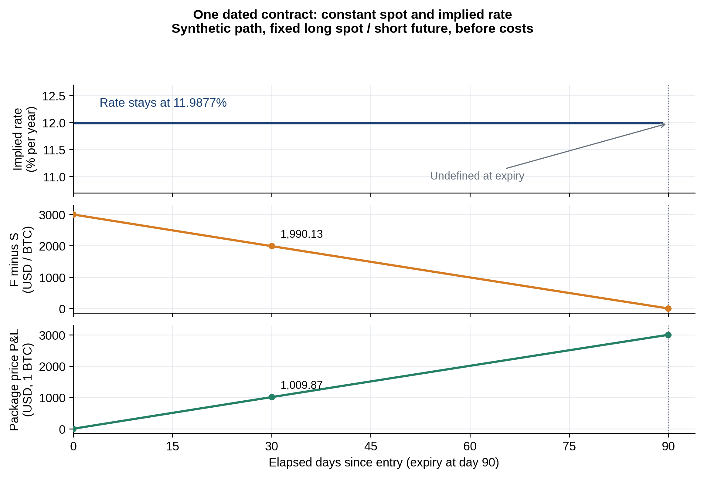

**ภาพ 2.1 อัตราคงเดิมแต่ส่วนต่างราคาและกำไรเปลี่ยนตามเวลาที่เหลือ**

อ่านภาพด้วยกัน: ทั้งสามกราฟใช้สถานการณ์สมมติเดียวกัน: spot คงที่ 100,000, r impl คงเดิม, ถือ long spot และ short futures เทียบหนึ่ง BTC แกนเวลาคือวันผ่านไปจากวันเปิด อัตราต่อปีไม่เปลี่ยน แต่ basis ลดและกำไรจากราคาเพิ่ม ที่วันหมดอายุไม่ใส่ค่า r เป็นศูนย์ เพราะสูตรเป็น 0/0

ถ้าถือสถานะได้ครบจนหมดอายุ และราคาชำระ futures ตรงกับราคาที่ใช้ขายหรือประเมิน spot ผลรวมของราคาเท่ากับ ($S_T$ − 100,000) + (103,000 − $S_T$) = 3,000 ไม่ขึ้นกับ $S_T$ ในสมมติฐานนี้ แต่กำไรสุทธิต้องรวมค่าธรรมเนียม ต้นทุนเงิน กระแสเงินระหว่างทาง และความคลาดเคลื่อนจากราคาอ้างอิงจริง การวัดผลตอบแทนต้องระบุฐานทุนที่รวม margin และเงินสำรอง ไม่ใช่นำ r impl ไปเรียกผลตอบแทนสุทธิของบัญชี

ต้องแยกสัญญาเดิมที่ใกล้หมดอายุออกจากอนุกรมอายุคงที่ เช่น “90 วันตลอด” ซึ่งอาจสร้างด้วย interpolation หรือ roll หลายสัญญา กราฟที่เรียบจากการต่อข้อมูลไม่ใช่พอร์ตที่ถือได้โดยไม่มีธุรกรรม และ perp ไม่มีวันหมดอายุแบบนี้ จึงนำเหตุผลการบรรจบตาม T ไปใช้กับ funding rate โดยอัตโนมัติไม่ได้

เมื่อใช้ futures ที่มี daily cash settlement ต้องบันทึก variation margin ตามเวลาและไม่บวกกำไรจากราคาเข้าบัญชีซ้ำอีกครั้ง [R23](#ref-r23) หัวข้อ 03.09 ลงบัญชีกรณีนี้ทีละวันและคำนวณเงินสดที่ต้องเตรียม สำหรับการส่ง maker-only ของเรา ต้องจำลองคิว partial fill และการได้เพียงขาเดียว ราคา mid หรือราคาที่ต้องการวางคำสั่งยังไม่ใช่ราคาที่รับรองว่าจะ fill ทั้งคู่ การตัดสินใจจาก r จึงเป็นเพียงจุดหนึ่งใน workflow

<a id="signal_design_02_06"></a>

### 02.06 ตรวจว่าค่าที่เปลี่ยนแปลงตรงกับเงินที่เปลี่ยนหรือไม่

ถ้าสร้าง X = P_A − h P_B โดย h คงที่ และถือหนึ่งหน่วย A กับ short h หน่วย B กำไรจากราคาเท่ากับการเปลี่ยน X ก่อนต้นทุน นี่เป็นเหตุผลทางบัญชีที่ทำให้ spread บางแบบเชื่อมกับการถือได้ตรง แต่ยังไม่ใช่หลักฐานว่า X จะกลับหรือพยากรณ์ได้ บท pairs trading ของ Palomar แยกเรื่องราคา spread กับการแปลงเป็นจำนวนที่ถือจริงไว้ให้ศึกษาเพิ่มเติม [R1](#ref-r1)

$$
X_t=P_{A,t}-hP_{B,t},\qquad \Delta\Pi^{\mathrm{price}}=\Delta P_A-h\Delta P_B=\Delta X
$$

อ่านสมการ: ต้องใช้หน่วยราคาที่เข้ากันและจำนวนคงที่ตามสูตรนี้ หากมี contract multiplier ให้รวมเข้าในจำนวนอ้างอิงก่อน และยังต้องลงบัญชีเงินสด ค่าธรรมเนียมกับต้นทุนการถือ

อัตราส่วนราคาเป็นอีกมุมมองหนึ่ง แต่การเปลี่ยนอัตราส่วนไม่เท่ากับกำไรของชุดจำนวนคงที่เสมอ สมมติเริ่ม A = 105 และ B = 50 อัตราส่วน A/B = 2.10 และ spread A − 2B = 5 ต่อมา A = 54 และ B = 25 อัตราส่วนเพิ่มเป็น 2.16 แต่ spread ลดเป็น 4 ถ้า long A หนึ่งหน่วยและ short B สองหน่วย กำไรจากราคาเท่ากับ (54 − 105) − 2(25 − 50) = −1

| สิ่งที่ติดตาม | เริ่มต้น | ภายหลัง |
| --- | --- | --- |
| อัตราส่วน A/B | 2.10 | 2.16 |
| ราคา spread A − 2B | 5 | 4 |
| กำไรของ long 1A short 2B | 0 | −1 ก่อนต้นทุน |

การเลือก ratio จึงอาจเหมาะเมื่ออยากวัดความแพงเชิงสัดส่วน แต่ต้องออกแบบ holdings ให้สอดคล้องกับคำถามและประเมินกำไรจริง ส่วน log-price spread มีความสะดวกในการตีความเชิงสัดส่วนเช่นกัน แต่ไม่ได้ทำให้ผลต่าง log กลายเป็นเงินสดของชุดจำนวนที่เลือกโดยอัตโนมัติ

การปรับสเกลก็เปลี่ยนภาพได้ สมมติ spread อยู่ที่ 5 ตลอด ใช้ค่ากลาง 0 แต่ส่วนเบี่ยงเบนมาตรฐานที่ใช้หารเพิ่มจาก 1 เป็น 2.5 ค่า z จะลดจาก 5 เหลือ 2 ทั้งที่ราคา spread ไม่เคลื่อนและกำไรราคาของสถานะเดิมเป็นศูนย์ การเห็น z เข้ากรอบจึงต้องแยกว่าเกิดจากราคา ค่ากลาง หรือสเกลที่อัปเดต

ถ้าน้ำหนักตะกร้าเปลี่ยนตามเวลา เราต้องแยกการเปลี่ยนราคาออกจากการเปลี่ยนคำจำกัดความของตะกร้า การเพิ่มลดสินทรัพย์เป็นธุรกรรมที่ใช้หรือคืนเงินสด การเปรียบเทียบ a ใหม่คูณราคาใหม่กับ a เก่าคูณราคาเก่าอย่างเดียวอาจนับมูลค่าที่ซื้อเพิ่มเป็นกำไร ต้องใช้บัญชี self-financing พร้อมกฎ rebalance และต้นทุนตามบท 3 ไม่ใช้เส้นดัชนีที่เปลี่ยนน้ำหนักแทน equity curve

<a id="signal_design_02_07"></a>

### 02.07 เลือก OLS และ PCA ตามปัญหาที่ต้องการแก้

> **ลงลึก** ข้ามได้ในการอ่านรอบแรก สิ่งที่ควรเก็บ: OLS และ PCA เป็นเครื่องมือสร้างตัวแปร ผลที่ได้เป็นเพียง candidate ที่ต้องทดสอบต่อ ยังไม่ใช่สัญญาณสำเร็จรูป

เครื่องมือทางสถิติหนึ่งชนิดมีหลายหน้าที่ เราควรเขียนก่อนว่าโมเดลรับอะไรเป็น input และเราต้องการ output ใด การใช้ OLS เพื่ออธิบายผลตอบแทนด้วย market factor ต่างจาก OLS เพื่อคาดการณ์ผลตอบแทนอนาคต และต่างจากการประมาณความสัมพันธ์ของระดับราคา แม้ชื่อฟังก์ชันในโค้ดจะเหมือนกัน

| การใช้เครื่องมือ | ค่าที่ได้และคำถาม | ข้อสรุปที่ยังให้ไม่ได้ |
| --- | --- | --- |
| OLS บนระดับราคา | coefficients และ price residual สำหรับตรวจความสัมพันธ์ระดับ | residual จะ stationary หรือซื้อขายได้คุ้มเสมอ |
| OLS บนผลตอบแทนกับ factors | exposures และ return residual หลังหักส่วนที่โมเดลอธิบาย | ส่วนที่เหลือเป็น mispricing หรือจะ reversal เสมอ |
| OLS แบบพยากรณ์ | ความสัมพันธ์ระหว่างข้อมูลที่รู้แล้วกับ target อนาคต | ความสัมพันธ์เป็นเหตุเป็นผลหรืออยู่ได้เมื่อเปลี่ยนช่วงข้อมูล |
| PCA ของข้อมูลที่กำหนด | scores และ loadings ที่อธิบายความแปรปรวนของชุดนั้น | component ที่ variance สูงเป็น alpha หรือ component ต่ำเป็นโอกาสเสมอ |

หากเราสงสัยว่าหุ้นหลายตัวเคลื่อนตามปัจจัยร่วม เราอาจใช้ PCA เป็นเครื่องมือสร้างปัจจัย ลดมิติ ประเมินความเสี่ยง หรือช่วยจัดกลุ่ม ก่อนคิดเรื่องสัญญาณ แต่ PCA ให้ทิศทางของความแปรปรวนตามข้อมูลและการเตรียมข้อมูลที่เราเลือก การใช้ราคา ผลตอบแทน หรือข้อมูลที่ปรับสเกลต่างกันเปลี่ยนคำถามและผลลัพธ์ได้ เอกสาร PCA ระบุวิธี centering และตัวเลือกของการแปลงไว้ [R26](#ref-r26)

ตัวอย่าง Avellaneda–Lee เริ่มจาก factor model แล้วศึกษาพฤติกรรมของส่วนที่เหลือ [R5](#ref-r5) ส่วน QuantConnect มีตัวอย่าง PCA and Pairs Trading ที่ให้แกะการไหลของข้อมูลไปสู่การสร้าง algorithm [R3](#ref-r3) เวลาอ่านโค้ด ให้ตามว่าตอน fit ใช้ราคา log price หรือ return, coefficients ถูก normalize เมื่อใด, threshold อยู่ในสเกลใด และตอนส่งคำสั่งแปลงน้ำหนักเป็นจำนวนอย่างไร การมีโค้ดเผยแพร่ช่วยให้ตรวจขั้นตอนเหล่านี้ได้ แต่ยังต้องตรวจสมมติฐานของผู้เขียน

OLS ที่มี intercept ทำให้ residual เฉลี่ยเป็นศูนย์ในข้อมูลที่ fit ตามโครงสร้างการประมาณค่า นั่นยังไม่บอกว่าค่าปัจจุบันจะทำนายการเปลี่ยนแปลงถัดไปได้ ส่วน PCA แยกทิศทางในเชิงความแปรปรวนก็ไม่ได้สร้างกลไกการกลับขึ้นมาเอง เราจึงใช้ residual หรือ component เป็น candidate ที่มีคำถามกำกับ แล้วทดสอบหน้าที่ที่ต้องการให้มันทำ

ถ้าต้องการพอร์ตที่ลด market exposure ให้ตั้งข้อกำหนดเรื่อง exposure แยกจากข้อกำหนดเรื่อง alpha พอร์ตที่ hedge ปัจจัยร่วมได้อาจยังไม่มีผลตอบแทนคาดหมายสุทธิที่น่าสนใจ และค่าที่เป็น orthogonal ในช่วง fit ไม่รับรอง exposure ในข้อมูลใหม่ การเปลี่ยน hedge จึงต้องถูกติดตามทั้งในระดับโมเดลและระดับจำนวนสินทรัพย์ที่ถือ

<a id="signal_design_02_08"></a>

### 02.08 plot เพื่อสำรวจ แล้วทดสอบคำถามเกี่ยวกับอนาคต

กราฟตามเวลามีประโยชน์สำหรับตรวจ outlier ช่องข้อมูลหาย การเปลี่ยน regime การ roll สัญญา และจังหวะที่นิยามตัวแปรเปลี่ยน แต่รูปร่างที่ดูแกว่งกลับไม่เพียงพอให้กำหนดว่าต้อง long เมื่อค่าต่ำและ short เมื่อค่าสูง เราต้องระบุว่าเมื่อเห็น X ในวันนี้ จะทำ action อะไร และจะวัดผลจากอนาคตช่วงใด

$$
Y_{t,h}(a)=\Pi^{\mathrm{net}}_{t\rightarrow t+h}(a)
$$

อ่านสมการ: Y คือกำไรสุทธิในอนาคตของ action a ที่ระบุไว้ เช่น long หนึ่งหน่วยหรือชุด long–short พร้อมกฎเข้าออกและต้นทุน ส่วน h คือระยะเวลาประเมิน X ต้องรู้ได้ก่อน action; Y เป็น target ที่ใช้ตรวจในภายหลัง ไม่ใช่ข้อมูลสำหรับตัดสินใจย้อนหลัง

ให้ plot อย่างน้อยสามมุมเมื่อเหมาะกับคำถาม: เส้น X ตามเวลาเพื่อดูว่าข้อมูลมีปัญหาหรือไม่, ความสัมพันธ์ของ X กับ target อนาคตเพื่อดูว่าเงื่อนไขต่างกันให้ผลต่างกันหรือไม่, และผลพอร์ตหลังแปลงเป็นคำสั่งเพื่อดูว่าผลจากสัญญาณรอดต้นทุนและความเสี่ยงหรือไม่ การรายงานจำนวนตัวอย่างและความไม่แน่นอนช่วยป้องกันการอ่านจุดหรือกลุ่มที่มีข้อมูลน้อยเกินไป

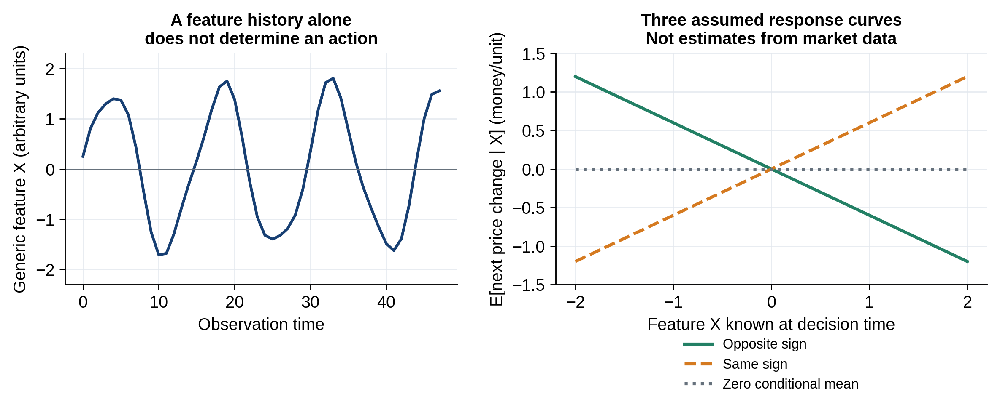

**ภาพ 2.2 เส้นสัญญาณที่เหมือนกันยังรองรับคำตอบเกี่ยวกับอนาคตได้หลายแบบ**

อ่านภาพด้วยกัน: ภาพนี้สมมติให้เห็นประวัติ X แบบเดียวกัน แล้วแสดงค่าคาดหมายของการเปลี่ยนราคาช่วงถัดไปสามแบบ ได้แก่ ทิศตรงข้ามกับ X ทิศเดียวกับ X และเป็นศูนย์ทุกค่า X เส้นเหล่านี้กำหนดขึ้นเพื่อสอนแนวคิด ไม่ได้ประมาณจากตลาด และยังต้องเลือก direction กับหักต้นทุนก่อนเป็นกำไรสุทธิ เส้นราบไม่ได้ตัดความเป็นไปได้ที่ X จะมีข้อมูลเกี่ยวกับความผันผวน ต้นทุน หรือการ fill

เช่น ถ้า X เป็น past return เราอาจตั้งสมมติฐาน momentum หรือ reversal ได้ แต่ต้องให้ข้อมูลอนาคตที่แยกไว้ตัดสินว่ารูปแบบใดได้รับการสนับสนุน การเลือกข้างหลังดูผลบนช่วงเดียวกันทำให้ช่วงนั้นเป็นข้อมูลสำหรับเลือกกลยุทธ์ หาก X เป็นความกว้าง bid–ask spread เป้าหมายที่เหมาะอาจเป็นต้นทุน execution หรือความเสี่ยง fill แทนการทำนายราคา

Order-flow imbalance เป็นตัวอย่างของการเริ่มจากกลไกการเปลี่ยนแปลงอุปสงค์อุปทานระยะสั้น งานของ Cont–Kukanov–Stoikov ศึกษาความสัมพันธ์กับการเปลี่ยนราคาในช่วงเวลาสั้น [R27](#ref-r27) ต้องระวังว่า association ภายในช่วงเวลาเดียวกันยังไม่ใช่หลักฐานพยากรณ์ช่วงหลังจากเรารู้ข้อมูลนั้นครบแล้ว ถ้าสัญญาณรู้ได้เมื่อแท่งปิด ก็ไม่ควรอ้างว่าเข้าต้นแท่งเดียวกันด้วยข้อมูลครบแท่ง

เราไม่จำเป็นต้องย่อทุกอย่างเหลือเส้นเดียว อาจใช้ตัวแปรมูลค่าเป็นสัญญาณหลัก ใช้ liquidity เป็นตัวกรอง และใช้ volatility หรือ inventory เป็นตัวกำหนดขนาด หรือใช้หลายตัวร่วมกันในโมเดล แต่ความซับซ้อนที่เพิ่มต้องมีเหตุผลและหลักฐานว่าช่วยเหนือ baseline ภายใต้ข้อกำหนดเดียวกัน

<a id="signal_design_02_09"></a>

### 02.09 รักษาลำดับเวลาและทดสอบกระบวนการเลือกด้วย

ข้อมูลสำหรับคำนวณ X ณ เวลา t ต้องเป็นข้อมูลที่เข้าถึงได้จริงก่อนการตัดสินใจนั้น รวมเวลาประกาศ เวลาที่ระบบได้รับข้อมูล และเวลาที่ต้องใช้คำนวณ คำว่าใช้ข้อมูลย้อนหลังไม่ได้รับรองว่าไม่มีข้อมูลอนาคตรั่ว หากราคาได้รับการปรับย้อนหลังหรือ universe ถูกเลือกจากรายชื่อสินทรัพย์ที่อยู่รอดจนปัจจุบัน ก็ยังต้องตรวจการสร้างชุดข้อมูล

พารามิเตอร์ก็เป็นข้อมูลชนิดหนึ่ง ค่าเฉลี่ย สเกล regression coefficients, PCA loadings, threshold และรายชื่อ candidate ที่ใช้ตัดสินใจ ล้วนต้องประมาณหรือเลือกจากข้อมูลที่อนุญาต ณ เวลานั้น ตัวอย่างที่ชัดคือ fit scaler หรือ PCA ด้วยทั้งชุดก่อนแยก train/test ซึ่งทำให้ข้อมูลทดสอบเข้ามามีส่วนใน representation แล้ว เอกสาร scikit-learn อธิบายการใช้ fit เฉพาะช่วงฝึกและใช้ transform กับข้อมูลภายหลังเพื่อลด leakage [R24](#ref-r24)

การแบ่งข้อมูลตามเวลาเป็นจุดเริ่ม แต่ยังต้องดู target ด้วย หากการเทรดที่เริ่มท้ายช่วงฝึกไปปิดในช่วงทดสอบ ผลอนาคตนั้นอาจทำให้ label สองช่วงคาบเกี่ยวกัน ต้องกำหนดช่องว่างหรือเอาตัวอย่างที่ทับช่วงออกตามระยะเวลาของ label และวิธีประเมิน ไม่ใช้จำนวน gap เดียวกับทุกกลยุทธ์ TimeSeriesSplit มีตัวเลือกสำหรับแบ่งลำดับเวลาและเว้น gap แต่ผู้วิจัยยังต้องเลือกให้ตรงกับข้อมูลและคำถาม [R25](#ref-r25)

ถ้าเราลองหลายสูตร หลาย lookback หลาย threshold หรือหลาย universe แล้วเลือกผู้ชนะ การเลือกทั้งหมดเป็นส่วนหนึ่งของกลยุทธ์ที่ต้องประเมินด้วย ให้เก็บบันทึกการทดลองว่าอะไรถูกลองและเพราะอะไร เมื่อดูผลช่วงทดสอบแล้วใช้มันปรับแบบ ช่วงนั้นกลายเป็นข้อมูลพัฒนา ไม่ควรเรียกผลที่ปรับจนผ่านว่าเป็นการทดสอบใหม่ที่ไม่เคยเห็น

การอ่าน code ของผู้อื่นก็ใช้หลักนี้ ไล่จาก source data ไปที่ timestamp, transformation, model fit, signal, target positions, orders, fills และ ledger แล้วถามว่าตอนนั้นผู้เขียนรู้อะไรจริง ตัวอย่างสาธารณะมีคุณค่าทั้งเมื่อเราทำซ้ำได้และเมื่อพบสมมติฐานที่ต้องแก้ ต้องแยกผลที่ต้นฉบับรายงานออกจากผลที่เรารันได้เอง

การประเมินขั้นสุดท้ายควรเทียบกับ baseline ที่ตอบคำถามเดียวกัน เช่น ไม่ซื้อขาย ถือชุดเดิมจนหมดอายุ หรือกฎง่ายที่ใช้ตัวแปรน้อยกว่า แล้วตรวจผลสุทธิ ความเสี่ยง การใช้ทุน turnover และความไวต่อต้นทุน การคัด X ออกหรือเก็บไว้เป็นเพียง risk filter เป็นผลวิจัยที่ใช้ต่อได้ ไม่จำเป็นต้องดัดแปลงทุก candidate จนกลายเป็นสัญญาณเปิดสถานะ

<a id="signal_design_02_10"></a>

### 02.10 บันทึกการออกแบบตัวแปรให้คนอื่นทำตามได้

ก่อนนำ candidate เข้าทดสอบเต็ม ให้เขียนบันทึกสั้นที่ทำให้คนอื่นสามารถคำนวณค่าเดียวกันและสร้างสถานะเดียวกันได้ เริ่มด้วยประโยค “เราจะใช้ X เพื่อทำหน้าที่ใด เพราะคาดว่าเหตุการณ์ใดจะเกิด ภายในเวลาเท่าไร และจะซื้อขายอะไรเมื่อเห็นเงื่อนไขนั้น” ถ้าประโยคนี้ยังขาด action หรือ horizon การเลือกกราฟยังไม่เสร็จ

| ช่องในบันทึก | ตัวอย่างสำหรับ implied carry |
| --- | --- |
| คำถามและกลไก | ส่วนต่าง dated futures–spot คุ้มกับการถือถึง expiry ภายใต้ต้นทุนที่ระบุหรือไม่ |
| นิยามและข้อมูล | ln(F/S)/τ; τ = วันเหลือ/365; ระบุสัญญา เวลา ราคาอ้างอิง และ convention |
| หน้าที่และกฎตัดสินใจ | ใช้คัดโอกาสเปิดชุด carry; เกณฑ์เทียบต้นทุนและทุน ไม่ใช่เพียงสูงกว่าเฉลี่ย |
| สถานะและบัญชี | long spot กับ short linear futures จำนวนอ้างอิงที่ตรงกัน; บันทึก fills, margin และ cash flows |
| การตรวจและทางเลือก | ตรวจผลสุทธิและ basis risk; ไม่ผ่านให้พักหรือเปรียบเทียบสัญญาอื่นภายใต้กฎที่ทดสอบไว้ |

สำหรับ candidate แบบพยากรณ์ ให้เปลี่ยนช่องกลไกและการตรวจเป็นสมมติฐานเกี่ยวกับ target อนาคต เช่น past residual สูงแล้ว expected return ช่วงถัดไปเป็นอย่างไร พร้อมทดสอบทั้ง baseline และต้นทุน ไม่จำเป็นต้องตั้ง OU ก่อน หากเลือกใช้ OU ภายหลัง ต้องอธิบายว่ามันช่วยประมาณอะไรและข้อสมมติเหมาะกับข้อมูลเพียงใด

บันทึกนี้เป็นตัวเชื่อมของทั้งเล่ม เมื่ออ่าน paper หรือ GitHub เราสามารถเติมช่องจากโค้ด แล้วทำเครื่องหมายช่องที่ต้นฉบับไม่ได้เปิดเผย เช่น universe ณ แต่ละวัน การยืมสินทรัพย์ หรือกฎ fill การขาดข้อมูลไม่ควรถูกแทนด้วยสมมติฐานที่ทำให้ผลดูดีที่สุด ให้บันทึกเป็นข้อจำกัดและออกแบบ sensitivity study ที่ตรงจุด

<a id="signal_design_02_11"></a>

### 02.11 ลองเลือกตัวแปรด้วยตัวเอง

ข้อ 1 — กราฟที่เปลี่ยนโดยราคาไม่เปลี่ยน: spread เท่ากับ 5 และค่ากลางเท่ากับ 0 ตลอด แต่สเกลที่ใช้ทำ z-score เปลี่ยนจาก 1 เป็น 2.5 นักลงทุนเห็น z ลดจาก 5 เหลือ 2 จึงบอกว่าการขายรอให้กลับทำกำไรแล้ว คุณจะตรวจข้อสรุปนี้อย่างไร ต้องเปิดดูกราฟหรือบัญชีใดเพิ่ม และ z ยังมีประโยชน์อะไรได้บ้าง?

ข้อ 2 — อัตราลดแต่กำไรต่างทิศ: เริ่ม S = 100,000, F = 103,000 เหลือ 90 วัน และถือ long spot หนึ่ง BTC คู่กับ short linear futures เทียบหนึ่ง BTC ต่อมา S = 120,000, F = 123,100 เหลือ 80 วัน ค่า r impl ประมาณ 11.64% จงคำนวณกำไรแต่ละขาและกำไรรวม แล้วอธิบายว่าถ้าต้องการใช้กราฟ r เป็นเกณฑ์ปิดก่อนหมดอายุ ต้องทดสอบสิ่งใดเพิ่มเติม

ข้อ 3 — เสนอ candidate ใหม่: คุณเห็นโค้ดคำนวณ order-flow feature จากข้อมูลครบหนึ่งนาที และกราฟแสดงว่าค่านี้สัมพันธ์กับการเปลี่ยนราคาภายในนาทีเดียวกัน จงเขียนคำถามวิจัยใหม่หนึ่งข้อที่ตัดสินใจได้หลังสิ้นนาทีนั้น ระบุ X, target อนาคต, action, เวลาเริ่มวัดผล และ baseline จากนั้นเสนออีกหน้าที่หนึ่งที่ feature นี้อาจมี หากยังไม่พบความสามารถทำนายทิศทางหลังต้นทุน

ก่อนเปิดเฉลย ให้เขียนเหตุผลเป็นย่อหน้า ไม่ตอบเพียงชื่อโมเดลหรือชื่อ indicator จุดที่ต้องการฝึกคือการบอกว่าค่าที่วัดหมายถึงอะไร รู้ได้เมื่อใด และเชื่อมกับสิ่งที่ถืออย่างไร

<a id="signal_design_02_12"></a>

### 02.12 เฉลยและหน้าทบทวน

เฉลยข้อ 1: การลดของ z มาจากตัวหารที่เพิ่มขึ้น กำไรจากราคา spread คงที่เป็นศูนย์สำหรับจำนวนที่ถือคงที่ก่อนต้นทุน ต้องดูราคา spread ค่ากลาง สเกล และบัญชี holdings/cash แยกกัน ค่า z ยังอาจใช้เปรียบเทียบขนาดความเบี่ยงเบนหรือช่วยควบคุมความเสี่ยงได้ แต่ถ้าจะใช้เป็นสัญญาณปิด ต้องประเมินกฎนั้นกับกำไรและต้นทุนจริง

เฉลยข้อ 2: spot ได้ +20,000; futures ได้ 103,000 − 123,100 = −20,100; รวม −100 ก่อนต้นทุน เพราะ monetary basis เพิ่มจาก 3,000 เป็น 3,100 แม้ annualized ratio ลดลง การใช้ r เป็นเกณฑ์ปิดต้องตรวจผลของ S และเวลาที่เหลือ ตลอดจนจำนวนที่ถือและต้นทุนปิด โดยวัด target เป็นกำไรของกฎนั้น ไม่ใช้การลดของ r เป็นกำไรแทน

เฉลยข้อ 3: ตัวอย่างคำตอบคือ “หลังรู้ order-flow feature ของนาทีที่เพิ่งจบ เราจะตรวจว่ามันเพิ่มความสามารถคาดการณ์การเปลี่ยนราคาในนาทีถัดไปเหนือ baseline หรือไม่” X ต้องคำนวณจากข้อมูลที่มาถึงแล้ว เริ่มจำลองคำสั่งหลังเวลาประมวลผลจริง กำหนด long/short/ไม่เทรด จำนวน กฎ fill และปิดให้ชัด แล้ววัดกำไรสุทธิของ action นั้น เปรียบเทียบกับกฎที่ไม่ใช้ feature และกับไม่ซื้อขาย ผลร่วมสมัยในภาพเดิมยังตอบคำถามนี้ไม่ได้

อีกคำตอบที่ยอมรับได้ในข้อ 3 คือใช้ feature ช่วยอธิบาย execution risk หรือเลือกช่วงพักคำสั่ง โดยตั้ง target เป็นต้นทุน fill หรือความเสี่ยงหลัง fill ที่นิยามไว้ แล้วทดสอบใหม่ หน้าที่นี้ไม่จำเป็นต้องให้สัญญาณทิศทางที่ทำกำไรได้ แต่ต้องแสดงว่าช่วยการตัดสินใจตามหน้าที่ที่กำหนดจริง

หน้าทบทวน: เมื่อได้ยินชื่อค่าที่อยาก plot ให้ถามว่าเป็นราคาของตะกร้า ตัววัดมูลค่าหรือการพยากรณ์ หรือ risk/execution filter ตัวเลขมีหน่วยอะไร สูงและต่ำหมายความว่าอย่างไร รู้ได้ก่อนตัดสินใจหรือไม่ เหตุผลที่คาดหวังการเปลี่ยนแปลงมาจากเงื่อนไขสัญญา สมมติฐานเชิงพฤติกรรม หรือสิ่งที่เพิ่งเห็นในข้อมูล

จากนั้นตรวจสะพานไปสู่เงินจริง: action คืออะไร จำนวนสินทรัพย์แต่ละขาเป็นเท่าไร ค่าที่ plot เปลี่ยนเพราะราคา พารามิเตอร์ สเกล หรือเวลา การคำนวณกำไรใช้ holdings และ cash flows ครบหรือไม่ และผลที่เห็นผ่านการทดสอบนอกช่วงที่ใช้เลือกวิธีแล้วหรือยัง

<a id="pilot"></a>

## บท 3 จากสัญญาณสู่สถานะและกำไรขาดทุน

เชื่อมสัญญาณ จำนวนที่ถือ และบัญชีด้วยตัวอย่างที่คำนวณตามได้

<a id="pilot_03_01"></a>

### 03.01 เริ่มจากสามสิ่งที่ต้องเชื่อมให้ถึงกัน

ลองนึกถึงผลทดสอบที่เราเคยเห็นครับ เส้น spread เคลื่อนกลับเข้าหาค่าเฉลี่ยหลายครั้ง แต่เส้นเงินในบัญชีกลับลดลง เราอาจสงสัยทันทีว่าควรเปลี่ยนโมเดลหรือเพิ่มสินทรัพย์ ก่อนตัดสินใจเช่นนั้น มีคำถามที่เล็กกว่าและตรวจได้ตรงกว่า คือในแต่ละช่วงเราได้ถืออะไรจริง และราคาที่เปลี่ยนทำให้สถานะนั้นได้หรือเสียเงินเท่าไร

บทนี้จะค่อย ๆ เชื่อมสัญญาณเข้ากับจำนวนสินทรัพย์ และเชื่อมจำนวนสินทรัพย์เข้ากับเงินในบัญชี เราใช้สินทรัพย์สมมติ A และ B ซึ่งซื้อขายได้เป็นจำนวนหน่วย ราคาทั้งสองรายงานด้วยหน่วยเงินเดียวกัน ตัวอย่างเป็นบัญชีอย่างง่ายของการซื้อสินทรัพย์และขายชอร์ต โดยบันทึกเงินเต็มมูลค่าที่จ่ายหรือรับจากแต่ละธุรกรรม เพื่อให้คำนวณตามได้ทุกขั้น หัวข้อ 03.09 จะเปลี่ยนขาหนึ่งเป็น futures เพื่อให้เห็นหลักประกัน การชำระกำไรขาดทุนรายวัน และ funding เป็นครั้งแรก ส่วนกติกาตามผลิตภัณฑ์จะลงรายละเอียดในบทที่เกี่ยวข้อง

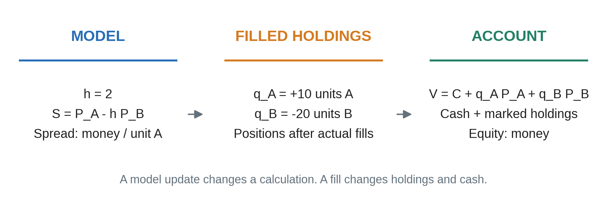

**ภาพ 3.1 สัญญาณ สถานะ และมูลค่าบัญชีมีหน้าที่ต่างกัน แต่ต้องเชื่อมถึงกัน**

อ่านภาพด้วยกัน: อ่านจากซ้ายไปขวาครับ โมเดลรับข้อมูลที่รู้แล้วและสร้างสัญญาณ จากนั้นกฎของเราจึงกำหนดจำนวนเป้าหมาย คำสั่งที่ซื้อขายสำเร็จทำให้เกิดสถานะจริง และสถานะจริงร่วมกับราคา เงินสด และต้นทุนจึงกำหนดมูลค่าบัญชี หากข้ามขั้นใด เราอาจกำลังวัดผลของสิ่งที่ไม่เคยถือ

เมื่อจบบท คุณควรคำนวณกำไรขาดทุนรายขาได้ อธิบายว่าการเปลี่ยน hedge ratio ต่างจากการเปลี่ยนราคาตรงไหน และบอกได้ว่าตัวเลขใดต้องรู้ก่อนจึงจะคำนวณผลตอบแทนได้ พื้นฐานที่ต้องใช้มีเพียงการคูณ การบวกจำนวนติดลบ และการคิดเปอร์เซ็นต์ หากยังไม่คุ้นกับ price กับ return ให้เปิดหัวข้อ III.01 ของเล่ม Quant for Non-Quant ประกอบ

ตลอดบทให้หยุดถามตัวเองสามข้อเป็นระยะ: ตัวเลขนี้เป็นสัญญาณ จำนวนหน่วย หรือเงิน? เรารู้ตัวเลขนี้ตั้งแต่เมื่อไร? และตัวเลขนี้เปลี่ยนเพราะตลาดเคลื่อน หรือเพราะเราเปลี่ยนวิธีคำนวณ? คำตอบจะช่วยพาเราไปสู่บัญชีที่ตรวจย้อนกลับได้

<a id="pilot_03_02"></a>

### 03.02 กำหนดเครื่องหมายและหน่วยก่อนเริ่ม

สมมติราคา A เท่ากับ 100 หน่วยเงินต่อหนึ่งหน่วย A และราคา B เท่ากับ 50 หน่วยเงินต่อหนึ่งหน่วย B เราตัดสินใจถือ long A จำนวน 10 หน่วย และ short B จำนวน 20 หน่วย การ long ทำให้เราได้ประโยชน์เมื่อราคาสูงขึ้น ส่วนการ short ทำให้เราได้ประโยชน์เมื่อราคาลดลง เราจะเก็บทิศทางนี้ไว้ในเครื่องหมายของจำนวนที่ถือ

| สัญลักษณ์ | ความหมาย | ค่าที่ใช้เริ่มต้น |
| --- | --- | --- |
| P_A, P_B | ราคาต่อหนึ่งหน่วยสินทรัพย์ | 100 และ 50 |
| q_A | จำนวน A ที่ถือ มีเครื่องหมาย | +10 หน่วย A |
| q_B | จำนวน B ที่ถือ มีเครื่องหมาย | −20 หน่วย B |
| C | เงินสดในบัญชีตัวอย่าง | 1,000 หลังเปิดสองขา ก่อนต้นทุน |
| V | มูลค่าบัญชีหรือ equity | เงินสดรวมมูลค่าสถานะตามราคาปัจจุบัน |
| h | จำนวน B ต่อหนึ่ง A ในราคา spread | 2 หน่วย B ต่อ 1 หน่วย A |

คำว่า short 20 หน่วย หมายถึงเรามีภาระต้องซื้อสินทรัพย์ 20 หน่วยกลับเพื่อปิดสถานะ ในสมการจึงเขียน q_B = −20 การใส่เครื่องหมายไว้ในจำนวนช่วยให้สูตรเดียวกันใช้ได้กับทั้ง long และ short โดยไม่ต้องจำสูตรกำไรสองชุด

$$
\Delta \Pi_i=q_i\left(P_{i,1}-P_{i,0}\right)
$$

อ่านสมการ: อ่านว่า กำไรขาดทุนจากราคาของสินทรัพย์ตัวที่ i เท่ากับ จำนวนที่ถือแบบมีเครื่องหมาย คูณด้วยราคาปลายช่วงลบราคาต้นช่วง สูตรนี้ใช้เมื่อจำนวนที่ถือคงที่ตลอดช่วง และยังไม่รวมรายรับหรือต้นทุนอื่น

ตรวจหน่วยด้วยครับ จำนวนสินทรัพย์คูณกับการเปลี่ยนแปลงของราคาต่อหน่วย จะได้ผลเป็นเงิน ถ้าเราเปลี่ยนไปใช้สัญญาที่มี contract multiplier ต้องนำตัวคูณนั้นเข้าบัญชีด้วย ส่วนการใช้ return แทนราคาจะต้องคูณด้วยมูลค่าสถานะที่สอดคล้องกัน รายละเอียดเหล่านี้เป็นเหตุผลที่เราต้องระบุวัตถุและหน่วยก่อนนำสูตรไปใช้

ในบทนี้ h มาจากความสัมพันธ์ระหว่างระดับราคา จึงอ่านเป็นจำนวน B ต่อหนึ่ง A ได้ ส่วน beta จาก regression ของผลตอบแทนมีความหมายเป็นความไวของผลตอบแทน การแปลง beta ชนิดนั้นเป็นจำนวนหน่วยต้องใช้ราคาของแต่ละสินทรัพย์ร่วมด้วย เราจะกลับมาแยกกรณีเหล่านี้อย่างละเอียดในบท hedge

<a id="pilot_03_03"></a>

### 03.03 คำนวณกำไรจากสิ่งที่ถือจริง

ขณะนี้เราถือ A จำนวน +10 และ B จำนวน −20 ต่อมาราคา A เปลี่ยนจาก 100 เป็น 102 ส่วน B เปลี่ยนจาก 50 เป็น 50.5 เราจะคำนวณทีละขาก่อนรวมเข้าด้วยกัน เพื่อให้เห็นว่ากำไรของพอร์ตเกิดจากตรงไหน

| สินทรัพย์ | จำนวนที่ถือ | ราคาเริ่ม → ราคาจบ | กำไรขาดทุนจากราคา |
| --- | --- | --- | --- |
| A | +10 | 100 → 102 | 10 × 2 = +20 |
| B | −20 | 50 → 50.5 | −20 × 0.5 = −10 |
| รวม | คงจำนวนเดิมตลอดช่วง | ยังไม่รวมต้นทุน | +20 − 10 = +10 |

ขา A ได้กำไร 20 เพราะราคาสูงขึ้น 2 ต่อหน่วยและเราถืออยู่ 10 หน่วย ขา B ขาดทุน 10 เพราะเราขายชอร์ตไว้ แต่ราคาที่ต้องซื้อกลับสูงขึ้น 0.5 ต่อหน่วย จำนวนติดลบคูณกับราคาที่เพิ่มขึ้นจึงให้ผลติดลบ พอร์ตได้กำไรจากราคาสุทธิ 10 หน่วยเงิน

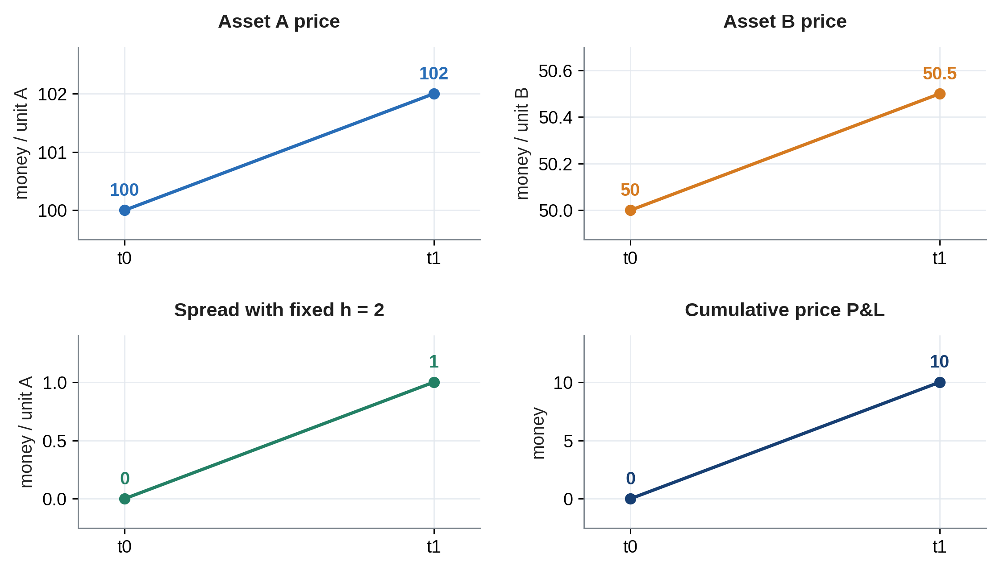

**ภาพ 3.2 ราคาเปลี่ยน จำนวนที่ถือคงที่ และกำไรเกิดขึ้นรายขา**

อ่านภาพด้วยกัน: สองช่องบนแสดงราคาต้นช่วงและปลายช่วงของ A กับ B ส่วนช่องล่างซ้ายแสดง spread เมื่อ h คงที่ที่ 2 และช่องล่างขวาแสดงกำไรราคาสะสมเมื่อถือ A +10 และ B −20 ตลอดช่วง เส้นเชื่อมระหว่างสองจุดใช้ช่วยอ่านภาพ ตัวอย่างไม่ได้ให้เส้นทางราคาระหว่างสองเวลานั้น

ลองเปลี่ยนเพียงราคา B ตอนจบเป็น 49.5 ขา B จะได้กำไร +10 เพราะ −20 × (−0.5) = +10 เมื่อรวมกับขา A ที่ได้ +20 พอร์ตจะได้ +30 การมี long และ short ไม่ได้หมายความว่าขาหนึ่งต้องกำไรและอีกขาหนึ่งต้องขาดทุนเสมอ ผลขึ้นอยู่กับทิศทางราคาที่เกิดจริง

การคำนวณนี้ยังไม่ได้บอกว่ากฎที่ใช้เลือก A และ B มีความได้เปรียบในการทำนายอนาคต เราเพิ่งตรวจส่วนที่จำเป็นก่อน คือหากถือจำนวนเหล่านี้และราคาเดินตามเส้นทางนี้ บัญชีต้องเปลี่ยนเท่าไร ความถูกต้องของบัญชีกับคุณภาพของสมมติฐานต้องได้รับการตรวจแยกกัน

<a id="pilot_03_04"></a>

### 03.04 ให้บัญชีเงินสดตอบคำถามเดียวกัน

เพื่อเช็กผล +10 อีกทางหนึ่ง ให้เริ่มจากเงินทุน 1,000 หน่วยเงินและยังไม่มีสินทรัพย์ จากนั้นซื้อ A จำนวน 10 ที่ราคา 100 ใช้เงิน 1,000 และขายชอร์ต B จำนวน 20 ที่ราคา 50 ได้เงินจากการขาย 1,000 ในบัญชีอย่างง่ายนี้ เงินสดหลังเปิดสองขาจึงกลับมาเป็น 1,000

$$
V_t=C_t+q_{A,t}P_{A,t}+q_{B,t}P_{B,t}
$$

อ่านสมการ: อ่านว่า มูลค่าบัญชี ณ เวลา t เท่ากับเงินสด บวกจำนวน A คูณราคา A บวกจำนวน B คูณราคา B โดยจำนวน short เป็นลบ จึงนำมูลค่าภาระของขา short มาหักออกโดยอัตโนมัติ

| เหตุการณ์ | เงินสด C | มูลค่า A | มูลค่า B | Equity V |
| --- | --- | --- | --- | --- |
| ก่อนเปิดสถานะ | 1,000 | 0 | 0 | 1,000 |
| ซื้อ A 10 ที่ 100 | 0 | 1,000 | 0 | 1,000 |
| ขายชอร์ต B 20 ที่ 50 | 1,000 | 1,000 | −1,000 | 1,000 |
| ราคาเป็น A 102 และ B 50.5 | 1,000 | 1,020 | −1,010 | 1,010 |
| ปิดทั้งสองขาที่ราคานี้ | 1,010 | 0 | 0 | 1,010 |

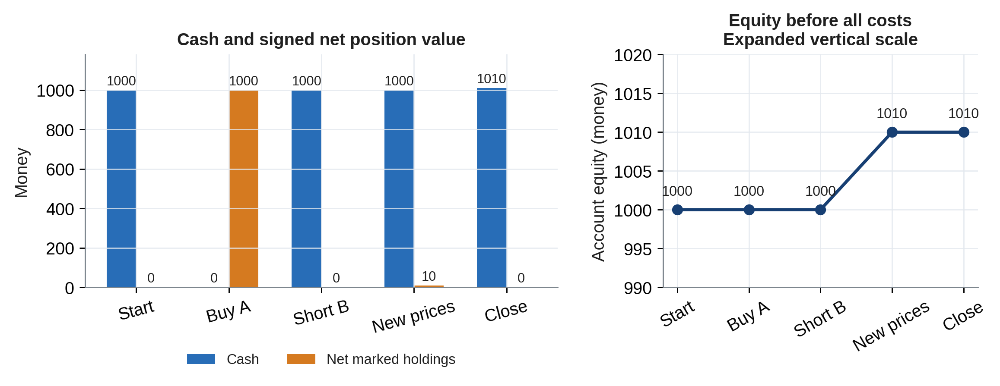

**ภาพ 3.3 การเปลี่ยนเงินสดและมูลค่าสถานะต้องรวมกลับเป็น equity เดียวกัน**

อ่านภาพด้วยกัน: ระหว่างเปิดสถานะ เงินสดย้ายไปเป็นสินทรัพย์หรือเปลี่ยนพร้อมภาระ short จึงไม่ได้เพิ่มความมั่งคั่งด้วยตัวการซื้อขายนั้นเอง เมื่อราคาตลาดเปลี่ยน มูลค่าสถานะสุทธิจาก 0 เป็น 10 และ equity จาก 1,000 เป็น 1,010 เมื่อปิดสถานะ มูลค่าที่ค้างอยู่จึงย้ายกลับมาเป็นเงินสด

ตรงนี้มีข้อแตกต่างที่ต้องรักษาไว้ครับ เงินสดตามสมการเป็นรายการบัญชีทั้งหมดที่เรากำลังติดตาม เงินที่ถอนได้หรือเงินที่ใช้เปิดสถานะเพิ่มได้จริงขึ้นกับข้อกำหนดของบัญชีและหลักประกัน เงินจากการขายชอร์ตจึงไม่ใช่เงินทุนใหม่ที่เราใช้ได้อย่างอิสระ การตรวจระบบจริงต้องบันทึกข้อจำกัดนั้นเพิ่ม

ในตัวอย่างนี้ไม่มีการเติมเงินหรือถอนเงินระหว่างทาง ดังนั้น equity ที่เพิ่มขึ้น 10 จึงตรงกับกำไรจากราคา 10 หากมีเงินฝากเพิ่ม 100 เราจะต้องแยกเงินฝากออกก่อนอธิบายว่า equity ที่สูงขึ้นมาจากกลยุทธ์เท่าไร การฝากเงินเปลี่ยนขนาดบัญชี แต่ไม่ใช่กำไรจากการซื้อขาย

<a id="pilot_03_05"></a>

### 03.05 เมื่อใดการเปลี่ยน spread จึงแปลงเป็นเงินได้

ตอนนี้กลับมาดู spread ครับ กำหนด h = 2 และสร้าง X จากราคา A ลบสองเท่าของราคา B เหตุผลในการใช้ h จะมาจากสมมติฐานหรือการประมาณในบทถัดไป สำหรับบทนี้เราตรึงค่าไว้ เพื่อดูความสัมพันธ์ระหว่าง spread กับบัญชีให้ชัดก่อน

$$
X_t=P_{A,t}-hP_{B,t}
$$

อ่านสมการ: อ่านว่า spread ณ เวลา t เท่ากับราคา A ลบ h เท่าของราคา B ในตัวอย่าง h เท่ากับ 2 จึงหมายถึงใช้ B สองหน่วยเทียบกับ A หนึ่งหน่วย

ก่อนราคาเปลี่ยน X_0 = 100 − 2 × 50 = 0 หลังราคาเปลี่ยน X_1 = 102 − 2 × 50.5 = 1 ดังนั้น spread เพิ่มขึ้น 1 เราถือรูปแบบนี้สิบชุด แต่ละชุดคือ long A หนึ่งหน่วยและ short B สองหน่วย จึงได้กำไรจากราคา 10 × 1 = 10

$$
\Delta\Pi=10\,\Delta X=10\,\Delta P_A-20\,\Delta P_B
$$

อ่านสมการ: อ่านว่า กำไรจากราคาเท่ากับสิบคูณการเปลี่ยนแปลง spread และเมื่อกระจายวงเล็บจะได้สิบคูณการเปลี่ยนราคา A ลบยี่สิบคูณการเปลี่ยนราคา B ซึ่งตรงกับจำนวนที่เราถือจริง

ความเชื่อมโยงนี้เกิดได้เพราะ h คงที่และจำนวนที่ถือสอดคล้องกับ h ตลอดช่วง หากเปลี่ยนไปถือ A ห้าหน่วยและ B ลบสิบหน่วย จำนวนชุดจะเหลือห้าและกำไรจะเป็น 5 หากใช้ spread เส้นเดิมแต่ถือจำนวนอื่นที่ไม่เป็นสัดส่วนกัน เราต้องกลับไปคำนวณกำไรจากจำนวนจริงของแต่ละขา

สังเกตด้วยว่า spread ในตัวอย่างเพิ่มจากศูนย์เป็นหนึ่ง การคำนวณเปอร์เซ็นต์ด้วยการหาร X_0 จะหารด้วยศูนย์ ปัญหานี้บอกว่า spread ที่สร้างขึ้นไม่ได้เป็นฐานเงินทุนของเราโดยอัตโนมัติ เช่นเดียวกับ z-score ซึ่งเป็นคะแนนที่ไม่มีหน่วยเงิน การที่ z-score ขยับหนึ่งหน่วยจึงยังบอกกำไรไม่ได้จนกว่าจะระบุสถานะและราคา

เมื่ออ่านกรณีศึกษาของผู้อื่น จึงควรถามต่อทันทีว่า spread ที่เขาแสดงสร้างจากราคา log price หรือ return และน้ำหนักในสมการถูกแปลงเป็นจำนวนที่ซื้อขายอย่างไร คำถามนี้จะช่วยเชื่อมภาพที่เห็นกับสิ่งที่บัญชีรับความเสี่ยงจริง

<a id="pilot_03_06"></a>

### 03.06 เปลี่ยน hedge ratio แล้วกำไรเกิดขึ้นหรือยัง

เริ่มตัวอย่างใหม่โดยให้ราคาคงที่ A = 100 และ B = 50 ทั้งก่อนและหลังการคำนวณ เดิม h = 2 ทำให้ X = 0 จากนั้นโมเดลปรับ h เป็น 1.8 spread ที่คำนวณใหม่จะเป็น 100 − 1.8 × 50 = 10 แม้ไม่มีราคาตัวใดเปลี่ยนเลย

ถ้าเรายังถือ A +10 และ B −20 เท่าเดิม กำไรจากราคาต้องเป็นศูนย์ เพราะทั้งสองขามีการเปลี่ยนราคาเท่ากับศูนย์ ค่า spread ที่เพิ่มขึ้นเกิดจากการเปลี่ยนไม้บรรทัดของโมเดล การนำ 10 คูณการเปลี่ยน spread ใหม่นี้แล้วรายงานกำไร 100 จะไม่ตรงกับบัญชีที่ถืออยู่

$$
X_1-X_0=\Delta P_A-h_0\Delta P_B-(h_1-h_0)P_{B,1}
$$

อ่านสมการ: อ่านว่า การเปลี่ยน spread เมื่อ h เปลี่ยน มีทั้งส่วนจากราคาที่เคลื่อนภายใต้ h เดิม และส่วนจากการเปลี่ยน h คูณราคา B ตอนจบ พจน์สุดท้ายเป็นผลจากการนิยาม spread ใหม่ จึงไม่ใช่กำไรของสถานะเดิมโดยอัตโนมัติ

ในตัวอย่างนี้สองพจน์แรกเท่ากับศูนย์ ส่วนพจน์สุดท้ายเท่ากับ −(1.8 − 2) × 50 = +10 จึงอธิบายค่า spread ใหม่ได้ครบ การแยกพจน์นี้มีประโยชน์เมื่ออ่าน rolling hedge หรือ Kalman hedge เพราะทำให้เห็นว่ากราฟเปลี่ยนจากตลาดหรือจากค่าประมาณ

แล้วถ้าเราปรับสถานะให้ตรงกับ h ใหม่จริงล่ะ? เมื่อคง A +10 ไว้ B เป้าหมายจะเป็น −18 จากเดิม −20 เราจึงต้องซื้อ B กลับ 2 หน่วยที่ราคา 50 ใช้เงิน 100 ถ้าก่อนปรับมีเงินสด 1,000 หลังปรับเงินสดจะเหลือ 900 ขณะเดียวกันมูลค่าสถานะสุทธิจะเป็น 10 × 100 − 18 × 50 = 100 ผลรวมยังเท่ากับ 1,000

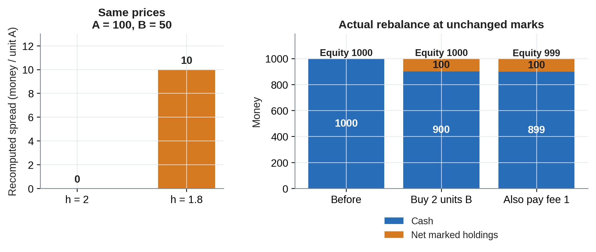

**ภาพ 3.4 การซื้อ B กลับเพื่อปรับ hedge ย้ายมูลค่าระหว่างเงินสดกับสถานะ**

อ่านภาพด้วยกัน: เปรียบเทียบทั้งสามรายการครับ ก่อนปรับมีเงินสด 1,000 และมูลค่าสถานะสุทธิ 0 หลังปรับมีเงินสด 900 และมูลค่าสถานะสุทธิ 100 จึงมี equity เท่าเดิม หากจ่ายค่าธรรมเนียม 1 เพิ่ม เงินสดจะเหลือ 899 และ equity เหลือ 999

$$
C^{+}=C^{-}-\sum_i\Delta q_i P^{\mathrm{fill}}_i-\mathrm{fee}
$$

อ่านสมการ: อ่านว่า เงินสดหลังปรับเท่ากับเงินสดก่อนปรับ ลบผลรวมของจำนวนที่ซื้อเพิ่มแบบมีเครื่องหมายคูณราคาที่ซื้อขายสำเร็จ และลบค่าธรรมเนียม โดย $P^{\mathrm{fill}}_i$ คือราคา fill จริง หากขายออกจำนวนเปลี่ยนเป็นลบ พจน์นี้จึงเพิ่มเงินสด

ตัวอย่างนี้สมมติว่าซื้อขายได้ที่ราคาเดียวกับที่ใช้ประเมินสถานะ จึงแสดงว่าการปรับน้ำหนักเองไม่สร้างมูลค่าเพิ่มก่อนต้นทุน หากราคา fill แย่กว่าราคาที่ใช้ mark ผลต่างจะปรากฏในบัญชีเงินสดกับมูลค่าสถานะอยู่แล้ว เมื่อรายงานต้นทุน slippage จึงต้องระวังไม่หักความเสียหายก้อนเดียวกันซ้ำอีกครั้ง

<a id="pilot_03_07"></a>

### 03.07 จากกำไรขั้นต้นสู่กำไรสุทธิและผลตอบแทน

กลับไปยังเส้นทางราคาที่ A เพิ่มจาก 100 เป็น 102 และ B เพิ่มจาก 50 เป็น 50.5 ซึ่งให้กำไรจากราคา +10 คราวนี้เพิ่มต้นทุนสมมติทั้งรอบรวม 12 แบ่งเป็นต้นทุนตอนเปิด 4 ระหว่างถือ 3 และตอนปิด 5 ตัวเลขเหล่านี้ตั้งขึ้นเพื่อสอนบัญชี ไม่ใช่อัตราค่าธรรมเนียมของตลาดใด

| รายการ | จำนวนเงิน | คำอธิบาย |
| --- | --- | --- |
| กำไรจากราคาขา A | +20 | จำนวน +10 คูณราคาเปลี่ยน +2 |
| กำไรจากราคาขา B | −10 | จำนวน −20 คูณราคาเปลี่ยน +0.5 |
| ต้นทุนเปิด | −4 | ต้นทุนสมมติรวมตอนเปิดสองขา |
| ต้นทุนระหว่างถือ | −3 | รายการสมมติที่เกิดระหว่างถือ |
| ต้นทุนปิด | −5 | ต้นทุนสมมติรวมตอนปิดสองขา |
| กำไรสุทธิทั้งรอบ | −2 | 20 − 10 − 4 − 3 − 5 |

หากเริ่มด้วยทุน 1,000 เงินสดหลังเปิดและหักต้นทุนเปิดจะเหลือ 996 เมื่อราคาเปลี่ยน มูลค่าสถานะสุทธิเป็น +10 จากนั้นจ่ายต้นทุนระหว่างถือ 3 เงินสดเหลือ 993 และ equity เท่ากับ 1,003 เมื่อปิดทั้งสองขาจะได้เงินสดสุทธิจากสถานะเพิ่ม 10 แล้วจ่ายต้นทุนปิด 5 จบด้วยเงิน 998 กำไรสุทธิจึงเป็น −2 ตรงกับตาราง

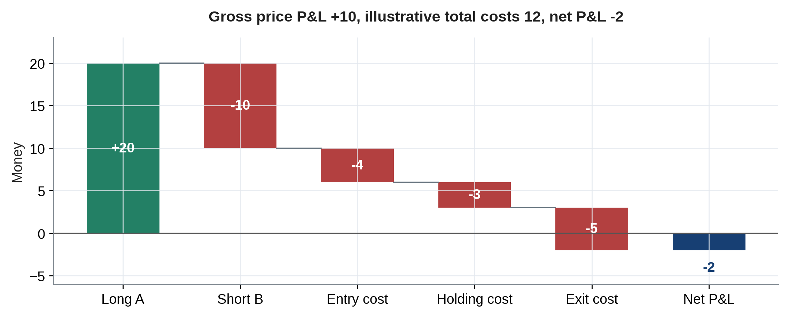

**ภาพ 3.5 กำไรจากราคาสองขารวมกันเป็น 10 และต้นทุนสมมติทั้งรอบทำให้เหลือสุทธิ −2**

อ่านภาพด้วยกัน: อ่านแท่งจากซ้ายไปขวา ขา long A เพิ่มกำไร 20 ขา short B ลดกำไร 10 จากนั้นหักต้นทุนที่กำหนดเป็นยอดเงินรวม 4, 3 และ 5 แท่งสุดท้ายแสดงผลสุทธิ −2 ต้นทุนแต่ละรายการถูกนับครั้งเดียว

$$
\Pi_{\mathrm{net}}=\Pi_{\mathrm{price}}+\mathrm{income}-\mathrm{costs}
$$

อ่านสมการ: อ่านว่า กำไรสุทธิเท่ากับกำไรจากราคา บวกรายรับอื่น แล้วหักต้นทุนทั้งหมดที่ยังไม่ได้รวมอยู่ในบัญชีรายการก่อนหน้า ในตัวอย่างนี้ไม่มีรายรับอื่น จึงได้ 10 − 12 = −2

คำว่า costs ต้องมีรายการที่ชัดเจน หากราคา fill ในบัญชีรวมผลของการซื้อแพงหรือขายถูกกว่าราคาอ้างอิงแล้ว ผลนั้นอยู่ในกำไรที่คำนวณจาก fill เราสามารถแยกแสดงเป็น attribution เพื่อทำความเข้าใจได้ แต่จะนำมาหักซ้ำจากกำไรเดิมไม่ได้ หลักเดียวกันใช้กับต้นทุนที่หักผ่านเงินสดไปแล้ว

ต่อไปจึงถามว่า −2 คิดเป็นผลตอบแทนเท่าไร ในตัวอย่างไม่มีการฝากหรือถอนเงิน เราใช้ทุนเริ่มต้น 1,000 เป็นฐาน จึงได้ −2 ÷ 1,000 = −0.2% หากใช้ gross notional เริ่มต้น 2,000 เป็นฐานจะได้ −0.1% แต่ตัวเลขนี้เป็นอัตรากำไรต่อ gross exposure ซึ่งตอบอีกคำถามหนึ่ง ต้องตั้งชื่อให้ตรงกับตัวหาร

$$
G_0=|q_AP_{A,0}|+|q_BP_{B,0}|=2{,}000
$$

อ่านสมการ: อ่านว่า gross notional เริ่มต้นเท่ากับผลรวมของมูลค่าสถานะแบบค่าสัมบูรณ์ ได้ 1,000 บวก 1,000 เท่ากับ 2,000 ก่อนต้นทุน เมื่อเทียบกับ equity เริ่มต้น 1,000 จึงมี gross exposure สองเท่าของทุน

ส่วน net notional เริ่มต้นเท่ากับ 1,000 − 1,000 = 0 ศูนย์นี้บอกการหักล้างของมูลค่าสถานะที่มีเครื่องหมาย ณ เวลานั้น ไม่ใช่เงินทุนที่ใช้และไม่ใช่ตัวหารของผลตอบแทน การรายงานผลทุกครั้งจึงต้องบอกทั้งฐานเงินทุน gross exposure และความหมายของผลตอบแทนที่ใช้

<a id="pilot_03_08"></a>

### 03.08 ให้เวลาและคำสั่งอยู่ในบัญชีด้วย

จนถึงตอนนี้เราให้จำนวนที่ถือคงที่และรู้ราคา fill แน่นอน แต่ระบบจริงมีลำดับเหตุการณ์ ถ้าใช้ราคาปิดของแท่งเวลา t คำนวณสัญญาณ สัญญาณนั้นจะเกิดหลังเรารู้ราคาปิดแล้ว การซื้อขายและกำไรที่ตามมาจึงต้องสอดคล้องกับเวลาที่คำสั่งเกิดและซื้อขายสำเร็จ

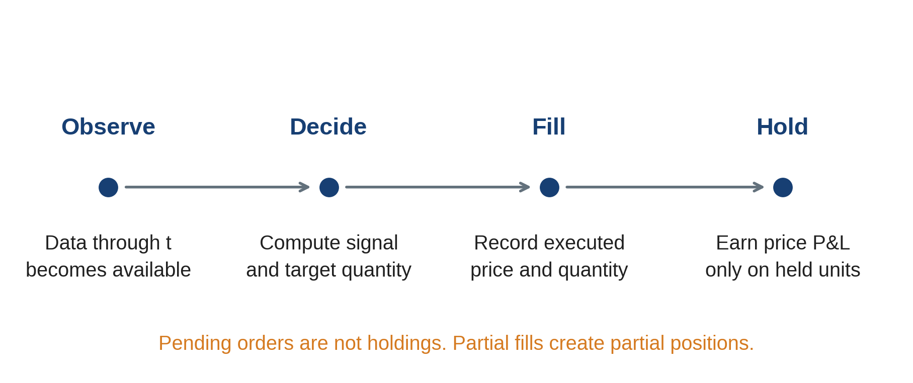

**ภาพ 3.6 ข้อมูล สัญญาณ คำสั่ง และ fill ต้องเรียงตามเวลาที่เกิดจริง**

อ่านภาพด้วยกัน: เริ่มจากข้อมูลที่เกิดขึ้นแล้ว ตามด้วยการคำนวณและส่งคำสั่ง จากนั้นดูเวลาที่คำสั่งซื้อขายสำเร็จ จำนวนที่ fill แล้วเท่านั้นจึงเข้าบัญชีสำหรับการเปลี่ยนราคาหลังจากนั้น หาก fill เกิดกลางช่วง ต้องแบ่งช่วงหรือใช้บัญชีตามเหตุการณ์ให้ถูกต้อง

$$
\Delta\Pi_t=\sum_i q_{i,t-1}\left(P_{i,t}-P_{i,t-1}\right)+I_t-K_t
$$

อ่านสมการ: อ่านว่า หากจำนวนที่ถือ ณ ต้นช่วงคงที่ตลอดช่วง กำไรขาดทุนของช่วงเท่ากับจำนวนต้นช่วงคูณการเปลี่ยนราคาแต่ละสินทรัพย์ แล้วบวกรายรับ I และหักต้นทุน K ตัวห้อย t−1 เตือนว่าเราต้องถืออยู่ก่อนรับการเปลี่ยนราคานั้น

สูตรนี้ไม่ได้อนุญาตให้ใช้จำนวนเป้าหมายที่เพิ่งคำนวณตอนปลายช่วงมาแทนจำนวนต้นช่วง ถ้ามีการซื้อขายระหว่างช่วง เราจะอัปเดตเงินสดและจำนวนตามแต่ละ fill แล้วประเมิน equity จากสถานะล่าสุด วิธีนี้รองรับการ fill บางส่วนได้ตรงกว่า เพราะจำนวนเป้าหมายกับจำนวนที่ถือจริงอาจยังไม่เท่ากัน เอกสาร Trade Fills ของ QuantConnect แยกราคาและจำนวนที่ซื้อขายสำเร็จ รวมถึงกรณี partial fills ซึ่งเป็นตัวอย่างของเหตุผลที่บัญชีต้องอัปเดตจาก fill event [R2](#ref-r2)

```python
# Start with valid marks and a recorded opening account.
for event in events_sorted_by_time:
    if event.is_market_update:
        update_marks(event)

    if event.is_fill:
        cash -= event.signed_qty * event.fill_price
        cash -= event.fee
        held[event.asset] += event.signed_qty
        update_pending_orders(event)

    if event.is_cashflow:
        cash += event.signed_amount

    equity = cash + sum(held[i] * mark[i] for i in assets)

    if event.is_signal_time:
        signal = model(data_known_by(event.time))
        target = size_positions(signal)
        reconcile_and_submit(target, held, pending_orders)
```

อ่านโค้ดจากบัญชีก่อนครับ fill ที่มีจำนวนบวกหมายถึงซื้อ จึงลดเงินสดและเพิ่มจำนวนที่ถือ ส่วนจำนวนลบหมายถึงขายและให้ผลกลับกัน รายรับหรือต้นทุนระหว่างถือเข้าผ่าน cashflow แบบมีเครื่องหมาย หลังแต่ละเหตุการณ์จึงประเมิน equity ด้วยราคา mark ล่าสุดที่ใช้ได้ ส่วน signal สร้างเป้าหมายและคำสั่ง การส่งคำสั่งยังไม่เปลี่ยน held ขั้น reconcile_and_submit ต้องนำคำสั่งค้างมาพิจารณา ปรับหรือยกเลิกคำสั่งเดิมก่อนส่งส่วนที่ยังขาด เพื่อไม่สั่งซ้ำระหว่างรอ fill

ในเหตุการณ์ที่มีเวลาเดียวกัน ต้องกำหนดลำดับย่อยให้ชัด เช่น ข้อมูลราคาใดพร้อมให้โมเดลใช้ก่อนส่งคำสั่ง และการจ่าย funding ใช้สถานะ ณ เวลาใด สำหรับ maker orders การแตะราคาในแท่ง OHLC เพียงอย่างเดียวยังไม่ระบุว่าเราจะ fill เท่าไรหรือเมื่อไร บท execution จะขยายแบบจำลองนั้น โดยยังใช้บัญชีตาม fill ชุดเดิมเป็นฐาน

<a id="pilot_03_09"></a>

### 03.09 เมื่อขาหนึ่งเป็น futures: หลักประกัน การชำระรายวัน และ funding

จนถึงตรงนี้ทุกขาจ่ายหรือรับเงินเต็มมูลค่าตอนซื้อขาย สัญญา futures ทำงานอีกแบบครับ เราไม่จ่ายมูลค่าเต็มของสัญญา แต่วางหลักประกัน และกำไรขาดทุนจากราคาถูกชำระเป็นเงินสดเข้าออกบัญชีหลักประกันตามรอบที่สัญญากำหนด [R23](#ref-r23) สมการ equity ยังเป็นสมการเดิม สิ่งที่เปลี่ยนคือเงินอยู่ในช่องไหน และเราหยิบมาใช้ได้หรือไม่

ใช้กรณี BTC จากบท 2: ซื้อ spot 1 BTC ที่ 100,000 และ short linear dated futures เทียบ 1 BTC ที่ 103,000 เริ่มด้วยทุน 125,000 กติกาสมมติเพื่อการสอนมีสองข้อ ข้อแรก ยอดในบัญชีหลักประกันหลังชำระแต่ละวันต้องไม่ต่ำกว่า 10% ของราคา futures ปัจจุบัน ข้อสอง กำไรขาดทุนของ futures ชำระเป็นเงินสดทุกสิ้นวัน ตลาดจริงมีอัตรา initial กับ maintenance แยกกัน และมีกติกาเรื่องสินทรัพย์ที่ใช้เป็นหลักประกันต่างกันไป ต้องอ่านจากเอกสารของสัญญาที่จะใช้

$$
V_t=C^{\mathrm{free}}_t+q_SS_t+M_t
$$

อ่านสมการ: equity เท่ากับเงินสดอิสระ บวกจำนวน spot ที่ถือคูณราคา spot บวกยอดบัญชีหลักประกัน M หลังชำระกำไรขาดทุนของ futures ถึงเวลานั้นแล้ว ในหัวข้อนี้ S คือราคา spot และ F คือราคา futures ตามตารางสัญลักษณ์ เมื่อกำไรขาดทุนถูกชำระเข้า M ไปแล้ว ห้ามบวกกำไรจาก mark ของ futures ซ้ำอีกรอบ

| เหตุการณ์ | เงินสดอิสระ | มูลค่า spot | บัญชีหลักประกัน | Equity |
| --- | --- | --- | --- | --- |
| เริ่มต้น | 125,000 | 0 | 0 | 125,000 |
| ซื้อ spot 1 BTC ที่ 100,000 | 25,000 | 100,000 | 0 | 125,000 |
| short futures ที่ 103,000 และวางหลักประกัน 10,300 | 14,700 | 100,000 | 10,300 | 125,000 |
| สิ้นวันที่ 1: S = 110,000 และ F = 113,200 ชำระ −10,200 | 14,700 | 110,000 | 100 | 124,800 |
| เติมหลักประกันให้ครบ 11,320 | 3,480 | 110,000 | 11,320 | 124,800 |
| วันหมดอายุ: S = F = 105,000 ชำระ +8,200 | 3,480 | 105,000 | 19,520 | 128,000 |

อ่านแถวสิ้นวันที่ 1 ก่อนครับ spot กำไร 10,000 ส่วน futures ขาดทุน 10,200 equity จึงลดลง 200 ซึ่งเท่ากับ basis ที่กว้างขึ้นจาก 3,000 เป็น 3,200 ตามสมการในหัวข้อ 02.05 แต่บัญชีหลักประกันเหลือ 100 ขณะที่กติกาต้องการ 11,320 เราจึงต้องโอนเงิน 11,220 ในวันนั้น กำไร 10,000 ของ spot เป็นมูลค่าที่ยังไม่ได้ขาย และในกติกาตัวอย่างนี้นำมาวางแทนเงินสดไม่ได้ เมื่อถือครบถึงวันหมดอายุ equity เป็น 128,000 เพิ่มขึ้น 3,000 ตรงกับส่วนต่างตอนเปิด ก่อนต้นทุนทั้งหมด

ทีนี้ลดทุนเริ่มต้นเป็น 120,000 โดยทุกอย่างเหมือนเดิม เงินสดอิสระหลังเปิดจะเหลือ 9,700 ซึ่งไม่พอสำหรับการเติม 11,220 ยังขาดอีก 1,520 ทั้งที่ equity เท่ากับ 119,800 และลดลงเพียง 200 หากขา futures ถูกบังคับปิดที่ 113,200 เราจะรับรู้ขาดทุน 10,200 และเหลือ spot ขาเดียวที่รับทิศทางราคาเต็มจำนวน ส่วนต่าง 3,000 ที่คำนวณไว้สำหรับวันหมดอายุจึงไม่ใช่ผลของสถานะที่เหลืออยู่อีกต่อไป

$$
U=(1+m)(F_1-F_0),\qquad F_1>F_0
$$

อ่านสมการ: U คือเงินที่ต้องเติมในวันนั้น และ m คืออัตราหลักประกันของกติกาตัวอย่าง เท่ากับ 0.10 เมื่อราคา futures ขึ้น เราต้องจ่ายส่วนขาดทุน $F_1-F_0$ และต้องเพิ่มหลักประกันตามราคาที่สูงขึ้นอีก m เท่าของส่วนนั้น ในตัวอย่างคือ 1.1 × 10,200 = 11,220 สมการนี้ใช้กับกติกาที่กำหนดในหัวข้อนี้ กติกาอื่นให้สูตรอื่น

กลับสมการแล้วจะได้คำถามที่ควรตอบก่อนเปิดสถานะ เงินสดอิสระ 9,700 รองรับการขึ้นของราคา futures ภายในหนึ่งวันได้ 9,700 ÷ 1.1 หรือประมาณ 8,818 คิดเป็นราว 8.6% ของ 103,000 ส่วนเงินสดอิสระ 14,700 รองรับได้ประมาณ 13,364 หรือราว 13.0% ตัวเลขขึ้นกับกติกาสมมติ แต่วิธีคิดนำไปใช้ต่อได้: เลือกขนาดการเคลื่อนไหวที่ต้องการผ่านให้ได้ แล้วคำนวณเงินสดที่ต้องมีในบัญชีที่ถูกเรียกเงิน ไม่ดูเฉพาะ equity รวม

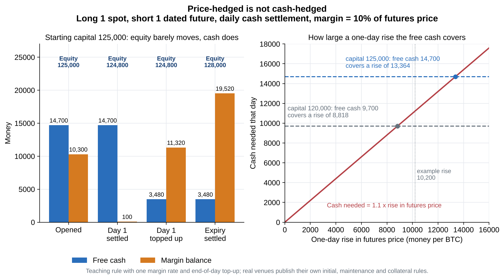

**ภาพ 3.7 สถานะที่ราคาหักล้างกันยังต้องใช้เงินสดระหว่างทาง**

อ่านภาพด้วยกัน: ด้านซ้ายใช้ทุนเริ่มต้น 125,000 ตัวเลขบนสุดคือ equity ซึ่งเปลี่ยนจาก 125,000 เป็น 124,800 และ 128,000 ส่วนแท่งแสดงเงินสดอิสระกับบัญชีหลักประกันที่สลับขนาดกันระหว่างทาง ด้านขวา เส้นทึบคือเงินที่ต้องเติมตามขนาดการขึ้นของราคา futures ในหนึ่งวัน เส้นประคือเงินสดอิสระของทุนสองระดับ จุดตัดบอกการขึ้นสูงสุดที่รองรับได้ ภาพใช้กติกาสมมติของหัวข้อนี้และยังไม่รวมต้นทุน

Perpetual futures ไม่มีวันหมดอายุ จึงไม่มีแถว “วันหมดอายุ” ที่สัญญาทำให้ basis กลับเป็นศูนย์ สิ่งที่มีแทนคือ funding ซึ่งเป็นกระแสเงินระหว่างฝั่ง long กับฝั่ง short ตามรอบที่ผลิตภัณฑ์กำหนด เมื่ออัตราเป็นบวก ฝั่ง long จ่ายให้ฝั่ง short และกลับกันเมื่ออัตราเป็นลบ ในบัญชีของเรา funding เป็นรายการ cash flow แบบมีเครื่องหมาย แยกจากกำไรขาดทุนจากราคา

ตัวอย่างสมมติ: ซื้อ spot 1 BTC ที่ 100,000 และ short linear perp เทียบ 1 BTC ที่ 100,050 ถือผ่านสามรอบ funding แล้วปิดทั้งสองขาที่ราคา spot 99,000 และ perp 99,020 สมมติให้ funding แต่ละรอบเท่ากับราคา mark คูณอัตราของรอบนั้น รอบละ 8 ชั่วโมง และค่าธรรมเนียม 0.02% ของมูลค่าต่อการซื้อขายหนึ่งครั้ง ความถี่ สูตร funding และค่าธรรมเนียมจริงต้องอ่านจากเอกสารของสัญญา

| รายการ | การคำนวณ | เงิน |
| --- | --- | --- |
| Funding รอบ 1 อัตรา +0.01% ที่ mark 100,000 | ฝั่ง short รับ | +10.00 |
| Funding รอบ 2 อัตรา +0.03% ที่ mark 101,000 | ฝั่ง short รับ | +30.30 |
| Funding รอบ 3 อัตรา −0.02% ที่ mark 99,000 | ฝั่ง short จ่าย | −19.80 |
| กำไรจากราคา spot | 99,000 − 100,000 | −1,000.00 |
| กำไรจากราคา perp ขา short | 100,050 − 99,020 | +1,030.00 |
| ค่าธรรมเนียมสี่ครั้ง | 0.02% × (100,000 + 100,050 + 99,000 + 99,020) | −79.614 |
| กำไรสุทธิ | 20.50 + 30.00 − 79.614 | −29.114 |

กำไรจากราคารวม +30 เท่ากับ basis ที่แคบลงจาก 50 เป็น 20 ส่วน funding รวม +20.50 โดยสองรอบแรกเป็นรายรับ แต่รอบที่สามอัตรากลับเครื่องหมายและเราเป็นฝ่ายจ่าย เมื่อหักค่าธรรมเนียมแล้วรอบนี้ขาดทุนสุทธิ 29.114 ถ้า funding อยู่ที่ราว 10 ต่อรอบและราคาไม่เปลี่ยน ต้องถือประมาณ 8 รอบจึงพอค่าธรรมเนียมระดับนี้ ส่วนอัตรา 0.01% ต่อรอบ เมื่อคูณเป็นรายปีแบบ simple คือ 0.01% × 3 × 365 = 10.95% ตัวเลขรายปีนี้ใช้ได้เมื่ออัตราเท่าเดิมทุกรอบ ซึ่งสัญญาไม่ได้รับรอง

สิ่งที่ควรเก็บจากสองตัวอย่างมีสามข้อครับ ข้อแรก กำไรขาดทุนที่ชำระแล้วและ funding ลงบัญชีเป็นเงินสดตามรอบที่เกิดจริง ด้วยเครื่องหมายจริง ข้อสอง basis ของ perp ไม่มีวันที่สัญญากำหนดให้เป็นศูนย์ จึงต้องรายงานกำไรจากราคาแยกจาก funding ข้อสาม ขา perp ใช้หลักประกันเช่นเดียวกับตารางแรก การคำนวณเงินสดที่ต้องเตรียมจึงใช้วิธีเดียวกัน บท 6 จะขยายเรื่องนี้กับเงื่อนไขของสัญญาจริง

<a id="pilot_03_10"></a>

### 03.10 ใช้บัญชีนี้แกะกรณีศึกษาของผู้อื่น

เมื่อต้องอ่าน paper หรือ tutorial เราจะเริ่มจากจดว่าสิ่งที่ผู้เขียนเรียกว่า spread หรือ portfolio คืออะไร จากนั้นหาตัวแปรที่เก็บจำนวนซื้อขายจริง และไล่ว่าตัวแปรนั้นเข้าระบบกำไรขาดทุนอย่างไร หัวข้อ 15.3.2 ของ Palomar อธิบายความต่างระหว่างราคากับ log price และการคิดกำไรด้วยน้ำหนักที่ถืออยู่ในช่วงนั้น [R1](#ref-r1) เราใช้คำถามเหล่านี้ตรวจตัวอย่างที่สร้างขึ้นเองในบทนี้ โดยเริ่มจากหน่วยและบัญชี

| แกนที่ใช้แกะ | คำถามที่ต้องตอบในกรณีศึกษา |
| --- | --- |
| Asset Selection | เหตุใด A และ B จึงอยู่ด้วยกัน ราคาและหน่วยเข้ากันได้หรือไม่ และแต่ละขาต้องเข้าถึงการซื้อขายแบบใด |
| Workflow | ข้อมูลใดเข้าประมาณ h สัญญาณเกิดเมื่อไร และข้อมูลส่วนไหนยังไม่ควรถูกใช้ในขณะนั้น |
| Position Management | h ถูกแปลงเป็นจำนวนอย่างไร เปิดหรือปรับเมื่อไร และมี fill ต้นทุน เงินสด กับหลักประกันอย่างไร |

ตัวอย่างแรกที่ควรทำหลังอ่านคือเลือกช่วงเวลาสั้น ๆ แล้วเขียนตารางราคา จำนวนที่ถือ เงินสด และ equity ด้วยมือ หากผลไม่ตรงกับโปรแกรม ให้หยุดไล่ตรวจช่วงนั้นก่อนดู Sharpe ratio หรือกำไรสะสมทั้งปี ปัญหาอาจเป็นเครื่องหมาย short การใช้จำนวนผิดช่วงเวลา หรือการหักต้นทุนซ้ำ ซึ่งแก้ได้จากรายการบัญชีโดยตรง

จากนั้นจึงตรวจคำถามระดับสมมติฐาน เช่น เหตุใด spread จึงควรกลับ ช่วงฝึกกับช่วงประเมินแยกกันอย่างไร และการเลือกคู่ทำก่อนหรือหลังเห็นผล เงื่อนไขเหล่านี้จะเป็นเนื้อหาของบทถัดไป ผลที่เราคำนวณได้ในบทนี้ทำหน้าที่เป็นตัวอย่างตรวจบัญชี ยังไม่มีการประมาณโมเดลจากตลาดหรือประเมินความได้เปรียบนอกตัวอย่าง

ก่อนดัดแปลง tutorial ไปใช้กับสินทรัพย์ใหม่ ให้บันทึกสิ่งที่เปลี่ยนด้วย เช่น จากหุ้นเป็น perpetual futures จะมีชนิดสัญญา multiplier funding และหลักประกันที่ต้องตรวจเพิ่ม หากต้องการ maker-only จะต้องเปลี่ยนสมมติฐานคำสั่งและการ fill ให้สอดคล้องด้วย การคงชื่อโมเดลเดิมไว้ไม่ได้ทำให้ข้อกำหนดบัญชีเหมือนเดิมทั้งหมด

สมุดวิจัยของแต่ละกรณีจะระบุสถานะว่าอ่านต้นฉบับแล้ว ตรวจ code แล้ว รันแล้ว หรือทำซ้ำผลได้แล้ว คุณจึงเปิดกลับมาดูได้ว่าข้อสรุปใดมีหลักฐานระดับไหน และงานชิ้นถัดไปควรตรวจส่วนใด

<a id="pilot_03_11"></a>

### 03.11 ลองคำนวณและเปลี่ยนเงื่อนไข

ลองทำโจทย์ก่อนเปิดเฉลยครับ ทุกข้อใช้สินทรัพย์เชิงเส้น หน่วยเงินเดียวกัน และไม่มีตัวคูณสัญญาเพิ่มเติม เว้นแต่จะระบุเป็นอย่างอื่น ให้เขียนทั้งวิธีคิดและหน่วยของคำตอบ หากติดขัดให้เริ่มจากจำนวนที่ถือแบบมีเครื่องหมาย

ข้อ 1 — เปลี่ยนทิศทางราคา: เริ่ม A = 100 และ B = 50 ถือ A +10 และ B −20 ต่อมาราคา A = 99 และ B = 49.5 กำไรจากราคาแต่ละขาและทั้งพอร์ตเท่าไร? ถ้าทั้งสองราคาลดลง แปลว่าพอร์ตต้องขาดทุนหรือไม่?

ข้อ 2 — เปลี่ยนขนาดสถานะ: ราคาเดินจาก A = 100 และ B = 50 ไปเป็น A = 102 และ B = 50.5 แต่เราถือ A +5 และ B −10 กำไรจากราคาเท่าไร? ถ้ามีต้นทุนทั้งรอบคงที่ 12 และทุนเริ่มต้น 1,000 กำไรสุทธิและผลตอบแทนต่อทุนเท่าไร? อธิบายว่าเหตุใดการลดขนาดสถานะจึงไม่ได้ทำให้ทุกตัวเลขลดลงครึ่งหนึ่งในโจทย์นี้

ข้อ 3 — เปลี่ยน h โดยราคาคงเดิม: ที่ A = 100 และ B = 50 โมเดลเปลี่ยน h จาก 2 เป็น 2.2 spread เปลี่ยนเท่าไร? ถ้ายังถือ A +10 และ B −20 กำไรจากราคาเท่าไร? ถ้าจะปรับให้ตรง h ใหม่โดยคง A +10 ต้องซื้อหรือขาย B อีกกี่หน่วย?

ข้อ 4 — ตรวจเงินสดหลัง rebalance: เริ่ม A = 100 และ B = 50 ถือ A +10 และ B −20 มีเงินสด 1,000 ปรับ B เป็น −18 โดย fill ที่ 50.2 ต่อหน่วย ขณะที่ยัง mark B ที่ 50 และจ่าย fee 1 เงินสด มูลค่าสถานะ และ equity หลังปรับเท่าไร? ความเสียหายจาก fill ที่แพงกว่า mark อยู่ในบัญชีแล้วหรือยัง?

ข้อ 5 — เลือกตัวหาร: กลยุทธ์จบรอบได้กำไรสุทธิ 8 ใช้ทุนเริ่มต้น 1,000 และมี gross notional เริ่มต้น 2,000 โดย net notional เริ่มต้นเป็นศูนย์ ผลตอบแทนต่อทุนเป็นเท่าไร? อัตรากำไรต่อ gross notional เป็นเท่าไร? แต่ละตัวเลขตอบคำถามใด?

ข้อ 6 — เป้าหมายกับ fill จริง: หลังราคาปิดเวลา t โมเดลต้องการ long A 10 หน่วย แต่ซื้อสำเร็จจริงเพียง 4 หน่วยที่ราคา 101 ต่อมาประเมิน A ที่ 103 ขณะนั้นส่วนที่เหลือยังไม่ fill ให้คิดกำไรจากราคา A ตั้งแต่ fill นี้โดยไม่รวมต้นทุน กำไรควรเป็นเท่าไร? ถ้าโปรแกรมใช้จำนวนเป้าหมาย 10 จะคลาดเคลื่อนอย่างไร?

ข้อ 7 — เงินสดระหว่างทาง: ใช้กติกาของหัวข้อ 03.09 เปิด long spot 1 BTC ที่ 100,000 กับ short futures ที่ 103,000 แล้วเหลือเงินสดอิสระ 9,700 ถ้าสิ้นวันราคา futures เป็น 111,000 และ spot เป็น 108,100 ต้องเติมหลักประกันเท่าไร เงินสดอิสระเหลือเท่าไร และ equity เปลี่ยนเท่าไร? การที่ equity เปลี่ยนน้อยบอกได้หรือไม่ว่าเงินสดเพียงพอ?

ข้อ 8 — Funding กับต้นทุน: สถานะ long spot คู่กับ short perp เทียบ 1 BTC ได้รับ funding สามรอบเป็น +10.00, +30.30 และ −19.80 กำไรจากราคารวมสองขาเท่ากับ +30 และค่าธรรมเนียมรวม 79.614 กำไรสุทธิเท่าไร? ถ้ารายงานเขียนว่า “funding 0.01% ต่อรอบ เท่ากับผลตอบแทน 10.95% ต่อปี” ต้องมีเงื่อนไขอะไรกำกับประโยคนี้?

คำถามคิดต่อ: เมื่อบัญชีถูกต้องแล้ว แต่ผลนอกตัวอย่างยังขาดทุน คุณต้องการหลักฐานอะไรเพิ่มก่อนตัดสินใจว่าจะเปลี่ยนคู่ เปลี่ยนกฎ ปรับความถี่ หรือหยุดแนวคิดนี้? เขียนการทดลองถัดไปหนึ่งอย่าง พร้อมระบุว่าผลแบบใดจะทำให้คุณเปลี่ยนความเห็น

<a id="pilot_03_12"></a>

### 03.12 เฉลยพร้อมเหตุผล

ข้อ 1: ขา A ได้ 10 × (99 − 100) = −10 ส่วนขา B ได้ −20 × (49.5 − 50) = +10 รวมเป็น 0 ก่อนต้นทุน แม้ราคาทั้งคู่ลดลง ขา short ก็ได้ประโยชน์ การดูทิศทางราคาอย่างเดียวจึงไม่พอ ต้องคูณด้วยจำนวนที่ถือและรวมผลของทุกขา

ข้อ 2: ขา A ได้ +10 และขา B ได้ −5 รวมกำไรจากราคา +5 หักต้นทุนคงที่ 12 เหลือ −7 ผลตอบแทนต่อทุนเริ่มต้นเท่ากับ −7 ÷ 1,000 = −0.7% กำไรจากราคาในโจทย์ลดลงครึ่งหนึ่งตามจำนวนที่ถือ แต่ต้นทุนถูกกำหนดให้คงที่ จึงไม่ลดลงครึ่งหนึ่ง การทดลองจริงต้องแยกว่าอะไรเป็นต้นทุนคงที่ อะไรขึ้นกับมูลค่าหรือจำนวนคำสั่ง

ข้อ 3: spread เดิมเป็น 0 และใหม่เป็น 100 − 2.2 × 50 = −10 แต่กำไรจากราคาของสถานะเดิมเท่ากับ 0 เพราะราคาไม่เปลี่ยน หากปรับ h จริง B เป้าหมายเป็น −22 จึงต้องขายชอร์ตเพิ่ม 2 หน่วย ในกรณี fill ที่ 50 และไม่มีต้นทุน เงินสดเพิ่ม 100 แต่มูลค่าสถานะสุทธิลดลง 100 ทำให้ equity คงเดิม

ข้อ 4: ต้องซื้อ B กลับ 2 หน่วย ใช้เงิน 2 × 50.2 = 100.4 และจ่าย fee 1 เงินสดเหลือ 898.6 มูลค่าสถานะที่ mark เท่ากับ 10 × 100 − 18 × 50 = 100 ดังนั้น equity เท่ากับ 998.6 ลดลง 1.4 โดย 0.4 มาจากการซื้อแพงกว่า mark และ 1 มาจาก fee ผลของราคา fill อยู่ในเงินสดแล้ว การหัก slippage 0.4 ซ้ำจาก equity นี้จะทำให้บัญชีต่ำกว่าความจริง

ข้อ 5: ผลตอบแทนต่อทุนเท่ากับ 8 ÷ 1,000 = 0.8% ส่วนอัตรากำไรต่อ gross notional เท่ากับ 8 ÷ 2,000 = 0.4% ตัวแรกเปรียบเทียบกำไรกับทุนที่กำหนดเป็นฐาน ตัวที่สองเปรียบเทียบกับขนาด exposure ที่เปิดตอนเริ่ม ทั้งคู่คำนวณได้ แต่ต้องใช้ชื่อและฐานที่ชัดเจน ส่วน net notional เท่ากับศูนย์ไม่ใช่ตัวหารที่ใช้คำนวณผลตอบแทนนี้

ข้อ 6: จำนวนที่รับการเปลี่ยนราคาจริงคือ 4 หน่วย จึงได้ 4 × (103 − 101) = 8 หน่วยเงิน หากใช้เป้าหมาย 10 โปรแกรมจะรายงาน 20 ซึ่งมากกว่าจริง 12 ส่วนที่ยังไม่ fill ยังไม่มีสถานะที่จะได้กำไรจากการเคลื่อนไหวนี้ และการเคลื่อนไหวก่อนราคา fill ก็ไม่ใช่กำไรของสถานะที่เพิ่งเปิด

ข้อ 7: ราคา futures ขึ้น 8,000 จึงชำระ −8,000 บัญชีหลักประกันเหลือ 10,300 − 8,000 = 2,300 ขณะที่ต้องมี 10% × 111,000 = 11,100 ต้องเติม 8,800 ซึ่งเท่ากับ 1.1 × 8,000 เงินสดอิสระเหลือ 9,700 − 8,800 = 900 ส่วน equity เพิ่ม 100 เพราะ spot ได้ 8,100 และ futures เสีย 8,000 หรือ basis แคบลงจาก 3,000 เป็น 2,900 การเปลี่ยนของ equity บอกผลรวมของราคา แต่ไม่บอกว่าเงินอยู่ในบัญชีที่ถูกเรียกหรือไม่ ครั้งนี้เติมได้และเหลือ 900 ซึ่งรองรับการขึ้นต่อได้อีกประมาณ 818 เท่านั้น

ข้อ 8: Funding รวม 10.00 + 30.30 − 19.80 = 20.50 บวกกำไรจากราคา 30 แล้วหักค่าธรรมเนียม 79.614 เหลือ −29.114 ประโยคเรื่อง 10.95% ต่อปีต้องระบุว่าเป็นการคูณแบบ simple จาก 0.01% × 3 รอบต่อวัน × 365 วัน ภายใต้สมมติฐานว่าอัตราเท่าเดิมและเป็นบวกทุกรอบ ยังไม่หักค่าธรรมเนียม ยังไม่รวมการเปลี่ยนของ basis และต้องบอกฐานทุนที่รวมหลักประกันกับเงินสำรอง จึงยังไม่ใช่ผลตอบแทนสุทธิของบัญชี

สำหรับคำถามคิดต่อ ไม่มีการทดลองเดียวที่เหมาะกับทุกกรณี ตัวอย่างหนึ่งคือคงกฎและสินทรัพย์เดิมไว้ แล้วแยกกำไรจากราคากับต้นทุนในช่วงประเมินที่กันไว้ หากกำไรจากราคายังเป็นบวกแต่ต้นทุนมากกว่า อาจศึกษาความถี่หรือช่วงที่ควรงดซื้อขาย โดยต้องประเมินการเปลี่ยนกฎกับข้อมูลที่ยังไม่ใช้เลือกกฎด้วย หากกำไรจากราคาติดลบอยู่แล้ว คำถามถัดไปอาจอยู่ที่สมมติฐานหรือความเสถียรของความสัมพันธ์ ข้อสรุปต้องตามหลักฐานที่มี

<a id="pilot_03_13"></a>

### 03.13 หน้าทบทวนจากสัญญาณถึงเงินจริง

คำถามหลักของบท: สิ่งที่โมเดลคำนวณ ถูกแปลงเป็นจำนวนที่ซื้อขายจริง แล้วทำให้เงินในบัญชีเปลี่ยนอย่างไร?

| สิ่งที่ต้องจำ | ความหมายที่นำไปใช้ |
| --- | --- |
| Signal | ข้อมูลจากโมเดลที่ใช้ตัดสินใจ ต้องระบุเวลาและความหมาย |
| Target position | จำนวนที่ต้องการถือหลัง sizing และข้อจำกัด |
| Actual holdings | จำนวนที่เกิดจาก fill จริง ใช้คำนวณความเสี่ยงและกำไร |
| Equity | เงินสดรวมมูลค่าสถานะตามราคา mark |
| Net P&L | กำไรจากราคาและรายรับอื่น หักต้นทุนโดยไม่คิดซ้ำ |

$$
V=C+\sum_i q_iP_i
$$

อ่านสมการ: บัญชีต้องรวมกลับได้เสมอ โดย q เป็นจำนวนที่ถือจริงและมีเครื่องหมาย

ถ้าจำนวนคงที่ กำไรจากราคาเท่ากับผลรวม q คูณการเปลี่ยนราคา การเปลี่ยน h หรือค่าเฉลี่ยของโมเดลเพียงอย่างเดียวไม่ใช่กำไรของสถานะเดิม หากปรับสถานะจริง ต้องบันทึก fill เงินสด และต้นทุนพร้อมกัน

ตัวเลขที่ควรคำนวณซ้ำได้: A +10 และ B −20 เมื่อราคา 100/50 เปลี่ยนเป็น 102/50.5 ได้กำไรจากราคา +10 ถ้ามีต้นทุนสมมติทั้งรอบ 12 จะเหลือสุทธิ −2 จากทุนเริ่มต้น 1,000 คิดเป็น −0.2%

ก่อนเชื่อผลทดสอบ ให้ตรวจสี่จุด: จำนวนที่ใช้เป็นจำนวนจริงหรือเป้าหมาย? จำนวนนี้มีอยู่ก่อนการเปลี่ยนราคาช่วงที่นำมาคิดกำไรหรือไม่? ต้นทุนถูกนับครบและไม่ซ้ำหรือไม่? ผลตอบแทนใช้เงินทุนใดเป็นฐาน?

ปิดหนังสือแล้วลองอธิบาย: ทำไมราคาคงเดิมแต่ spread เปลี่ยนได้? ทำไมการซื้อ B กลับทำให้เงินสดลดแต่ equity อาจเท่าเดิม? ทำไม net notional ศูนย์จึงไม่ได้แปลว่าระบบไม่ใช้ทุน? และทำไมสถานะที่กำไรขาดทุนจากราคาหักล้างกันจึงยังขาดเงินสดระหว่างทางได้?

ทางอ่านต่อ: บท 4 จะตรวจว่าจำนวนที่ถือ hedge ความเสี่ยงชนิดใด บท 8 จะสร้างกฎเข้าออกจากสัญญาณ บท 10 จะพิจารณาเมื่อ hedge หรือความสัมพันธ์เปลี่ยน และบท 16 จะขยายการ fill ต้นทุน และข้อจำกัดของคำสั่ง

<a id="hedging"></a>

## บท 4 เรา hedge อะไร และยังเหลือความเสี่ยงอะไร

จากจำนวนที่ถือและความไวต่อปัจจัย สู่พอร์ตหลายขาที่ตรวจได้

> **ก่อนอ่าน:** บท 2–3 รวมทั้ง beta และความเสี่ยงแบบ systematic กับ idiosyncratic จากภาค III–IV ของเล่มเดิม
>
> **เมื่อจบบท คุณควรทำได้:** สร้างตาราง exposure ของพอร์ต แปลงมูลค่าเป็นจำนวนที่ถือ ตรวจจำนวนข้อกำหนดที่เป็นอิสระ และบอกความเสี่ยงที่ยังเหลือ
>
> **ตัวอย่างหลักของบท:** คู่ A–B ที่กำหนดขา short ได้ห้าวิธี พอร์ต A/B/C ที่ gross 20,000 และตะกร้าสี่ขา (15, 11, −18, −8)

<a id="hedging_04_01"></a>

### 04.01 กำหนดความเสี่ยงที่ต้องการลด

หลังจากบท 3 เราควรแยกได้ว่าสัญญาณที่เปลี่ยน สถานะที่ถือ และกำไรขาดทุนเป็นคนละสิ่ง บทนี้เพิ่มอีกคำถามหนึ่ง: เมื่อเราพูดว่าพอร์ต hedge แล้ว เรากำลังลดความไวต่ออะไร และยังยอมรับความเสี่ยงแบบไหนอยู่ เป้าหมายคืออ่านชุด long–short ออก เลือกจำนวนแต่ละขาด้วยเหตุผล และตรวจได้ว่าคำว่า neutral ในรายงานตรงกับสิ่งที่ถือจริงเพียงใด

เริ่มจากประโยคที่เจาะจง เช่น “ต้องการลดผลจากการที่ตลาดรวมขึ้นหรือลง แต่ยังรับผลจากความแตกต่างระหว่างสินทรัพย์” หรือ “ต้องการลดความไวต่อทั้งตลาดและปัจจัยอุตสาหกรรมที่ระบุ” ประโยคเหล่านี้กำหนดสิ่งที่ต้องวัดได้ชัดกว่าคำว่า full hedge เพราะเราไม่สามารถตรวจคำว่าครบทุกความเสี่ยงโดยไม่มีรายการความเสี่ยงและเงื่อนไขกำกับ

การมีทั้ง long และ short เป็นรูปแบบของสถานะ แต่ยังไม่บอกระดับการ hedge เราอาจมีจำนวนสินทรัพย์สองขาเท่ากัน มีมูลค่าดอลลาร์เท่ากัน หรือมีผลตอบสนองต่อตลาดหักล้างกัน แต่ละแบบตอบคนละคำถาม และอาจให้จำนวนซื้อขายไม่เหมือนกัน การคำนวณในบทนี้จึงเริ่มจากหน่วย ก่อนยกระดับไปยัง factor model และข้อจำกัดของพอร์ต

อีกคำถามที่ต้องเขียนแยกกันคือ เราคาดหวังกำไรจากอะไร การลด market exposure ไม่ได้ระบุว่าความสัมพันธ์ที่เหลือจะกลับ มี momentum หรือให้ carry ที่คุ้มต้นทุน พอร์ตที่ hedge ได้ตามแบบจำลองอาจไม่มีผลตอบแทนคาดหมายสุทธิที่น่าสนใจ เราจะใช้การ hedge เป็นข้อกำหนดของพอร์ต แล้วตรวจสมมติฐานเรื่องกำไรด้วยข้อมูลและบัญชีของมันเอง

สามแกนของเล่มทำงานร่วมกันตรงนี้: Asset Selection เลือกเครื่องมือที่มี exposure และความสามารถซื้อขายเหมาะสม Workflow กำหนดการประมาณค่า การตรวจความเสี่ยง และเวลาที่ปรับ ส่วน Position Management แปลงผลเหล่านั้นเป็นจำนวนจริงและแผนจัดการเมื่อขาใดทำไม่ได้ ผู้อ่านควรจบบทนี้โดยอธิบายได้ว่าแต่ละขามีหน้าที่อะไร รวมทั้งเหตุผลที่บางครั้งเลือกไม่เปิดพอร์ต

<a id="hedging_04_02"></a>

### 04.02 หน่วยที่ hedge ต้องตรงกับสิ่งที่ถือ

ให้ $q_i$ เป็นจำนวนที่ถือ โดยค่าบวกหมายถึง long และค่าลบหมายถึง short สำหรับสินทรัพย์ราคา $P_i$ ที่วัดเป็นสกุลเงินเดียวกันและมีหนึ่งหน่วยสินทรัพย์ต่อหนึ่งหน่วยที่ซื้อขาย มูลค่าสถานะมีเครื่องหมายคือ $d_i$ = $q_i$ $P_i$ ในตัวอย่างต่อไปนี้ใช้ดอลลาร์และสินทรัพย์เชิงเส้น หากเป็นสัญญาที่มี contract multiplier หรือกำไรขาดทุนแบบ inverse ต้องใช้สูตรของสัญญาก่อน ไม่หยิบจำนวนสัญญามาบวกกับจำนวนหุ้นหรือเหรียญโดยตรง

$$
d_i=q_iP_i,\qquad \Pi^{\mathrm{price}}=\sum_i d_iR_i
$$

อ่านสมการ: $R_i$ คือ simple return ตลอดช่วงที่กำหนด และ $d_i$ คือมูลค่าสถานะที่ต้นช่วง จำนวน $q_i$ คงที่ตลอดช่วงนั้น สมการจึงเชื่อมมูลค่าเริ่มกับกำไรจากราคาได้ตรงสำหรับสินทรัพย์เชิงเส้นในสกุลเงินเดียวกัน ยังไม่รวมค่าธรรมเนียม รายรับระหว่างถือ และค่าใช้จ่ายเงินทุน

| ระดับที่ต้องการตรวจ | สิ่งที่คำนวณ | สิ่งที่ยังสรุปไม่ได้ |
| --- | --- | --- |
| จำนวนอ้างอิง | จำนวนหน่วยสินทรัพย์หรือ exposure ตามสัญญาที่เข้าคู่กัน | จำนวนเท่ากันของคนละสินทรัพย์ไม่ได้รับรองมูลค่าหรือ beta เท่ากัน |
| Dollar neutral | ผลรวม $d_i$ เป็นศูนย์ | ไม่รับรองว่าตอบสนองต่อตลาดหรือปัจจัยอื่นเป็นศูนย์ |
| Beta neutral | ผลรวม $d_i$ $\beta_i$ เป็นศูนย์ในโมเดลที่ระบุ | ไม่ตัดความเสี่ยงเฉพาะตัว และ beta อาจเปลี่ยน |
| Factor neutral | ผลรวม exposure ต่อแต่ละ factor ที่เลือกเป็นศูนย์หรืออยู่ในกรอบ | ยังมี factors ที่ไม่ได้ใส่ ความคลาดเคลื่อนของโมเดล และความเสี่ยงการซื้อขาย |

ตัวอย่างสองสินทรัพย์: long A มูลค่า 10,000 และ short B มูลค่า 10,000 ทำให้ dollar exposure สุทธิเป็นศูนย์ หาก beta ของ A เท่ากับ 1.5 และของ B เท่ากับ 1.0 จะยังเหลือ beta exposure เท่ากับ 5,000 ดอลลาร์ตามโมเดล ถ้าต้องการหักล้าง beta โดยตรึง long A ไว้ ต้อง short B มูลค่า 15,000 จึงเห็นได้ว่าข้อกำหนด dollar neutral กับ beta neutral ไม่ใช่ข้อเดียวกัน ทั้งสองเงื่อนไขแยกกันในคำอธิบาย portfolio constraints ของ Palomar [R29](#ref-r29)

คำว่า hedge ratio ต้องบอกด้วยว่าได้มาจากอะไร หากประมาณ regression ของผลตอบแทน $R_A$ บน $R_B$ แล้วได้ค่าสัมประสิทธิ์ b การ hedge long A มูลค่า $d_A$ ด้วย B ตามโมเดลนี้ใช้มูลค่าขา B ประมาณ −b $d_A$ ซึ่งเป็นขา short เมื่อ b เป็นบวก จากนั้นจึงหารด้วยราคา B เพื่อแปลงเป็นจำนวน ถ้า A ราคา 100 และ B ราคา 50 ค่า b เท่ากับ 1 ไม่ได้แปลว่า long A หนึ่งหน่วยกับ short B หนึ่งหน่วย แต่เป็น long A หนึ่งหน่วยกับ short B สองหน่วยเพื่อให้มูลค่าเริ่มเท่ากัน

ส่วน regression บนระดับราคา เช่น $P_A$ = a + h $P_B$ + X ให้ h ในหน่วยที่ใช้สร้าง spread ราคา $P_A$ − h $P_B$ ภายใต้นิยามนี้จำนวนคงที่หนึ่งหน่วยของ A กับ −h หน่วยของ B เชื่อมการเปลี่ยน spread กับกำไรราคาได้ตามบท 3 ทั้ง b จากผลตอบแทนและ h จากระดับราคาอาจถูกเรียกว่า hedge ratio แต่ไม่ควรแทนกันโดยไม่ตรวจหน่วย การใช้ log price ยังต้องระบุการแปลงเป็นมูลค่าและจำนวนใหม่อีกครั้ง

ผลรวมมูลค่าที่มีเครื่องหมายเรียกว่า net exposure ส่วนผลรวมค่าสัมบูรณ์เรียกว่า gross exposure พอร์ต long 10,000 กับ short 10,000 จึงมี net เท่ากับศูนย์และ gross เท่ากับ 20,000 เงินทุนที่ต้องวางไม่ได้เท่ากับ net และไม่จำเป็นต้องเท่ากับ gross เราจะคำนวณทุนจากวิธีชำระราคา margin และเงินสำรองที่ต้องใช้แยกต่างหาก

เพื่อเห็นว่าวิธีกำหนดขนาดขา hedge แต่ละแบบให้พอร์ตต่างกันเพียงใด ให้ตรึง long A จำนวน 100 หน่วยที่ราคา 100 มูลค่า 10,000 แล้วเลือกขนาดขา short B ที่ราคา 50 ด้วยห้าวิธี ใช้โมเดลปัจจัยเดียวที่กำหนดขึ้น: beta ของ A เท่ากับ 1.5 ของ B เท่ากับ 1.0 ความผันผวนของปัจจัยตลาด 2% ต่อช่วง และ B มีความผันผวนเฉพาะตัว 1% ต่อช่วง โดยส่วนเฉพาะตัวเป็นอิสระจากตลาด

$$
b=\frac{\operatorname{Cov}(R_A,R_B)}{\operatorname{Var}(R_B)}=\frac{\beta_A\beta_B\sigma_M^2}{\beta_B^2\sigma_M^2+\sigma_{\varepsilon B}^2}=\frac{1.5\times4}{4+1}=1.2
$$

อ่านสมการ: slope ของ regression ผลตอบแทน A บน B เท่ากับ covariance หารด้วย variance ของ B ตัวเลข 4 และ 1 คือ variance ในหน่วยเปอร์เซ็นต์ยกกำลังสอง เมื่อ B มีความเสี่ยงเฉพาะตัว ค่า b จะต่ำกว่าอัตราส่วน beta ซึ่งเท่ากับ 1.5 ขนาดขา B ตามค่า b ทำให้ variance ของพอร์ตสองขาต่ำสุดตามโมเดล ไม่ได้ทำให้ exposure ต่อตลาดเป็นศูนย์

| วิธีกำหนดขา B | จำนวน B | มูลค่า B | Net | Beta exposure | P&L เมื่อตลาด −4% | ส่วนเบี่ยงเบนมาตรฐานของ P&L ต่อช่วง |
| --- | --- | --- | --- | --- | --- | --- |
| จำนวนหน่วยเท่ากับ A | −100 | −5,000 | +5,000 | 10,000 | −400 | 206.2 |
| Dollar neutral | −200 | −10,000 | 0 | 5,000 | −200 | 141.4 |
| h = 1.6 จากระดับราคา (ค่าสมมติ) | −160 | −8,000 | +2,000 | 7,000 | −280 | 161.2 |
| b = 1.2 จาก regression ผลตอบแทน | −240 | −12,000 | −2,000 | 3,000 | −120 | 134.2 |
| Beta neutral | −300 | −15,000 | −5,000 | 0 | 0 | 150.0 |

คอลัมน์ P&L ใช้เฉพาะพจน์ตลาด ส่วนคอลัมน์สุดท้ายรวมความเสี่ยงตลาดกับความเสี่ยงเฉพาะตัวของ B โดยไม่รวมส่วนเฉพาะตัวของ A ซึ่งเท่ากันทุกแถว มีสามเรื่องที่ควรสังเกต เรื่องแรก ห้าวิธีให้จำนวน B ตั้งแต่ 100 ถึง 300 หน่วยจากคู่เดียวกัน คำว่า hedge แล้วจึงยังไม่บอกขนาด เรื่องที่สอง พอร์ต beta neutral ไม่ได้มีความผันผวนต่ำสุด เพราะการ short B มากขึ้นนำความเสี่ยงเฉพาะตัวของ B เข้ามาเพิ่ม ค่า 150.0 สูงกว่า 141.4 ของ dollar neutral และ 134.2 ของ b = 1.2 เรื่องที่สาม h จากระดับราคาตอบคำถามว่าจะสร้าง spread ราคาอย่างไร ไม่ได้ถูกเลือกเพื่อลด beta หรือ variance ของผลตอบแทน ตัวเลขทั้งหมดขึ้นกับโมเดลสมมติ ถ้าความผันผวนเฉพาะตัวของ B เปลี่ยน อันดับในคอลัมน์สุดท้ายก็เปลี่ยนได้

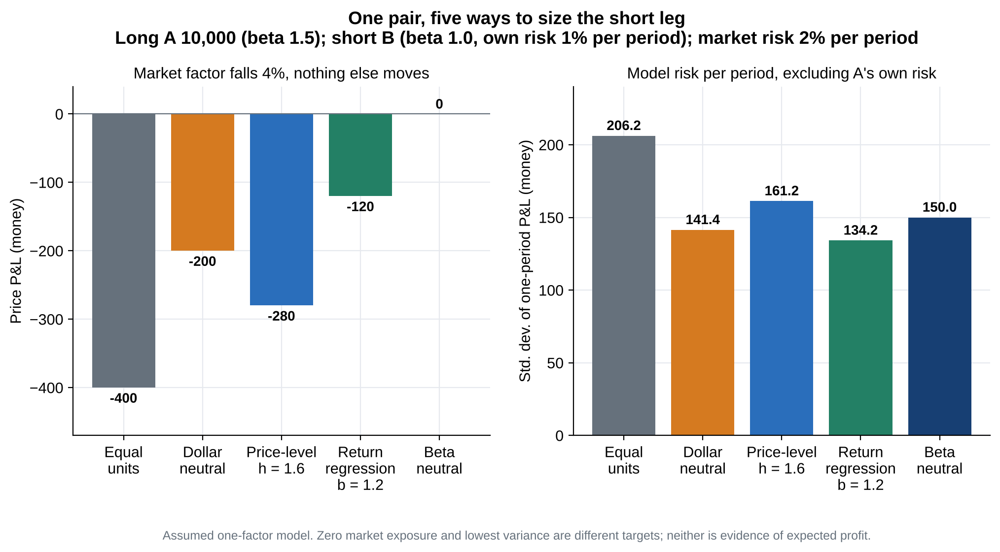

**ภาพ 4.1 คู่เดียวกันกับห้าวิธีกำหนดขา short**

อ่านภาพด้วยกัน: ด้านซ้ายแสดงผลของพจน์ตลาดเมื่อปัจจัยตลาดลง 4% และส่วนอื่นเป็นศูนย์ แท่งยิ่งสั้นแปลว่า beta exposure ยิ่งใกล้ศูนย์ ด้านขวาแสดงส่วนเบี่ยงเบนมาตรฐานของ P&L ต่อช่วงตามโมเดล วิธีที่ดีที่สุดในภาพซ้ายคือ beta neutral แต่วิธีที่ต่ำสุดในภาพขวาคือ b = 1.2 เป้าหมายสองแบบจึงให้คำตอบต่างกัน และทั้งสองภาพยังไม่บอกอะไรเกี่ยวกับกำไรคาดหมาย

<a id="hedging_04_03"></a>

### 04.03 ตรวจพอร์ตสามสินทรัพย์ทีละเงื่อนไข

กำหนดตัวอย่างสมมติสามสินทรัพย์ A B และ C เพื่อให้คำนวณตามได้ง่าย ราคาต้นช่วงเท่ากับ 100, 50 และ 200 ดอลลาร์ต่อหน่วยตามลำดับ เราเลือกมูลค่าสถานะ 5,000, 5,000 และ −10,000 ดอลลาร์ จึงถือ A จำนวน 50 หน่วย B จำนวน 100 หน่วย และ short C จำนวน 50 หน่วย ตัวเลขทั้งหมดเป็นข้อมูลสอนที่กำหนดขึ้น ไม่มีการอ้างว่าเป็นผลประมาณจากตลาด

| สินทรัพย์ | จำนวน q | มูลค่า d | Market beta | Loading ของ G |
| --- | --- | --- | --- | --- |
| A | 50 | 5,000 | 1.2 | 0.5 |
| B | 100 | 5,000 | 0.8 | −0.5 |
| C | −50 | −10,000 | 1.0 | 0.2 |

อ่านคอลัมน์ market beta ว่าในโมเดลที่ใช้ A มีความไวต่อตลาด 1.2 เท่า B มี 0.8 เท่า และ C มี 1.0 เท่า ส่วน G เป็น factor อีกตัวที่นิยามให้มีหน่วยเป็นผลตอบแทน เรากำหนด loadings ของ G ตามคอลัมน์สุดท้าย เพื่อแสดงว่าความเสี่ยงมากกว่าหนึ่งแหล่งอาจมีผลต่อพอร์ตเดียวกัน ตัวเลข loading เป็นคำอธิบายภายใต้โมเดล ไม่ใช่คำสัญญาว่าราคาจะตอบสนองตรงทุกครั้ง

$$
\sum_i d_i=5{,}000+5{,}000-10{,}000=0
$$

อ่านสมการ: net dollar exposure เป็นศูนย์ ขา long รวม 10,000 และขา short มีขนาดรวม 10,000 ส่วน gross เท่ากับ 20,000

$$
\sum_i d_i\beta_i=5{,}000(1.2)+5{,}000(0.8)-10{,}000(1.0)=0
$$

อ่านสมการ: ผลตอบสนองต่อตลาดที่โมเดลกำหนดหักล้างกัน จึงเรียกพอร์ตนี้ว่า beta neutral ต่อ market factor ชุดนี้ได้ ณ จุดคำนวณ

ตรวจ factor G ต่อ: 5,000×0.5 + 5,000×(−0.5) − 10,000×0.2 = −2,000 ดอลลาร์ พอร์ตจึง neutral สองเงื่อนไขแรก แต่ยังมี exposure ต่อ G ทางลบ หากเราไม่ได้ตรวจคอลัมน์นี้ เราอาจอธิบายผลที่เกิดจาก G ผิดว่าเป็นความผิดพลาดของสัญญาณหรือเป็นกำไรจาก alpha ทั้งหมด

การตรวจควรรายงาน exposure พร้อมวันที่ประมาณ ช่วงข้อมูล และราคาอ้างอิงเสมอ ค่า neutral ที่คำนวณตอนเปิดอาจไม่เหมือนตอนกลางวัน เพราะราคาเปลี่ยน จำนวน fill ไม่ครบ หรือค่าประมาณ beta เปลี่ยน รายงานที่บอกเพียง long เท่าไร short เท่าไรจึงยังไม่ตอบว่าความเสี่ยงที่เราต้องการลดอยู่ในกรอบหรือไม่

<a id="hedging_04_04"></a>

### 04.04 พอร์ตที่ neutral ยังขาดทุนได้อย่างไร

เพื่อแยกแหล่งกำไรขาดทุน ให้ใช้ factor model อย่างง่าย $R_i$ = $\alpha_i$ + $\beta_i$ $R_M$ + $\gamma_i$ $R_G$ + $\epsilon_i$ โดย $R_M$ คือผลตอบแทนตลาด $R_G$ คือผลตอบแทน factor G และ $\epsilon_i$ คือส่วนเฉพาะตัวที่โมเดลไม่ได้อธิบาย เมื่อนำมาคูณมูลค่าที่ถือ ผลของแต่ละส่วนก็รวมเป็นกำไรขาดทุนของพอร์ต การทำ beta exposure เป็นศูนย์จึงตัดเฉพาะพจน์ของตลาดตามสมมติฐานนี้

$$
\Pi^{\mathrm{price}}=d^\top\alpha+(d^\top\beta)R_M+(d^\top\gamma)R_G+d^\top\varepsilon
$$

อ่านสมการ: อ่านทีละส่วนเป็นส่วน intercept ของโมเดล ผลจากตลาด ผลจาก factor G และผลเฉพาะตัวของสินทรัพย์ ทุก loading และมูลค่าที่ถืออ้างอิงต้นช่วงเดียวกัน ในตัวอย่าง stress เรากำหนดส่วนที่ไม่ได้ระบุให้เป็นศูนย์เพื่อแยกกลไก ไม่ได้ถือว่าความเสี่ยงเหล่านั้นเป็นศูนย์ในตลาดจริง

| สถานการณ์สมมติที่แยกกัน | ส่วนที่เปลี่ยน | กำไรขาดทุนจากส่วนที่กำหนด |
| --- | --- | --- |
| ตลาดลง 5% | ใช้ beta เดิมและให้ส่วนอื่นเป็นศูนย์ | 0 × (−5%) = 0 |
| Factor G ขึ้น 3% | ตลาดและส่วนเฉพาะตัวเป็นศูนย์ | −2,000 × 3% = −60 |
| B มี shock เฉพาะตัว −2% | ไม่มี shock ของตลาดหรือ G | 5,000 × (−2%) = −100 |
| Beta ของ A เปลี่ยนเป็น 1.4 แล้วตลาดลง 5% | จำนวนเดิมและส่วนอื่นเป็นศูนย์ | Beta exposure ใหม่ 1,000; ผล = −50 |

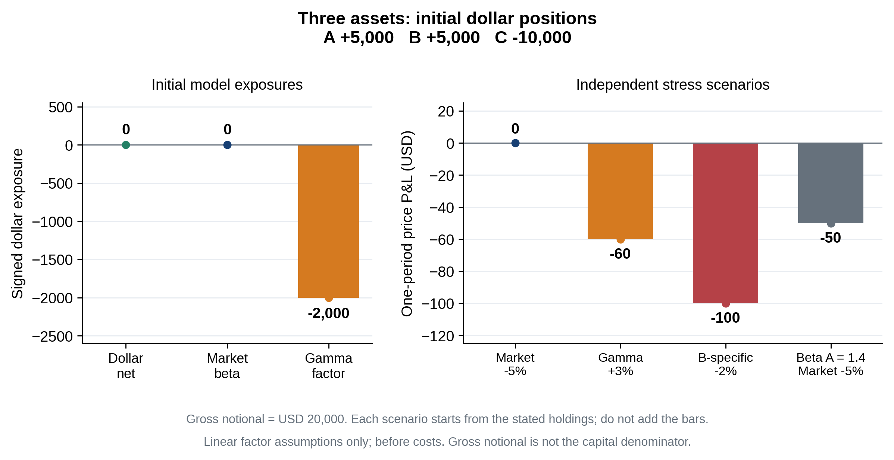

**ภาพ 4.2 การหักล้างตลาดไม่ได้หักล้างทุกแหล่งความเสี่ยง**

อ่านภาพด้วยกัน: ป้าย Gamma factor ในภาพหมายถึง factor G ของบทนี้ ไม่ใช่ gamma ของ options ในบท 5 ภาพใช้พอร์ตสามสินทรัพย์เดิมและแยกสถานการณ์อิสระสี่แบบ ผล 0, −60, −100 และ −50 มาจากสมมติฐานในตาราง ไม่ใช่เส้นทางเวลาเดียวกัน ไม่ใช่ผล backtest และยังไม่หักต้นทุน ความสูงของแท่งแสดงกำไรขาดทุนเฉพาะส่วนที่กำหนดให้เปลี่ยน

กรณี beta ของ A เปลี่ยน คำนวณใหม่ได้ 5,000×1.4 + 5,000×0.8 − 10,000×1.0 = 1,000 ดอลลาร์ แม้จำนวนทุกขาคงเดิมและ net dollar ยังเป็นศูนย์ พอร์ตก็ไม่ beta neutral ภายใต้ loading ชุดใหม่แล้ว นี่เป็นเหตุผลที่ต้องติดตามทั้งการเปลี่ยนของแบบจำลองและของ holdings การ fit ในอดีตได้ค่า exposure ใกล้ศูนย์ไม่ได้รับรองข้อมูลอนาคต

การไม่ใส่ G ในโมเดลไม่ได้ทำให้ความเสี่ยงของ G หายไป และ residual ไม่ควรถูกเรียกว่า alpha โดยอัตโนมัติ ในงาน Avellaneda–Lee มีการแยกปัจจัยร่วมและศึกษาส่วนที่เหลือต่อด้วยสมมติฐานของกลยุทธ์ [R5](#ref-r5) สำหรับงานของเรา ต้องถามเพิ่มว่าส่วนที่เหลือคาดการณ์ได้หรือไม่ และค่าคาดหมายหลังต้นทุนพอชดเชยความไม่แน่นอนที่ยังถือหรือไม่

เวลาอ่าน stress ให้ตรวจเครื่องหมายและขนาด exposure ก่อนสรุป ถ้า G ขึ้นแล้วพอร์ตที่มี exposure ลบขาดทุน นั่นอาจตรงกับแบบจำลองที่เรายอมรับอยู่ ส่วนผลตลาดเป็นศูนย์ในตารางหมายถึงพจน์ของตลาดถูกหักล้างตามค่าที่กำหนด ไม่ได้หมายความว่าราคาทุกขาจะคงที่ หรือ equity และกระแสเงินสดจะไม่มีความผันผวนในสถานการณ์จริง

<a id="hedging_04_05"></a>

### 04.05 จำนวนขาเกิดจากข้อกำหนดของพอร์ต

> **ลงลึก** ข้ามได้ในการอ่านรอบแรก สิ่งที่ควรเก็บ: ยิ่งต้องการให้พอร์ตเป็นกลางต่อหลายเรื่อง ยิ่งต้องใช้หลายขา และการเพิ่มขาไม่ได้ทำให้พอร์ตปลอดภัยขึ้นเอง

คำถามว่าใช้สอง สาม หรือห้าขาดีกว่า ควรเริ่มจากจำนวนความเสี่ยงที่ต้องการควบคุมและเครื่องมือที่มีให้เลือก ในตัวอย่างสามสินทรัพย์ เราพบชุดที่ dollar neutral และ beta neutral ได้ แต่ยังไม่ neutral ต่อ G หากเพิ่มข้อกำหนดเรื่อง G โดยตรึง loadings เดิมทั้งหมด อาจไม่เหลือชุดสถานะที่ไม่เป็นศูนย์ให้ซื้อขาย

เขียนทุกข้อกำหนดเป็นแถวของเมทริกซ์ H: แถวแรกเป็นเลขหนึ่งเพื่อรวมดอลลาร์ แถวถัดไปเป็น market betas และอีกแถวเป็น loadings ของ G แล้วให้ d เป็นคอลัมน์มูลค่าสถานะ ระบบ H d = 0 หมายถึงทุก exposure ที่เลือกหักล้างกัน rank ของ H คือจำนวนข้อกำหนดเชิงเส้นที่เป็นอิสระต่อกัน ถ้าบางแถวซ้ำหรือเป็นผลรวมของแถวอื่น จำนวนแถวที่เขียนอาจมากกว่า rank

$$
Hd=0,\qquad \dim\ker(H)=n-\operatorname{rank}(H)
$$

อ่านสมการ: n คือจำนวนสินทรัพย์และ ker(H) คือชุดคำตอบที่ให้ exposure ศูนย์ ในระบบเชิงเส้น homogeneous ที่ยังไม่มีขอบเขตอื่น จะมีคำตอบ d ที่ไม่เป็นศูนย์ก็ต่อเมื่อ n มากกว่า rank(H) ข้อนี้เป็นเรื่องความเป็นไปได้ทางพีชคณิต ไม่ใช่การรับรองว่าคำตอบนั้นมี alpha หรือซื้อขายได้จริง

สำหรับ A B C ชุดนี้ ข้อกำหนด dollar, beta และ G เป็นอิสระครบสามข้อ จึงมี rank เท่ากับ 3 เมื่อมีสามตัวแปร คำตอบที่ทำให้ทั้งสาม exposure เป็นศูนย์พร้อมกันมีเพียงไม่ถืออะไรเลย แต่ไม่ได้หมายความว่าสามสินทรัพย์จะทำสามเงื่อนไขไม่ได้ในทุกกรณี ถ้า loadings ชุดอื่นทำให้ rank ต่ำกว่า 3 ก็อาจมีคำตอบที่ไม่เป็นศูนย์ได้ ต้องตรวจค่าจริงของโจทย์

เพิ่มสินทรัพย์ D ราคา 80 ดอลลาร์ต่อหน่วย ที่กำหนด beta = 1.1 และ loading ของ G = −0.2 ตารางต่อไปนี้แสดงสัมประสิทธิ์ที่นำไปคูณมูลค่าสถานะของแต่ละขา แล้วบวกตามแถวให้ได้ศูนย์ ระบบใหม่มีสี่ตัวแปรและ rank เท่ากับ 3 จึงมีอิสระหนึ่งมิติ

| ข้อกำหนด | A | B | C | D |
| --- | --- | --- | --- | --- |
| Dollar neutral | 1 | 1 | 1 | 1 |
| Market beta | 1.2 | 0.8 | 1.0 | 1.1 |
| Factor G | 0.5 | −0.5 | 0.2 | −0.2 |

ตัวอย่างอัตราส่วนมูลค่าที่ผ่านทั้งสามเงื่อนไขคือ (15, 11, −18, −8) ตรวจ net ได้ 15+11−18−8=0 ตรวจ beta ได้ 18+8.8−18−8.8=0 และตรวจ G ได้ 7.5−5.5−3.6+1.6=0 การตรวจตามแถวช่วยให้เห็นว่าแต่ละขาหักล้างความเสี่ยงร่วมกันอย่างไร

$$
d=\frac{20{,}000}{52}(15,11,-18,-8)^\top
$$

อ่านสมการ: ผลรวมค่าสัมบูรณ์ของอัตราส่วนเท่ากับ 52 จึงคูณด้วย 20,000 หาร 52 เพื่อให้ gross เท่ากับพอร์ตเดิม 20,000 ดอลลาร์ การคูณทุกขาด้วยสเกลเดียวกันรักษา exposure ที่เป็นศูนย์ไว้

| สินทรัพย์ | มูลค่าที่แน่นอน | ค่าประมาณเพื่ออ่าน |
| --- | --- | --- |
| A | 75,000 / 13 | 5,769.23 |
| B | 55,000 / 13 | 4,230.77 |
| C | −90,000 / 13 | −6,923.08 |
| D | −40,000 / 13 | −3,076.92 |

ให้ใช้เศษส่วนหรือความละเอียดเต็มในการตรวจ identities ตัวเลขสองตำแหน่งในตารางมีไว้ช่วยอ่าน เมื่อส่งคำสั่งจริงต้องแปลงด้วยราคาและปัดตาม lot size หลังปัดแล้วต้องคำนวณ exposures อีกครั้ง เราอาจยอมให้คลาดเคลื่อนในกรอบที่กำหนด หรือจำเป็นต้องเพิ่มทุน เปลี่ยนเครื่องมือ หรือยกเลิกคำสั่ง ถ้าขา D ยืมไม่ได้หรือมีขนาดขั้นต่ำสูง คำตอบทางพีชคณิตนี้ก็อาจใช้ไม่ได้

ลองปัดจริงด้วยราคา 100, 50, 200 และ 80 ดอลลาร์ต่อหน่วย จำนวนที่แน่นอนคือ 57.69, 84.62, −34.62 และ −38.46 หน่วย ตารางต่อไปนี้ปัดแต่ละขาเข้าหาจำนวนที่ใกล้ที่สุดตามขนาด lot สองแบบ แล้วคำนวณ exposure ใหม่จากจำนวนที่ซื้อขายได้

| ขนาด lot | จำนวน A, B, C, D | Net | Beta exposure | G exposure | Gross |
| --- | --- | --- | --- | --- | --- |
| ไม่ปัด | 57.69, 84.62, −34.62, −38.46 | 0 | 0 | 0 | 20,000 |
| 1 หน่วย | 58, 85, −35, −38 | +10 | +16 | −17 | 20,090 |
| 10 หน่วย | 60, 80, −30, −40 | +800 | +880 | +440 | 19,200 |

เมื่อ lot เท่ากับ 1 หน่วย ความคลาดเคลื่อนอยู่ในหลักสิบดอลลาร์ ตลาดลง 5% กระทบพจน์ตลาดเพียง −0.80 แต่เมื่อ lot เท่ากับ 10 หน่วย beta exposure เป็น 880 ตลาดลง 5% จึงให้ −44 และ exposure ต่อ G เป็น +440 พอร์ตที่ออกแบบให้ผ่านสามเงื่อนไขจึงไม่ผ่านสักเงื่อนไขหลังปัด การปัดแต่ละขาแยกกันเป็นเพียงวิธีที่ง่ายที่สุด เราอาจค้นหาชุดจำนวนเต็มที่ให้ exposure รวมเล็กกว่า เพิ่มขนาดพอร์ตให้ lot เล็กลงเมื่อเทียบกับสถานะ หรือยอมรับกรอบคลาดเคลื่อนที่เขียนไว้ล่วงหน้า

การเพิ่มขาทำให้มีทางเลือกมากขึ้นได้ แต่ยังเพิ่มค่าธรรมเนียม กฎ fill และงานจัดการทุน พอร์ตสี่ขานี้ลด exposure ต่อ G ในโมเดลที่กำหนด แต่ยังมีความเสี่ยงเฉพาะตัวของทั้งสี่สินทรัพย์ เปรียบเทียบประโยชน์กับต้นทุนภายใต้ gross หรือฐานทุนที่สอดคล้องกัน แทนการสรุปว่ายิ่งมีขามากยิ่งปลอดภัย

<a id="hedging_04_06"></a>

### 04.06 ให้ optimization ช่วยจัดพอร์ตตามคำถาม

> **ลงลึก** ข้ามได้ในการอ่านรอบแรก สิ่งที่ควรเก็บ: optimizer ช่วยเลือกระหว่างพอร์ตที่ผ่านข้อจำกัด ไม่ได้สร้างเหตุผลของกำไร และคำตอบว่าไม่ถืออะไรเป็นคำตอบที่ถูกได้

เมื่อมีหลายคำตอบที่ผ่านข้อจำกัด เราต้องมีเกณฑ์เลือกระหว่างคำตอบเหล่านั้น เช่น ลดความแปรปรวน รักษาผลตอบแทนที่คาดไว้ ลดการซื้อขายจากพอร์ตเดิม หรือจำกัดความเสี่ยงของแต่ละขา Optimization เป็นวิธีทำให้ข้อกำหนดและความแลกเปลี่ยนเหล่านี้ชัดเจน ไม่ได้สร้างเหตุผลของ alpha ให้เราเอง

กำหนด K เป็นฐานทุนที่เลือกอย่างชัดเจนและให้ $w_i$ = $d_i$/K สำหรับส่วนของพอร์ตที่ซื้อขายสินทรัพย์เสี่ยงในบทนี้ ข้อกำหนด dollar neutral คือผลรวม $w_i$ เป็นศูนย์ ต่างจากตัวอย่างพอร์ตลงทุนเต็มจำนวนที่ตั้งผลรวม weights เป็นหนึ่ง หากใช้โค้ดสาธารณะ ต้องตรวจว่า cash อยู่ในเวกเตอร์หรือแยกออก รวมทั้งนิยามทุนและ leverage ก่อนเปลี่ยน constraint

$$
\max_w\left\{\widehat\mu^\top w-\lambda w^\top\widehat\Sigma w-\widehat C(w,w_{\mathrm{old}})\right\}
$$

อ่านสมการ: mu หมวกคือผลตอบแทนที่คาดสำหรับ horizon ที่เลือก Sigma หมวกคือ covariance ที่ประมาณจากข้อมูล และ lambda คือน้ำหนักที่ให้กับความเสี่ยง C หมวกแทนต้นทุนที่ประมาณ เช่น การเปลี่ยนจากพอร์ตเดิมและต้นทุนการถือ โดยแปลงทุกส่วนให้สอดคล้องกับฐานทุนและช่วงเวลาเดียวกัน

ข้อจำกัดอาจกำหนดให้ net เป็นศูนย์ ให้ exposures ที่เลือกอยู่ในกรอบ จำกัด gross และขนาดต่อขา รวมถึง turnover จากของเดิม ตัวอย่างใน CVX Short Course แสดงโครงสร้าง mean–variance ข้อจำกัด leverage ต้นทุนซื้อขาย และ factor covariance พร้อมโค้ด [R28](#ref-r28) เรานำมาใช้เรียนวิธีเขียนปัญหา ไม่ถือว่าพารามิเตอร์สมมติหรือ solution จากตัวอย่างนั้นเป็นข้อเสนอซื้อขายของตลาดที่เราสนใจ

ถ้าต้องการ risk model แบบ factors เราแยก covariance เป็นส่วนปัจจัยร่วมกับส่วนเฉพาะตัวได้ เมื่อ factor exposure ของพอร์ตเป็นศูนย์ ส่วนความเสี่ยงเฉพาะตัวในโมเดลยังอาจเหลือ การคำนวณ minimum variance จึงไม่เท่ากับการบังคับทุก factor ให้เป็นศูนย์ และทั้งสองอย่างก็ไม่เท่ากับการคาดว่ากำไรจะเป็นบวก ต้องเลือกเป้าหมายให้ตรงกับคำถาม

ถ้าไม่มีข้อกำหนดว่าต้องถืออะไรและเราลดความเสี่ยงหรือต้นทุนอย่างเดียว คำตอบไม่ถือสถานะอาจเหมาะสมที่สุด อย่าเพิ่มข้อกำหนดลงทุนเต็มจำนวนเพียงเพื่อให้ optimizer คืนพอร์ตที่ดูน่าสนใจ หากต้องรักษา exposure ของกลยุทธ์หลัก ให้เขียนข้อกำหนดนั้นพร้อมเหตุผล และตรวจว่าค่า alpha ที่คาดยังเหลือหลังหัก hedge costs เท่าไร

ค่าประมาณ mu, covariance และ loadings มีความไม่แน่นอน เราจึงควรเปรียบเทียบกับพอร์ตง่าย ทดสอบเมื่อเปลี่ยนช่วงข้อมูลและต้นทุน และตรวจ exposures ในข้อมูลใหม่ การใช้กรอบยอมคลาดเคลื่อนหรือจำกัด turnover อาจเหมาะกว่าการซื้อขายทุกครั้งที่ค่าประมาณขยับเล็กน้อย กฎที่เลือกต้องประเมินกับบัญชีจริง รวมถึงกรณีที่ลดความเสี่ยงตามโมเดลแต่เสียต้นทุนมากกว่าประโยชน์

<a id="hedging_04_07"></a>

### 04.07 เมื่อ hedge เปลี่ยนต้องมีธุรกรรมและบัญชี

แยก fixed quantity, fixed dollar และ fixed portfolio weight ออกจากกัน ถ้าตรึงจำนวน $q_i$ ไว้ เมื่อราคาเปลี่ยนมูลค่า $d_i$ จะเปลี่ยนด้วย ถ้าต้องการตรึง $d_i$ หรือ weights ตามสัดส่วนทุน ต้องซื้อขายเพื่อปรับจำนวน การเขียนสูตรที่ดูเหมือนคง weights ในทุกแท่ง โดยไม่ลงคำสั่งและต้นทุน จะให้พอร์ตสมมติที่ไม่ตรงกับสิ่งที่ถือได้จริง

การอัปเดต beta ในไฟล์ไม่ได้ย้ายความเสี่ยงของสถานะเดิมเอง โมเดลใหม่อาจเปลี่ยนการประเมิน exposures หรือเสนอจำนวนเป้าหมาย แต่ holdings จะเปลี่ยนก็ต่อเมื่อมี fill เราจึงต้องเก็บอย่างน้อยสามชุดค่า: จำนวนที่ถือจริง จำนวนที่ต้องการ และจำนวนที่กำลังรอคำสั่ง ระหว่างรอ fill ความเสี่ยงของพอร์ตชั่วคราวอาจสูงกว่าทั้งพอร์ตเดิมและพอร์ตเป้าหมาย เพราะแต่ละขาเปลี่ยนไม่พร้อมกัน

หลัก self-financing หมายถึงไม่มีเงินฝากหรือถอนจากเจ้าของพอร์ตระหว่างช่วงที่กำหนด โดยรวมบัญชีเงินกู้และภาระที่เกี่ยวข้องไว้ในพอร์ตด้วย การปรับสถานะต้องใช้เงินสดหรือการขายของที่อยู่ในพอร์ต รวมถึงการกู้ที่บันทึกหนี้และดอกเบี้ยครบถ้วน ถ้าเพิ่มขา long ต้องระบุแหล่งเงิน ถ้าลดขา short ต้องจ่ายเงินซื้อคืน เมื่อซื้อขายที่ราคา mark เดียวกันก่อนต้นทุน การย้ายองค์ประกอบเหล่านี้ไม่สร้างกำไรขึ้นเอง ใช้บัญชีตามบท 3 ตรวจ equity ก่อนและหลัง rebalance และแยกเงินเติมจากเจ้าของออกจากผลการซื้อขายเสมอ

สำหรับ futures ไม่จ่าย notional เต็มเหมือนการซื้อ spot แต่ต้องติดตามหลักประกันและการชำระกำไรขาดทุนตามกติกาสัญญา การใช้มูลค่าอ้างอิง d เพื่อคำนวณ exposure ไม่ได้เปลี่ยนสัญญาให้มี cash ledger เหมือนหุ้น ต้องแยก notional, marked gain, cash settlement และ collateral เพื่อไม่บวกกำไรซ้ำหรือถือว่าเงินที่ติดเป็นหลักประกันใช้ได้ทั้งหมด

กำหนดลำดับเวลาให้ตรวจย้อนหลังได้: ใช้ข้อมูลที่เข้าถึงแล้วประมาณโมเดล ประเมิน exposures ของ holdings ปัจจุบัน เปรียบเทียบทางเลือกภายใต้งบต้นทุน ส่งคำสั่ง บันทึก fill แล้วคำนวณความเสี่ยงใหม่ ถ้าข้อมูลใช้ราคาปิด ต้องเผื่อเวลาที่รู้ราคาปิดและเวลาส่งคำสั่งจริง การคำนวณบนทั้งวันแล้วอ้างว่าได้ราคาตอนต้นวันย่อมทำให้การ hedge ในการทดลองดีเกินสิ่งที่ทำได้

ในระบบ maker-only ของเรา ต้องมีกฎเมื่อบางขาไม่ fill หรือ fill เพียงบางส่วน เช่น ลดขนาดเป้าหมาย หยุดเพิ่มขาอื่น หรือรอภายใต้งบ exposure ที่กำหนด การเลือกกฎนี้ต้องทดสอบกับข้อมูล execution ที่รองรับ หากข้อมูลมีเพียงแท่งราคา การสรุปว่าราคาแตะแล้ว fill พร้อมกันครบทุกขาเป็นสมมติฐานที่ยังต้องตรวจ ไม่ควรซ่อนอยู่ในฟังก์ชันส่งคำสั่ง

เมื่อแบบจำลองหรือความสัมพันธ์เสื่อม การพักคำสั่งใหม่กับการจัดการสถานะเก่าต้องมีแผนแยกกัน ซึ่งบท 10 จะลงรายละเอียด การย้ายไปใช้ model ใหม่ไม่ได้ทำให้ต้นทุนและ inventory เดิมหายไป เราควรบันทึกว่าปรับเพราะความเสี่ยงเปลี่ยน เพราะ alpha เปลี่ยน หรือเพราะข้อจำกัดการถือเปลี่ยน เพื่ออ่านผลและปรับระบบได้ตรงจุด

<a id="hedging_04_08"></a>

### 04.08 วางทุนสำหรับความเสี่ยงที่สูตรราคาไม่อธิบาย

พอร์ตที่มี net dollar เป็นศูนย์ไม่ได้เป็นพอร์ตที่ใช้เงินศูนย์ เงินจาก short อาจถูกกันเป็น collateral ขา long อาจต้องใช้เงินทุนหรือเงินกู้ และแต่ละ venue อาจใช้หลักประกันคนละบัญชี การประเมินทุนต้องดูสิทธิใช้เงินและกฎ margin จริงตามผลิตภัณฑ์ ไม่ใช้ยอดรับจากการขาย short เป็นเงินอิสระทั้งหมดโดยอัตโนมัติ Palomar แยก capital budget ออกจาก leverage และ margin constraints ไว้ด้วยเหตุผลนี้ [R29](#ref-r29)

| ความเสี่ยงหรือข้อจำกัด | คำถามที่ต้องตอบก่อนเปิด |
| --- | --- |
| เงินทุนและ margin | แต่ละบัญชีต้องวางเท่าไร เงินสำรองอยู่ที่ใด และเมื่อราคาวิ่งสวนขาหนึ่งต้องเติมเงินได้เมื่อใด |
| Borrow และต้นทุนถือ | ยืมสินทรัพย์ได้จริงหรือไม่ อัตราค่าใช้จ่ายเปลี่ยนได้แค่ไหน และทำอย่างไรเมื่อถูกเรียกคืน |
| สภาพคล่องและจำนวนขา | ขนาดที่ต้องปิดมี depth รองรับหรือไม่ และจะทำอย่างไรหาก fill ได้ไม่ครบ |
| Venue และการโอนเงิน | บัญชีหรือระบบใดทำให้เงินติดอยู่ได้ และการโอนระหว่างที่ต่างกันมีเวลาและข้อจำกัดอย่างไร |
| สัญญาและราคาอ้างอิง | multiplier วันชำระราคา index collateral และสกุลเงินของแต่ละขาตรงกับสิ่งที่ model ไว้หรือไม่ |

การเปิดต่าง exchange อาจช่วยเข้าถึงราคาหรือเครื่องมือที่ต้องการ แต่ไม่ได้ทำให้การหักล้างกำไรขาดทุนเกิดเป็นเงินสดในบัญชีเดียวกัน สมมติขา long มีกำไรที่แห่งหนึ่งและขา short ต้องจ่าย margin ที่อีกแห่งหนึ่ง กำไรรวมทางบัญชีอาจดูพอ แต่เงินอาจย้ายไม่ทันความต้องการของขาที่ขาดทุน จึงต้อง stress ความต้องการเงินสดแยกตามบัญชี ควบคู่กับ stress equity ของพอร์ต

ความเสี่ยงของ venue, counterparty และการถือหลักประกันไม่ได้ถูกลบด้วย beta ของราคา หากหลายขาพึ่งระบบชำระหรือ collateral เดียวกัน การเพิ่มจำนวนตลาดที่แสดงบนหน้าจออาจไม่ได้เพิ่มแหล่งความเสี่ยงที่เป็นอิสระเท่าที่คิด ใน Asset Selection จึงต้องบันทึกทั้งความสัมพันธ์ของราคาและความเชื่อมโยงของการปฏิบัติงาน

การคำนวณ carry ต้องผูกกับทิศทางและผลิตภัณฑ์ที่ถือจริง หุ้น short อาจมีค่า borrow สัญญา perpetual มีกระแส funding ตามกติกา ขณะที่ dated futures มีราคาและวันชำระของมันเอง หากใช้เงินตัวเอง ต้นทุนโอกาสเป็นการเปรียบเทียบทางเศรษฐศาสตร์ แยกจากเงินดอกเบี้ยที่จ่ายจริง และไม่ควรหักต้นทุนก้อนเดียวกันซ้ำสองครั้ง

จำนวนขาก็ไม่ได้บอกว่าเป็น triangular arbitrage การทำ triangular คือการตรวจวงจรการแปลงสินทรัพย์หรือสกุลเงิน โดยเงินหลังผ่านการซื้อขายทุกขากลับมาวัดในหน่วยเริ่มต้น จึงต้องใช้ราคาตามด้านซื้อขาย จำนวน และค่าธรรมเนียมของวงจรนั้น การเปิด long–short สามขาที่ beta neutral ไม่ได้ทำให้เกิดวงจรแปลง และการใช้ Markowitz ไม่ได้สร้างส่วนต่างราคาของวงจรขึ้นมา

ขั้นทดลองที่เหมาะสมคือเริ่มจากสินทรัพย์และโครงบัญชีที่เข้าใจได้ ตรวจพอร์ตง่ายก่อน แล้วเพิ่มข้อกำหนดหรือเครื่องมือเมื่อเห็นความเสี่ยงที่ต้องแก้จริง ทุกครั้งที่เพิ่มขา ให้เขียนว่ามันลด exposure ใด เพิ่มค่าใช้จ่ายและข้อจำกัดอะไร และหลักฐานแบบไหนจะทำให้เราคัดทางเลือกนั้นออก หากขาที่ต้องใช้ทำไม่ได้ คำตอบที่ถูกต้องอาจเป็นลดขนาด เปลี่ยนพอร์ต หรือพักกลยุทธ์

<a id="hedging_04_09"></a>

### 04.09 แบบฝึกหัดตรวจระดับการ hedge

ข้อ 1 — อ่านคำว่า neutral ให้ครบ: long A มูลค่า 10,000 และ short B มูลค่า 10,000 โดย beta เท่ากับ 1.5 และ 1.0 ตามลำดับ จงหา net, gross และ beta exposure ถ้า market return เท่ากับ −4% และให้ส่วนอื่นเป็นศูนย์ พจน์ของตลาดทำให้กำไรขาดทุนเท่าไร หากตรึง long A ไว้ต้องเปลี่ยนขา B เป็นเท่าไรเพื่อ beta neutral แล้ว net เปลี่ยนอย่างไร

ข้อ 2 — ตรวจสิ่งที่เพิ่มขาสี่ช่วยได้: ใช้อัตราส่วน (15, 11, −18, −8) กับ beta และ loading ของ G ที่กำหนดในบท จงตรวจ net, beta และ G พร้อมหาสเกลที่ให้ gross 20,000 หลังจากนั้นสมมติ B มีผลตอบแทนเฉพาะตัว −2% โดยทุกส่วนอื่นเป็นศูนย์ พอร์ตยังขาดทุนหรือไม่ จงอธิบายว่าคำตอบนี้ขัดกับการ factor neutral หรือไม่

ข้อ 3 — แกะข้อสรุปจากรายงาน: โปรแกรมใช้สามสินทรัพย์และบอกว่า hedge dollar, market beta และ G ได้ครบ ทั้งที่เมทริกซ์ของสามข้อกำหนดมี rank เท่ากับ 3 และทุกข้อถูกตั้งให้เท่ากับศูนย์แน่นอน ต่อมารายงานแสดงสถานะ nonzero และ Sharpe สูง คุณจะตรวจอะไรเป็นลำดับแรก และถ้าเพิ่มสินทรัพย์ตัวที่สี่จนได้คำตอบที่ผ่านสมการ ต้องตรวจอะไรอีกก่อนเรียกว่าใช้งานได้

ข้อ 4 — ขนาด hedge ขึ้นกับเป้าหมาย: ใช้โมเดลของตารางห้าวิธีในหัวข้อ 04.02 ถ้า B ไม่มีความผันผวนเฉพาะตัว ค่า b เป็นเท่าไร และตรงกับวิธีใดในตาราง? ถ้าความผันผวนเฉพาะตัวของ B เพิ่มเป็น 2% ต่อช่วง ค่า b และมูลค่าขา B เป็นเท่าไร จงเทียบส่วนเบี่ยงเบนมาตรฐานของ P&L กับ dollar neutral และ beta neutral แล้วอธิบายว่าควรเลือกวิธีใดเมื่อเป้าหมายคือ market exposure เป็นศูนย์

ก่อนเปิดเฉลย ให้เขียนคำตอบเป็นเหตุผลและบัญชีสั้น ๆ ระบุหน่วยของ exposure ให้ครบ ไม่ตอบเพียงว่ามี long และ short แล้วถือว่า hedge ได้ ในข้อสุดท้ายไม่ต้องตัดสินว่าโค้ดผิดทันที แต่ควรระบุสมมติฐานที่ต้องตรงกัน และตรวจว่ารายงานใช้ข้อกำหนดเดียวกับคำอธิบายหรือไม่

<a id="hedging_04_10"></a>

### 04.10 เฉลยและหน้าทบทวน

เฉลยข้อ 1: net = 0 และ gross = 20,000 แต่ beta exposure = 10,000×1.5 − 10,000×1.0 = 5,000 ดอลลาร์ เมื่อ market return = −4% พจน์ตลาดให้ −200 ดอลลาร์ หากตรึง long A ที่ 10,000 ต้อง short B ที่ 15,000 เพื่อให้ beta exposure เป็นศูนย์ แต่ net จะเป็น −5,000 และ gross เพิ่มเป็น 25,000 จึงต้องประเมินทุนและต้นทุนใหม่ การทำให้เงื่อนไขหนึ่งผ่านอาจเปลี่ยนอีกเงื่อนไขหนึ่ง

เฉลยข้อ 2: net ของอัตราส่วนเป็นศูนย์ beta รวม 18+8.8−18−8.8=0 และ G รวม 7.5−5.5−3.6+1.6=0 สเกลคือ 20,000/52 = 5,000/13 มูลค่า long B จึงเท่ากับ 55,000/13 ดอลลาร์ ถ้าเฉพาะ B มี shock −2% จะขาดทุน 1,100/13 หรือประมาณ 84.62 ดอลลาร์ก่อนต้นทุน ข้อนี้ไม่ขัดกับ factor neutrality เพราะเหตุการณ์ถูกกำหนดให้อยู่ในส่วนเฉพาะตัวที่ยังถืออยู่

เฉลยข้อ 3: เริ่มตรวจจำนวนตัวแปร rank และสมการที่ส่งให้ solver ว่าตรงกับที่รายงานหรือไม่ สำหรับระบบสามตัวแปรที่ rank เท่ากับ 3 และ H d = 0 แน่นอน จะมีเพียง d = 0 จึงควรตรวจว่ารายงานใช้ exposure tolerance แทนศูนย์หรือไม่ มี cash หรือเครื่องมืออื่นเป็นตัวแปรเพิ่มหรือไม่ weights ถูกเปลี่ยนหรือปัดแยกขาภายหลังหรือไม่ และตรวจ residual ของข้อจำกัดด้วยค่าความละเอียดเต็ม การตรวจนี้ช่วยแยกข้อผิดพลาดการสื่อสาร การตั้งโจทย์ และการคำนวณ

หลังเพิ่มสินทรัพย์ตัวที่สี่ ต้องตรวจว่ามีสิทธิ short, lot size และ liquidity ที่ทำให้จำนวนตามคำตอบซื้อขายได้หรือไม่ ต่อด้วยเงินทุนในแต่ละบัญชี ต้นทุนและการ fill ความไวต่อ loading ที่ประมาณคลาดเคลื่อน และผลในข้อมูลอนาคต การมีคำตอบ nonzero ที่ผ่านสมการเป็นเพียงการผ่านข้อกำหนดด้าน exposure ไม่ได้ตรวจ alpha หรือความคุ้มค่าหลังต้นทุนให้เรา

เฉลยข้อ 4: เมื่อ B ไม่มีความผันผวนเฉพาะตัว b = 1.5 × 4 ÷ 4 = 1.5 ตรงกับ beta neutral และพจน์ตลาดกับความเสี่ยงของ B หักล้างกันหมดตามโมเดล เมื่อความผันผวนเฉพาะตัวเป็น 2% จะได้ b = 6 ÷ (4 + 4) = 0.75 มูลค่าขา B เท่ากับ 7,500 หรือ 150 หน่วย ส่วนเบี่ยงเบนมาตรฐานของ P&L เท่ากับ 212.1 เทียบกับ 223.6 ของ dollar neutral และ 300.0 ของ beta neutral ถ้าเป้าหมายคือ market exposure เป็นศูนย์ ยังต้องใช้ beta neutral และยอมรับความผันผวนที่สูงกว่า หรือหาเครื่องมือ hedge ที่มีความเสี่ยงเฉพาะตัวต่ำกว่า ค่า b ตอบเป้าหมายความผันผวนต่ำสุดของสองขานี้เท่านั้น

หน้าทบทวน: เมื่อเห็นพอร์ต long–short ให้ถามว่าถืออะไรในหน่วยใด คำนวณ net และ gross จากราคาไหน ต้องการลด factor ใด และใช้ loading ที่ประมาณจากข้อมูลถึงเมื่อใด จากนั้นตรวจว่ากำไรคาดหมายมาจากกลไกอะไร พอร์ตเสี่ยงต่อ residual และการเปลี่ยนโมเดลเพียงใด และการปรับจำนวนทำให้เกิด cash flow กับต้นทุนอะไร

จำนวนขาที่เหมาะสมต้องตอบทั้งความเป็นไปได้ของข้อกำหนดและความสามารถปฏิบัติจริง เราเพิ่มขาเมื่อมันมีหน้าที่ที่ระบุได้ ใช้ optimization เพื่อเปรียบเทียบทางเลือก และยอมให้ผลเป็นไม่เปิดสถานะได้ บท 5 จะถอยออกมาดูแผนที่ของวิธีสร้างกลยุทธ์ทั้งหมด ก่อนที่บท 8–10 จะลงมือเขียนกฎเข้าออก ตรวจหลักฐาน mean reversion และตัดสินใจเมื่อสิ่งที่หวังไม่เกิด

<a id="strategy_map"></a>

## บท 5 แผนที่วิธีสร้างกลยุทธ์

แยก payoff, forecast, hedge, construction และ execution ก่อนเลือกเครื่องมือ

> **ก่อนอ่าน:** บท 1–4 โดยเฉพาะบัญชีตาม fill ของบท 3 และตาราง exposure ของบท 4
>
> **เมื่อจบบท คุณควรทำได้:** แยกห้าคำถามของกลยุทธ์ใดก็ได้ จัดกลยุทธ์ที่พบเข้าแผนที่ และบอกว่าต้องตรวจหลักฐานชนิดใดก่อนเชื่อ
>
> **ตัวอย่างหลักของบท:** call 6 ลบ put 4 บวกเงินสด 100 ให้ payoff เท่ากับ spot ราคา 102

<a id="strategy_map_05_01"></a>

### 05.01 แยกคำถาม ก่อนเลือกเครื่องมือ

บท 1–4 ใช้ตัวอย่างไม่กี่แบบ คือ spot คู่ futures และตะกร้า long–short ของสินทรัพย์สมมติ แต่กลยุทธ์ที่คุณจะเจอใน paper ในโค้ดสาธารณะ หรือในกลุ่มนักเทรด มีอีกหลายแบบที่ดูต่างกันมาก บทนี้ถอยออกมาดูภาพรวมครับ เป้าหมายไม่ใช่ให้เชี่ยวชาญทุกแบบ แต่ให้มองออกว่าแต่ละแบบเปลี่ยนส่วนไหนของระบบ เมื่อเจอกลยุทธ์ใหม่จะได้รู้ว่าต้องตรวจอะไร หัวข้อ 05.05 และ 05.08 ลงลึกกว่าส่วนอื่น ข้ามได้ในรอบแรก

คำว่า “ทำอย่างอื่นนอกจาก long–short” อาจหมายถึงเปลี่ยนเครื่องมือ เปลี่ยนสิ่งที่คาดการณ์ หรือเปลี่ยนความเสี่ยงที่รับ เราควรระบุว่าต้องการเปลี่ยนส่วนใดก่อน เช่น ใช้ options แทนหุ้นอาจยังมี exposure ทางเดียวกับหุ้น ขณะที่ถือ options พร้อมปรับ delta hedge ทำให้ต้องศึกษากำไรขาดทุนจากความผันผวนและการปรับสถานะเพิ่ม การมีสูตรใหม่จึงยังไม่บอกว่าได้กลยุทธ์ชนิดใหม่

| คำถาม | สิ่งที่ต้องเขียนให้ชัด |
| --- | --- |
| Payoff | แต่ละสถานการณ์ทำให้สินทรัพย์หรือสัญญาจ่ายอะไร เมื่อใด |
| Forecast | เราคาดผลอนาคตอะไร จากข้อมูลที่รู้ได้ตอนตัดสินใจ |
| Hedge | ต้องการลดความไวต่อปัจจัยใด และยังรับความเสี่ยงใด |
| Construction | ใช้เครื่องมือและจำนวนเท่าไรเพื่อสร้างสถานะที่ต้องการ |
| Execution | คำสั่งใดทำให้ได้สถานะจริง พร้อมต้นทุนและกรณี fill ไม่ครบ |

Forecast เป็นข้อมูลประกอบการตัดสินใจ ไม่ใช่ขา hedge การคาดว่าหุ้นจะขึ้นอย่างแม่นยำไม่ได้ทำให้พอร์ตหุ้นนั้นมี market exposure เป็นศูนย์ เพื่อเห็นข้อจำกัดนี้ ให้พิจารณาสินทรัพย์เชิงเส้นในโมเดลตลาดเดียวกัน โดย $d_i$ เป็นมูลค่า long และ $\beta_i$ เป็นบวกทุกตัว หากถือสินทรัพย์เสี่ยงอย่างน้อยหนึ่งตัว ผลรวมความไวต่อตลาดต้องเป็นบวก

$$
\sum_i d_i\beta_i>0\quad\text{if }d_i\geq0,\ \beta_i>0,\ \sum_i d_i>0
$$

อ่านสมการ: ทุกพจน์เป็นศูนย์หรือบวก และมีอย่างน้อยหนึ่งพจน์เป็นบวก จึงรวมเป็นศูนย์ไม่ได้ ภายใต้สมมติฐานนี้ long-only ที่มีสถานะเสี่ยงไม่สามารถ beta neutral ได้ เงินสดที่กำหนด beta เป็นศูนย์ช่วยลด exposure เมื่อใช้แทนหุ้น แต่ไม่หักล้าง exposure ที่ยังเหลือ

ข้อสรุปนี้ไม่ได้ครอบคลุมกรณีที่มีสินทรัพย์ beta ติดลบ หรืออนุพันธ์ที่สร้าง exposure อีกทิศ และ beta ที่ประมาณก็อาจเปลี่ยน การอยู่เงินสดทั้งหมดให้ exposure ศูนย์ได้โดยไม่ถือความเสี่ยงนั้น ส่วนการใช้ short futures หรือ synthetic short ต้องนับ exposure ที่เกิดขึ้นจริง แม้ชื่อเครื่องมือจะต่างจากการยืมหุ้นมาขาย หลักนี้ช่วยแยกความสามารถพยากรณ์ออกจากข้อกำหนดของพอร์ตตามบท 4

<a id="strategy_map_05_02"></a>

### 05.02 แผนที่ของวิธีสร้างสถานะและโอกาส

ตารางนี้แบ่งวิธีตามเหตุผลที่ใช้สร้างสถานะ ไม่ได้แบ่งตามจำนวนขาหรือชื่อโมเดล บางวิธีใช้ร่วมกันได้ เช่น predictor เลือกว่าจะถือ volatility หรือไม่ แล้วใช้ delta hedge ลดความไวต่อทิศทางราคา เราต้องตรวจทั้งผลของสัญญา เหตุผลที่คาดกำไร และต้นทุนของกฎที่เลือก

| แนวทาง | สิ่งที่เราพยายามสร้างหรือรับ | ขอบเขตที่ยังต้องตรวจ |
| --- | --- | --- |
| Exact replication | ใช้หลายสัญญารวม cash ให้ payoff ตรงกับอีกชุดตามเงื่อนไข | ความเหมือนของ payoff ไม่ได้สร้างกำไรจากส่วนต่างราคาทันที |
| Statistical basket | ใช้ข้อมูลเลือกตะกร้าหรือ residual ที่มีคุณสมบัติตามโจทย์ | ความสัมพันธ์ที่ประมาณไม่ใช่ข้อผูกพันตามสัญญา |
| Prediction | คาดผลอนาคตแล้วเลือก long, short, cash หรืออนุพันธ์ | Forecast ไม่รับรอง hedge หรือกำไรสุทธิ |
| Volatility relative value | ใช้ options รับความเสี่ยงความผันผวน พร้อมจัดการ delta | ยังมี gamma, vega, jumps และต้นทุนการ hedge |
| Futures curve | ซื้อขายความต่างระหว่างอายุสัญญาหรือรูปร่างของเส้นราคา | ต้องตรวจหน่วย อายุสัญญา และเหตุผลที่ส่วนต่างควรเปลี่ยน |
| Market making | เสนอราคาโดยคำนึงถึงโอกาส fill และ inventory | สองคำสั่งไม่ได้แปลว่าสองด้านจะ fill หรือพอร์ตเป็นกลาง |
| การถือหรือแปลงตามสัญญา | เชื่อมราคากับการส่งมอบ เช่น cash-and-carry ในบท 2 | ตรวจสิ่งอ้างอิง วันชำระ ทุน ค่าถือ และทุกขาที่ต้องทำจริง |

การซื้อขายจาก forecast เพียงขาเดียวเป็นแนวทางศึกษาที่มีเหตุผลได้ แต่ไม่ควรเรียกทุกกรณีว่า arbitrage ส่วนการเพิ่มขาเพื่อลดปัจจัยร่วม หรือเปลี่ยน short หุ้นเป็นอีกสัญญาหนึ่ง ยังต้องมีการรับ exposure ทางลบที่ชัดเจน เราจะใช้ตารางนี้เลือกกรณีศึกษา แล้วถามต่อว่ากฎเปิด ปิด และหยุดถือควรผูกกับกลไกใด ไม่ใช้ z-score ชุดเดียวครอบทุกวิธี

<a id="strategy_map_05_03"></a>

### 05.03 สร้าง payoff ให้ตรงกัน: call, put และเงินสด

กำหนดตัวอย่างสมมติ European call และ put บนสินทรัพย์เดียวกัน มี strike 100 วันหมดอายุและราคา settlement เดียวกัน หนึ่งหน่วยสัญญาอ้างอิงสินทรัพย์หนึ่งหน่วย ทั้งคู่ชำระเป็นเงินสดจากราคา $S_T$ ไม่มีเงินปันผล ดอกเบี้ยเป็นศูนย์ และยังไม่คิด bid–ask หรือค่าธรรมเนียม วันนี้ call ราคา 6, put ราคา 4 และ spot ราคา 102 เราจะซื้อ call หนึ่งหน่วย ขาย put หนึ่งหน่วย แล้วตรวจผลโดยไม่ต้องคาดว่า $S_T$ จะอยู่ที่ใด

$$
C_T-P_T=(S_T-100)^+-(100-S_T)^+=S_T-100
$$

อ่านสมการ: สัญลักษณ์ x ยกกำลัง + หมายถึง max(x,0) ด้าน call ได้เฉพาะส่วนที่ราคาสูงกว่า 100 ส่วน short put ต้องจ่ายเมื่อราคาต่ำกว่า 100 เมื่อรวมกันจึงได้ $S_T$ ลบ 100 ทุกกรณี นี่คือความตรงกันของ payoff ตามเงื่อนไข ไม่ใช่ผลจาก regression

| ราคาปลายทาง | Call − Put | รวมเงินสด 100 | กำไรเทียบต้นทุน 102 |
| --- | --- | --- | --- |
| 80 | −20 | 80 | −22 |
| 100 | 0 | 100 | −2 |
| 120 | 20 | 120 | 18 |

ชุด options มีต้นทุนสุทธิ 6−4 = 2 ถ้าเติมเงินสด 100 และเก็บไว้ถึงวันครบกำหนด ต้นทุนรวมเป็น 102 และมูลค่าปลายทางเท่ากับ $S_T$ จึงเทียบกับมูลค่าปลายทางของ spot หนึ่งหน่วยได้ในสมมติฐานนี้ กำไรของทั้งสองแบบคือ $S_T$−102 การจำลอง payoff ไม่ได้ทำให้พอร์ตปลอดความเสี่ยงทิศทาง และตัวเลขชุดนี้ไม่ได้มีส่วนต่าง arbitrage ให้เก็บ หลัก put–call parity เชื่อม options กับสินทรัพย์และเงินทุนลักษณะนี้ [R30](#ref-r30)

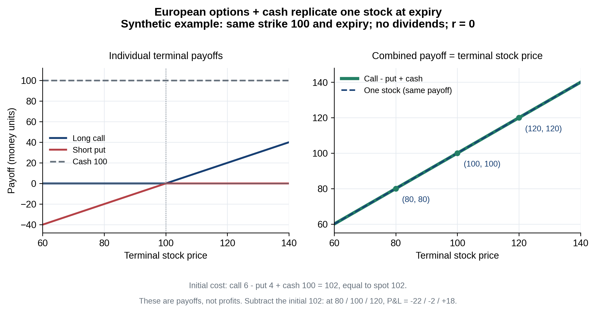

**ภาพ 5.1 เงินสดเติมส่วนที่ขาดจาก synthetic forward**

อ่านภาพด้วยกัน: ใช้ตัวเลขสมมติเดียวกับตาราง: call ลบ put ให้ $S_T$−100 เมื่อเติมเงินสด 100 จึงได้ $S_T$ การเทียบกำไรต้องหักต้นทุนเริ่ม 102 ด้วย เส้น payoff ที่เหมือนกันไม่ได้แสดงว่ามีโอกาสทำกำไรโดยไม่รับความเสี่ยง

หากดอกเบี้ยไม่เป็นศูนย์ ต้องใช้เงินที่วันนี้มีมูลค่าเพียงพอจะจ่าย 100 ณ วันครบกำหนด หากมีเงินปันผลต้องแยกกระแสเงินระหว่างทาง การถือหุ้นจริงกับ options ไม่ให้สิทธิผู้ถือหุ้นเหมือนกันทั้งหมด สำหรับ American options ยังต้องจัดการ early exercise และ assignment เพิ่ม ในการซื้อขายจริง premium และ collateral เกิดคนละเวลา ต้นทุน 102 ในตัวอย่างจึงไม่ใช่ข้อสรุปว่า margin หรือเงินสำรองทุกบัญชีจะเท่ากัน ถ้าจะค้าส่วนต่างระหว่างชุด ต้องจับคู่ทุกขาที่ราคา executable พร้อม funding และ borrow ให้ครบ

<a id="strategy_map_05_04"></a>

### 05.04 ตะกร้าจากข้อมูลต่างจากการจำลองตามสัญญา

Statistical synthetic เริ่มจากการหาชุดสินทรัพย์ที่ร่วมกันอธิบายหรือสร้างพฤติกรรมบางอย่าง เช่น หาความสัมพันธ์ระยะยาวของระดับราคา หักผลของปัจจัยร่วมออกจาก returns หรือเลือกตะกร้าที่อยู่ในช่วงราคาตามโจทย์ ค่าน้ำหนักและคุณสมบัติที่ได้ขึ้นกับข้อมูลและวิธีประมาณ ไม่มีสัญญาบังคับให้ residual กลับศูนย์ในอนาคตเหมือนเอกลักษณ์ payoff ของ call กับ put

| แนวคิด | คำถามหลัก | ข้อสรุปที่ยังให้ไม่ได้ |
| --- | --- | --- |
| Cointegration | มีชุดระดับราคาที่ส่วนผสมมีพฤติกรรม stationary ภายใต้โมเดลหรือไม่ | จะกลับทัน horizon ที่ซื้อขายได้ และกำไรจะคุ้มต้นทุน |
| Factor hedge / PCA | ความเสี่ยงร่วมส่วนใดอธิบายข้อมูล และต้องการหักอะไรออก | Residual เป็น alpha หรือพอร์ตจะ mean revert เสมอ |
| ออกแบบตะกร้า | เลือก weights ให้ผ่าน objective และข้อจำกัดที่กำหนดได้อย่างไร | คุณสมบัติในช่วงฝึกจะคงอยู่ และจำนวนทุกขาซื้อขายได้จริง |

งาน Avellaneda–Lee ใช้ factor model แล้วศึกษาส่วนที่เหลือต่อ [R5](#ref-r5) งาน moving-band ของ Johansson และคณะเลือกตะกร้าผ่าน optimization พร้อมข้อจำกัดของ band และ leverage [R7](#ref-r7) ส่วนงานที่ตามมาจัดเงินระหว่างตะกร้า [R8](#ref-r8) จึงเป็นคนละชั้นของปัญหา: สร้างตัวแปร สร้างตะกร้า และจัดพอร์ต การมี code จากผู้เขียนช่วยให้ตรวจขั้นตอน แต่ไม่ได้ยืนยันสมมติฐานด้านข้อมูล ต้นทุน หรือการ fill ให้ตลาดของเรา

เราควรเขียนจำนวนที่จะถือจาก weights พร้อมหน่วยให้ครบ หากใช้ log prices หรือ return residual ต้องแสดงสะพานไปยัง holdings ใหม่ ไม่ถือว่าค่าที่ plot เป็นราคาตะกร้าโดยอัตโนมัติ เมื่อเปลี่ยน weights ให้ลงบัญชีธุรกรรมและ cash flow ตามบท 3 พร้อมตรวจ exposures ตามบท 4 สำหรับแหล่งภายนอกข้างต้น ฉบับนี้อ่านวิธีและตรวจแหล่ง code แล้ว แต่ยังไม่ได้อ้างว่าทำซ้ำผลต้นฉบับได้

<a id="strategy_map_05_05"></a>

### 05.05 เปลี่ยนความเสี่ยงที่เทรด: volatility และเส้นอายุสัญญา

> **ลงลึก** ข้ามได้ในการอ่านรอบแรก สิ่งที่ควรเก็บ: การเปลี่ยนไปใช้ options หรือ spread ข้ามอายุสัญญาเป็นการเปลี่ยนชนิดความเสี่ยงที่รับ ไม่ได้ทำให้ความเสี่ยงหายไป

อีกแนวทางคือถือ options แล้วลดความไวต่อการเปลี่ยนราคาเล็กน้อยด้วย delta hedge เราจึงต้องศึกษาผลของความผันผวน อายุสัญญา และการปรับ hedge เพิ่ม ดัชนี Realized Volatility ของ Cboe (ticker GAMMA) เป็นตัวอย่าง benchmark ที่ระบุโครงสร้าง: straddles อายุสั้นห้าชุด พร้อม synthetic monthly forward และ cash มีการปรับ delta รายวันและถือแต่ละ straddle ถึงหมดอายุ [R38](#ref-r38) กฎของดัชนีเป็นตัวอย่างการสร้างพอร์ต ไม่ใช่สัญญาณว่า options ทุกวันมีราคาถูก

$$
\Delta_{\mathrm{total}}=\Delta_{\mathrm{options}}+q_S=0
$$

อ่านสมการ: ในตัวอย่างที่ hedge ด้วยสินทรัพย์อ้างอิงเชิงเส้นหนึ่งหน่วยต่อหน่วย $q_S$ คือจำนวนสินทรัพย์ และ delta ของ options รวม multiplier แล้ว เงื่อนไขนี้ลดความไวอันดับหนึ่ง ณ จุดคำนวณ ยังไม่ตัด gamma, vega, jumps หรือความคลาดเคลื่อนระหว่างรอบ hedge

คำถาม entry ต้องเทียบผลของการเคลื่อนไหวที่คาดตลอดช่วงถือกับราคา options และต้นทุนการ hedge ไม่ใช่เห็น historical volatility สูงกว่า implied volatility แล้วสรุปว่าซื้อได้ทันที ต้องตรวจ horizon เส้นทางราคาและ exposure ที่เปลี่ยน QuantLib มีตัวอย่างโค้ดบัญชี discrete hedging ของ European option ภายใต้ Black–Scholes ซึ่งใช้ศึกษาการกระจาย replication error ได้ [R46](#ref-r46) เราอ่านโครงโค้ดแล้ว ยังไม่ได้รันต้นฉบับ โค้ดตัวอย่างนั้นไม่ใช่ผล alpha ในตลาดจริงและยังไม่รวม execution costs ที่ระบบเราต้องเพิ่ม

สำหรับ futures เราอาจเลือกเทรดรูปร่างของเส้นอายุสัญญาแทน Calendar spread ถือคนละทิศในสองอายุ ส่วน butterfly แบบซื้อใช้จำนวน +1, −2, +1 ในสามอายุ [R39](#ref-r39) เมื่อ multiplier ของทุกขาเท่ากันและจำนวนคงที่ สมการด้านล่างเชื่อมการเปลี่ยนราคากับเงินได้ แต่ส่วนต่างข้ามอายุไม่มีข้อบังคับทั่วไปให้กลับศูนย์ ต้องระบุเหตุผลด้านเส้นราคา และแผนก่อน expiry หรือ delivery แต่ละขา นี่ต่างจาก options butterfly ข้าม strike และต่างจากวงจรการแปลงสามสินทรัพย์

$$
\Delta\Pi^{\mathrm{price}}=M(\Delta F_1-2\Delta F_2+\Delta F_3)
$$

อ่านสมการ: F ของสัญญาอายุที่ 1, 2 และ 3 เป็นราคาของสามอายุสัญญา M เป็นตัวคูณเป็นหน่วยเงินต่อการเปลี่ยนราคาหนึ่งหน่วย ยังไม่รวมต้นทุน ราคาสเปรดที่ plot ไม่ใช่ทุนหรือ margin และจำนวนรวมเป็นศูนย์ไม่ได้รับรองว่าจะหักล้างทุกการเปลี่ยนรูปของเส้นราคา

<a id="strategy_map_05_06"></a>

### 05.06 Market making เริ่มจากคำสั่ง แต่ความเสี่ยงอยู่ที่ inventory

การเสนอ bid และ ask เป็นอีกกระบวนการสร้างโอกาส เราอาจซื้อจากผู้ที่ต้องการขายและขายให้ผู้ที่ต้องการซื้อ แต่การมีคำสั่งสองด้านไม่เท่ากับถือพอร์ตเป็นกลาง ถ้าคำสั่งซื้อ fill ก่อน เราถือ inventory ที่เสี่ยงต่อราคาจนกว่าจะขายหรือ hedge ได้ และถ้าราคาเปลี่ยนทันทีหลัง fill ส่วนต่างที่เห็นบนหน้าจออาจไม่กลายเป็นกำไรสุทธิ ต้องรวมค่าธรรมเนียม การเคลื่อนไหวหลัง fill และต้นทุนการลดสถานะ

Avellaneda–Stoikov ศึกษาการตั้งราคาโดยคำนึงถึง inventory และโอกาสที่คำสั่งจะถูกซื้อขายตามระยะจาก mid-price ภายใต้แบบจำลองของผู้เขียน [R40](#ref-r40) แนวคิดที่ควรนำมาถามต่อคือ เมื่อ inventory มากขึ้น เราต้องการเปลี่ยนราคาและขนาดด้านใดเพื่อลดความเสี่ยง แต่ต้องประมาณโอกาส fill จากข้อมูลที่เหมาะสมเอง ไม่ถือว่าราคาแตะคำสั่งในแท่งเดียวแปลว่า fill แล้ว ฉบับนี้อ่านต้นฉบับดังกล่าว ยังไม่ได้ยืนยันผลจาก implementation ภายนอก

| ช่วงของการตัดสินใจ | สิ่งที่ต้องติดตาม |
| --- | --- |
| ก่อนเสนอราคา | ส่วนต่างที่คาดว่าจะได้หลังต้นทุน ความน่าจะเป็น fill และขนาดที่รับเพิ่มได้ |
| เมื่อ fill เพียงด้านเดียว | จำนวน inventory จริง อายุที่ถือ exposure และคำสั่งที่ยังค้าง |
| เมื่อชนข้อจำกัด | กฎหยุดเพิ่มสถานะ การยกเลิกคำสั่ง และแผนลดของเดิมพร้อมบัญชีเงินจริง |

สำหรับระบบ maker-only การเลื่อน quote เพื่อขาย inventory ไม่รับรองว่าจะขายได้ และการเกิด stop trigger ไม่เท่ากับสถานะถูกปิดแล้ว เราต้องแยกการหยุดรับความเสี่ยงใหม่ออกจากการจัดการของเดิม รวมทั้งบันทึก partial fills จนความเสี่ยงลดจริง หลักเดียวกันนี้ใช้กับทุกวิธีในตาราง: กฎสร้างโอกาส กฎ hedge และกฎออกจากสถานะต้องเชื่อมกันในบัญชี ก่อนนำไปประเมินว่ามีความได้เปรียบหรือไม่

<a id="strategy_map_05_07"></a>

### 05.07 ใช้ prediction ได้โดยไม่บังคับให้ทุกชุดเป็น OU

หากไม่พบ mean reversion เรามีสิทธิ์หยุดศึกษาชุดนั้น หรือเปลี่ยนคำถามที่ทดสอบ เช่น จาก “จะกลับเข้าค่าเฉลี่ยหรือไม่” เป็น “ข้อมูลที่รู้ตอนนี้ช่วยคาดผลตอบแทนข้างหน้าได้หรือไม่” การเปลี่ยนนี้ไม่ใช่หลักฐานว่ากลยุทธ์ใหม่ใช้ได้ เราต้องกำหนดผลอนาคต horizon ต้นทุน และข้อมูลที่ไม่ใช้เลือกโมเดลใหม่อีกครั้ง ความสัมพันธ์ที่ไม่กลับเข้าค่าเฉลี่ยอาจไม่มีความได้เปรียบแบบใดเลยก็ได้

ตัวอย่างที่เห็นความต่างชัดคือ residual momentum ของ Blitz, Huij และ Martens: ศึกษาความต่อเนื่องของผลตอบแทนส่วนที่ factor model อธิบายไม่ได้ [R31](#ref-r31) ตัวอย่าง QuantConnect ใช้ข้อมูลรายเดือนเพื่อประมาณ factor model แล้วจัดอันดับผลตอบแทน residual ย้อนหลัง โดยเว้นเดือนล่าสุดและปรับด้วยความผันผวน ซื้อกลุ่มอันดับสูงและขายกลุ่มอันดับต่ำ [R32](#ref-r32) จึงมีทิศทางตรงกับความต่อเนื่องของ residual ไม่ใช่ขาย residual เพียงเพราะเพิ่งเพิ่ม การจัดอันดับอย่างเดียวก็ยังไม่รับรองว่า holdings จริงจะมี factor exposure เป็นศูนย์

อีกตัวอย่างคือ Deep Learning Statistical Arbitrage ซึ่งเชื่อม factor residuals กับการสกัดสัญญาณจากลำดับข้อมูลและการเลือกพอร์ต เรียนรู้รูปแบบที่ยืดหยุ่นกว่าการ fix OU รวมถึงรูปแบบกลับตัวและแนวโน้มเฉพาะช่วง แต่ยังอาศัยข้อสมมติว่ารูปแบบในข้อมูลมีเสถียรภาพแบบมีเงื่อนไขพอให้เรียนรู้ การไม่กำหนด OU จึงไม่ได้ทำให้ไม่มีสมมติฐาน [R33](#ref-r33) repository ของผู้เขียนเปิดโค้ด แต่ไม่เผยแพร่ข้อมูล asset returns และ characteristics ต้นฉบับเพราะข้อจำกัดสิทธิ์ข้อมูล ฉบับนี้ยังไม่ได้ฝึกโมเดลหรือทำซ้ำผลของงาน [R34](#ref-r34)

| สิ่งที่คาด | สิ่งที่ใช้ตัดสินใจ | สิ่งที่ยังต้องแยก |
| --- | --- | --- |
| การกลับของ spread | ผลเปลี่ยนแปลงจากค่าปัจจุบันกลับสู่ระดับอ้างอิง | ค่ากลางและความสัมพันธ์อาจเปลี่ยน |
| Residual momentum | ผลตอบแทนต่อเนื่องหลังหักปัจจัยที่เลือก | Residual ใน regression ไม่ใช่คำสั่ง hedge สำเร็จแล้ว |
| Conditional prediction | ผลตอบแทนหรือ P&L อนาคตเมื่อข้อมูลอยู่ในสภาวะนี้ | ต้องเทียบต้นทุน ความเสี่ยง และโอกาสไม่เทรด |
| Trading policy ที่เรียนจากข้อมูล | จำนวนหรือ weights ที่เลือกเมื่อเห็นข้อมูลอดีต | ต้องแปลงเป็น underlying holdings และคิดต้นทุนบนการซื้อขายจริง |

กำหนด target ให้ตรงกับสิ่งที่จะซื้อขาย ถ้าฝึกจาก return แต่จำนวนที่ส่งเป็นหุ้น ต้องใช้ราคาและทุนแปลงหน่วย หากโมเดลตัดสินใจบน residual portfolios ต้องแปลงกลับเป็น holdings ของสินทรัพย์ต้นทางก่อนคำนวณ turnover และค่าถือ ไม่บวกค่าธรรมเนียมเฉพาะเส้น residual ที่ซื้อขายตรง ๆ ไม่ได้ ความแตกต่างนี้เป็นจุดเชื่อมระหว่างบท 2, 3 และ 4

<a id="strategy_map_05_08"></a>

### 05.08 Copula และ probability บอกอะไร และไม่ได้บอกอะไร

> **ลงลึก** ข้ามได้ในการอ่านรอบแรก สิ่งที่ควรเก็บ: คะแนนความน่าจะเป็นจากโมเดลบอกว่าค่าปัจจุบันผิดปกติแค่ไหน ไม่ได้บอกโอกาสกำไร และโอกาสชนะที่สูงยังอยู่ร่วมกับผลคาดหมายติดลบได้

Copula เป็นอีกวิธีอธิบายความสัมพันธ์ของตัวแปรหลังแยกรูปแบบการแจกแจงของแต่ละตัว เราอาจแปลงผลตอบแทน A และ B เป็น percentile U และ V จากข้อมูลช่วงฝึก แล้วตรวจว่าตัวหนึ่งอยู่ตรงไหนเมื่อเทียบกับอีกตัว ตัวอย่าง QuantConnect ใช้ conditional tail scores สร้างสัญญาณคู่ภายใต้แนวคิด mean reversion [R36](#ref-r36) จึงเป็นทางเลือกของการวัดความสัมพันธ์และสัญญาณ ไม่ใช่หลักฐานว่าการใช้ copula ทำให้ไม่ต้องมีสมมติฐานการกลับตัว

$$
h_{U\mid V}(u\mid v)=\frac{\partial C(u,v)}{\partial v}=P(U\leq u\mid V=v)
$$

อ่านสมการ: สำหรับ copula ที่ต่อเนื่องและมีอนุพันธ์ตามเงื่อนไข C เป็น joint CDF ส่วน h เป็น conditional CDF ของ U เมื่อกำหนด V ที่ค่า v ไม่ใช่ความน่าจะเป็นที่การเทรดจากวันนี้จะกำไร การนิยาม conditioning ให้ถูกมีผลต่อสูตรที่ใช้ [R37](#ref-r37)

ถ้าพบ conditional percentile 0.95 เรารู้ว่าค่าปัจจุบันอยู่ทางหางของความสัมพันธ์ที่ประมาณ แต่ยังไม่รู้ว่าราคาใดจะปรับ ราคาอื่นอาจเคลื่อนตาม หรือความสัมพันธ์อาจเปลี่ยน จึงต้องทดสอบต่อว่าค่านี้สัมพันธ์กับผลอนาคตของ holdings ที่เลือกอย่างไร แผน exit อาจใช้ score กลับเข้าช่วงกลาง ผลคาดหมายหมด หรือเวลาถือครบ โดยแต่ละแบบต้องกำหนดก่อนดูผลทดสอบ

แม้โมเดลจะทำนายโอกาสกำไรในอนาคตโดยตรง ความน่าจะเป็นสูงอย่างเดียวก็ยังไม่พอ ให้สมมติว่าชนะ 65% ได้ครั้งละ 1 หน่วยเงิน แพ้ 35% เสียครั้งละ 3 และเสียต้นทุน 0.1 ทุกครั้ง ผลคาดหมายสุทธิยังเป็นลบ ตัวเลขนี้เป็นสถานการณ์ที่เรากำหนดเองเพื่อแยก probability ออกจาก payoff

$$
0.65(1)+0.35(-3)-0.1=-0.5
$$

อ่านสมการ: น้ำหนักความน่าจะเป็นต้องคูณขนาดผลแต่ละกรณี แล้วหักต้นทุน เฉพาะเมื่อแจกแจงและ payoff ที่สมมตินี้ตรงกับการตัดสินใจจริงจึงใช้เป็นผลคาดหมายของรอบนั้นได้

เมื่ออ่านโค้ดตัวอย่าง ให้หาให้ครบว่าคะแนนสร้างจากราคา return หรือ log-return; coefficient มีหน่วยใด; คูณอะไรแล้วได้จำนวนหุ้น; มีเงื่อนไขปิดเมื่อคะแนนอยู่ช่วงกลางหรือเพียงไม่เปิดเพิ่ม; และเมื่อไม่ fit copula สำเร็จทำอะไรกับสถานะเดิม อย่าเติมคำตอบเหล่านี้ให้ต้นฉบับโดยไม่ตรวจ แยกสิ่งที่ตัวอย่างระบุออกจากนโยบายที่เราต้องออกแบบเพิ่ม

<a id="strategy_map_05_09"></a>

### 05.09 ลองตัดสินใจก่อนเปิดเฉลย

ใช้สมมติฐานและหน่วยของบทนี้ อย่าเพิ่งตีความคำว่า synthetic, probability หรือ stop ว่าเป็นคำรับรองผล ให้เขียน holdings กระแสเงิน และเหตุผลที่ใช้ตัดสินใจควบคู่กับตัวเลข

ข้อ 1 — Synthetic: ซื้อ European call ราคา 6 ขาย put ราคา 4 ที่ strike 100 วันหมดอายุเดียวกัน ดอกเบี้ยและปันผลเป็นศูนย์ ต้องเพิ่มสินทรัพย์ใดจึงได้ payoff เท่ากับ spot หนึ่งหน่วย? ถ้าราคาปลายทาง 80 จะมี payoff และ P&L เท่าไร? ถ้าใช้ options สองขาอย่างเดียว คำตอบต่างอย่างไร?

ข้อ 2 — Win rate สูงแต่ขาดทุน: โมเดลหนึ่งมีโอกาสชนะ 65% ได้ 1 แพ้เสีย 3 ต้นทุนทุกครั้ง 0.1 ผลคาดหมายสุทธิต่อครั้งเท่าไร และควรตัดสินจาก win rate อย่างเดียวหรือไม่?

ข้อ 3 — โจทย์ถ่ายโอน: futures butterfly +1, −2, +1 รวมจำนวนเป็นศูนย์ จึงไม่มีความเสี่ยงจากการเปลี่ยนรูปร่างของเส้นราคาจริงหรือไม่? และหากทุกสินทรัพย์มี beta บวก ภายใต้โมเดลเชิงเส้นเดิม การถือ long-only ที่ยังมีสินทรัพย์เสี่ยงทำให้ beta exposure รวมเป็นศูนย์ได้หรือไม่? ใช้เหตุผลจาก holdings ตอบก่อนดูเฉลย

<a id="strategy_map_05_10"></a>

### 05.10 เฉลยและหน้าทบทวน

เฉลยข้อ 1: เพิ่มเงินสด 100 ต้นทุนรวม 6−4+100 = 102 เมื่อราคาปลายทางเท่ากับ 80 ได้ payoff −20+100 = 80 และ P&L 80−102 = −22 หากถือ options เพียงสองขา ต้นทุนเริ่ม 2 payoff −20 จึงยังได้ P&L −22 เมื่อดอกเบี้ยศูนย์ แต่ payoff ไม่เท่ากับหุ้น และการจัดทุน margin กับ cash flows ต่างกัน ความเหมือนของ P&L ในโจทย์ไม่ได้ยืนยันว่าบัญชีจริงต้องใช้ทุนเท่ากัน

เฉลยข้อ 2: ผลคาดหมายสุทธิ = 0.65×1−0.35×3−0.1 = −0.5 ต่อครั้ง ตัวอย่างนี้แสดงว่า win rate สูงอยู่ร่วมกับผลคาดหมายติดลบได้ เพราะครั้งที่แพ้เสียมากกว่าครั้งที่ชนะสามเท่า ต้องดูโอกาส ขนาดของผลแต่ละกรณี และต้นทุนพร้อมกัน

เฉลยข้อ 3: Butterfly ยังรับความเสี่ยงการเปลี่ยนส่วนโค้ง เพราะกำไรราคาเป็น $M(\Delta F_1-2\Delta F_2+\Delta F_3)$ ซึ่งไม่จำเป็นต้องศูนย์ การเลื่อนราคาทุกอายุเท่ากันอาจหักล้างได้ในสมมติฐานนี้ แต่การเปลี่ยนรูปร่างยังทำให้กำไรหรือขาดทุน ส่วนพอร์ต long-only ตามโจทย์มีผลรวมมูลค่าแต่ละขาคูณ beta เป็นบวกถ้ามีอย่างน้อยหนึ่งสถานะเสี่ยง จึงไม่ beta neutral เงินสดทั้งหมดให้ exposure ศูนย์ได้ แต่ไม่มีสถานะเสี่ยงเหลือในกรณีนั้น

| คำถามทบทวน | หลักที่ควรอธิบายได้ |
| --- | --- |
| กำลังเปลี่ยนอะไร | แยก payoff, forecast, hedge, construction และ execution |
| Synthetic เหมือนอะไร | ระบุว่าเหมือนตามสัญญาหรือใกล้กันจากข้อมูล และรวม cash ให้ครบ |
| Probability บอกอะไร | ความผิดปกติของค่าปัจจุบันภายใต้โมเดล ไม่ใช่โอกาสกำไร และต้องคูณขนาดผลกับหักต้นทุน |
| หลักฐานถึงระดับใด | อ่านวิธี ตรวจโค้ด รันตัวอย่าง และทำซ้ำผลตลาด เป็นคนละสถานะ |

ทางอ่านต่อ: บท 6 และ 7 ลงลึกคู่ที่ผูกกันด้วยสัญญาและคู่ที่ผูกกันด้วยสถิติ บท 8 นำแผนที่นี้ไปเขียนกฎเข้า ถือ และออก ส่วนโค้ด methods_signals_stops_demo.py ตรวจ payoff และตัวเลขของบทนี้กับบท 8 โดยไม่ดาวน์โหลดข้อมูลตลาดหรือส่งคำสั่งซื้อขาย

<a id="contract_pairs"></a>

## บท 6 คู่ที่ผูกกันด้วยสัญญา: carry, basis และ funding

จากอัตราบนหน้าจอ สู่ผลตอบแทนของทุน และการตัดสินใจถือหรือปิด

> **ก่อนอ่าน:** หัวข้อ 02.04–02.05 เรื่อง implied carry กับ basis และหัวข้อ 03.09 เรื่องหลักประกันกับ funding
>
> **เมื่อจบบท คุณควรทำได้:** แปลงอัตราบนหน้าจอเป็นผลตอบแทนต่อทุนที่ต้องผูกไว้จริง ตัดสินใจว่าจะปิดก่อนหมดอายุหรือถือต่อ และบอกว่า funding แบบใดคุ้มค่าธรรมเนียม
>
> **ตัวอย่างหลักของบท:** อัตรา 12.17% ต่อปีบนหน้าจอ ที่เหลือส่วนเกินจริง 5.23% ต่อปีเมื่อนับทุน ค่าธรรมเนียม และทางเลือกอื่นของเงิน

<a id="contract_pairs_06_01"></a>

### 06.01 คู่ที่สัญญาช่วยผูกไว้ให้

บทนี้เริ่มภาค 2 ด้วยคู่ที่ง่ายที่สุดครับ คือ BTC spot คู่กับ BTC futures เหตุผลที่ง่ายไม่ใช่เพราะกำไรแน่นอน แต่เพราะมีกลไกหนึ่งที่เราไม่ต้องพยากรณ์ วันหมดอายุของ dated futures บังคับให้ราคาชำระของสัญญาเท่ากับราคาอ้างอิงที่สัญญากำหนด ส่วนต่างระหว่างสองขาจึงต้องมาบรรจบกันในวันนั้น

แต่สัญญารับรองเพียงเรื่องเดียว ลองแยกให้ชัดว่าอะไรถูกผูกไว้และอะไรไม่ถูก

| เรื่อง | สัญญาผูกไว้หรือไม่ | อยู่ในหัวข้อ |
| --- | --- | --- |
| ส่วนต่างราคาในวันหมดอายุ | ผูกไว้ โดยเทียบกับราคาอ้างอิงที่สัญญากำหนด | 06.02 |
| ส่วนต่างราคาระหว่างทาง | ไม่ผูก ขยายหรือหดได้ทุกวัน | 06.03 |
| เงินสดที่ต้องเติมหลักประกัน | ไม่ผูก ขึ้นกับทิศทางราคา | 06.03 |
| ราคาที่เราขาย spot ได้จริงวันหมดอายุ | ไม่ผูก อาจต่างจากราคาอ้างอิง | 06.06 |
| funding ของ perp | ไม่มีวันหมดอายุมาช่วย อัตราเปลี่ยนทุกรอบ | 06.05 |

บทนี้จะไล่ทีละแถว เริ่มจากคำถามแรกที่มือใหม่มักข้าม คืออัตราที่เห็นบนหน้าจอเท่ากับผลตอบแทนของเราหรือไม่

<a id="contract_pairs_06_02"></a>

### 06.02 จากอัตราบนหน้าจอสู่ผลตอบแทนของทุน

ใช้ตัวอย่างเดิมจากบท 1–3: spot 100,000 และ futures 103,000 เหลือ 90 วัน ส่วนต่าง 3,000 คิดเป็น 3% ของราคา spot เมื่อแปลงเป็นอัตราต่อปีแบบ simple จะได้ 3% × 365/90 = 12.17% ตัวเลขนี้คือสิ่งที่เครื่องมืออย่าง CME BasisWatch แสดงในรูปแบบหนึ่ง [R20](#ref-r20) หัวข้อ 02.04 คำนวณอีกแบบแบบ continuous ได้ 11.99% ทั้งสองตัวเป็นอัตราเทียบกับราคา spot ยังไม่ใช่ผลตอบแทนของเงินที่เราต้องใช้

ขั้นแรก เปลี่ยนตัวหารเป็นทุนที่ต้องผูกไว้จริง หัวข้อ 03.09 ใช้ทุน 125,000 คือซื้อ spot 100,000 วางหลักประกัน 10,300 และเหลือเงินสดสำรอง 14,700 สำหรับเติมหลักประกันเมื่อราคาขึ้น ถ้าไม่มีเงินสำรองส่วนนี้ ราคาขึ้นวันเดียวก็อาจทำให้ขา futures ถูกบังคับปิด เงินทั้ง 125,000 จึงเป็นทุนของกลยุทธ์ ส่วนต่าง 3,000 เทียบกับทุนนี้ได้ 2.4% ต่อ 90 วัน หรือ 9.73% ต่อปี

ขั้นที่สอง หักค่าธรรมเนียม สมมติ 0.05% ต่อการซื้อขายหนึ่งครั้ง มีสามครั้งคือ ซื้อ spot 100,000 short futures 103,000 และขาย spot วันหมดอายุ สมมติราคาตอนนั้น 105,000 ส่วนการชำระ futures สมมติว่าไม่มีค่าธรรมเนียม รวมเป็น 0.05% × (100,000 + 103,000 + 105,000) = 154 กำไรสุทธิจึงเหลือ 2,846 หรือ 9.23% ต่อปีของทุน

ขั้นที่สาม เทียบกับทางเลือกอื่นของเงินก้อนเดียวกัน ถ้าเงิน 125,000 นี้ได้ผลตอบแทน 4% ต่อปีจากทางเลือกที่เสี่ยงน้อยกว่า ใน 90 วันจะได้ 125,000 × 4% × 90/365 = 1,232.88 ส่วนเกินที่กลยุทธ์ให้จริงคือ 2,846 − 1,232.88 = 1,613.12 หรือ 5.23% ต่อปี อัตราที่ใช้เทียบนี้เรียกว่า hurdle rate คือผลตอบแทนขั้นต่ำที่ทุนต้องได้จึงจะคุ้มที่ผูกไว้ ตัวเลข 4% เป็นค่าสมมติ คุณต้องเลือกเองตามทางเลือกที่มีจริง

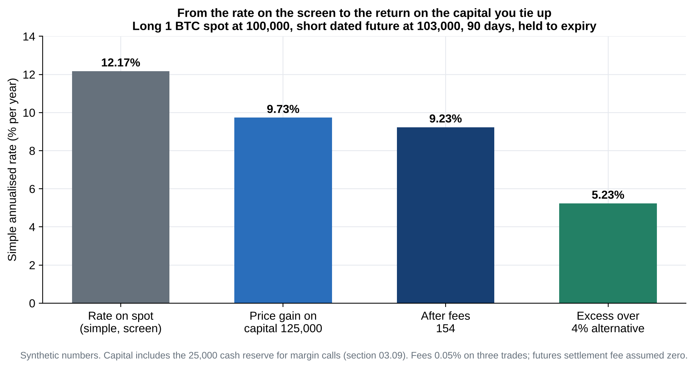

**ภาพ 6.1 จากอัตราบนหน้าจอสู่ผลตอบแทนของทุนที่ต้องผูกไว้**

อ่านภาพด้วยกัน: แท่งแรกคืออัตราเทียบราคา spot ที่เห็นบนหน้าจอ แท่งที่สองเปลี่ยนตัวหารเป็นทุนทั้งหมดรวมเงินสำรอง แท่งที่สามหักค่าธรรมเนียม และแท่งสุดท้ายหักผลตอบแทนที่เงินก้อนเดียวกันได้จากทางเลือกอื่น ทุกแท่งเป็นอัตรา simple ต่อปีของสถานะเดียวกัน จาก 12.17% เหลือ 5.23%

ภาพนี้ให้เกณฑ์เข้าที่ใช้ได้จริง: เปิดสถานะเมื่อส่วนเกินหลังหักทุกอย่างสูงพอชดเชยความเสี่ยงที่ยังเหลือในหัวข้อ 06.03 และ 06.06 ไม่ใช่เมื่ออัตราบนหน้าจอสูงกว่าค่าเฉลี่ยย้อนหลัง สังเกตด้วยว่าทุนที่ใช้มีผลมาก ถ้าเตรียมเงินสำรองมากขึ้นเพื่อความปลอดภัย ผลตอบแทนต่อทุนจะลดลง โจทย์ข้อ 1 ท้ายบทให้ลองคำนวณ

<a id="contract_pairs_06_03"></a>

### 06.03 ระหว่างทาง: basis ขยับ และเงินสดถูกเรียก

ส่วนต่าง 3,000 รับรองเฉพาะวันหมดอายุ ระหว่างทาง กำไรขาดทุนจากราคาของสถานะนี้เท่ากับ basis ตอนเข้าลบ basis ปัจจุบัน ตามสมการในหัวข้อ 02.05 ถ้า basis กว้างขึ้นจาก 3,000 เป็น 3,500 เราขาดทุน 500 ชั่วคราว ถ้าหดเหลือ 1,000 เรากำไร 2,000 ก่อนวันหมดอายุ ความผันผวนของ basis จึงเป็นความเสี่ยงหลักของการถือระหว่างทาง แม้ทิศทางราคา BTC จะถูก hedge แล้ว

เรื่องที่สองคือเงินสด หัวข้อ 03.09 แสดงว่าเมื่อราคา futures ขึ้น 10,200 ในวันเดียว equity ลดเพียง 200 แต่ต้องโอนเงินเติมหลักประกัน 11,220 กฎที่ได้จากตัวอย่างนั้นใช้เป็นเกณฑ์ก่อนเปิดได้เลย: เลือกขนาดการขึ้นของราคาในหนึ่งวันที่ต้องการผ่านให้ได้ แล้วเตรียมเงินสดอิสระอย่างน้อย 1.1 เท่าของขนาดนั้นตามกติกาตัวอย่าง ทุน 125,000 รองรับการขึ้นได้ราว 13% ต่อวัน

บาง exchange ให้ใช้เหรียญที่ถืออยู่เป็นหลักประกันของขา futures ได้ ซึ่งช่วยมาก เพราะเมื่อราคาขึ้น มูลค่าหลักประกันก็ขึ้นตาม ความต้องการเงินสดจะลดลงมาก แต่ต้องอ่านกติกาให้ครบ ทั้งส่วนลดมูลค่าหลักประกัน (haircut) ที่อาจเพิ่มในตลาดผันผวน และความเสี่ยงที่เหรียญทั้งสองขาฝากอยู่ใน exchange เดียวกัน ซึ่งหัวข้อ 06.06 จะกลับมาพูด

ข้อสรุปของหัวข้อนี้คือ ความเสี่ยงระหว่างทางมีสองชั้น ชั้นแรกคือ basis ที่ทำให้ equity แกว่ง ชั้นที่สองคือเงินสดที่ต้องมีในบัญชีที่ถูกเรียก ชั้นที่สองอันตรายกว่า เพราะถ้าผ่านไม่ได้ เราจะถูกบังคับปิดขาหนึ่งและเหลือสถานะที่ไม่ได้ hedge

<a id="contract_pairs_06_04"></a>

### 06.04 ปิดก่อนหมดอายุหรือถือต่อ

สมมติผ่านไป 30 วัน spot อยู่ที่ 101,000 และ futures อยู่ที่ 101,500 basis หดจาก 3,000 เหลือ 500 เร็วกว่าที่คาด กำไรจากราคาถึงตอนนี้เท่ากับ 3,000 − 500 = 2,500 คำถามคือ ควรปิดเลย หรือถือต่ออีก 60 วันเพื่อเก็บอีก 500 ที่เหลือ?

หลักจากหัวข้อ 08.02 คือเทียบเฉพาะสิ่งที่ยังต่างกันระหว่างสองทางเลือก ค่าธรรมเนียมตอนเข้าจ่ายไปแล้ว เป็นรายการร่วมของทั้งสองทาง จึงไม่ต้องนำมาคิด

| รายการ | ปิดวันนี้ | ถือถึงวันหมดอายุ |
| --- | --- | --- |
| basis ที่ยังเก็บได้ | 0 | +500 |
| ค่าธรรมเนียมขาออก | ขาย spot และซื้อ futures คืน 0.05% × 202,500 = −101.25 | ขาย spot วันหมดอายุ สมมติที่ 101,000 = −50.50 |
| ทุนถูกผูกต่อ | 0 วัน | 60 วัน |

ถือต่อได้เงินมากกว่าปิดวันนี้ 500 − 50.50 + 101.25 = 550.75 แต่ต้องผูกทุน 125,000 ต่ออีก 60 วัน ถ้า hurdle rate คือ 4% ต่อปี ทุนก้อนนี้ควรได้ 125,000 × 4% × 60/365 = 821.92 จากทางเลือกอื่น ซึ่งมากกว่า 550.75 การปิดวันนี้จึงดีกว่าราว 271 อีกวิธีมองคือ เงินเพิ่ม 550.75 คิดเป็นเพียง 2.68% ต่อปีของทุน ต่ำกว่า hurdle rate

ถ้า hurdle rate เป็น 2% ต่อปี ค่าเสียโอกาสจะเหลือ 410.96 และการถือต่อคุ้มกว่า คำตอบจึงขึ้นกับทางเลือกของเงินที่คุณมีจริง ไม่มีคำตอบเดียวสำหรับทุกคน สิ่งที่เปลี่ยนไม่ได้คือวิธีคิด: เทียบเงินที่ยังได้เพิ่มกับค่าเสียโอกาสของทุนที่ยังผูกอยู่ แล้วเขียนเป็นกฎไว้ก่อนเปิด เพื่อไม่ต้องตัดสินใจตามความรู้สึกเมื่อเห็นกำไร

ตัวอย่างนี้ยังไม่นับความเสี่ยงระหว่าง 60 วันที่เหลือ basis อาจกว้างกลับขึ้นไป และเงินสำรองยังต้องอยู่ครบ ซึ่งยิ่งทำให้การปิดน่าสนใจขึ้นเมื่อส่วนที่เหลือเล็ก

<a id="contract_pairs_06_05"></a>

### 06.05 Perp: เมื่อไม่มีวันหมดอายุมาช่วย

ทีนี้เปลี่ยนขา futures เป็น perp ครับ เราถือ spot 1 BTC และ short perp เทียบ 1 BTC เหมือนเดิม แต่ไม่มีวันหมดอายุที่บังคับให้ส่วนต่างกลับเป็นศูนย์ รายรับหลักกลายเป็น funding ที่บท 0 และหัวข้อ 03.09 อธิบายไว้ เมื่ออัตราเป็นบวก ฝั่ง short ที่เราถืออยู่จะได้รับเงิน

ปัญหาคือเราไม่รู้อัตราล่วงหน้า ลองดูสี่เส้นทางที่เป็นไปได้ใน 30 วัน หรือ 90 รอบ funding โดยตรึงราคา mark ไว้ที่ 100,000 เพื่อแยกเฉพาะผลของ funding ค่าธรรมเนียมเปิดและปิดสองขารวม 80 ตามหัวข้อ 03.09 และทุน 125,000 เท่าเดิม

| เส้นทางของอัตรา | funding รวม | สุทธิหลังค่าธรรมเนียม | ต่อปีของทุน |
| --- | --- | --- | --- |
| A: +0.01% ทุกรอบ | 900 | 820 | 7.98% |
| B: +0.03% 30 รอบแรก แล้ว +0.005% | 1,200 | 1,120 | 10.90% |
| C: +0.01% 45 รอบ แล้ว −0.01% 45 รอบ | 0 | −80 | −0.78% |
| D: +0.01% ห้ารอบสลับ −0.005% สามรอบ | 405 | 325 | 3.16% |

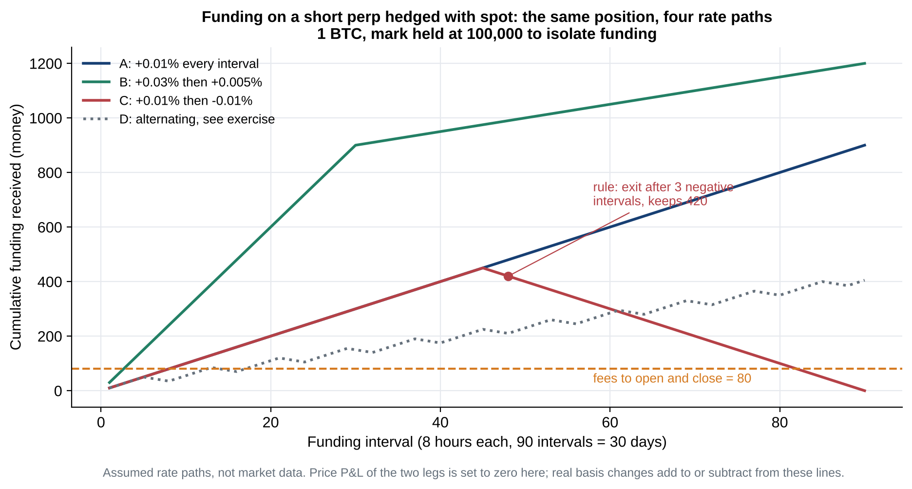

**ภาพ 6.2 funding สะสมของสถานะเดียวกันภายใต้สี่เส้นทางของอัตรา**

อ่านภาพด้วยกัน: แต่ละเส้นคือ funding สะสมที่ฝั่ง short ได้รับ เส้นประแนวนอนคือค่าธรรมเนียมเปิดและปิดรวม 80 เส้นทาง B ได้เร็วในช่วงแรกแล้วช้าลง เส้นทาง C ได้แล้วคืนหมดเมื่ออัตรากลับเครื่องหมาย จุดสีแดงคือที่กฎ “ออกเมื่ออัตราติดลบสามรอบติดกัน” ปิดสถานะในเส้นทาง C และเก็บไว้ได้ 420

กฎออกช่วยเส้นทาง C ได้ชัด จาก −80 เป็น +340 แต่ลองใช้กฎเดียวกันกับเส้นทาง D ครับ อัตราติดลบสามรอบติดกันตั้งแต่ช่วงแรก กฎจึงปิดสถานะเมื่อเก็บได้เพียง 35 ได้สุทธิ −45 ทั้งที่ถ้าถือต่อจะได้ +325 กฎที่ดูดีกับเส้นทางหนึ่งอาจเสียหายกับอีกเส้นทางหนึ่ง และถ้าปิดแล้วเปิดใหม่ ค่าธรรมเนียม 80 ก็จะเกิดซ้ำทุกครั้ง กฎออกของ funding จึงต้องทดสอบกับหลายเส้นทาง ไม่ใช่เลือกจากเส้นทางที่เพิ่งเห็น บทความของ Presto Research เป็นตัวอย่างงานที่วิเคราะห์การตัดสินใจลักษณะนี้ และอ่านต่อได้ [R10](#ref-r10)

อีกเรื่องที่ตารางนี้ซ่อนไว้คือราคา เราตรึง mark ไว้เพื่อแยก funding ออกมา แต่ในความจริง ราคา perp ต่างจาก spot ได้ และส่วนต่างนั้นเปลี่ยนตลอด หัวข้อ 03.09 แสดงว่ากำไรจากราคาสองขาเท่ากับส่วนต่างที่แคบลง ซึ่งอาจบวกหรือลบ funding ก็ได้ และไม่มีวันหมดอายุมาบังคับให้มันกลับเป็นศูนย์ การรายงานผลจึงต้องแยกสามบรรทัดเสมอ: funding ที่ได้รับ กำไรจากราคาของสองขา และค่าธรรมเนียม

<a id="contract_pairs_06_06"></a>

### 06.06 ความเสี่ยงที่ hedge ราคาไม่ได้ช่วย

สถานะ spot คู่ futures ลดความเสี่ยงจากทิศทางราคา BTC ได้ แต่ยังเหลือความเสี่ยงอีกหลายชนิดที่ต้องเขียนไว้ก่อนเปิด

| ความเสี่ยง | เกิดอย่างไร | ตรวจหรือลดอย่างไร |
| --- | --- | --- |
| ราคาอ้างอิงวันหมดอายุ | futures ชำระด้วยดัชนีที่สัญญากำหนด แต่เราขาย spot ได้อีกราคา | อ่านนิยามราคาชำระ และวางแผนขาย spot ให้ใกล้ช่วงเวลาที่ดัชนีคำนวณ |
| เงินสดและการถูกบังคับปิด | ราคาขึ้นแรงจนเงินสดไม่พอเติมหลักประกันของขา short | เตรียมเงินสดตามหัวข้อ 06.03 และตรวจกติกาหลักประกันกับ haircut |
| Exchange | exchange หยุดให้ถอน ล้มละลาย หรือเปลี่ยนกติกากลางทาง | กระจายเงินตามที่รับได้ และนับเงินที่ฝากไว้เป็นความเสี่ยง ไม่ใช่เงินสดที่ปลอดภัย |
| Stablecoin | สัญญาคิดกำไรขาดทุนเป็น stablecoin ที่อาจหลุดจากราคาที่ควรเป็น | ระบุสกุลที่ใช้คิดผลทุกขา และรวมความเสี่ยงนี้ในทุน |
| ค่าธรรมเนียมและ funding ที่เปลี่ยน | อัตราใหม่ทำให้สถานะที่เปิดแล้วไม่คุ้ม | ใช้เกณฑ์ถือต่อแบบหัวข้อ 06.04 ทุกครั้งที่เงื่อนไขเปลี่ยน |

ความเสี่ยงแถวแรกคิดเป็นตัวเลขได้ง่าย สมมติวันหมดอายุดัชนีชำระราคาที่ 105,000 แต่เราขาย spot ได้ที่ 104,900 กำไรจากราคาจะเป็น (104,900 − 100,000) + (103,000 − 105,000) = 2,900 แทนที่จะเป็น 3,000 ส่วนต่าง 100 นี้เกิดแม้สัญญาทำงานตามที่เขียนไว้ทุกข้อ โจทย์ข้อ 4 ท้ายบทใช้ตัวอย่างนี้

ความเสี่ยงที่เหลือคิดเป็นตัวเลขยากกว่า แต่ไม่ได้หมายความว่าเล็กกว่า ในคริปโต ความเสี่ยงของ exchange และ stablecoin เคยทำให้สถานะที่ hedge ราคาไว้ครบเสียหายได้ทั้งก้อน จึงควรตั้งขนาดสถานะจากคำถามว่า “ถ้าเงินในบัญชีนี้ถอนไม่ได้ เรารับได้เท่าไร” ไม่ใช่จากผลตอบแทนที่คาดอย่างเดียว

<a id="contract_pairs_06_07"></a>

### 06.07 เขียนข้อกำหนดของกลยุทธ์ cash-and-carry

กลยุทธ์ซื้อ spot คู่กับ short futures เพื่อเก็บส่วนต่างเรียกว่า cash-and-carry ลองรวมทุกอย่างในบทนี้เป็นข้อกำหนดที่คนอื่นทำตามได้ ตารางนี้เป็นตัวอย่างที่ใช้ค่าสมมติของบท ไม่ใช่ค่าที่แนะนำ

| หัวข้อ | สิ่งที่กำหนด |
| --- | --- |
| เครื่องมือ | BTC spot และ BTC dated futures แบบ linear ที่หมดอายุภายใน 30–120 วัน |
| เกณฑ์เข้า | ส่วนเกินต่อปีของทุน หลังหักค่าธรรมเนียมที่คาดและ hurdle rate สูงกว่าค่าที่กำหนดไว้ เช่น 3% ต่อปี |
| ขนาดและทุน | ขนาดสถานะที่ทำให้เงินสดอิสระรองรับการขึ้นของราคาในหนึ่งวันได้ตามที่กำหนด เช่น 13% |
| เกณฑ์ถือต่อหรือปิด | ตรวจทุกวัน: ถ้าเงินที่ยังได้เพิ่มจากการถือ หลังหักค่าธรรมเนียม ต่ำกว่าค่าเสียโอกาสของทุนในช่วงที่เหลือ ให้ปิด |
| เหตุบังคับลด | เงินสดอิสระต่ำกว่าเกณฑ์ หรือกติกาหลักประกันเปลี่ยน ให้ลดขนาดทั้งสองขาพร้อมกัน |
| การส่งคำสั่ง | เปิดสองขาให้ใกล้กันที่สุด ถ้าได้ขาเดียวเกินเวลาที่กำหนด ให้ปิดขานั้นตามกฎในหัวข้อ 08.04 |
| การรายงาน | แยกกำไรจากราคา funding หรือ basis ที่ได้ ค่าธรรมเนียม และส่วนเกินเทียบ hurdle rate ทุกเดือน |

ข้อกำหนดนี้ยังไม่มีคำว่า “basis สูงกว่าค่าเฉลี่ย” เลย เพราะเกณฑ์เข้าของกลยุทธ์ตามสัญญาคือความคุ้มค่าของทุน ไม่ใช่การพยากรณ์ว่า basis จะกลับ ถ้าวันหนึ่งคุณอยากเพิ่มกฎแบบนั้น ก็ต้องตรวจเป็นการพยากรณ์แยกต่างหาก ตามหลักในบท 1

<a id="contract_pairs_06_08"></a>

### 06.08 ลองคำนวณก่อนเปิดเฉลย

ข้อ 1 — ทุนมากขึ้น: ใช้ตัวเลขในหัวข้อ 06.02 แต่เตรียมทุน 150,000 แทน 125,000 ส่วนเกินต่อปีของทุนหลังหัก hurdle rate 4% เป็นเท่าไร? เงินสดอิสระหลังเปิดรองรับการขึ้นของราคา futures ในหนึ่งวันได้กี่เปอร์เซ็นต์ตามกติกาของหัวข้อ 03.09? การเพิ่มทุนแลกอะไรกับอะไร?

ข้อ 2 — basis หดช้ากว่าที่คิด: ผ่านไป 30 วัน spot อยู่ที่ 101,000 และ futures อยู่ที่ 102,500 ใช้ค่าธรรมเนียมและ hurdle rate 4% เหมือนหัวข้อ 06.04 ควรปิดหรือถือต่อ?

ข้อ 3 — กฎออกที่ทำร้ายตัวเอง: ในเส้นทาง D ของหัวข้อ 06.05 ทำไมกฎ “ออกเมื่ออัตราติดลบสามรอบติดกัน” จึงได้ผลแย่กว่าถือต่อ? ถ้าจะทดสอบกฎนี้ให้ยุติธรรม ต้องทำอะไรบ้าง?

ข้อ 4 — ราคาชำระกับราคาขายจริง: futures ชำระที่ดัชนี 105,000 แต่เราขาย spot ได้ 104,900 ก่อนค่าธรรมเนียม กำไรจากราคาเป็นเท่าไร และส่วนที่หายไปเป็นความเสี่ยงชนิดใด?

<a id="contract_pairs_06_09"></a>

### 06.09 เฉลยและหน้าทบทวน

เฉลยข้อ 1: กำไรสุทธิยังเป็น 2,846 เทียบกับทุน 150,000 ได้ 7.69% ต่อปี ค่าเสียโอกาส 90 วันเท่ากับ 150,000 × 4% × 90/365 = 1,479.45 ส่วนเกินเหลือ 1,366.55 หรือราว 3.69% ต่อปี ด้านความปลอดภัย เงินสดอิสระหลังเปิดเท่ากับ 150,000 − 100,000 − 10,300 = 39,700 รองรับการขึ้นของราคา futures ได้ 39,700 ÷ 1.1 ≈ 36,091 หรือราว 35% ของ 103,000 การเพิ่มทุนจึงแลกผลตอบแทนต่อทุนที่ลดลงกับโอกาสที่จะไม่ถูกบังคับปิด

เฉลยข้อ 2: basis ที่ยังเหลือคือ 1,500 ถือต่อได้มากกว่าปิดวันนี้ 1,500 − 50.50 + 0.05% × 203,500 = 1,500 − 50.50 + 101.75 = 1,551.25 มากกว่าค่าเสียโอกาส 60 วัน 821.92 จึงควรถือต่อตามเกณฑ์นี้ ส่วนเกินที่เหลือยังสูงพอชดเชยการผูกทุน

เฉลยข้อ 3: ในเส้นทาง D อัตราติดลบเพียงช่วงสั้น ๆ แล้วกลับเป็นบวก กฎจึงออกตอนที่ funding สะสมยังน้อยและเสียค่าธรรมเนียมเต็มจำนวน ถ้าจะทดสอบให้ยุติธรรม ต้องกำหนดกฎและค่าธรรมเนียมการเปิดใหม่ไว้ก่อน แล้วทดสอบกับเส้นทางของอัตราจำนวนมากหรือข้อมูลจริงที่ไม่ได้ใช้เลือกกฎ เทียบกับการถือตลอดเป็น baseline และนับจำนวนครั้งที่ออกแล้วต้องเข้าใหม่

เฉลยข้อ 4: กำไรจากราคาเท่ากับ (104,900 − 100,000) + (103,000 − 105,000) = 2,900 ส่วนที่หายไป 100 คือความเสี่ยงจากราคาอ้างอิง เพราะสองขาไม่ได้ปิดด้วยราคาเดียวกัน แม้สัญญาจะทำงานตามที่เขียนไว้ทุกข้อ

หน้าทบทวน: เมื่อเห็นอัตรา carry หรือ funding บนหน้าจอ ให้ถามสี่ข้อตามลำดับ เทียบกับอะไร ทุนที่ต้องผูกไว้จริงรวมเงินสำรองเท่าไร หลังค่าธรรมเนียมเหลือเท่าไร และเทียบกับทางเลือกอื่นของเงินแล้วยังคุ้มหรือไม่ จากนั้นถามเรื่องระหว่างทางว่าเงินสดพอผ่านการขึ้นของราคาที่ต้องการหรือไม่ และเงินที่ฝากไว้ในแต่ละที่รับความเสียหายได้เท่าไร

ทางอ่านต่อ: บท 7 เปลี่ยนจากคู่ที่สัญญาผูกไว้ ไปเป็นคู่ที่ไม่มีสัญญาใดบังคับ ซึ่งต้องอาศัยหลักฐานเชิงสถิติแทน ส่วนโค้ด v09_ch06_ch07_demo.py ตรวจตัวเลขทุกตัวในบทนี้

<a id="statistical_pairs"></a>

## บท 7 คู่ที่ผูกกันด้วยสถิติ: ทำไมจึงควรสัมพันธ์กัน

เหตุผลของคู่ หลักฐานที่ใช้ตรวจ และกับดักของการค้นหาคู่จากข้อมูล

> **ก่อนอ่าน:** บท 1–4 และบท 6 ถ้าคำว่า correlation หรือ cointegration ยังไม่คุ้น ให้เปิดภาค II และ VI ของ Quant for Non-Quant ประกอบ
>
> **เมื่อจบบท คุณควรทำได้:** บอกว่าคู่หนึ่งผูกกันด้วยอะไร แยก correlation ของผลตอบแทนออกจากการที่ส่วนต่างถูกดึงกลับ แบ่งข้อมูลเป็นช่วงเลือกคู่กับช่วงทดสอบ และเขียนทะเบียนคู่ที่มีเกณฑ์คัดออก
>
> **ตัวอย่างหลักของบท:** คู่จำลองที่ผลตอบแทนสัมพันธ์กัน 0.90 แต่ส่วนต่างไม่กลับ เทียบกับคู่ที่สัมพันธ์กันเพียง 0.72 แต่ส่วนต่างถูกดึงกลับ

<a id="statistical_pairs_07_01"></a>

### 07.01 เมื่อไม่มีสัญญามาผูก

บท 6 มีวันหมดอายุของ futures เป็นหลักประกันว่าส่วนต่างต้องบรรจบกัน บทนี้ไม่มีสิ่งนั้นแล้วครับ สมมติคุณสังเกตว่าเหรียญสองตัวในกลุ่มเดียวกันมักขึ้นลงด้วยกัน แล้ววันหนึ่งตัวหนึ่งขึ้นไปไกลกว่าอีกตัว คำถามแรกไม่ใช่ “จะเปิดสถานะเมื่อไร” แต่คือ “อะไรจะดึงสองราคานี้กลับมาหากัน”

คู่ในคริปโตเรียงได้ตามความแข็งแรงของสิ่งที่ผูกไว้ ยิ่งลงไปข้างล่าง ยิ่งต้องพึ่งหลักฐานจากข้อมูลมากขึ้น

| ระดับความผูกพัน | ตัวอย่างในคริปโต | อะไรดึงราคากลับ | ความเสี่ยงหลัก |
| --- | --- | --- | --- |
| ตามสัญญา | spot กับ dated futures | การชำระราคาวันหมดอายุ | เงินสดระหว่างทางและราคาอ้างอิง (บท 6) |
| แลกคืนได้แต่มีเงื่อนไข | โทเคนที่แทนเหรียญอื่นและแลกคืนได้ เช่น wrapped token หรือ staked token | ผู้ที่แลกคืนหรือสร้างใหม่ได้ซื้อขายจนส่วนต่างแคบลง | คิวแลกคืนยาว การแลกถูกระงับ หรือผู้ออกโทเคนมีปัญหา |
| เชื่อมทางเศรษฐกิจ | เหรียญที่แข่งในกลุ่มเดียวกัน หรือเหรียญของเครือข่ายกับโทเคนในระบบนั้น | ปัจจัยร่วมที่กระทบทั้งคู่ แต่ไม่มีกลไกบังคับ | ข่าวเฉพาะตัว หรือตลาดเปลี่ยนมุมมองต่อตัวใดตัวหนึ่งอย่างถาวร |
| สถิติล้วน | คู่ที่พบจากการค้นข้อมูลย้อนหลัง | ไม่มีเหตุผลที่อธิบายได้ | ความบังเอิญจากการค้นมาก (หัวข้อ 07.04) |

แถวที่สองน่าสนใจสำหรับมือใหม่ เพราะอยู่ระหว่างสัญญากับสถิติ โทเคนที่แลกคืนได้มีกลไกดึงราคากลับจริง แต่กลไกนั้นทำงานผ่านคนที่แลกคืนได้ และอาจช้าหรือหยุดในช่วงตลาดตึงตัว ส่วนต่างจึงกว้างได้นานกว่าที่คิด

ก่อนดูกราฟ ให้เขียนก่อนว่าคู่ที่สนใจอยู่แถวไหน และกลไกที่ดึงราคากลับทำงานอย่างไร ถ้าตอบได้แค่ว่า “กราฟเคยวิ่งด้วยกัน” แปลว่าคู่นั้นอยู่แถวล่างสุด และหลักฐานทุกอย่างต้องมาจากข้อมูลที่ยังไม่ได้ใช้เลือกคู่

<a id="statistical_pairs_07_02"></a>

### 07.02 Correlation สูงไม่ได้แปลว่าจะกลับ

เครื่องมือแรกที่คนส่วนใหญ่ใช้เลือกคู่คือ correlation ของผลตอบแทนรายวัน ค่านี้บอกว่าสองเหรียญขยับไปทางเดียวกันในวันเดียวกันบ่อยแค่ไหน แต่ไม่ได้บอกว่าเมื่อราคาห่างกันแล้วจะถูกดึงกลับหรือไม่ สองเรื่องนี้ต่างกัน [R13](#ref-r13)

เพื่อให้เห็นชัด เราจำลองราคาสองแบบ แบบละ 200 คู่ คู่ละ 500 วัน ทั้งสองแบบมีปัจจัยร่วมที่ขยับวันละประมาณ 3% เหมือนตลาดคริปโตทั้งตลาด แบบแรกแต่ละเหรียญมีการเคลื่อนไหวเฉพาะตัวที่สะสมไปเรื่อย ๆ โดยไม่มีอะไรดึงกลับ แบบที่สองเหรียญ B ถูกผูกกับ A ด้วยส่วนต่างที่ถูกดึงกลับทุกวัน แต่ส่วนต่างนั้นแกว่งแรงกว่า

| แบบของคู่ | correlation ของผลตอบแทนรายวัน (เฉลี่ย) | วันในช่วงทดสอบที่ส่วนต่างอยู่ในกรอบ ±2 sd ของช่วงเลือก (เฉลี่ย) |
| --- | --- | --- |
| ไม่มีอะไรผูกระยะยาว | 0.90 | 59.7% |
| มีกลไกดึงส่วนต่างกลับ | 0.72 | 91.8% |

คู่ที่ไม่มีอะไรผูกกลับมี correlation สูงกว่า เพราะปัจจัยร่วมครอบงำการเคลื่อนไหวรายวัน แต่ส่วนต่างของมันค่อย ๆ เดินออกไป ในช่วงทดสอบจึงอยู่ในกรอบเดิมเพียงราว 60% ของวัน ส่วนคู่ที่ผูกไว้จริงขยับรายวันไม่พร้อมกันเท่า แต่ส่วนต่างถูกดึงกลับ จึงอยู่ในกรอบราว 92% ของวัน

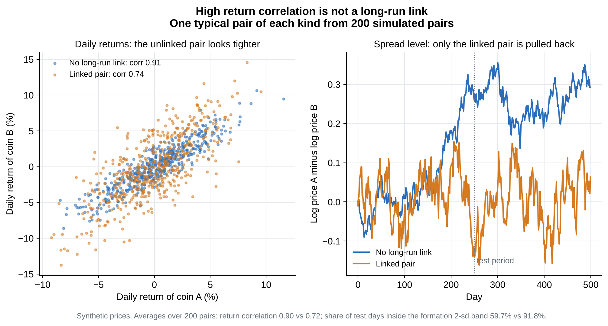

**ภาพ 7.1 correlation ของผลตอบแทนสูงไม่ได้แปลว่าส่วนต่างจะถูกดึงกลับ**

อ่านภาพด้วยกัน: ด้านซ้ายคือผลตอบแทนรายวันของเหรียญ A กับ B จุดสีน้ำเงินของคู่ที่ไม่มีอะไรผูกเกาะกลุ่มแน่นกว่า ด้านขวาคือส่วนต่างของ log price ตลอด 500 วัน เส้นสีน้ำเงินเดินออกไปแล้วไม่กลับ เส้นสีส้มแกว่งแรงกว่าแต่กลับมารอบเดิม ทั้งสองคู่เป็นตัวอย่างที่มีค่าใกล้ค่าเฉลี่ยของแบบตัวเอง ราคาทั้งหมดจำลองขึ้น

ยังมีกับดักที่สองซ่อนอยู่ครับ ถ้าเราประมาณ AR(1) ของส่วนต่างในช่วงเลือกคู่ ตามวิธีในบท 9 คู่ที่ไม่มีอะไรผูกได้ค่า φ เฉลี่ย 0.976 ซึ่งแปลเป็น half-life ราว 28.5 วัน ดูเหมือนส่วนต่างกลับช้า ๆ ทั้งที่ข้อมูลสร้างจากการเดินสุ่มที่ไม่กลับเลย ค่า φ ที่ใกล้ 1 แยกการกลับช้ามากออกจากการไม่กลับได้ยาก ตามที่หัวข้อ 09.02 อธิบายไว้ การทดสอบ cointegration แบบ Engle–Granger ถูกออกแบบมาเพื่อคำถามนี้ และต้องใช้ค่าวิกฤตที่รองรับส่วนต่างซึ่งประมาณขึ้นจากข้อมูลเดียวกัน [R17](#ref-r17)

<a id="statistical_pairs_07_03"></a>

### 07.03 แบ่งช่วงเลือกคู่กับช่วงทดสอบ

ทุกการเลือกที่ใช้ข้อมูลต้องมีช่วงที่ใช้เลือก และช่วงที่ไม่ได้แตะระหว่างเลือก ในงานเลือกคู่ ช่วงแรกเรียกว่า formation period ใช้ประมาณค่ากลาง สเกล hedge ratio และตัดสินว่าคู่ผ่านเกณฑ์หรือไม่ ช่วงที่สองเรียกว่า test period ใช้ดูว่าสิ่งที่เห็นในช่วงแรกยังอยู่หรือไม่ โดยห้ามย้อนกลับไปแก้เกณฑ์

ตัวอย่างในหัวข้อ 07.02 ใช้ 250 วันแรกเป็นช่วงเลือก และ 250 วันหลังเป็นช่วงทดสอบ กรอบ ±2 sd คำนวณจากช่วงเลือกเท่านั้น แล้วตรึงไว้ ถ้าเราคำนวณค่ากลางและ sd จากทั้ง 500 วัน ส่วนต่างในช่วงทดสอบจะดูอยู่ในกรอบมากกว่าความจริง เพราะกรอบได้ปรับตัวเข้าหาข้อมูลที่มันควรถูกทดสอบไปแล้ว นี่คือ leakage แบบเดียวกับที่หัวข้อ 02.09 เตือนไว้

กฎสามข้อที่ใช้กับทุกคู่ ข้อแรก รายชื่อเหรียญที่เป็นผู้สมัครต้องมาจากข้อมูลที่มีอยู่ ณ วันเริ่มช่วงเลือก เหรียญที่ถูกถอดออกจาก exchange ระหว่างทางก็ต้องอยู่ในรายชื่อด้วย ข้อสอง ระยะเวลาของสองช่วงต้องเขียนไว้ก่อน ไม่ใช่ลองหลายแบบแล้วเลือกแบบที่ผลดี ข้อสาม ถ้าดูผลช่วงทดสอบแล้วกลับไปแก้อะไรก็ตาม ช่วงนั้นกลายเป็นส่วนหนึ่งของการเลือกไปแล้ว ต้องหาช่วงใหม่มาทดสอบ

<a id="statistical_pairs_07_04"></a>

### 07.04 ยิ่งค้นมาก ยิ่งเจอคู่ที่ดูดีโดยบังเอิญ

ตลาดคริปโตมีเหรียญหลายร้อยตัว ถ้าจับคู่ทุกตัวจะได้หลายหมื่นคู่ การค้นแบบนี้ทำได้ง่ายด้วยโค้ดไม่กี่บรรทัด และนั่นคือปัญหาครับ เมื่อค้นมากพอ เราจะเจอคู่ที่ดูดีในอดีตเสมอ แม้ไม่มีคู่ไหนผูกกันจริงเลย

ลองจำลองดู สร้างคู่แบบที่ไม่มีอะไรผูกระยะยาว 200 คู่ ทุกคู่มี correlation ของผลตอบแทนราว 0.90 แล้วจัดอันดับด้วยเกณฑ์ที่นิยมใช้ คือจำนวนครั้งที่ส่วนต่างข้ามค่ากลางในช่วงเลือก ยิ่งข้ามบ่อยยิ่งดูเหมือนกลับเร็ว เลือก 10 อันดับแรก แล้วเทียบกับคู่ที่ผูกกันจริง 10 คู่

| กลุ่ม | ครั้งที่ข้ามค่ากลางในช่วงเลือก (เฉลี่ย) | วันในช่วงทดสอบที่อยู่ในกรอบ ±2 sd | \|z\| สูงสุดในช่วงทดสอบ (เฉลี่ย) |
| --- | --- | --- | --- |
| ทั้ง 200 คู่ที่ไม่มีอะไรผูก | 13.5 | — | — |
| 10 อันดับแรกที่เลือกจาก 200 คู่นั้น | 32.3 | 60.2% | 4.82 |
| 10 คู่ที่ผูกกันจริง | 39.2 | 93.7% | 3.05 |

ในช่วงเลือก 10 คู่ที่ถูกคัดมาดูเกือบดีเท่าคู่จริง ข้ามค่ากลางเฉลี่ย 32 ครั้งเทียบกับ 39 ครั้ง แต่ในช่วงทดสอบ ส่วนต่างหลุดกรอบไปราว 40% ของวัน และไปไกลถึงเกือบ 5 sd ส่วนคู่ที่ผูกกันจริงยังอยู่ในกรอบราว 94% ของวัน สิ่งที่เราเลือกได้จาก 200 คู่จึงเป็นความบังเอิญของช่วงเลือก ไม่ใช่ความผูกพัน

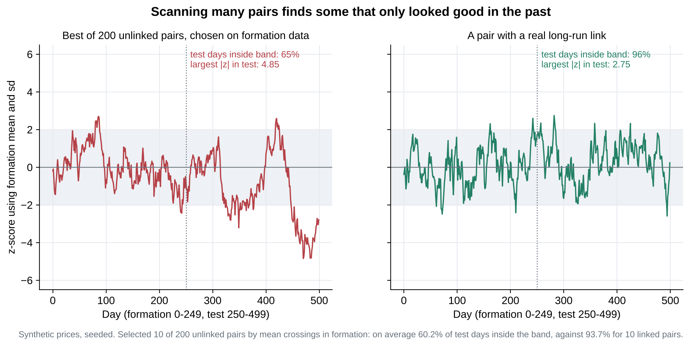

**ภาพ 7.2 การค้นหลายคู่ทำให้เจอคู่ที่ดูดีเฉพาะในอดีต**

อ่านภาพด้วยกัน: แกนตั้งคือ z-score ที่ใช้ค่ากลางและ sd จากช่วงเลือก แถบสีเทาคือกรอบ ±2 เส้นประแนวตั้งแบ่งช่วงเลือกกับช่วงทดสอบ ด้านซ้ายคือคู่อันดับหนึ่งจาก 200 คู่ที่ไม่มีอะไรผูก ซึ่งข้ามค่ากลาง 38 ครั้งในช่วงเลือก แต่ช่วงทดสอบหลุดลงไปถึง −4.85 ด้านขวาคือคู่ที่ผูกกันจริง ซึ่งยังแกว่งอยู่ในกรอบเกือบตลอด

วิธีป้องกันมีสี่ข้อ ข้อแรก เริ่มจากเหตุผลของคู่ตามตารางในหัวข้อ 07.01 ก่อนค้น และจำกัดผู้สมัครให้เหลือเฉพาะคู่ที่มีเหตุผล ข้อสอง นับและบันทึกจำนวนคู่ที่ลองทั้งหมด เพราะยิ่งลองมาก ผู้ชนะยิ่งน่าสงสัย ข้อสาม ทดสอบทุกคู่ที่ผ่านด้วยช่วงที่ไม่ได้ใช้เลือก ข้อสี่ ตั้งความคาดหวังว่าคู่ที่ผ่านช่วงเลือกส่วนใหญ่จะไม่ผ่านช่วงทดสอบ งานของ QuantRocket เป็นกรณีศึกษาเรื่องการคัดคู่และผลที่เปลี่ยนไปเมื่อเวลาผ่านไป อ่านต่อได้ [R4](#ref-r4)

<a id="statistical_pairs_07_05"></a>

### 07.05 จากคู่ที่เลือกสู่จำนวนที่ถือ

เมื่อได้คู่ที่ผ่านแล้ว ยังต้องตัดสินใจว่าจะถือแต่ละขาเท่าไร บท 4 แสดงว่าคู่เดียวกันกำหนดขนาดขา hedge ได้อย่างน้อยห้าวิธี และแต่ละวิธีตอบเป้าหมายต่างกัน ตารางในหัวข้อ 04.02 ใช้ได้ตรง ๆ กับคู่เหรียญ

ในคริปโตมีสามเรื่องที่ต้องระวังเพิ่ม เรื่องแรก เหรียญเล็กมักผันผวนกว่าและตอบสนองต่อตลาดแรงกว่าเหรียญใหญ่ การถือสองขามูลค่าเท่ากันจึงไม่ทำให้ความไวต่อตลาดเป็นศูนย์ เรื่องที่สอง ถ้าส่วนต่างนิยามด้วย log price หัวข้อ 02.06 อธิบายว่าการเปลี่ยนของส่วนต่างไม่ใช่กำไรของจำนวนที่ถือคงที่โดยอัตโนมัติ ต้องเลือกว่าจะตรึงจำนวนหรือตรึงมูลค่า และถ้าตรึงมูลค่าต้องลงบัญชีการปรับสถานะทุกครั้ง เรื่องที่สาม ขาที่จะ short อาจต้องใช้ perp แทนการยืมเหรียญ ซึ่งนำ funding และหลักประกันจากบท 6 เข้ามาในกลยุทธ์ด้วย

งาน pairs trading ของ Palomar แยกเรื่องราคาของส่วนต่างกับจำนวนที่ถือจริงไว้ให้ศึกษาต่อ [R1](#ref-r1) ส่วนกฎเข้า ถือ และออกจากคู่ที่เลือกแล้วอยู่ในบท 8

<a id="statistical_pairs_07_06"></a>

### 07.06 ทะเบียนคู่: เหตุผล เกณฑ์ผ่าน และเกณฑ์คัดออก

ทุกคู่ที่ศึกษาควรมีบันทึกหนึ่งแถวในทะเบียน ทั้งคู่ที่ผ่านและคู่ที่ไม่ผ่าน คู่ที่ไม่ผ่านสำคัญพอกัน เพราะเป็นหลักฐานว่าเราลองไปกี่ครั้ง ตัวอย่างต่อไปนี้เป็นคู่สมมติของเหรียญ A กับ B ที่แข่งในกลุ่มเดียวกัน เกณฑ์ทุกตัวเป็นตัวอย่างที่ต้องกำหนดเองก่อนดูข้อมูล

| ช่อง | ตัวอย่างที่เติมแล้ว |
| --- | --- |
| เหตุผลของคู่ | A และ B เป็นเหรียญของสองเครือข่ายที่แข่งในกลุ่มเดียวกัน คาดว่าปัจจัยของกลุ่มกระทบทั้งคู่ ระดับความผูกพัน: เชื่อมทางเศรษฐกิจ |
| สิ่งที่จะทำให้เหตุผลหายไป | เครือข่ายใดเครือข่ายหนึ่งถูกโจมตี เปลี่ยนกลไกสำคัญ หรือถูกถอดออกจาก exchange หลัก |
| ข้อมูลและช่วงเวลา | ราคาปิดรายวัน ช่วงเลือก 250 วัน ช่วงทดสอบ 250 วันถัดไป รายชื่อผู้สมัครจาก ณ วันเริ่มช่วงเลือก |
| เกณฑ์ผ่านช่วงเลือก | ผ่านการทดสอบ cointegration ที่ระดับที่กำหนด และ half-life สั้นกว่าระยะถือที่ยอมรับ |
| เกณฑ์ผ่านช่วงทดสอบ | ส่วนต่างอยู่ในกรอบ ±2 sd ของช่วงเลือกอย่างน้อย 85% ของวัน และกฎในบท 8 ให้ผลสุทธิหลังต้นทุนเป็นบวก |
| เกณฑ์คัดออก | ไม่ผ่านช่วงทดสอบ หรือเกิดเหตุการณ์ในช่องที่สอง |
| การประเมินใหม่ | ทุก 90 วันด้วยข้อมูลใหม่ที่ยังไม่เคยใช้ คู่ที่ถูกคัดออกกลับมาได้เมื่อมีเหตุผลใหม่ ไม่ใช่เพราะกราฟดูดีขึ้น |
| สถานะ | ผู้สมัคร ผ่านช่วงเลือก ผ่านช่วงทดสอบ ใช้งาน พัก หรือคัดออก พร้อมวันที่และเหตุผล |
| จำนวนคู่ที่ลองในรอบนี้ | บันทึกเป็นตัวเลข เช่น 12 คู่จากกลุ่มเดียวกัน |

ทะเบียนนี้เชื่อมกับสามแกนของเล่ม: Asset Selection อยู่ในช่องเหตุผล Workflow อยู่ในช่องข้อมูลและเกณฑ์ ส่วน Position Management อยู่ในช่องสถานะ ซึ่งบท 10 จะใช้ต่อเมื่อคู่ที่ใช้งานอยู่เริ่มเสื่อม

<a id="statistical_pairs_07_07"></a>

### 07.07 ลองตัดสินใจก่อนเปิดเฉลย

ข้อ 1 — correlation 0.95: ผลตอบแทนรายวันของสองเหรียญมี correlation 0.95 ในปีที่ผ่านมา เพื่อนบอกว่า “สัมพันธ์กันขนาดนี้ ส่วนต่างต้องกลับแน่” คุณจะตอบอย่างไร และต้องดูอะไรเพิ่ม?

ข้อ 2 — ผู้ชนะจาก 500 คู่: คุณค้น 500 คู่แล้วพบคู่หนึ่งที่ส่วนต่างข้ามค่ากลาง 40 ครั้งในช่วงเลือก มากที่สุดในทุกคู่ ก่อนเชื่อว่าคู่นี้ผูกกันจริง ต้องทำอะไรบ้าง?

ข้อ 3 — half-life ที่ไม่มีจริง: คู่หนึ่งให้ φ = 0.976 จากข้อมูลช่วงเลือก คิดเป็น half-life ราว 28.5 วัน ข้อมูลนี้พอให้สรุปว่าส่วนต่างกลับช้า ๆ หรือไม่?

ข้อ 4 — โทเคนที่แลกคืนได้: เขียนสามช่องแรกของทะเบียนคู่สำหรับคู่ “โทเคนที่แลกคืนเป็นเหรียญ X ได้ กับเหรียญ X เอง” ระดับความผูกพันอยู่แถวไหน และอะไรจะทำให้เหตุผลหายไป?

<a id="statistical_pairs_07_08"></a>

### 07.08 เฉลยและหน้าทบทวน

เฉลยข้อ 1: correlation 0.95 บอกว่าสองเหรียญขยับทางเดียวกันในวันเดียวกัน แต่ไม่บอกว่าเมื่อห่างกันแล้วจะถูกดึงกลับ ตัวอย่างในหัวข้อ 07.02 มีคู่ที่ correlation 0.90 แต่ส่วนต่างเดินออกไปเรื่อย ๆ ต้องดูเหตุผลที่ผูกคู่ไว้ ผลการทดสอบ cointegration ในช่วงเลือก และพฤติกรรมของส่วนต่างในช่วงทดสอบที่ไม่ได้ใช้เลือก

เฉลยข้อ 2: คู่ที่ดีที่สุดจาก 500 คู่ถูกเลือกเพราะดูดีในช่วงเลือก จึงมีโอกาสสูงที่จะเป็นความบังเอิญ ตามตัวอย่างในหัวข้อ 07.04 ต้องหาเหตุผลทางเศรษฐกิจของคู่ บันทึกว่าลองไป 500 คู่ ทดสอบกับช่วงที่ไม่ได้ใช้เลือกโดยตรึงเกณฑ์ไว้ และเทียบกับจำนวนครั้งที่ข้ามค่ากลางซึ่งคู่ที่ไม่มีอะไรผูกทำได้โดยบังเอิญ

เฉลยข้อ 3: ไม่พอ ในหัวข้อ 07.02 คู่ที่สร้างจากการเดินสุ่มซึ่งไม่กลับเลยก็ให้ φ เฉลี่ย 0.976 ในช่วงเลือก ค่า φ ใกล้ 1 แยกการกลับช้ามากออกจากการไม่กลับได้ยาก ต้องใช้การทดสอบที่ออกแบบสำหรับคำถามนี้ ดูความไม่แน่นอนของ φ และดูช่วงทดสอบ

เฉลยข้อ 4: ตัวอย่างคำตอบ เหตุผลของคู่: ผู้ที่แลกคืนได้จะซื้อโทเคนเมื่อราคาต่ำกว่าเหรียญ X แล้วแลกคืนเพื่อเก็บส่วนต่าง ระดับความผูกพันคือแลกคืนได้แต่มีเงื่อนไข สิ่งที่จะทำให้เหตุผลหายไป: คิวแลกคืนยาวจนเกินระยะถือ การแลกคืนถูกระงับ หรือผู้ออกโทเคนมีปัญหา ข้อมูลและช่วงเวลา: ราคาของทั้งสองขา ประวัติระยะเวลารอแลกคืน และกติกาการแลกคืนในแต่ละช่วง

หน้าทบทวน: เมื่อเห็นคู่ที่ “วิ่งด้วยกัน” ให้ถามตามลำดับ คู่นี้ผูกกันด้วยอะไรตามตารางในหัวข้อ 07.01 correlation ที่เห็นเป็นเรื่องรายวันหรือเรื่องส่วนต่างระยะยาว เลือกคู่ด้วยข้อมูลช่วงไหน และทดสอบด้วยช่วงไหน ลองไปกี่คู่กว่าจะเจอคู่นี้ และถ้าไม่ผ่าน คู่นี้จะถูกบันทึกในทะเบียนอย่างไร

ทางอ่านต่อ: บท 8 นำคู่ที่ผ่านทะเบียนไปเขียนกฎเข้า ถือ และออก บท 9 ลงลึกเรื่องหลักฐานของแรงดึงกลับ ส่วนโค้ด v09_ch06_ch07_demo.py สร้างราคาจำลองและตัวเลขทุกตัวในบทนี้ด้วย seed คงที่

<a id="decision_rules"></a>

## บท 8 จากค่าที่ plot สู่กฎเข้า ถือ ออก

แปลงสัญญาณเป็นจำนวน คำสั่ง และเหตุผลที่ออก

> **ก่อนอ่าน:** บท 3 เรื่องบัญชีตาม fill บท 5 และบท 7
>
> **เมื่อจบบท คุณควรทำได้:** แปลงค่าที่ plot เป็นจำนวนที่จะถือ เขียนกฎเข้า ถือ และออก แยกเหตุออกแต่ละแบบ และจัดการคำสั่งที่ fill ไม่ครบ
>
> **ตัวอย่างหลักของบท:** short ตะกร้า 10 หน่วยที่ X = 2.1 กับสามเส้นทางออกที่ได้ 16, 2 และ −21

<a id="decision_rules_08_01"></a>

### 08.01 จากค่าที่ plot สู่จำนวนที่จะถือและคำสั่ง

บท 5 ให้แผนที่ของวิธีสร้างกลยุทธ์ และบท 7 ให้วิธีเลือกคู่ บทนี้กลับมาที่คำถามภาคปฏิบัติครับ: เห็นค่าที่ plot แล้ว จะถือเท่าไร เข้าเมื่อไร ถือต่อหรือออกเมื่อไร และเมื่อสั่งออกแล้วต้องทำอะไรต่อ ตัวอย่างหลักใช้ตะกร้าสมมติที่กำหนดค่ากลางและสเกลไว้ล่วงหน้า เพื่อแยกเรื่องกฎออกจากเรื่องการประมาณค่า ซึ่งบท 9–10 จะกลับมาถาม

การออกแบบ signal เริ่มจากคำถามอนาคตที่ชัด แล้วค่อยเลือกตัวแปร ตัวอย่างเช่น เมื่อ X เป็น implied financing ที่คำนวณจาก futures เราอาจถามว่า carry หลังต้นทุนเงินทุนและการชำระจะคุ้มหรือไม่ หาก X เป็น residual score เราอาจถามว่าผลราคาใน horizon ถัดไปมีทิศและขนาดใด ไม่ใช้เพียงความรู้สึกว่าเส้นอยู่สูงหรือต่ำ ขั้นตอนต่อไปคือกำหนด candidate holdings และคำนวณผลที่คาดว่าจะได้รับจากจำนวนเหล่านั้น

$$
\widehat{G}_t(q)=\sum_i q_i\widehat{E}[P_{i,t+H}-P_{i,t}\mid\mathcal I_t]-\widehat{C}_t(q)-b_t(q)
$$

อ่านสมการ: q คือจำนวนคงที่ตลอด H และ P มีหน่วยเงินต่อหน่วยที่ q นับ ถ้านับสัญญา futures ต้องใส่ multiplier และแปลงสกุลเงินให้ตรงกัน P ณ t เป็นราคาอ้างอิงตอนตัดสินใจ C รวมต้นทุนเข้า ออก ค่าถือ และผลเสียของราคา fill เทียบ P ณ t และ t+H ตามลำดับ โดยประมาณด้วยข้อมูล ณ t ส่วน b คือส่วนเผื่อความไม่แน่นอน ไม่ใช่ค่าธรรมเนียมจริง ถ้ามีปันผลหรือกระแสเงินอื่นต้องเพิ่มให้ครบ

ตัวอย่างสมมติ: พิจารณา long A 10 หน่วยและ short B 10 หน่วย โมเดลคาดว่าราคา A เพิ่ม 0.8 และ B เพิ่ม 0.2 ใน horizon เดียวกัน กำไรราคาคาดหวังคือ 10×0.8−10×0.2 = 6 ถ้าต้นทุนทั้งรอบที่คาดเป็น 3 จะเหลือ expected net 3 และหากกำหนดส่วนเผื่อ 1 จะเหลือ decision margin 2 ตัวเลขนี้ยังไม่ใช่ realized P&L และตัวคูณจำนวนไม่ได้พิสูจน์ว่า hedge แล้ว ต้องตรวจราคาปัจจุบัน beta และ exposures เพิ่ม

| ลำดับ | คำถามที่ต้องตอบก่อนเดินต่อ |
| --- | --- |
| ข้อมูลและเวลา | รู้ X ณ เวลาใด และคำสั่งแรกที่ใช้ X ส่งได้เมื่อใด |
| ผลอนาคต | คาดราคา return หรือ cash flow อะไร ใน horizon เท่าไร |
| Holdings | เลือกเครื่องมือ จำนวน multiplier และเงินทุนอย่างไร |
| เกณฑ์เข้า | ผลคาดหวังหลังต้นทุนและส่วนเผื่อผ่านหรือไม่ พร้อมข้อจำกัดความเสี่ยง |
| คำสั่ง | จากจำนวนที่มีจริงต้องซื้อขายเพิ่มหรือลดเท่าไร และยอมรับ fill แบบใด |
| ตรวจผล | แยก forecast สถานะเป้าหมาย จำนวน fill และผลสุทธิจริง |

Cvxportfolio มีตัวอย่าง market-neutral ที่รวม forecast, risk และต้นทุนไว้ใน objective พร้อมข้อจำกัดพอร์ต โค้ดนี้ช่วยให้เห็นว่า prediction กับ hedge เป็นคนละส่วนของระบบ [R35](#ref-r35) แต่ตัวอย่างที่เปิดอ่านเลือก hyperparameters และ backtest ในช่วง START/END เดียวกัน จึงยังใช้แทนการประเมินบนช่วงเวลาที่ไม่แตะระหว่างเลือกวิธีไม่ได้ เราจะใช้โครงสร้างการตัดสินใจของตัวอย่าง และออกแบบการแบ่งข้อมูลใหม่เมื่อต้องการทดสอบผลจริง

| กลไก | Candidate signal สำหรับเข้า | เหตุออกตามแนวคิด |
| --- | --- | --- |
| Mean reversion | ความคลาดเคลื่อนและความเร็วที่คาดให้ผลสุทธิคุ้ม | กลับเข้าเขตออกหรือโอกาสคงเหลือไม่คุ้ม |
| Prediction / momentum | ผลอนาคตของ candidate holdings หลังต้นทุนเป็นบวกพอ | forecast ใหม่ไม่รองรับการถือต่อหรือครบ horizon |
| Volatility relative value | ผลจากความผันผวนที่คาดคุ้มราคา options และ hedge costs | edge หาย exposure เกินข้อจำกัด หรือครบอายุที่กำหนด |
| Futures curve / carry | ส่วนต่างเทียบเหตุผลด้านเส้นราคาและค่าถือ | ถึงมูลค่าเป้าหมาย ก่อน expiry หรือข้อสมมติเปลี่ยน |
| Market making | quote มีผลคาดหมายคุ้มเมื่อรวม fill และ inventory | ปรับหรือถอน quote ลด inventory และคุมอายุการถือ |

ตารางนี้เป็นโจทย์สำหรับวิจัย ไม่ใช่ threshold สำเร็จรูป เมื่อ expected net เป็นบวกแต่ข้อมูลไม่น่าเชื่อถือ margin ไม่พอ หรือคำสั่งทำไม่ได้ เราเลือกไม่เปิดได้ ส่วนสถานะที่เปิดแล้วต้องใช้ต้นทุนคงเหลือและกฎออกของมัน ไม่ทดสอบเงื่อนไขเปิดใหม่ซ้ำแล้วถือว่านั่นเป็นคำตอบเรื่องการถือต่อ ส่วนถัดไปจะแยกการตัดสินใจเหล่านี้ให้ครบ

<a id="decision_rules_08_02"></a>

### 08.02 การเข้า การถือต่อ และการออกตอบคนละคำถาม

ก่อนเปิดสถานะ เราถามว่าประโยชน์คาดหวังคุ้มต้นทุนทั้งรอบและความเสี่ยงหรือไม่ เมื่อถือแล้ว เราถามว่าจากเวลานี้ควรถือต่อหรือปิด ข้อมูลและต้นทุนที่ยังหลีกเลี่ยงได้ต่างกัน จึงไม่จำเป็นต้องใช้เส้นเดียวกันทั้งเข้าและออก

ค่าธรรมเนียมเข้าที่จ่ายแล้วต้องอยู่ในกำไรสุทธิของรอบนั้น แต่เมื่อเปรียบเทียบ “ปิดตอนนี้” กับ “ถือต่อแล้วปิด” ต้นทุนเข้าที่ผ่านไปเป็นรายการร่วมของทั้งสองทางเลือก เราควรเทียบการเปลี่ยนราคา กระแสเงินและต้นทุนระหว่างถือ ต้นทุนปิดในแต่ละเวลา และทุนที่ยังผูกอยู่ การรอเพียงเพื่อให้ยอดกลับมาเท่าทุนเดิมไม่ได้ทำให้ผลคาดหมายจากวันนี้ดีขึ้น

ส่วน loss limit ยังวัดผลสะสมได้ เพราะกำหนดว่ารอบนี้ยอมเสียทุนเท่าไร แยกบัญชีที่รวมต้นทุนครบออกจากคำถามว่าต้นทุนใดยังเปลี่ยนได้ และอย่าหักผลเสียของราคา fill ซ้ำในชื่อ slippage

| เหตุผลที่ออกหรือพัก | สิ่งที่ใช้ตรวจ | การตัดสินใจ |
| --- | --- | --- |
| โอกาสหมดหรือถึงเป้า | spread กลับ หรือผลคาดหมายคงเหลือต่ำ | ปิดตามกฎ แม้กำไรสุทธิอาจยังติดลบ |
| ขาดทุนถึงงบ | P&L ของตะกร้าจริงรวมต้นทุน | ลดหรือปิดตาม loss policy |
| ถือครบเวลา | อายุสถานะจากนาฬิกาที่กำหนด | ออกเมื่อเกิน horizon ที่อนุญาต |
| ข้อมูลหรือโมเดลไม่ผ่าน | ข้อมูลผิด ข้อสมมติหรือการประมาณใช้ไม่ได้ | พักเปิดใหม่ และใช้แผนสถานะค้าง |
| ทุนหรือความเสี่ยงไม่พอ | margin เงินสด exposure และ stress | ลดความเสี่ยงตามข้อจำกัดทุน |
| execution ไม่สำเร็จ | partial fill คำสั่งถูกปฏิเสธหรือหมดเวลา | ยกเลิกส่วนค้างและจัดการจำนวนที่ได้จริง |

คำว่า stop จึงต้องตามด้วยว่าวัดอะไร ที่ระดับขา ตะกร้า หรือบัญชี และส่งผลต่อการเปิดใหม่หรือสถานะเดิมอย่างไร การให้ z กลับถึงเส้นออกเป็นกฎปิดตามสัญญาณ ไม่ได้รับรองว่าได้เงินครบเป้า ส่วน margin อาจบังคับให้ลดสถานะก่อนโอกาสที่คาดไว้จะเกิดขึ้น [R23](#ref-r23)

ลองถือ long A และ short B ด้วยมูลค่าเริ่มต้นเท่ากัน หากราคาทั้งคู่ขึ้นเป็นสัดส่วนเดียวกัน ขา short อาจขาดทุนในขณะที่กำไรรวมใกล้ศูนย์ การตั้ง stop รายขาโดยไม่ตรวจพอร์ตอาจตัดขาที่ช่วย hedge ออก หากต้องใช้การคุมความเสี่ยงรายขาจริง ต้องระบุด้วยว่าจะทำอย่างไรกับขาที่เหลือ

<a id="decision_rules_08_03"></a>

### 08.03 ตัวอย่างสามเส้นทางที่ออกด้วยคนละเหตุผล

ตัวเลขต่อไปนี้กำหนดเพื่อฝึกตรรกะและบัญชี ไม่ใช่ค่าที่เหมาะที่สุดหรือผล backtest ให้ X = A − B เป็นราคาตะกร้าคงน้ำหนัก กำหนด B = 100 ทุกจุด ค่าเฉลี่ย μ = 0 และส่วนเบี่ยงเบนมาตรฐาน σ = 1 ถูกกำหนดไว้ก่อนเริ่มและไม่เปลี่ยนระหว่างรอบ จึงได้ z = X ในตัวอย่างนี้

เมื่อไม่มีสถานะ ไม่ได้อยู่ใน PAUSED และ X ≥ 2 ให้เปิด short ตะกร้า 10 หน่วย คือ short A 10 หน่วยและ long B 10 หน่วย หลังเปิดแล้ว ออกตามปกติเมื่อ X ≤ 0.5 ออกเมื่อกำไรสุทธิที่ประเมินว่าปิดได้ลดถึง −15 หรือเมื่อครบ 3 ช่วงหลังการเข้า แล้วแต่ว่าเหตุใดเกิดก่อน ต้นทุนเข้า 0.4 และต้นทุนออก 0.6 รวม 1 หน่วยเงิน ไม่มีต้นทุนอื่นในโจทย์

ในโค้ดตัวอย่าง ถ้าเหตุออกเกิดพร้อมกันให้ตรวจ loss ก่อน signal แล้วจึง time เมื่อออกเพราะ loss จะคงสิทธิ์เปิดใหม่เป็น PAUSED (หัวข้อ 10.03) จนมีการ resume ชัดเจนขณะ flat และผ่าน checks การกลับมาของสัญญาณเข้าเพียงอย่างเดียวไม่เปิดรอบใหม่

$$
\widehat{\Pi}_{\mathrm{liq},t}=10(X_e-X_t)-0.4-0.6
$$

อ่านสมการ: X ที่ e คือราคาตะกร้าตอนเข้า สำหรับ short 10 หน่วย การลดของ X ทำให้ได้กำไร หักค่าเข้าที่จ่ายแล้ว 0.4 และค่าออกที่สมมติว่าจะจ่าย 0.6 เพื่อประเมินยอดสุทธิหากปิด ณ จุดนั้น เมื่อปิดจริงต้องแทนด้วยราคา fill และค่าใช้จ่ายจริง

สมมติให้ซื้อขายได้ครบที่ราคาของจุดสังเกตทันทีเพื่อแยกเรื่องบัญชีออกมาศึกษา ทุกเส้นเริ่ม flat ที่ X = 0 แล้วเปิดที่ X = 2.1 นับจุดที่เปิดเป็นอายุศูนย์ จุดสังเกตถัดไปจึงมีอายุ 1, 2 และ 3 ช่วง สมมติฐานนี้ยังไม่มีคิว maker ความล่าช้า หรือ partial fill

| เส้นทาง X ตามจุดสังเกต | เหตุผลที่ปิด | กำไรสุทธิ |
| --- | --- | --- |
| 0 → 2.1 → 1.7 → 0.4 | กลับถึงเส้นออก เมื่ออายุ 2 ช่วง | 10 × 1.7 − 1 = 16 |
| 0 → 2.1 → 2.0 → 1.9 → 1.8 | ครบเวลา 3 ช่วง แม้ยังไม่ถึง 0.5 | 10 × 0.3 − 1 = 2 |
| 0 → 2.1 → 2.8 → 4.1 | ตรวจพบว่าขาดทุนเกินงบ | 10 × (−2.0) − 1 = −21 |

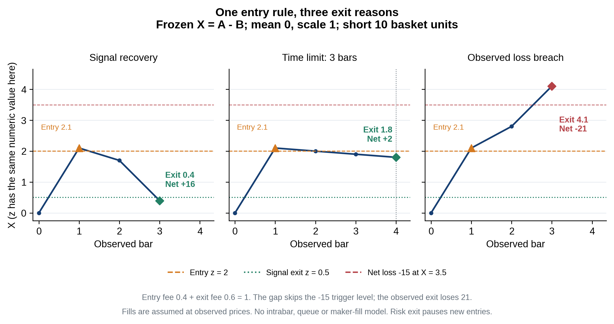

**ภาพ 8.1 สามเส้นทางสมมติกับกฎออกตามสัญญาณ เวลา และขาดทุน**

อ่านภาพด้วยกัน: อ่านจากจุดเข้าเดียวกันที่ X = 2.1 เส้นแรกออกเมื่อ X ต่ำกว่า 0.5 เส้นที่สองออกเมื่อครบ 3 ช่วง และเส้นที่สามออกเมื่อจุดสังเกตแสดงผลขาดทุนเกินงบ เส้นที่เชื่อมจุดใช้ช่วยอ่านลำดับ ไม่ได้เพิ่มข้อมูลราคาและโอกาส fill ระหว่างจุด

สำหรับราคาเข้าชุดนี้ ขอบขาดทุน −15 ตรงกับ X = 3.5 เพราะ 10(2.1 − 3.5) − 1 = −15 แต่ข้อมูลตัวอย่างกระโดดจาก 2.8 ไป 4.1 ณ จุดที่ตรวจและปิดได้ผลจึงเป็น −21 ไม่ใช่ −15 อย่าเขียน backtest ว่าได้ปิดที่ 3.5 ทั้งที่ไม่มีข้อมูลหรือแบบจำลอง execution รองรับการ fill ตรงนั้น

Time stop ในเส้นที่สองปิดด้วยกำไรได้ ส่วนเส้นแรกต้องตรวจจำนวนที่ถือกับราคาจริง หาก mean หรือ scale เปลี่ยนจน z หดตัวโดยราคาไม่เปลี่ยน กำไรจะไม่เหมือนตัวอย่างนี้

ด้าน long เปิด A +10 และ B −10 เมื่อ X ≤ −2 ออกตามปกติเมื่อ X ≥ −0.5 ใช้ขอบขาดทุนสุทธิและเวลาเดิม กำไรราคาคือ 10(X ตอนออก − X ตอนเข้า) และกำไรสุทธิได้จากการหักต้นทุน 1 ความสมมาตรเป็นสมมติฐานการสอน; ต้นทุนยืม สภาพคล่อง และข้อจำกัดจริงอาจต่างกันสองด้าน

<a id="decision_rules_08_04"></a>

### 08.04 เมื่อสัญญาณสั่งออก ต้องจัดการคำสั่งและสถานะต่อ

โปรแกรมต้องรู้ทั้งเป้าที่ตั้งใจและจำนวนที่ fill แล้ว การส่งคำสั่งปิดยังไม่ทำให้ความเสี่ยงหายไป ระบบควรแยกขั้นทำงานต่อไปนี้และอัปเดตบัญชีจาก order events [R2](#ref-r2) [R48](#ref-r48)

| สถานะ | ความหมาย | งานที่ยังต้องทำ |
| --- | --- | --- |
| FLAT | ไม่มี holdings และคำสั่งค้างที่เปิดความเสี่ยงได้ | ตรวจสิทธิ์เปิดและเงื่อนไขเข้า |
| OPENING | ส่งคำสั่งเข้าแล้ว อาจได้เพียงบางขา | ตรวจ fills เวลา และ exposure จริง |
| OPEN | ได้สถานะตามกฎที่ยอมรับ | ตรวจออก ขาดทุน เวลา ทุน และโมเดล |
| CLOSING | กำลังปิดหรือลดจำนวนที่มีจริง | ติดตามส่วนค้างจนกระทบยอดได้ |

ระบบจริงมีสถานะที่ห้าคือ PAUSED ซึ่งไม่ได้บอกว่าถืออะไร แต่บอกว่ายังมีสิทธิ์เปิดสถานะใหม่หรือไม่ หัวข้อ 10.03 อธิบายแยก เพราะเกี่ยวกับการตัดสินใจเมื่อหลักฐานเสื่อม

หากตั้งใจ short A 10 และ long B 10 แต่ได้จริง A −10 กับ B +4 ต้องคำนวณ exposure และ P&L ด้วยจำนวนนี้ หากอีกขาถูกปฏิเสธหรือเกินเวลา opening ที่กำหนด ต้องเลือกว่าจะทำชุดให้ครบ ลดส่วนเกิน หรือยกเลิกแผนและปิดส่วนที่มี การส่ง cancel ไม่ได้ย้อนคืน fills ที่เกิดแล้ว ต้องอ่านผลยืนยันและตรวจเหตุการณ์ที่มาถึงระหว่างยกเลิกก่อนส่งคำสั่งชุดใหม่

เมื่อออกจากตะกร้า ต้องวางเป้าลดทั้งสองขาและติดตามจำนวนที่เหลือ การ stop ขาเดียวแล้วปล่อยอีกขาไว้เปลี่ยนความเสี่ยงของกลยุทธ์ คำสั่ง stop-market เองก็ไม่รับรองว่าจะได้ราคา stop เมื่อราคากระโดด จึงต้องแยกจุดที่กฎถูกกระตุ้นออกจากเวลา ราคา และจำนวนที่ปิดได้จริง [R44](#ref-r44)

นโยบายปกติแบบ maker-only ต้องระบุ timeout การปรับราคา และขอบ inventory ที่ยอมรับ ส่วนเหตุฉุกเฉินต้องมีแผนต่างหากที่สอดคล้องกับสิทธิ์ส่งคำสั่งที่กำหนดไว้ หากยังใช้ maker-only ทุกกรณี เรารับรองการปิดทันทีหรือขาดทุนสูงสุดที่แน่นอนไม่ได้ การเปลี่ยนไปใช้คำสั่งชนราคาในเหตุฉุกเฉินต้องเป็นข้อกำหนดที่เลือกไว้ล่วงหน้า ไม่ใช่ข้อสมมติที่ backtest เพิ่มเองเมื่อปิดไม่ทัน

<a id="decision_rules_08_05"></a>

### 08.05 เขียนข้อกำหนดให้ตรวจตามได้ก่อนทดสอบ

เขียน strategy specification ให้ผู้อ่านอีกคนตัดสินใจจากข้อมูลเดียวกันได้ โดยเชื่อม Asset Selection, Workflow และ Position Management แยกสิ่งที่ source ระบุ สมมติฐานที่เราเพิ่ม และผลที่ยังไม่ได้ทำซ้ำ

| หัวข้อ | สิ่งที่ต้องระบุ | คำถามตรวจ |
| --- | --- | --- |
| ข้อมูลและเวลา | universe แหล่งข้อมูล เวลาเผยแพร่และเวลาตัดสินใจ | ค่าใดรู้ได้จริงก่อนส่งคำสั่ง |
| ตัวแปรและหน้าที่ | สูตร X หน่วย horizon; forecast กับ hedge | ค่าเปลี่ยนจากราคา หรือการประมาณใหม่ |
| สถานะและทุน | จำนวน contract multiplier เงินสด margin และ expiry | ถืออะไรและรักษาสถานะผ่านเส้นทางได้หรือไม่ |
| กฎตัดสินใจ | เข้า ออก loss/time stop, pause และ resume | ถ้าเหตุการณ์หลายอย่างเกิดพร้อมกันใช้อะไรก่อน |
| execution และบัญชี | ประเภทคำสั่ง latency partial fill ค่าธรรมเนียมและ carry | สถานะที่ได้จริงตรงเป้าหรือเหลือความเสี่ยงใด |
| การประเมินและ source | ช่วง fit/เลือกวิธี/OOS เวอร์ชันโค้ดและสถานะทำซ้ำ | ผลดีเกิดหลังลองหรือแก้ไปกี่ครั้ง |

ให้ risk ที่กำหนดไว้และการจัดการคำสั่งค้างถูกตรวจแม้ไม่มีสัญญาณใหม่ บันทึกเวลา ข้อมูลที่ใช้ เหตุผลการตัดสินใจ เป้าสถานะ คำสั่ง และ fills แยกกัน หากแท่งเดียวแตะทั้งเส้นกำไรกับเส้นขาดทุน ข้อมูล OHLC เพียงอย่างเดียวอาจไม่บอกว่าเกิดอะไรก่อน ต้องใช้ข้อมูลละเอียดขึ้นหรือกติกาการจำลองที่ประกาศไว้ ไม่เลือกเส้นทางที่ทำให้ผลดีภายหลัง

การ fit ตัวแปร hedge, scaler, OU หรือเส้นเข้าออกต้องอยู่ภายในข้อมูลที่อนุญาตในรอบนั้น การคัดคู่และคัดทิ้งก็เป็นส่วนของกลยุทธ์ หากลองหลายคู่ หลาย stop และหลาย horizon แล้วเลือกผู้ชนะ ต้องบันทึกการทดลองและประเมินต่อด้วยข้อมูลที่ยังไม่ใช้เลือก ช่องว่างของการแบ่งข้อมูลต้องสัมพันธ์กับช่วงที่ label และสถานะทับซ้อน ไม่ใช่ใช้จำนวนเดียวทุกกรณี [R24](#ref-r24) [R25](#ref-r25)

การถือต่อใช้ผลคาดหมายจากปัจจุบันกับต้นทุนคงเหลือ ส่วนรายงานรวมต้นทุนจริงครบทั้งรอบ เมื่อเงื่อนไขไม่ผ่าน การพัก คัดออก หรือเลือกกลไกอื่นเป็นผลวิจัยที่ใช้ได้ โดยยังต้องจัดการสถานะค้างตามแผน

<a id="decision_rules_08_06"></a>

### 08.06 ลองตัดสินใจก่อนเปิดเฉลย

ใช้สมมติฐานและหน่วยของบทนี้ ให้เขียน holdings กระแสเงิน และเหตุผลที่ใช้ตัดสินใจควบคู่กับตัวเลข

ข้อ 1 — ผลคาดหมายกับเกณฑ์เข้า: โมเดลคาด A เพิ่ม 0.8 และ B เพิ่ม 0.2 เราถือ A +10, B −10 ต้นทุนคาด 3 ส่วนเผื่อ 1 จงแยก expected gross, expected net และ decision margin พร้อมบอกว่าต้องรู้อะไรเพิ่มจึงสรุปว่า beta neutral ได้

ข้อ 2 — Gap กับ time stop: Short ตะกร้า 10 หน่วยที่ X = 2.1 ต้นทุนเข้าออก 1 รวมกัน loss limit สุทธิ −15 เส้นออกปกติ 0.5 และ time limit 3 ช่วงหลังเข้า หากสังเกต 2.8 แล้วจุดถัดไปเป็น 4.1 จะรายงาน exit ที่ X = 3.5 ได้หรือไม่? หากเส้นทางหลังเข้าเป็น 2.0, 1.9, 1.8 จะออกเพราะอะไร และกำไรสุทธิเท่าไร?

<a id="decision_rules_08_07"></a>

### 08.07 เฉลยและหน้าทบทวน

เฉลยข้อ 1: Expected gross = 6, expected net = 3 และ decision margin = 2 ส่วนเผื่อ 1 ไม่ใช่ค่าใช้จ่ายจริงในบัญชีหลังเทรด ต้องรู้มูลค่าของแต่ละขาและ beta ใน convention เดียวกันจึงตรวจ market exposure ได้ จำนวน +10/−10 อย่างเดียวไม่พอ

เฉลยข้อ 2: ขอบสมการอยู่ที่ X = 3.5 แต่ไม่ได้มีหลักฐานว่า fill ที่นั่น ตัวอย่างสมมติให้ fill ที่จุดที่สังเกตได้ จึงออกที่ 4.1 และ net = 10(2.1−4.1)−1 = −21 ส่วนเส้นทาง 2.0, 1.9, 1.8 ครบอายุ 3 ช่วง จึงออกด้วย time limit และได้ net = 10×0.3−1 = 2 การหยุดตามเวลาไม่จำเป็นต้องขาดทุน และ loss trigger ไม่ใช่การรับรองขาดทุนสูงสุด

| คำถามทบทวน | หลักที่ควรอธิบายได้ |
| --- | --- |
| ทำไมค่านี้เป็น signal | เชื่อมค่าปัจจุบันกับผลอนาคตของ holdings พร้อมต้นทุน |
| เมื่อใดควรออก | แยกโอกาสหมด ขาดทุน เวลา โมเดล ทุน และ execution |
| ความเสี่ยงลดเมื่อไร | เมื่อ fills ยืนยันว่าจำนวนที่ถือลดลง ไม่ใช่เมื่อส่งคำสั่ง |
| ข้อกำหนดครบหรือยัง | คนอื่นตัดสินใจจากข้อมูลเดียวกันได้ตามตารางในหัวข้อ 08.05 |

ทางอ่านต่อ: ตัวอย่างในบทนี้สมมติว่าตะกร้าจะกลับเข้าค่ากลาง บท 9 ถามว่าสมมติฐานนั้นมีหลักฐานแค่ไหน และบท 10 ว่าด้วยการพักระบบและการกลับมาใช้

<a id="mean_reversion"></a>

## บท 9 Mean reversion ใช้ได้เมื่อไร

หลักฐาน ความเร็วกลับ และเวลาที่ใช้จริง

> **ก่อนอ่าน:** บท 3 เรื่อง spread กับ holdings และบท 8 ถ้าคำว่า conditional expectation หรือ AR(1) ยังไม่คุ้น ให้เปิดภาค II และ V ของ Quant for Non-Quant ประกอบ
>
> **เมื่อจบบท คุณควรทำได้:** บอกว่าตัวแปรใดควรกลับ ประเมินว่ากลับเร็วพอคุ้มต้นทุนหรือไม่ และแยก half-life ออกจากเวลาที่เส้นทางแตะเป้าจริง
>
> **ตัวอย่างหลักของบท:** short ตะกร้า 10 หน่วยที่ X = 2 ปิดหลัง 4 ช่วง ภายใต้ค่า φ ต่างกัน

<a id="mean_reversion_09_01"></a>

### 09.01 เริ่มจากสิ่งที่เราคาดว่าจะกลับ

ตัวอย่างในบท 8 สมมติว่าตะกร้าจะกลับเข้าค่ากลาง บทนี้ถามว่าสมมติฐานนั้นมีหลักฐานแค่ไหน และถ้ากลับจริง กลับเร็วพอจะคุ้มต้นทุนหรือไม่ครับ

เราไม่จำเป็นต้องทำให้ทุกสินทรัพย์เป็น mean reverting และไม่จำเป็นต้องใช้ OU กับทุกกลยุทธ์ สิ่งที่ต้องทำคือระบุให้ชัดว่าเราคาดหวังพฤติกรรมอะไรจากตัวแปรใด มีหลักฐานแค่ไหน และพฤติกรรมนั้นสร้างกำไรจากสถานะที่ซื้อขายได้จริงหรือไม่ เมื่อหลักฐานไม่สนับสนุน การพักหรือคัดออกเป็นผลลัพธ์ของงานวิจัยที่สมบูรณ์ได้

ก่อนถามว่า “สินทรัพย์นี้ไม่ mean revert แล้วทำอย่างไร” ให้ชี้ก่อนว่าสิ่งที่ตรวจคือราคาสินทรัพย์ ราคา spread ผลตอบแทน หรือ residual จากโมเดล ราคาของ A และ B อาจไม่กลับมาที่ระดับเดิม แต่ความสัมพันธ์บางแบบระหว่างสองตัวอาจมีเสถียรภาพ ในทางกลับกัน การที่ผลตอบแทนเฉลี่ยใกล้ศูนย์ไม่ได้ทำให้ราคาหรือผลรวมสะสมของผลตอบแทนต้องย้อนกลับมาศูนย์ แนวคิด cointegration ใช้ตรวจความสัมพันธ์ของหลายอนุกรมในระดับนี้ [R13](#ref-r13)

| สิ่งที่ตรวจ | คำถามที่เหมาะสม | สิ่งที่ยังสรุปไม่ได้ |
| --- | --- | --- |
| ราคาสินทรัพย์ A | มีเหตุผลให้กลับสู่ระดับหรือเส้นสมดุลใด | ราคาไม่กลับ ไม่ได้แปลว่าสร้าง spread กับสินทรัพย์อื่นไม่ได้ |
| Spread ที่สร้างจาก A และ B | ความคลาดเคลื่อนมีแนวโน้มลดลงในช่วงเวลาที่เราจะถือหรือไม่ | กราฟย้อนหลังดูแกว่งในกรอบ ยังไม่ยืนยันพฤติกรรมในอนาคต |
| Return หรือ residual return | มีข้อมูลช่วยคาดการณ์ผลตอบแทนช่วงถัดไปหรือไม่ | ค่าเฉลี่ยใกล้ศูนย์ ไม่รับประกันว่าผลรวมสะสมจะ mean revert |
| Residual หลังหักค่าเฉลี่ยหรือ factor | สิ่งที่เหลือตรงกับความคลาดเคลื่อนที่ต้องการซื้อขายหรือไม่ | การหักค่าเฉลี่ยหรือใช้ PCA ไม่ได้เป็นหลักฐานว่าเกิดแรงดึงกลับ |

ตัวอย่างสั้น ๆ ให้ log price เดินแบบ random walk โดยการเปลี่ยน log price แต่ละช่วงเป็นอิสระ มีการกระจายเหมือนกันและค่าเฉลี่ยศูนย์ เราจึงได้ log return ที่ stationary แต่ระดับ log price ยังสะสมความเปลี่ยนแปลงไปเรื่อย ๆ การทำ differencing จึงเปลี่ยนวัตถุที่ศึกษา ไม่ได้สร้างแรงดึงให้ราคากลับมาเดิม เช่นเดียวกับ OLS ที่มี intercept ซึ่งทำให้ residual ในชุดที่ fit มีค่าเฉลี่ยศูนย์ตามโครงสร้างการประมาณค่า ข้อนี้ยังไม่บอกลำดับเวลาของ residual ว่าจะกลับเร็ว ช้า หรือหลุดไปต่อ ในงาน Avellaneda–Lee ผู้เขียนยังชี้ว่าการที่ cumulative residual กลับเป็นศูนย์ตรงปลายหน้าต่างประมาณค่าอาจเป็น artifact จาก residual ที่รวมศูนย์ตามการ fit ไม่ใช่หลักฐานการกลับที่สังเกตได้อย่างอิสระจากขั้นตอนสร้างข้อมูล [R5](#ref-r5)

ในบทนี้ เราจะเริ่มจาก spread แบบราคาและ hedge คงที่ เพื่อให้การเปลี่ยน spread เชื่อมกับกำไรจากจำนวนที่ถือได้ตามบท 3 หากเลือกใช้ log price, return หรือ hedge ที่เปลี่ยนตามเวลา ต้องเขียนการแปลงสัญญาณเป็นจำนวนสินทรัพย์และบัญชีเงินสดใหม่ให้ตรงกับนิยามนั้น

<a id="mean_reversion_09_02"></a>

### 09.02 OU เป็นทางเลือกหนึ่งของการอธิบายพฤติกรรม

> **ลงลึก** ข้ามได้ในการอ่านรอบแรก สิ่งที่ควรเก็บ: OU เป็นแบบจำลองหนึ่งของการกลับเข้าค่าเฉลี่ย การ fit โมเดลได้ไม่ได้พิสูจน์ว่าข้อมูลกลับจริง

Mean reversion เป็นข้อเสนอเกี่ยวกับพฤติกรรม ส่วน OU เป็นแบบจำลองที่ใส่โครงสร้างเฉพาะลงไปในพฤติกรรมนั้น รูปแบบ OU มาตรฐานด้านล่างสมมติว่ามีระดับสมดุลคงที่ แรงปรับกลับแปรตามระยะห่าง และมีความผันผวนแบบ Brownian ที่ขนาดคงที่ การใช้สมการนี้จึงต้องตรวจว่าข้อสมมติเหล่านี้เหมาะกับคำถามและข้อมูลเพียงใด

$$
dX_t=\kappa(\mu-X_t)\,dt+\sigma\,dW_t
$$

อ่านสมการ: X คือระดับตัวแปรที่ศึกษา เช่น spread; μ คือระดับสมดุลในหน่วยเดียวกัน; κ คือความเร็วปรับกลับ หน่วยเป็นหนึ่งต่อเวลา; σ มีหน่วยของ X ต่อรากที่สองของเวลา เมื่อ κ เป็นบวกและ X สูงกว่า μ ส่วนแรงปรับกลับจะชี้ลง แต่ noise ยังอาจทำให้ X ขึ้นต่อในช่วงถัดไป

การกำหนดให้ κ > 0 ในโปรแกรมเป็นการจำกัดโมเดลให้อยู่ในกลุ่มที่มีแรงปรับกลับ ไม่ใช่หลักฐานว่าข้อมูลมีพฤติกรรมนี้จริง โปรแกรมสามารถคืนคำตอบภายใต้ข้อจำกัดที่เรากำหนดได้ แม้ข้อมูลจะอธิบายได้ดีกว่าด้วย random walk หรือโมเดลอื่น เราจึงต้องดูความเหมาะสมของโมเดล ความไม่แน่นอน และผลนอกช่วง fit เพิ่ม

$$
X_{t+1}-\mu=\phi(X_t-\mu)+\varepsilon_{t+1}
$$

อ่านสมการ: AR(1) แบบนี้บอกว่าความห่างจากสมดุลในช่วงถัดไปเท่ากับ φ คูณความห่างปัจจุบัน บวกสิ่งที่คาดไม่ถึง เรากำหนดให้ ε มี conditional mean เป็นศูนย์เมื่อทราบข้อมูลถึงเวลา t

AR(1) ทำให้เราเริ่มเรียนจากข้อมูลเป็นช่วง ๆ ได้โดยไม่ต้องเริ่มด้วยสมการเวลาอย่างต่อเนื่อง ภายใต้ innovation ที่เหมาะสมและมี variance จำกัด เงื่อนไข |φ| < 1 รองรับ stationary solution ได้ เมื่อ 0 < φ < 1 ค่าเฉลี่ยแบบมีเงื่อนไขจะค่อย ๆ เข้าใกล้ μ; เมื่อ −1 < φ < 0 ความห่างจะสลับข้างพร้อมขนาดที่ลดลง แนวคิด AR และการทดสอบ mean reversion มีรายละเอียดเพิ่มเติมใน [R12](#ref-r12) ตัวอย่างที่กำหนดจุดเริ่ม X = 2 ในส่วนถัดไปใช้คำนวณ conditional mean ไม่ได้อ้างว่าการกระจายเริ่มต้นอยู่ในสมดุลแล้ว

$$
\phi=e^{-\kappa\Delta},\qquad \kappa=-\frac{\ln\phi}{\Delta}
$$

อ่านสมการ: สำหรับการสังเกต OU มาตรฐานทุกระยะเวลา Δ อย่างสม่ำเสมอ ความสัมพันธ์นี้เป็นแบบ exact ไม่ใช่การประมาณด้วย Euler ถ้า κ เป็นบวก ค่า φ ต้องอยู่ระหว่างศูนย์กับหนึ่ง

ดังนั้น AR(1) ที่ φ เป็นลบอาจ stationary และมีการกลับแบบสลับข้าง แต่ไม่ใช่ผลการสุ่มสังเกต scalar OU มาตรฐานโดยตรง นี่เป็นตัวอย่างที่แสดงว่า “ไม่เข้ารูป OU” ไม่เท่ากับ “ไม่มี mean reversion ทุกแบบ” อีกด้านหนึ่ง ค่า φ ที่ประมาณได้เพียงจุดเดียว เช่น 0.99 ยังต้องดูความไม่แน่นอน ถ้าค่าที่สมเหตุสมผลยังครอบคลุม 1 ข้อมูลอาจยังแยกระหว่างการกลับช้ามากกับ random walk ได้ไม่ชัด

เราจึงใช้ OU เป็น baseline ที่ช่วยคิดและเปรียบเทียบได้ แต่เก็บทางเลือกไว้ตั้งแต่ต้น ได้แก่ ไม่ซื้อขาย, random walk ที่ไม่มีสัญญาณกลับ, AR แบบเวลาไม่ต่อเนื่อง และโมเดลที่เปลี่ยนเฉพาะส่วนซึ่งมีหลักฐานว่าจำเป็น

<a id="mean_reversion_09_03"></a>

### 09.03 กลับจริง แต่กลับช้าจนไม่คุ้มก็ได้

ลองกำหนดตัวอย่างสมมติที่ตรวจตามได้ โดยให้ X เป็น spread แบบราคาที่มีสมดุลคงที่ μ = 0 และ hedge คงที่ จุดเริ่มต้น X เท่ากับ 2 หน่วยเงินต่อหนึ่งหน่วยตะกร้า เราขายตะกร้า 10 หน่วยและกำหนดว่าจะปิดเมื่อผ่านไป 4 ช่วงเวลา ไม่เปลี่ยนจำนวนระหว่างทาง สมมติต้นทุนรวมของการเข้า ถือ และปิดเท่ากับ 1 หน่วยเงิน และไม่มีรายรับอื่น

$$
\mathbb{E}[X_{t+H}\mid X_t]=\phi^H X_t
$$

อ่านสมการ: เมื่อ μ เท่ากับศูนย์และ noise มี conditional mean เป็นศูนย์ ค่าเฉลี่ยของ spread หลัง H ช่วงเท่ากับ φ ยกกำลัง H คูณ spread ปัจจุบัน เส้นนี้เป็นค่าเฉลี่ยแบบมีเงื่อนไข ไม่ใช่เส้นทางราคาที่รับประกันว่าจะเกิด

$$
\mathbb{E}[\Pi_{\mathrm{net}}]=10(2-2\phi^4)-1
$$

อ่านสมการ: ขายไว้สิบหน่วยจึงได้กำไรเมื่อ spread ลดลง จากราคาเริ่ม 2 ลบราคาปลายทางที่คาดหมาย แล้วคูณสิบและหักต้นทุนหนึ่งหน่วย สมการนี้ใช้ได้กับจำนวนคงที่และการปิดที่ H = 4 ตามที่กำหนด

| ค่า φ สมมติ | E[X หลัง 4 ช่วง] | กำไรคาดหมายก่อนต้นทุน | หลังต้นทุน 1 |
| --- | --- | --- | --- |
| 0.80 | 0.81920000 | 11.80800000 | 10.80800000 |
| 0.99 | 1.92119202 | 0.78807980 | −0.21192020 |
| 1.00 | 2.00000000 | 0.00000000 | −1.00000000 |
| 1.02 | 2.16486432 | −1.64864320 | −2.64864320 |

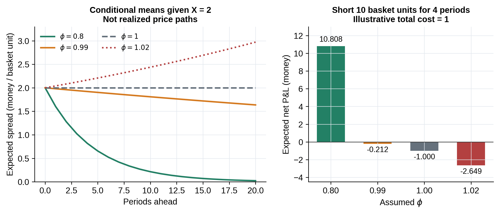

**ภาพ 9.1 ความเร็วกลับและระยะเวลาถือเปลี่ยนความคุ้มค่าหลังต้นทุน**

อ่านภาพด้วยกัน: เส้นทางด้านหนึ่งแสดง conditional mean จากจุดเริ่มเดียวกันภายใต้ค่า φ ต่างกัน อีกด้านเปรียบเทียบกำไรคาดหมายสุทธิของการปิดหลังสี่ช่วง ตัวเลขมาจากสมมติฐานที่ระบุ ไม่ใช่ข้อมูลตลาดหรือผล backtest

กรณี φ = 0.99 ยังมีแรงปรับกลับในโมเดล แต่ในสี่ช่วงเวลาที่เรายอมถือ การเปลี่ยนที่คาดหมายมีขนาดเล็กกว่าต้นทุน กรณีนี้จึงควรถูกคัดออกจากกฎซื้อขายที่กำหนดได้ แม้จะเรียกกระบวนการว่า mean reverting ส่วนกรณี φ = 1.02 เป็นเพียงตัวอย่างการเบี่ยงออกที่ทำให้การขายรอกลับขาดทุนคาดหมาย ไม่ใช่หลักฐานให้ใช้ momentum กับสินทรัพย์จริง

$$
H_{1/2}=\frac{\ln(1/2)}{\ln\phi},\qquad 0<\phi<1
$$

อ่านสมการ: Half-life นี้คือเวลาที่ conditional mean ของความห่างจากสมดุลลดเหลือครึ่งหนึ่ง มีหน่วยเป็นจำนวนช่วงที่ใช้กับ φ ถ้า φ เท่ากับ 0.80 จะประมาณ 3.11 ช่วง และถ้าเท่ากับ 0.99 จะประมาณ 68.97 ช่วง

Half-life ไม่ใช่คำสัญญาว่าราคาจะกลับมาถึงเป้าหมายภายในเวลานั้น และไม่ใช่ expected first-passage time โดยอัตโนมัติ ถ้าเปลี่ยนกฎจากปิดเมื่อครบสี่ช่วงเป็นปิดเมื่อแตะเป้าหมาย เราต้องวิเคราะห์เส้นทางและเวลาที่แตะเป้าหมายใหม่ นอกจากนี้ การขยายช่วงถือเพื่อรอการกลับอาจเพิ่มต้นทุน ความเสี่ยง และเวลาที่ทุนถูกผูกอยู่ จึงต้องประเมินใหม่ทั้งชุด

เพื่อเห็นความต่างนี้เป็นตัวเลข เราจำลอง AR(1) ที่ μ = 0 จากจุดเริ่ม X = 2 แล้วนับจำนวนช่วงจนพบ X ≤ 1 เป็นครั้งแรก ณ จุดสังเกต ระดับ 1 คือระดับที่ conditional mean ไปถึงเมื่อครบ half-life พอดี สิ่งที่ต้องกำหนดเพิ่มคือขนาดของ shock ต่อช่วง เพราะ half-life ขึ้นกับ φ ตัวเดียว แต่เวลาที่เส้นทางจริงแตะเป้าขึ้นกับ noise ด้วย ตารางใช้ shock แบบ normal จำนวน 100,000 เส้นทางต่อกรณี ด้วย seed ที่กำหนดในโค้ด ตัวเลขปัดแล้วและมีความคลาดเคลื่อนจากการสุ่มในหลักสุดท้าย

| φ | ส่วนเบี่ยงเบนของ shock | Half-life ของค่าเฉลี่ย | มัธยฐานของเวลาแตะเป้า | ค่าเฉลี่ย | เปอร์เซ็นไทล์ 90 | แตะภายใน 4 ช่วง | ขึ้นถึง X ≥ 3 ก่อนแตะเป้า |
| --- | --- | --- | --- | --- | --- | --- | --- |
| 0.80 | 0.1 | 3.11 | 4 | 3.7 | 5 | 88.6% | 0.0% |
| 0.80 | 0.5 | 3.11 | 3 | 3.9 | 7 | 69.8% | 1.1% |
| 0.99 | 0.5 | 68.97 | 12 | 34.7 | 94 | 23.0% | 44.8% |

แถวแรกมี noise น้อย เส้นทางจึงเดินใกล้ค่าเฉลี่ยและแตะเป้าราวช่วงที่ 3 ถึง 5 ใกล้กับ half-life แถวที่สองใช้ φ เดิมแต่ noise มากขึ้น half-life ยังเป็น 3.11 แต่ราว 30% ของเส้นทางยังไม่แตะเป้าเมื่อครบ 4 ช่วงที่กฎตัวอย่างกำหนดให้ปิด และราว 14% ใช้เวลาตั้งแต่ 7 ช่วงขึ้นไป แถวที่สามมี half-life เกือบ 69 ช่วง แต่ครึ่งหนึ่งของเส้นทางแตะเป้าภายใน 12 ช่วง สิ่งที่พาไปถึงคือ noise มากกว่าแรงปรับกลับ และ noise ชุดเดียวกันพา 44.8% ของเส้นทางขึ้นไปถึง 3 ก่อน ซึ่งสำหรับสถานะ short 10 หน่วยคือขาดทุนจากราคา 10 ก่อนต้นทุน

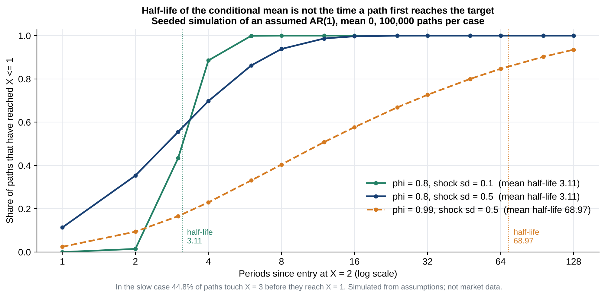

**ภาพ 9.2 Half-life ของค่าเฉลี่ยไม่ใช่เวลาที่เส้นทางแตะเป้าครั้งแรก**

อ่านภาพด้วยกัน: แกนนอนคือจำนวนช่วงหลังเข้าที่ X = 2 ในสเกล log แกนตั้งคือสัดส่วนของเส้นทางที่เคยพบ X ≤ 1 แล้ว เส้นประแนวตั้งคือ half-life ของแต่ละค่า φ ถ้า half-life เป็นเวลาที่แตะเป้าจริง ทุกเส้นควรกระโดดขึ้นตรงเส้นประของตัวเอง แต่กรณี φ = 0.99 มีเส้นทางราว 85% ที่แตะเป้าก่อนถึง half-life และภาพนี้ยังไม่แสดงเส้นทางที่ไปถึงขอบขาดทุนก่อน ผลมาจากการจำลองตามสมมติฐาน ไม่ใช่ข้อมูลตลาด

ข้อสรุปสำหรับการออกแบบกฎคือ half-life ใช้เปรียบเทียบความเร็วของแรงปรับกลับระหว่าง candidate ได้ แต่ time stop เป้ากำไร และ loss limit ต้องประเมินจากการกระจายของเส้นทางภายใต้ noise ที่ประมาณได้ โดยดูสองด้านพร้อมกัน คือเวลาที่แตะเป้าและโอกาสที่ไปถึงขอบขาดทุนก่อน

แม้แถวแรกมีกำไรคาดหมายเป็นบวก เราก็ยังไม่ได้ประเมินความผันผวน ขาดทุนระหว่างทาง สภาพคล่อง หรือโอกาสที่โมเดลเปลี่ยนไป ตัวอย่างนี้ตอบเฉพาะว่า ความเร็วกลับกับต้นทุนสามารถทำให้สองกระบวนการที่ต่างเรียกว่า mean reverting มีความเหมาะกับกลยุทธ์เดียวกันต่างกันได้

<a id="mean_reversion_09_04"></a>

### 09.04 หลักฐานที่ยังไม่ชัดต้องมีสถานะของมันเอง

> **ลงลึก** ข้ามได้ในการอ่านรอบแรก สิ่งที่ควรเก็บ: ผลทดสอบทางสถิติที่ยังไม่ชัดเป็นสถานะหนึ่งที่ต้องบันทึก ไม่จำเป็นต้องตัดสินเป็นผ่านหรือไม่ผ่านทันที

เราไม่ควรมีเพียงป้าย “ผ่าน” กับ “ไม่ผ่าน” สำหรับทุกคำถาม เพราะข้อมูลอาจยังไม่พอแยกหลายคำอธิบายออกจากกัน เช่น ดูคล้ายกลับช้ามาก ดูคล้าย random walk หรือเคยมีสมดุลแต่เปลี่ยนระดับในช่วงกลาง การประกาศว่าไม่ทราบในจุดนี้ช่วยกำหนดการทดลองถัดไปได้ตรงกว่าการบังคับเลือกโมเดลทันที

ADF เริ่มจากสมมติฐานศูนย์ว่ามี unit root ผลที่ยังปฏิเสธสมมติฐานนี้ไม่ได้จึงไม่ใช่การพิสูจน์ว่าไม่มี mean reversion ทุกชนิด ส่วน KPSS เริ่มจากสมมติฐานศูนย์ว่าอนุกรม stationary รอบค่าคงที่หรือแนวโน้มตามรูปแบบที่เลือก ทั้งสองจึงถามคนละทิศทาง และต้องอ่านร่วมกับ specification ของการทดสอบ [R15](#ref-r15) [R16](#ref-r16)

เราจะบันทึก lag, intercept หรือ trend, ช่วงข้อมูล และความถี่ที่ใช้ทุกครั้ง หากคำถามคือ cointegration ของอนุกรมระดับที่เข้าเงื่อนไข เช่น ตัวแปร I(1) ต้องใช้กรอบทดสอบและ critical values ที่รองรับ residual จากความสัมพันธ์ที่ประมาณขึ้นมา ไม่อ่าน p-value ของ ADF ธรรมดาเหมือนเป็นอนุกรมที่กำหนดไว้ล่วงหน้า เอกสาร augmented Engle–Granger ระบุข้อสมมติและวิธีของปัญหานี้ [R17](#ref-r17) ส่วน residual จากโมเดลผลตอบแทนหรือ factor model ต้องเลือกการตรวจให้ตรงกับคำถามของโมเดลนั้น

| หลักฐานที่ต้องดู | คำถามที่ช่วยตอบ |
| --- | --- |
| เหตุผลของความสัมพันธ์ | ทำไมตัวแปรนี้ควรมีแรงปรับกลับ และอะไรทำให้เหตุผลนั้นหายไป |
| ทิศทางที่คาดหมายตามระดับ spread | เมื่อสูงหรือต่ำกว่าสมดุล การเปลี่ยนช่วงถัดไปมีแนวโน้มกลับจริงหรือไม่ |
| ความไม่แน่นอนและความเสถียร | ผลยังอยู่เมื่อเปลี่ยนช่วงประมาณค่าอย่างมีเหตุผล หรือถูกขับด้วยเหตุการณ์ไม่กี่ครั้ง |
| การทดสอบทางสถิติที่เหมาะสม | ข้อมูลขัดกับโมเดลพื้นฐานตรงไหน และมีข้อจำกัดเรื่อง power หรือ specification อะไร |
| ผลนอกช่วงเลือกโมเดล | กฎคัดเลือกและกฎซื้อขายที่ตรึงไว้ยังมีประโยชน์กับข้อมูลที่ยังไม่เคยเห็นหรือไม่ |
| กำไรจาก holdings หลังต้นทุน | ขนาดการกลับคุ้มกับการซื้อขายจริง เวลา เงินทุน และความเสี่ยงหรือไม่ |

การดู conditional change อาจเริ่มอย่างง่ายด้วยการแบ่งระดับ spread เป็นช่วง แล้วประเมินการเปลี่ยนใน horizon ที่สนใจ แต่ต้องสร้างกลุ่มและตัดสินใจเลือกวิธีจากข้อมูลฝึกก่อน ข้อมูลหลายแถวอาจมาจากเหตุการณ์ต่อเนื่องเดียวกัน จึงไม่ควรนับเป็นหลักฐานอิสระทั้งหมด ช่วงความไม่แน่นอนควรสะท้อนการพึ่งพากันของข้อมูล เช่น ใช้การแบ่งตามเวลา หรือ block bootstrap ที่ออกแบบให้ตรงปัญหา

ไม่มีค่า p, half-life, z-score หรือจำนวนครั้งที่ข้ามศูนย์เพียงค่าเดียวที่ทำหน้าที่อนุญาตให้ซื้อขายได้ทุกตลาด เราจะกำหนดเกณฑ์ล่วงหน้าตาม horizon ต้นทุนและข้อจำกัดของโจทย์ แล้วเก็บผลว่า “สนับสนุน”, “ยังไม่ชัด” หรือ “ไม่สนับสนุนภายใต้ข้อกำหนดนี้” พร้อมเหตุผล

<a id="mean_reversion_09_05"></a>

### 09.05 อ่านคำว่า optimal ให้ครบทั้งโมเดลและเป้าหมาย

> **ลงลึก** ข้ามได้ในการอ่านรอบแรก สิ่งที่ควรเก็บ: เส้นเข้าออกที่ “ดีที่สุด” ขึ้นกับโมเดล เป้าหมาย และต้นทุนที่สมมติ จึงต้องออกแบบจุดเข้า จุดออก และ stop ร่วมกัน

งาน optimal stopping ทำให้เส้นเข้าออกเป็นผลของโจทย์ที่ระบุชัด คำว่า optimal ต้องตามด้วยเป้าหมาย โมเดล ต้นทุน และข้อจำกัด การเปลี่ยนจากผลคาดหมายคิดลดเป็น Sharpe หรือเพิ่มข้อจำกัดทุนอาจให้เส้นต่างกัน

Leung และ Li เลือกเวลาเข้าและปิดภายใต้ OU กับต้นทุน โดยใช้มูลค่าคาดหมายคิดลด เมื่อกำหนด stop-loss สำหรับด้าน long และพารามิเตอร์ยังทำให้มีโอกาสเข้าที่ให้มูลค่าคาดหมายเป็นบวก เขตเข้ากลายเป็นช่วงมีขอบเขตอยู่เหนือ stop ราคาต่ำลงจึงไม่ได้แปลว่าควรซื้อเสมอถ้าใกล้ขอบที่ต้องออกเกินไป ในกรอบนี้การยก stop ขึ้นยังลดระดับ take-profit ที่เหมาะสม จึงควรออกแบบเข้า ออก และ stop ร่วมกัน [R41](#ref-r41)

การเพิ่ม stop จำกัดชุดทางเลือกและทำให้มูลค่าที่ดีที่สุดไม่สูงกว่าโจทย์เดิม แต่อาจจำเป็นต่อความเสี่ยงที่ยอมรับ ผลของงานอาศัยพลวัตและการปิดตามแบบจำลอง หากใช้ข้อมูลเป็นแท่ง ราคา gap หรือ maker ที่รอคิว ต้องจำลอง execution เพิ่มก่อนกล่าวถึงขอบขาดทุนจริง [R41](#ref-r41)

Lipton และ López de Prado ศึกษากรอบออกด้วย profit-taking, stop-out และเวลาถือสูงสุด ภายใต้ OU โดยมองเป้าหมาย Sharpe และใช้วิธี heat potentials บางเงื่อนไขของแบบจำลองให้ผลว่าขอบ stop-loss ไม่ช่วยเป้าหมายที่เลือก ขณะเดียวกันผู้เขียนอภิปรายความเสี่ยงจากการระบุโมเดลผิด จึงไม่ควรแปลงผลเป็นกฎว่า “มี mean reversion แล้วไม่ต้องมี stop” หรือว่า stop แบบเดียวเหมาะทุกตลาด [R42](#ref-r42)

s-score ของ Avellaneda–Lee วัดระยะ residual จากสมดุลตามโมเดล กฎพื้นฐานเข้า long ต่ำกว่า −1.25 หรือ short สูงกว่า +1.25; ปิด short ต่ำกว่า +0.75 และปิด long สูงกว่า −0.50 เส้นออกจึงไม่สมมาตร ค่ามาจากการปรับเทียบในช่วงข้อมูลของงาน และกฎกลับใกล้สมดุลยังต้องแยกจากแผนขาดทุนหรือ margin [R5](#ref-r5)

ArbitrageLab เปิด source คำนวณระดับเข้าออก OU ทั้งมีและไม่มี stop-loss เช่น optimal_entry_interval_stop_loss เป็น implementation ของผู้พัฒนาไลบรารี การเห็นโค้ดยังไม่เท่ากับทำซ้ำผล paper ต้องตรวจพารามิเตอร์ หน่วยเวลา การค้นหาราก และช่วง fit ก่อนใช้ [R43](#ref-r43)

Half-life คือเวลาที่ conditional mean ของความคลาดเคลื่อนลดครึ่งหนึ่ง ไม่ใช่เวลารับรองว่าจะชนเส้นออก การตั้ง time stop เป็นจำนวนเท่าของ half-life เป็น candidate ที่ต้องตรวจเวลาถือและผลหลังต้นทุน และไม่พบ mean reversion ก็ไม่ได้พิสูจน์ว่าพบ momentum

<a id="mean_reversion_09_06"></a>

### 09.06 ฝึกตัดสินใจ

ข้อ 1 — โมเดลไม่ตรงกับพฤติกรรม: ประมาณ AR(1) ได้ φ = −0.5 ภายใต้สมมติฐาน innovation ที่เหมาะสม นักวิจัยบอกว่า “แปลงเป็น κ ของ OU ไม่ได้ ดังนั้นไม่มี mean reversion” คุณเห็นด้วยหรือไม่ และต้องตรวจอะไรต่อก่อนซื้อขาย?

ข้อ 2 — มีแรงกลับแต่ไม่ผ่านต้นทุน: ใช้ตัวอย่าง short ตะกร้า 10 หน่วยที่ X เริ่ม 2, μ = 0, φ = 0.99 และปิดหลัง 4 ช่วง ถ้าลดต้นทุนรวมจาก 1 เหลือ 0.5 กำไรคาดหมายสุทธิเป็นเท่าไร ผลนี้พอให้สรุปว่าควรซื้อขายแล้วหรือยัง?

ข้อ 3 — แตะเป้าเร็วกว่า half-life: ในตารางจำลองของหัวข้อ 09.03 กรณี φ = 0.99 มัธยฐานของเวลาแตะเป้าคือ 12 ช่วง สั้นกว่า half-life ราว 69 ช่วงมาก นักวิจัยสรุปว่า “spread กลับเร็วกว่าที่โมเดลบอก จึงเพิ่มขนาดสถานะได้” ข้อสรุปนี้มองข้ามอะไร? ให้คำนวณกำไรราคาคาดหมายของ short 10 หน่วยเมื่อถือ 12 ช่วงประกอบคำตอบ

<a id="mean_reversion_09_07"></a>

### 09.07 เฉลยและหน้าทบทวน

เฉลยข้อ 1: ไม่เห็นด้วยกับข้อสรุปนั้น |−0.5| < 1 ให้ AR ที่ stationary ได้และ conditional mean ของความห่างสลับข้างพร้อมขนาดที่ลดลง แต่ scalar OU มาตรฐานที่สังเกตเป็นช่วงมี φ เป็นบวก ต้องตรวจความเสถียร ความไม่แน่นอน เวลาและต้นทุนการซื้อขาย รวมทั้งการแปลงสัญญาณเป็น holdings; ไม่ใช่เปลี่ยนไปบังคับ OU ให้ fit

เฉลยข้อ 2: กำไรคาดหมายก่อนต้นทุนเท่ากับ 0.78807980 จึงเหลือ 0.28807980 หน่วยเงินหลังต้นทุน 0.5 เป็นบวกเฉพาะภายใต้ตัวอย่างและข้อสมมติที่กำหนด ยังต้องประเมินความเสี่ยงของเส้นทาง ความไม่แน่นอนของ φ ความเปลี่ยนแปลงของโมเดลและต้นทุนที่เกิดจริง

เฉลยข้อ 3: การแตะเป้าเร็วในกรณีนี้มาจาก noise ซึ่งพาราคาไปได้ทั้งสองทาง เส้นทาง 44.8% ขึ้นไปถึง 3 ก่อนแตะเป้า ส่วนที่โมเดลให้เป็นความได้เปรียบคือการเปลี่ยนของ conditional mean ซึ่งใน 12 ช่วงเท่ากับ 2 × (1 − 0.99 ยกกำลัง 12) หรือประมาณ 0.227 กำไรราคาคาดหมายของ short 10 หน่วยจึงเป็นราว 2.27 ก่อนต้นทุน เล็กเมื่อเทียบกับการแกว่งของราคาระหว่างทาง การเพิ่มขนาดจึงเพิ่มความเสี่ยงจาก noise เป็นหลัก ต้องประเมินผลคาดหมายสุทธิ โอกาสถึง loss limit และทุนที่ต้องรองรับก่อนตัดสินใจ

หน้าทบทวน — อธิบายให้ได้โดยปิดเนื้อหาหลัก: เรากำลังทดสอบราคา spread หรือ return? อะไรคือพฤติกรรมที่คาดหวัง และอะไรคือข้อสมมติที่โมเดลใส่เพิ่ม? หลักฐานที่ไม่ชัดต่างจากหลักฐานหักล้างอย่างไร? การกลับเร็วหรือช้าเข้ากับ horizon และต้นทุนหรือไม่?

ทางอ่านต่อ: บท 10 ถามต่อว่า เมื่อหลักฐานเสื่อมหรือความสัมพันธ์เปลี่ยน จะเปลี่ยนโมเดล พัก หรือหยุด และจะทำอะไรกับสถานะที่ถืออยู่

<a id="regime_change"></a>

## บท 10 เมื่อความสัมพันธ์เปลี่ยน: ปรับ พัก หรือหยุด

เปลี่ยนโมเดล จัดการสถานะค้าง และกลับมาใช้ใหม่อย่างมีเงื่อนไข

> **ก่อนอ่าน:** บท 8–9
>
> **เมื่อจบบท คุณควรทำได้:** เลือกทางไปต่อเมื่อหลักฐานเสื่อม พักการเปิดสถานะใหม่โดยยังจัดการสถานะค้าง และเขียนเงื่อนไขกลับมาใช้ที่ตรวจได้
>
> **ตัวอย่างหลักของบท:** ค่ากลางที่เลื่อนจาก 0 เป็น 10 ทำให้ residual ลดจาก 10 เป็น 0 โดยสถานะเดิมไม่ได้กำไร

บท 9 ถามว่าความสัมพันธ์มีแรงกลับหรือไม่ บทนี้ถามต่อว่า เมื่อหลักฐานเสื่อมหรือความสัมพันธ์เปลี่ยน เราจะทำอะไรกับโมเดล กับสถานะที่ถืออยู่ และกับสิทธิ์เปิดสถานะใหม่ หัวข้อ 10.01 ว่าด้วยโมเดลทางเลือกและลงลึกกว่าส่วนอื่น ในการอ่านรอบแรกเริ่มที่ 10.02 ได้

<a id="regime_change_10_01"></a>

### 10.01 เปลี่ยนโมเดลต้องบอกว่าแก้ปัญหาส่วนไหน

> **ลงลึก** ข้ามได้ในการอ่านรอบแรก สิ่งที่ควรเก็บ: เมื่อเปลี่ยนโมเดลแล้วกราฟดูดีขึ้น ยังต้องถามว่ากำไรมาจากราคาของสิ่งที่ถือ หรือมาจากการเปลี่ยนนิยามของกราฟ

ถ้าข้อมูลยังสนับสนุนการปรับกลับ แต่ OU แบบง่ายอธิบายไม่เหมาะ เรามีทางเลือกได้หลายแบบ อย่างไรก็ตาม เครื่องมือเหล่านี้ทำหน้าที่ต่างกัน บางตัวอธิบาย dynamics บางตัวประมาณสมดุล บางตัวสร้างตะกร้า และบางตัวเปลี่ยนแหล่งกำไรไปเลย จึงต้องระบุส่วนที่เปลี่ยนก่อนเปรียบเทียบผล

| แนวทาง | สิ่งที่เปลี่ยน | สิ่งที่ต้องตรวจเพิ่ม |
| --- | --- | --- |
| AR หรือ ECM/VECM | อธิบายการเปลี่ยนตามเวลาและการตอบสนองต่อความคลาดเคลื่อน | Lag, ความสัมพันธ์ระยะยาว และอัตราปรับกลับต้องเหมาะกับข้อมูล |
| Threshold หรือ conditional reversion | ให้การปรับกลับต่างกันตามขนาดความเบี่ยงเบนหรือเงื่อนไข | เกณฑ์และจำนวนเหตุการณ์แต่ละกลุ่มต้องพอทดสอบนอกช่วงฝึก |
| State-space และ Kalman | ติดตาม state เช่น mean หรือ hedge ที่เปลี่ยนตามเวลา | State คืออะไร ใช้ข้อมูลถึงเวลาใด และการปรับเพิ่ม turnover เท่าไร |
| ตะกร้าหลายสินทรัพย์หรือ moving band | เปลี่ยนวัตถุที่ซื้อขายและข้อกำหนดในการสร้างตะกร้า | เหตุผลของแต่ละขา ต้นทุน และพฤติกรรมหลังช่วงที่ใช้เลือกน้ำหนัก |
| สัญญาณผลตอบแทนแบบอื่น | เปลี่ยนสมมติฐาน เช่น relative momentum ที่มีข้อจำกัด exposure | ต้องพิสูจน์สัญญาณใหม่; การไม่พบ reversal ยังไม่ใช่หลักฐานของ momentum |
| Carry หรือความสัมพันธ์ตามสัญญา | เปลี่ยนกลไกรายรับและความเสี่ยงที่รับ | ต้นทุนถือ เงื่อนไขสัญญา funding และการชำระราคาต้องวิเคราะห์ใหม่ |

ใน VECM ค่าสัมประสิทธิ์ของความสัมพันธ์ระยะยาวและค่าสัมประสิทธิ์การปรับตัวทำหน้าที่คนละอย่าง จึงช่วยถามได้ว่าเราสร้างความคลาดเคลื่อนจากอะไร และตัวแปรใดตอบสนองต่อมัน [R18](#ref-r18) ส่วน threshold cointegration เป็นตัวอย่างของแนวคิดที่การปรับกลับอาจชัดเมื่อความเบี่ยงเบนมากกว่าช่วงหนึ่ง ไม่จำเป็นต้องมีแรงปรับกลับขนาดเดียวกันทุกระดับ [R19](#ref-r19) ทั้งสองยังต้องตรวจว่าข้อมูลสนับสนุนโครงสร้างที่เพิ่มขึ้นจริง

Kalman เป็นวิธีติดตาม state ภายใต้แบบจำลองที่เรากำหนด การ fit ได้เรียบขึ้นไม่ได้สร้าง cointegration หรือกำไรให้เกิดขึ้นเอง ตัวอย่างใน Palomar แสดงว่าการติดตาม hedge ดีขึ้นยังต้องประเมิน turnover และต้นทุน และสรุปว่าตัวกรองช่วยติดตามความสัมพันธ์ที่มีอยู่ ไม่ได้สร้างความสัมพันธ์นั้นขึ้นมา [R14](#ref-r14)

ตัวอย่างสมมติที่เห็นได้ทันทีคือ spread ที่ซื้อขายได้ X อยู่ที่ 10 ตลอด แต่โมเดลขยับค่ากลาง μ จาก 0 เป็น 8 และเป็น 10 ความคลาดเคลื่อน X − μ จึงลดจาก 10 เป็น 2 และเป็น 0 หากราคาและจำนวนที่ถือไม่เปลี่ยน กำไรจากราคาของสถานะเดิมยังเป็นศูนย์ การที่ residual กลับมาศูนย์ครั้งนี้เกิดจากการย้ายค่ากลาง

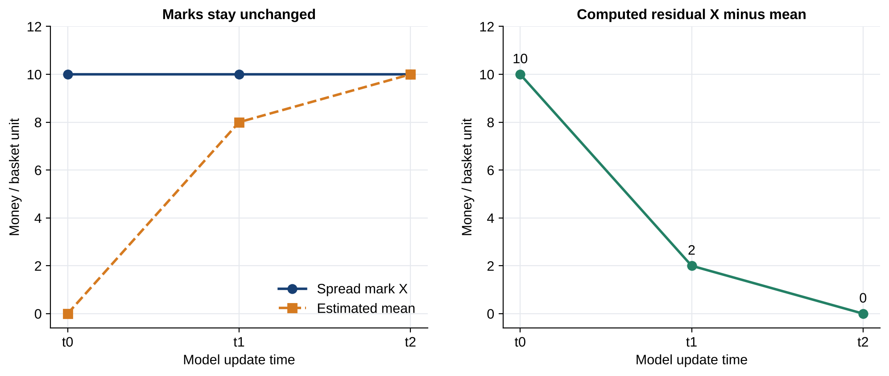

**ภาพ 10.1 ค่ากลางที่เลื่อนตามทำให้ residual ลดได้โดยราคาสถานะเดิมไม่เปลี่ยน**

อ่านภาพด้วยกัน: เปรียบเทียบเส้น X ที่คง 10 กับค่ากลาง μ ที่เพิ่ม 0 → 8 → 10 แล้วอ่าน residual 10 → 2 → 0 แยกจากกำไรของ holdings เดิม ตัวอย่างนี้ไม่ปฏิเสธการใช้ค่ากลางที่เปลี่ยนได้ แต่แสดงว่าต้องตรวจการคำนวณกับบัญชีคนละส่วน

เช่นเดียวกัน การสร้างตะกร้าให้แกว่งใน band ช่วงฝึกเป็นโจทย์ออกแบบที่ต่างจากการ fit OU งาน moving-band statistical arbitrage เป็นกรณีศึกษาของแนวทางนี้ [R7](#ref-r7) แต่การเพิ่มสินทรัพย์หรือเพิ่มอิสระของโมเดลไม่ได้รับประกันว่าข้อจำกัดที่เห็นในช่วงฝึกจะคงอยู่ในอนาคต ทุกครั้งที่เปลี่ยน mean, hedge หรือน้ำหนักตะกร้า ต้องกลับมาตรวจว่ากำไรเกิดจากการเปลี่ยนราคาของสิ่งที่ถือ หรือเกิดจากการเปลี่ยนวิธีนิยามกราฟ

<a id="regime_change_10_02"></a>

### 10.02 เลือกทางไปต่อและจัดการสถานะเดิมแยกกัน

ตารางต่อไปนี้เป็นกรอบตัดสินใจสำหรับงานวิจัยของเล่ม ไม่ใช่เกณฑ์ซื้อขายสำเร็จรูป เราต้องเติมหลักฐานและข้อจำกัดของตลาดจริงก่อนใช้ ป้ายสถานะอาจเปลี่ยนได้เมื่อมีข้อมูลใหม่ แต่การเปลี่ยนต้องมีเหตุผลที่บันทึกไว้

| สิ่งที่พบ | ทางไปต่อ | สิ่งที่ยังต้องระวังในการตีความ |
| --- | --- | --- |
| ข้อมูล เวลา หน่วย หรือบัญชีผิด | แก้ให้ถูกก่อนประเมินสัญญาณอีกครั้ง | ผลขาดทุนจากข้อผิดพลาดไม่ใช่หลักฐานหักล้างกลไก |
| หลักฐานยังไม่ชัด | พัก candidate เก็บข้อมูลเพิ่ม หรือกำหนดการทดลองที่แยกสมมติฐานได้ | การยังพิสูจน์ไม่ได้ ไม่เท่ากับพิสูจน์ว่าไม่มี |
| มีการกลับ แต่ช้าหรือเล็กกว่าต้นทุน | คัดออกจากกฎปัจจุบัน; ทดลอง horizon หรือเครื่องมือใหม่เมื่อมีเหตุผล | การขยายเวลาถือต้องคิดต้นทุนและทุนที่ถูกผูกใหม่ |
| มีการกลับเฉพาะเงื่อนไขหรือสมดุลเคลื่อน | ทดสอบโมเดลทางเลือกแบบ causal เทียบ baseline เดิม | ไม่เปลี่ยนนิยามจนกราฟดูดีโดยไม่เกิดกำไรจาก holdings |
| ข้อมูลใหม่ขัดกับความสัมพันธ์ที่เคยใช้ | หยุดเพิ่ม exposure แล้วประเมินสมมติฐานกับสถานะค้าง | ราคาที่หลุดไกลอาจเป็นการเปลี่ยน regime ไม่ใช่ราคาถูกยิ่งขึ้นเสมอ |
| คู่หรือตะกร้านี้ไม่สนับสนุนกลยุทธ์ | เปลี่ยนคู่ ตะกร้า universe หรือกลไก และเปิดการทดลองใหม่ | ไม่เอาผลไม่สำเร็จของ reversal ไปยืนยัน momentum หรือ carry อัตโนมัติ |

คำว่า “สินทรัพย์นี้ทำไม่ได้” ควรถูกเขียนให้แคบและตรวจสอบได้ เช่น “คู่ A–B ด้วยนิยาม spread นี้ ช่วงประมาณค่านี้ และกฎถือไม่เกินสี่ช่วง ยังไม่ผ่านเกณฑ์หลังต้นทุน” ข้อสรุปนี้ไม่ปิดโอกาสที่ A จะใช้กับสินทรัพย์อีกตัว หรือใช้กับสมมติฐานคนละแบบ แต่แต่ละทางต้องมีเหตุผลและทดสอบใหม่

สำหรับสถานะที่เปิดไปแล้ว การหยุดส่งคำสั่งใหม่กับการปิดของเดิมเป็นคนละการตัดสินใจ การพัก candidate ป้องกันการเพิ่มความเสี่ยง แต่ไม่ได้ทำให้ inventory ที่ค้างอยู่หายไป แผนวิจัยจึงต้องระบุไว้ก่อนว่าเมื่อหลักฐานเสื่อม จะลดสถานะ ทยอยปิด ใช้เวลาสูงสุด หรือประเมินการถือต่อภายใต้งบความเสี่ยงอย่างไร รวมถึงสิ่งที่จะทำเมื่อขาหนึ่งซื้อขายไม่ได้

การถือต่อต้องมีเหตุผลจากสถานะและข้อมูลปัจจุบัน พร้อมทุนและขอบเขตความเสียหายที่ยอมรับได้ ไม่ใช้เพียงเหตุผลว่าราคาเคยกลับในอดีต และไม่เพิ่มขนาดโดยอัตโนมัติเพราะ spread ห่างกว่าเดิม การเปลี่ยนป้ายจาก mean reversion ไปเป็นกลยุทธ์ใหม่ก็ไม่ได้ลบต้นทุนหรือความเสี่ยงของสถานะเก่า ต้องประเมินเหมือนการตัดสินใจลงทุน ณ วันนี้

เมื่อมีหลาย candidate เราสามารถจัดเงินเฉพาะกลุ่มที่ผ่านข้อกำหนดในเวลานั้น และเก็บส่วนที่เหลือโดยไม่เปิดความเสี่ยงของกลยุทธ์นี้ การเปรียบเทียบกับการไม่ซื้อขายต้องใช้ฐานทุนและรายรับรายจ่ายที่สอดคล้องกัน การไม่มี candidate ผ่านในรอบหนึ่งเป็นผลลัพธ์ที่ยอมรับได้

<a id="regime_change_10_03"></a>

### 10.03 พักการเปิดใหม่ และกลับมาใช้อย่างมีเงื่อนไข

หัวข้อ 08.04 แบ่งสถานะของระบบเป็น FLAT, OPENING, OPEN และ CLOSING ซึ่งบอกว่าเราถืออะไรอยู่ หัวข้อนี้เพิ่มสถานะที่ห้า ซึ่งบอกว่าเรายังมีสิทธิ์เปิดสถานะใหม่หรือไม่ครับ

| สถานะ | ความหมาย | งานที่ยังต้องทำ |
| --- | --- | --- |
| PAUSED | ระงับสิทธิ์เปิดใหม่ | ยังรับ fills ตรวจทุน และจัดการ inventory |

PAUSED ควรเก็บคู่กับสถานะการถือจริง เช่น paused ขณะยัง OPEN หรือ CLOSING อย่าใช้คำสั่งหยุดฟังก์ชันทั้งหมดจนไม่ตรวจความเสี่ยง เมื่อข้อมูลหรือโมเดลไม่ผ่าน ให้หยุดสร้างคำสั่งเพิ่มความเสี่ยง ยกเลิกคำสั่งเข้าที่ค้าง แล้วจัดการสถานะเดิมตามแผนที่ประกาศไว้ ซึ่งอาจลดทันทีหรือค่อยปิดภายใต้ข้อจำกัด

ระบบเข้าสู่ PAUSED ได้หลายทาง เช่น ข้อมูลหรือโมเดลไม่ผ่านเกณฑ์ตามตารางเหตุออกในหัวข้อ 08.02 ความสัมพันธ์ไม่ผ่านตามกรอบในหัวข้อ 10.02 หรือออกจากรอบเพราะขาดทุนถึงงบตามกฎตัวอย่างในหัวข้อ 08.03 ทุกกรณีใช้หลักเดียวกัน คือการกลับมาของสัญญาณเข้าเพียงอย่างเดียวไม่ปลดการพัก

MaximumDrawdownPercentPortfolio ใน LEAN ส่งเป้าศูนย์และยกเลิก insights แต่มีการ reset และทำงานกับรายการ targets จึงไม่ใช่ pause ถาวร หากสัญญาณเดิมยังเปิดใหม่ได้ ระบบอาจกลับเข้าสถานะหลังสั่งปิด ต้องตรวจการเชื่อม risk, alpha และ execution รวมถึงอายุและการ cancel insights [R45](#ref-r45) [R47](#ref-r47)

ก่อน resume ต้องมีการตัดสินใจชัดเจนว่าสาเหตุพักคลี่คลาย ข้อมูลกับโมเดลผ่านเกณฑ์ ทุนพร้อม และสถานะกับคำสั่งตรงบัญชี ตัวอย่างเริ่มเรียนอาจอนุญาต resume เมื่อ flat และไม่มีคำสั่งค้างเท่านั้น เก็บเหตุผลและเวลาที่ pause/resume โดยไม่ให้การกลับมาของสัญญาณตัวเดิมล้างสถานะพักโดยอัตโนมัติ

<a id="regime_change_10_04"></a>

### 10.04 ให้กระบวนการเลือกทางเป็นสิ่งที่ทดสอบได้

ถ้าอนุญาตให้เปลี่ยนสินทรัพย์ โมเดล timeframe และเกณฑ์ไปเรื่อย ๆ จนพบผลบวก เราอาจได้คำตอบที่ตรงกับอดีตโดยยังไม่มีเหตุผลว่าจะใช้ต่อได้ สิ่งที่ต้องทดสอบจึงรวมทั้งตัวกลยุทธ์และวิธีที่เราเลือกหรือสลับกลยุทธ์ด้วย

| ขั้นตอน | สิ่งที่ต้องระบุก่อนเห็นผลทดสอบ |
| --- | --- |
| กำหนดโจทย์ | ตัวแปรที่จะกลับ กลไกที่คาดหวัง horizon ต้นทุน และข้อจำกัดเงินทุน |
| กำหนด candidate | Universe และเหตุผลเลือกคู่หรือตะกร้า รวม baseline ไม่ซื้อขาย |
| แบ่งข้อมูล | ช่วงฝึก ช่วงเลือกวิธี และช่วงทดสอบตามเวลา; ห้ามเลือกคู่จากข้อมูลทั้งช่วงก่อนแบ่ง |
| เลือกโมเดลและกฎ | รายการทางเลือกที่มีเหตุผล ตัวแปรที่ปรับได้ และจำนวนการทดลองที่บันทึก |
| ทดสอบนอกช่วงเลือก | ตรึงกฎแล้วดู holdings, P&L, turnover, exposure และผลหลัง cost stress |
| ติดตามหลังเริ่มใช้ | ข้อมูลใดทำให้พัก เพิ่ม ลด หรือคัดออก; เมื่อใดจึงอนุญาตให้ประเมินใหม่ |

ใน walk-forward แต่ละรอบต้องเลือก universe ประมาณโมเดล และกำหนดพารามิเตอร์ด้วยข้อมูลที่มีอยู่ก่อนช่วงทดสอบรอบนั้น ถ้ารวมหลายโมเดลหรือใช้ตัวกรอง regime ต้องประเมินระบบที่รวมกฎเลือกนั้นแล้ว ห้ามนำโมเดลที่ชนะย้อนหลังในแต่ละช่วงมาต่อเป็นผลของระบบที่ไม่ได้รู้ผู้ชนะล่วงหน้า

การใช้ Kalman หรือโมเดล state-space ในสัญญาณต้องแยก filtering ซึ่งใช้ข้อมูลที่รู้ถึงเวลานั้น ออกจาก smoothing ที่อาจใช้ข้อมูลอนาคตช่วยประมาณอดีต เช่นเดียวกับการประมาณค่าเฉลี่ย rolling ต้องไม่ให้ข้อมูลช่วงที่จะซื้อขายเข้ามาปรับนิยามก่อนตัดสินใจ

กรณีศึกษาที่ควรแกะคือ Avellaneda–Lee ซึ่งแม้ใช้ OU ก็มีขั้นตอนตรวจความเหมาะสมและเลือกหุ้นที่เข้าเกณฑ์ของโมเดล ในรูปแบบที่รายงานใช้ช่วงประมาณค่า 60 วัน และกรอง characteristic reversion time τ = 1/κ ให้ต่ำกว่า 30 วัน [R5](#ref-r5) เกณฑ์นี้เป็นข้อกำหนดของงานนั้น ไม่ใช่ค่ามาตรฐานสำหรับทุกตลาด และ τ ต่างจาก half-life ซึ่งเป็น ln(2)/κ

เวลาศึกษาโค้ดสาธารณะ เราจะหาให้พบว่าเขาคัดออกตรงไหน ทำอะไรเมื่อไม่มี candidate ผ่าน และจัดการสถานะค้างอย่างไร นอกจากอ่านบรรทัดที่สร้างสัญญาณ ถ้าโค้ดตั้ง rank, κ, threshold หรือจำนวนสินทรัพย์ไว้คงที่ ให้แยกว่าเป็นสิ่งที่ประมาณจากข้อมูลหรือเป็นข้อสมมติที่ผู้เขียนเลือก

ผลของขั้นตอนนี้คือบันทึกที่ตอบได้สามแกน Asset Selection ระบุว่าทำไมเลือกหรือคัดออก; Workflow ระบุว่ารู้ข้อมูลเมื่อไรและเลือกวิธีอย่างไร; Position Management ระบุว่าถืออะไร ขนาดเท่าไร และออกจากสมมติฐานที่ใช้ไม่ได้อย่างไร การเปลี่ยนไปทำอย่างอื่นจึงกลายเป็นงานวิจัยใหม่ที่ตามรอยได้

<a id="regime_change_10_05"></a>

### 10.05 ฝึกตัดสินใจ

ข้อ 1 — เปลี่ยนสินทรัพย์หรือเปลี่ยนเรื่องที่ซื้อขาย: คู่ A–B ไม่ผ่านเกณฑ์นอกช่วงฝึก ผู้วิจัยลองเพิ่ม 50 คู่ แล้วเลือกคู่ที่ให้ผลดีที่สุดในช่วงเดิม อีกคนเปลี่ยน A–B เป็น momentum เพราะ “ไม่กลับก็ต้องไปต่อ” ทั้งสองวิธีขาดหลักฐานส่วนใด?

ข้อ 2 — Partial fill ระหว่างพัก: ตั้งเป้า A −10 และ B +10 แต่ fill ได้ A −10, B +4 แล้วโมเดลถูกพัก หลังส่ง cancel และคำสั่งปิดบางส่วน โปรแกรมควรถือว่า flat หรือยัง? ถ้าสัญญาณเดิมกลับมา จะเปิดรอบใหม่ได้ทันทีหรือไม่? เขียนสิ่งที่ต้องตรวจอย่างน้อยสี่รายการ และแยก “หยุดเปิดใหม่” ออกจาก “หยุดจัดการความเสี่ยง”

<a id="regime_change_10_06"></a>

### 10.06 เฉลยและหน้าทบทวน

เฉลยข้อ 1: การเลือกผู้ชนะจากการลองเพิ่มบนช่วงเดิมทำให้ช่วงนั้นกลายเป็นข้อมูลสำหรับเลือกวิธี ต้องบันทึกการทดลองและประเมินด้วยข้อมูลที่ยังไม่ถูกใช้เลือกต่อไป ส่วน momentum ต้องมีหลักฐานการคาดการณ์แบบไปต่อของมันเอง การไม่พบแรงกลับยังอธิบายได้ด้วย noise หรือการที่ไม่มีข้อมูลคาดการณ์ใด ๆ

เฉลยข้อ 2: ยังสรุปว่า flat ไม่ได้ ต้องตรวจ fills จริง รายการคำสั่งค้าง ผลยืนยัน cancel และ holdings กับเงินสดของทั้งสองขา รวมถึง exposure กับทุนระหว่างปิด การหยุดเปิดใหม่ยังต้องรับ order events และจัดการ inventory ต่อ การกลับมาของสัญญาณเดิมไม่ล้าง pause เอง ในตัวอย่างต้องมีคำสั่ง resume ชัดเจน flat ไม่มีคำสั่งค้าง และผ่าน checks ที่กำหนด

หน้าทบทวน — อธิบายให้ได้โดยปิดเนื้อหาหลัก: เมื่อย้ายค่ากลางหรือ hedge กำไรเกิดจาก holdings เดิมจริงหรือเพียงเปลี่ยนกราฟ? การหยุดเปิดสถานะใหม่ต่างจากการจัดการสถานะค้างอย่างไร? และต้องเห็นอะไรบ้างก่อนอนุญาตให้ระบบกลับมาเปิดสถานะ?

การตัดสินใจที่ต้องเขียนได้หนึ่งย่อหน้า: ภายใต้ข้อมูลและกฎที่กำหนด เราจะใช้ต่อ พัก คัดออก ทดลองโมเดลอื่น หรือเปิดสมมติฐานกลยุทธ์ใหม่ เพราะหลักฐานใด พร้อมระบุว่าจะจัดการสถานะค้างอย่างไร และต้องเห็นอะไรจึงจะกลับมาประเมินอีกครั้ง

ทางอ่านต่อ: บท 11–13 ซึ่งยังเป็นแผน จะขยายจากคู่ไปสู่ตะกร้าหลายขาและการจัดเงินระหว่างตะกร้า

<a id="glossary"></a>

## คำศัพท์สำหรับทบทวน

| **คำศัพท์**          | **ความหมายในเล่มนี้**                                                                 |
|--------------------|-----------------------------------------------------------------------------------|
| Signal             | ค่าหรือกฎเพื่อช่วยตัดสินใจ ต้องระบุวิธีแปลงเป็นคำสั่งซื้อขาย                                      |
| Holdings           | จำนวนที่ซื้อขายได้จริง ใช้ค่าบวกสำหรับ long และค่าลบสำหรับ short                             |
| Position value     | จำนวนที่ถือคูณราคาตีมูลค่า มีเครื่องหมายตามทิศทางสถานะ                                       |
| Cash balance       | ยอดเงินตามกระแสเงินซื้อขายและรายรับรายจ่าย อาจติดข้อจำกัดหลักประกัน                          |
| Equity             | ในบัญชีซื้อสินทรัพย์และขายชอร์ตของบทนี้ คือเงินสดบวกมูลค่าสถานะที่มีเครื่องหมาย                      |
| Mark to market     | ตีมูลค่าสถานะด้วยราคา ณ เวลาที่ประเมิน ต้องระบุประเภทของราคา                               |
| Hedge coefficient  | ตัวคูณในโมเดล หน่วยและวิธีแปลงเป็น holdings ขึ้นกับตัวแปรที่ใช้                                |
| Spread             | ค่าผสม เช่น $P_{A} - hP_{B}$ ต้องระบุหน่วย h และช่วงที่ h คงที่                             |
| Gross exposure     | ผลรวมค่าสัมบูรณ์ของมูลค่าแต่ละขา ใช้วัดขนาดสถานะรวม                                        |
| Net exposure       | ผลรวมมูลค่าสถานะที่มีเครื่องหมาย เป็นคนละปริมาณกับ factor exposure                          |
| Rebalance          | ซื้อขายเพื่อเปลี่ยนจำนวนที่ถือ ต้องบันทึกเงินสดและต้นทุน                                         |
| Fill               | การซื้อขายสำเร็จตามราคาและจำนวน สถานะเปลี่ยนตามส่วนที่ fill                               |
| Slippage           | ส่วนต่างของราคา fill กับราคาอ้างอิง ต้องระบุเครื่องหมายและไม่หักซ้ำ                           |
| P&L reconciliation | ตรวจให้กำไรจากราคา รายรับ และต้นทุน รวมเป็นการเปลี่ยน equity                             |
| Return denominator | ฐานเงินทุนของอัตราผลตอบแทน เช่น equity ต้นช่วง ต้องนิยามให้ชัด                              |
| Factor exposure    | ผลรวมความไวต่อปัจจัยของแต่ละขาที่ถ่วงด้วยมูลค่าสถานะ ต้องระบุปัจจัย โมเดล และหน่วย               |
| Beta neutrality    | ความไวรวมต่อปัจจัยตลาดเป็นศูนย์ตาม beta ที่ใช้ประเมิน ยังมีความเสี่ยงอื่นและความผิดพลาดของ beta ได้ |
| Idiosyncratic risk | การเคลื่อนไหวเฉพาะสินทรัพย์ที่โมเดลปัจจัยที่กำหนดยังอธิบายไม่ได้                                 |
| Rank and nullspace | Rank นับเงื่อนไขเชิงเส้นที่เป็นอิสระ; nullspace คือชุดเวกเตอร์ที่ทำให้ผลของสมการเชิงเส้นเป็นศูนย์     |
| Basis risk         | ความเสี่ยงจากราคาหรือราคาอ้างอิงของสองขาเคลื่อนไหวไม่ตรงตามความสัมพันธ์ที่ใช้ hedge             |
| Monetary basis | ส่วนต่างราคา futures ลบ spot ในหน่วยเงิน กำไรราคาของ long spot คู่ short futures เท่ากับ basis ตอนเข้าลบ basis ปัจจุบัน |
| Implied carry | อัตราต่อปีที่คำนวณย้อนจากราคา futures ราคา spot และเวลาที่เหลือ เป็นการจัดรูปราคา ไม่ใช่ผลตอบแทนสุทธิของบัญชี |
| Funding | กระแสเงินระหว่างฝั่ง long กับ short ของ perpetual futures ตามรอบที่สัญญากำหนด ลงบัญชีเป็น cash flow แยกจากกำไรราคา |
| Initial และ variation margin | หลักประกันที่ต้องวางเพื่อถือสัญญา และเงินที่ชำระกำไรขาดทุนตามราคาในแต่ละรอบ ทั้งคู่กำหนดเงินสดที่ต้องมีระหว่างทาง |
| Free cash | เงินสดที่ยังไม่ถูกกันเป็นหลักประกัน ใช้ตรวจว่าเติม margin ได้หรือไม่ เป็นคนละปริมาณกับ equity |
| Adverse selection | แนวโน้มที่คำสั่ง maker ได้ fill ในจังหวะที่ราคาถัดไปเคลื่อนสวนสถานะที่เพิ่งได้ |
| z-score | ระยะห่างจากค่ากลางหารด้วยสเกล ไม่มีหน่วยเงิน เปลี่ยนได้จากราคา ค่ากลาง หรือสเกล |
| Stationarity | คุณสมบัติที่ลักษณะทางสถิติของอนุกรมไม่เปลี่ยนตามเวลาตามนิยามของโมเดล ยังไม่บอกความเร็วกลับหรือกำไร |
| Cointegration | กรณีที่อนุกรมระดับราคาซึ่งไม่ stationary มีส่วนผสมเชิงเส้นที่ stationary ภายใต้โมเดล |
| OU และ AR(1) | แบบจำลองแรงปรับกลับแบบเวลาต่อเนื่องและแบบเป็นช่วง เชื่อมกันด้วย $\phi=e^{-\kappa\Delta}$ เมื่อ φ อยู่ระหว่างศูนย์กับหนึ่ง |
| Half-life | เวลาที่ conditional mean ของความห่างจากสมดุลลดเหลือครึ่งหนึ่ง ไม่ใช่เวลาที่เส้นทางจริงแตะเป้า |
| First-passage time | เวลาที่เส้นทางแตะระดับที่กำหนดเป็นครั้งแรก ขึ้นกับทั้งแรงปรับกลับและ noise |
| Replication | การสร้าง payoff ให้ตรงกับอีกชุดตามเงื่อนไขสัญญา เช่น call ลบ put บวกเงินสด ต่างจากตะกร้าที่ประมาณจากข้อมูล |
| Delta hedge | การถือสินทรัพย์อ้างอิงเพื่อหักความไวอันดับหนึ่งของ options ณ จุดคำนวณ ยังเหลือ gamma, vega และ jump |
| Loss limit และ time stop | กฎออกตามขาดทุนสะสมและตามอายุสถานะ จุดที่กฎถูกกระตุ้นไม่ใช่ราคาที่รับรองว่าปิดได้ |
| Pause และ resume | การระงับสิทธิ์เปิดสถานะใหม่และเงื่อนไขกลับมาเปิด ระหว่างพักยังต้องจัดการ inventory และคำสั่งค้าง |
| Leakage | การที่ข้อมูลซึ่งยังไม่รู้ ณ เวลาตัดสินใจเข้าไปอยู่ในการ fit การเลือก หรือการประเมิน |
| Walk-forward | การประมาณและเลือกวิธีด้วยข้อมูลถึงเวลาหนึ่ง แล้วประเมินกับช่วงถัดไป ทำซ้ำไปตามเวลา |
| Spot | ตลาดที่ซื้อขายเหรียญจริงและจ่ายเงินเต็มมูลค่า |
| Dated futures และ perp | สัญญาที่ถือด้วยหลักประกัน แบบแรกมีวันหมดอายุ แบบหลังไม่มีและใช้ funding แทน |
| Notional | มูลค่าเต็มของสถานะ เท่ากับจำนวนคูณราคา ใช้คิดกำไรขาดทุน ต่างจากหลักประกันที่วาง |
| Leverage | มูลค่าสถานะหารด้วยหลักประกันหรือทุนที่ใช้รองรับ |
| Liquidation | การที่ exchange บังคับปิดสถานะเมื่อหลักประกันต่ำกว่าระดับขั้นต่ำ |
| Bid, ask และ mid | ราคาสูงสุดที่รอซื้อ ราคาต่ำสุดที่รอขาย และค่ากลางของสองราคานี้ |
| Maker และ taker | คำสั่งที่วางรอใน order book และคำสั่งที่ซื้อขายทันทีกับราคาที่รออยู่ |
| Cash-and-carry | ซื้อ spot คู่กับ short futures ขนาดเท่ากัน เพื่อเก็บส่วนต่างที่บรรจบในวันหมดอายุ |
| Hurdle rate | ผลตอบแทนขั้นต่ำที่ทุนต้องได้จึงคุ้มที่ผูกไว้ เทียบจากทางเลือกอื่นของเงินก้อนเดียวกัน |
| Haircut | ส่วนลดมูลค่าที่ exchange ใช้เมื่อนับเหรียญเป็นหลักประกัน อาจเพิ่มขึ้นในตลาดผันผวน |
| Settlement price | ราคาที่ใช้ชำระ futures วันหมดอายุ คำนวณจากดัชนีที่สัญญากำหนด อาจต่างจากราคาที่เราขาย spot ได้ |
| Formation และ test period | ช่วงข้อมูลที่ใช้เลือกคู่และประมาณค่า กับช่วงที่ไม่ได้แตะระหว่างเลือกและใช้ทดสอบ |
| Selection bias | ความลำเอียงที่เกิดเมื่อลองหลายทางเลือกแล้วเลือกตัวที่ดูดีที่สุด ผู้ชนะมักดีเพราะบังเอิญ |

<a id="code"></a>

## โค้ดคำนวณประกอบบท

ไฟล์ตัวอย่างใช้ Python standard library ยกเว้นสคริปต์สร้างภาพสองไฟล์ที่ต้องใช้ matplotlib เพื่อคำนวณสถานการณ์สมมติ โดยไม่ดาวน์โหลดข้อมูลตลาดหรือส่งคำสั่งซื้อขาย ใช้ตรวจหน่วย บัญชี และตรรกะ การรันผ่านยังไม่ใช่หลักฐานกำไรในตลาด

| **ไฟล์ในโฟลเดอร์ code**         | **คำถามและผลสำคัญที่ตรวจ**                                                                   |
|-------------------------------|-------------------------------------------------------------------------------------------|
| part1_reasoning_demo.py       | บท 1 และ 4: แยก forecast 12 ออกจาก realized 8 → 5 → 2; ตรวจ exposure และตะกร้าสามกับสี่สินทรัพย์ |
| signal_design_demo.py         | บท 2: อัตรา implied carry กับ basis; ratio เพิ่มแต่ตะกร้าคงที่ขาดทุน; z เปลี่ยนโดยราคาไม่เปลี่ยน        |
| ch03_ledger_demo.py           | บท 3: กระทบยอดราคา เงินสด และ equity รวมการ rebalance ต้นทุน และ partial fills               |
| mean_reversion_demo.py        | บท 9: conditional mean ภายใต้ AR(1) ที่สมมติ half-life และค่ากลางที่เลื่อน                       |
| methods_signals_stops_demo.py | บท 5 และ 8: synthetic payoff, expected net และผลออก 16 / 2 / −21; pause ต้อง resume ชัดเจน      |
| v06_enrichment_demo.py | ตัวอย่างที่เพิ่มในฉบับ 0.6: รายรับสม่ำเสมอกับความเสียหายใหญ่ บัญชีหลักประกันและ funding ตารางเทียบ hedge ratio การปัด lot การจำลองเวลาแตะเป้า และตัวเลขของแบบฝึกหัดใหม่ |
| v06_figures.py | สร้างภาพ 1.1, 3.7, 4.1, 9.2 และวาดภาพ 10.1 ใหม่ ต้องติดตั้ง matplotlib และรันหลัง v06_enrichment_demo.py |
| v07_primer_checks.py | บท 0: ตรวจเลขของตัวอย่าง long/short, leverage, ต้นทุนหนึ่งรอบ, funding และเฉลยแบบตรวจตัวเอง |
| v09_ch06_ch07_demo.py | บท 6–7: ผลตอบแทนต่อทุนของ cash-and-carry การปิดก่อนหมดอายุ สี่เส้นทาง funding และราคาจำลองของคู่เหรียญ 200 คู่ พร้อมการจัดอันดับคู่ |
| v09_figures.py | สร้างภาพ 6.1, 6.2, 7.1 และ 7.2 ต้องติดตั้ง matplotlib และรันหลัง v09_ch06_ch07_demo.py |

รันจากโฟลเดอร์หลักของชุดต้นฉบับทีละไฟล์

```bash
python code/part1_reasoning_demo.py
python code/signal_design_demo.py
python code/ch03_ledger_demo.py
python code/mean_reversion_demo.py
python code/methods_signals_stops_demo.py
python code/v06_enrichment_demo.py > code/v06_enrichment_results.json
python code/v06_figures.py
python code/v07_primer_checks.py
python code/v09_ch06_ch07_demo.py > code/v09_ch06_ch07_results.json
python code/v09_figures.py
```

ตัวเลขสำคัญตรวจด้วย Decimal หรือ Fraction; ค่าที่พิมพ์บางรายการปัดทศนิยม Stress ในบท 4 เป็นเหตุการณ์แยกกัน บท 8 สมมติ fill ครบที่จุดสังเกต ไม่มีคิว maker หรือ intrabar execution

ส่วนการจำลองเวลาแตะเป้าใน v06_enrichment_demo.py ใช้ตัวสุ่มของ Python ด้วย seed คงที่ ใช้เวลารันราวครึ่งนาที ผลจึงทำซ้ำได้บนเครื่องเดียวกัน แต่ควรอ่านเป็นค่าประมาณ ไม่ใช่ค่าที่แน่นอนแบบตัวอย่างบัญชี

เมื่อต่อยอดข้อมูลจริง ให้เพิ่มเวลา contract multiplier เงินทุน margin และ execution ตามผลิตภัณฑ์ แยก source code ที่อ่านจากผลที่รันหรือทำซ้ำได้จริง

<a id="blueprint"></a>

## แผนหนังสือและเป้าหมายการเรียน

หนังสือเล่มนี้พาจากคำถามว่ากำไรควรมาจากไหน ไปสู่การเลือกสินทรัพย์ สร้างตัวแปร กำหนดสถานะ และตรวจผลด้วยบัญชีและข้อมูล จุดมุ่งหมายคือให้ผู้อ่านอธิบายเหตุผล คำนวณตัวอย่าง เลือกเครื่องมือ และเสนอการทดลองต่อได้ด้วยตัวเอง

สถานะของฉบับ 0.9: บท 0–7 และ 9 เขียนแล้ว บท 8 และ 10 เขียนแล้วบางส่วน บท 11–20 เป็นแผน ฉบับ 0.8 ย้ายบทเสริม 4B และ 7A ของฉบับก่อนเข้าเป็นบท 5, 8, 9 และ 10 และเขียนบท 1 ใหม่สำหรับมือใหม่ ฉบับ 0.9 เขียนบท 6 และ 7 ทั้งบท ตัวเลขทุกตัวในบทที่เขียนแล้วตรวจด้วยโค้ดที่แนบ ตัวอย่างที่ใช้ราคาจำลองระบุ seed ไว้ ส่วนโค้ดภายนอกและผล paper ยังไม่ได้รันทำซ้ำ

ฉบับ 0.7 ตรึงการตัดสินใจสองเรื่อง คือผู้อ่านเป็นมือใหม่และตลาดหลักเป็นคริปโต ผลต่อแผนมีสามข้อ ข้อแรก เส้นทางหลักของทุกบทต้องอ่านได้ด้วยเลขคณิต ส่วนเครื่องมือที่เกินกว่านั้นอยู่ในหัวข้อ “ลงลึก” ข้อสอง ทุกบทใหม่ต้องเริ่มจากตัวอย่างคริปโตก่อนสรุปเป็นหลักทั่วไป ข้อสาม ผู้อ่านไม่ถูกสมมติว่าเขียนโค้ดเป็น แบบฝึกจึงต้องทำได้ด้วยมือหรือ spreadsheet โดยโค้ดเป็นทางตรวจคำตอบ

ทุกกรณีเชื่อม Asset Selection, Workflow และ Position Management โดยเปิดทางทั้งการเริ่มจากกลไกและจากข้อมูลหรือโค้ด เมื่อเลือกเครื่องมือจะบอกว่ามันตอบคำถามใด มีทางเลือกอะไร และข้อมูลแบบไหนจะทำให้เปลี่ยนความคิด

ลำดับการฝึกคืออธิบายด้วยคำของตัวเอง คำนวณตัวอย่างง่าย เปลี่ยนเงื่อนไขเป็นโจทย์ที่ซับซ้อนขึ้น แล้วออกแบบการตรวจบนข้อมูลที่ยังไม่ใช้เลือกวิธี ผลขาดทุนต้องถูกวินิจฉัยแยกแนวคิด ข้อมูล สถานะ execution ต้นทุน และทุน ไม่ถือว่าเพิ่มความซับซ้อนแล้วจะได้คำตอบที่ดีขึ้นเสมอ

### ผลลัพธ์ที่ใช้ตรวจความเข้าใจ

| **ความสามารถ** | **หลักฐานจากการเรียน**                              |
|----------------|---------------------------------------------------|
| เล่าเหตุผลได้     | อธิบายแหล่งกำไรที่คาดหวังและสมมติฐานด้วยคำของตัวเอง       |
| คำนวณได้        | คำนวณตัวอย่างเล็กและตรวจหน่วย เงินสด สถานะ กับกำไรขาดทุน |
| เลือกใช้ได้       | เลือกเครื่องมือตามคำถาม พร้อมระบุว่าต้องใช้ข้อมูลอะไร        |
| หักล้างได้        | บอกหลักฐานหรือเหตุการณ์ที่จะทำให้เปลี่ยนสมมติฐาน            |

Quant for Non-Quant เล่มเดิมทำหน้าที่เป็นแหล่งทบทวนพื้นฐาน การอ้างกลับในแผนนี้ใช้ชื่อภาคเพื่อให้ค้นได้แม้เลขหน้าเปลี่ยน การนำคำอธิบายหรือสูตรใดมาใช้กับกรณีใหม่ยังต้องตรวจหน่วย สมมติฐาน และขอบเขตของสูตรนั้นอีกครั้ง

### สารบัญหนังสือเต็ม

| **ภาค** | **บท** | **หัวข้อ** | **สถานะ** |
|---|---|---|---|
| 1 | 00 | ก่อนเริ่ม: stat arb และตลาดคริปโต | เขียนแล้ว |
| 1 | 01 | กำไรของกลยุทธ์นี้ควรมาจากไหน | เขียนแล้ว |
| 1 | 02 | เลือกค่าอะไรมา plot และใช้ตัดสินใจอย่างไร | เขียนแล้ว |
| 1 | 03 | จากสัญญาณสู่สถานะและกำไรขาดทุน | เขียนแล้ว |
| 1 | 04 | เรา hedge อะไร และยังเหลือความเสี่ยงอะไร | เขียนแล้ว |
| 1 | 05 | แผนที่วิธีสร้างกลยุทธ์ | เขียนแล้ว |
| 2 | 06 | คู่ที่ผูกกันด้วยสัญญา: carry, basis และ funding | เขียนแล้ว |
| 2 | 07 | คู่ที่ผูกกันด้วยสถิติ: ทำไมจึงควรสัมพันธ์กัน | เขียนแล้ว |
| 2 | 08 | จากค่าที่ plot สู่กฎเข้า ถือ ออก | เขียนแล้วบางส่วน |
| 2 | 09 | Mean reversion ใช้ได้เมื่อไร | เขียนแล้ว |
| 2 | 10 | เมื่อความสัมพันธ์เปลี่ยน: ปรับ พัก หรือหยุด | เขียนแล้วบางส่วน |
| 3 | 11 | หักปัจจัยร่วมแล้วเหลืออะไร: reversal หรือ momentum | แผน |
| 3 | 12 | ออกแบบตะกร้า: กี่ขา และพฤติกรรมแบบใด | แผน |
| 3 | 13 | จัดเงินระหว่างหลายตะกร้า | แผน |
| 4 | 14 | อ่าน paper และ code ให้เห็นกระบวนการคิด | แผน |
| 4 | 15 | ทดสอบกับข้อมูลที่ยังไม่เคยเห็น | แผน |
| 4 | 16 | จากราคาบนกราฟสู่คำสั่งที่ซื้อขายได้ | แผน |
| 4 | 17 | อ่าน backtest ที่ขาดทุนให้เป็น | แผน |
| 5 | 18 | หลายสัญญาณและการปรับพอร์ตให้คุ้มต้นทุน | แผน |
| 5 | 19 | ความสัมพันธ์ที่ไม่เป็นเส้นตรงและ copula | แผน |
| 5 | 20 | จาก baseline สู่โมเดลเรียนรู้ | แผน |

### ที่มาของบทในฉบับ 0.8

ฉบับ 0.8 นำสารบัญที่เสนอในฉบับ 0.7 มาใช้จริง ตารางนี้บอกว่าเนื้อหาที่เขียนแล้วย้ายมาจากไหน เพื่อให้ตามรอยการแก้ไขได้

| **บทในฉบับ 0.8** | **มาจากฉบับ 0.7** |
|---|---|
| บท 5 | บทเสริม 4B หัวข้อ 4B.01–4B.08 โจทย์ข้อ 1 ครึ่งหลังของข้อ 2 และโจทย์ถ่ายโอน |
| บท 8 | หัวข้อ 4B.09–4B.11, 4B.13 ยกเว้นเรื่อง PAUSED, 4B.14 ครึ่งแรกของโจทย์ข้อ 2 และข้อ 3 |
| บท 9 | บทเสริม 7A หัวข้อ 07A.01–07A.04, หัวข้อ 4B.12 และโจทย์ 7A ข้อ 1, 2, 4 |
| บท 10 | หัวข้อ 07A.05–07A.07 เรื่อง PAUSED จาก 4B.13 โจทย์ 7A ข้อ 3 และโจทย์ 4B ข้อ 4 |
| แผนบท 6–20 | แผนบท 17, 5, 6, 7, 8, 9, 10 รวม 11, 12, 13, 14, 15, 16, 19, 18 และ 20 ของฉบับก่อนตามลำดับ |

เหตุผลของลำดับใหม่มีสามข้อ ข้อแรก คู่ spot–futures บรรจบตามสัญญา จึงเป็นคู่ที่ง่ายที่สุดสำหรับมือใหม่ และทำให้เห็นว่าคู่เชิงสถิติในบท 7 ขาดหลักประกันข้อใด ข้อสอง บท 4 อธิบายจำนวนขากับ rank ไปแล้ว แผนบทเรื่องจำนวนขาจึงรวมกับการออกแบบตะกร้าในบท 12 ข้อสาม เรื่อง pause และ resume มีที่อยู่หลักเพียงที่เดียวคือหัวข้อ 10.03 บทอื่นอ้างกลับ กรณี C12 เรื่อง delta-hedged options อยู่ในระดับแผนที่ของบท 5 เท่านั้น หากต้องการลงลึกเรื่อง options ต้องเพิ่มเป็นบทที่ 21

<a id="part_1"></a>

## แผนภาค 1 เข้าใจว่าเรากำลังซื้อขายอะไร

บท 0–5 เชื่อมศัพท์ตลาด ความหมายของข้อมูลและโมเดล เข้ากับสถานะ เงินสด และความเสี่ยงที่ถือจริง แล้วจบด้วยแผนที่วิธีสร้างกลยุทธ์

<a id="plan_00"></a>

### แผนบท 0 ก่อนเริ่ม: stat arb และตลาดคริปโตในระดับที่ต้องใช้

*ผู้อ่านต้องรู้ศัพท์และกลไกตลาดอะไรบ้าง จึงจะอ่านบทที่เหลือได้โดยไม่สะดุด?*

สถานะ: เขียนแล้ว

พื้นฐานก่อนอ่าน: ไม่มี

เนื้อหา: นิยาม stat arb; long/short และกำไรขาดทุนแบบมีเครื่องหมาย; spot, dated futures, perp และสัญญา linear กับ inverse; หลักประกัน leverage และการถูกบังคับปิด; order book, bid–ask, maker และ taker พร้อมต้นทุนหนึ่งรอบ; funding

กรณีศึกษา: BTC ราคา 100,000 ที่ bid 99,990 และ ask 100,010

เมื่อจบบท: แบบตรวจตัวเองห้าข้อที่ตอบได้ครบโดยไม่เปิดย้อน

ลองอธิบายด้วยตัวเอง: ทำไมสถานะสองขาที่กำไรขาดทุนรวมใกล้ศูนย์ยังถูกบังคับปิดได้?

<a id="plan_01"></a>

### แผนบท 1 กำไรของกลยุทธ์นี้ควรมาจากไหน

*กลยุทธ์คาดหวังกำไรจากความสัมพันธ์ตามสัญญา การกลับเข้าหากัน การพยากรณ์ หรือการรับ carry?*

สถานะ: เขียนแล้ว

พื้นฐานก่อนอ่าน: ทบทวนคำว่า payoff, cash flow และ expected value จากภาค I–II ของเล่มเดิม

เนื้อหา: ความสัมพันธ์ตามสัญญา การพยากรณ์ carry และ liquidity provision พร้อมเงื่อนไขที่ต่างกัน; แยกกำไรคาดหมาย การรับความเสี่ยง บัญชีผลจริง และความต้องการเงินทุน; ใช้ forecast กับผลจริงและต้นทุนวินิจฉัย backtest โดยเปลี่ยนทีละส่วน

กรณีศึกษา: ตัวอย่างสมมติ forecast 12 แต่ ideal realized 8 และกำไรสุทธิ 2 พร้อมแผนที่แหล่งกำไร; อ่านต่อ C9 และ C11 ในบท 5 เพื่อแยกการสร้าง payoff ที่เท่ากันจากผลตอบแทนที่คาดหมาย

เมื่อจบบท: สมมติฐานกลยุทธ์หนึ่งหน้า ระบุความเสี่ยงที่รับ หลักฐานหักล้าง และแผนตรวจสาเหตุเมื่อผลไม่ตรงคาด

ลองอธิบายด้วยตัวเอง: ถ้าใช้สินทรัพย์และคำสั่งเหมือนเดิม แต่เปลี่ยนสมมติฐานการกลับเข้าสมดุล แหล่งกำไรที่คาดหวังยังอธิบายได้หรือไม่?

<a id="plan_02"></a>

### แผนบท 2 เลือกค่าอะไรมา plot และใช้ตัดสินใจอย่างไร

*เราจะรู้ได้อย่างไรว่าควรสร้างและ plot ค่าใด และค่านั้นช่วยตัดสินใจเรื่องอะไร?*

สถานะ: เขียนแล้ว

พื้นฐานก่อนอ่าน: ทบทวน price, simple return และ log return จากหัวข้อ III.01 ของเล่มเดิม

เนื้อหา: เริ่มจากกลไก ข้อมูล หรือ source แล้วกำหนดคำถามและตัวแปร; แยกราคาตะกร้า valuation coordinate ตัวพยากรณ์ และ risk filter; เลือกการลบ หาร log residual หรือ implied parameter พร้อมตรวจหน่วยและเวลา

กรณีศึกษา: Implied carry, ตะกร้าคงที่เทียบ ratio, factor residual และตัวแปรสภาพคล่อง; บท 5 ใช้ C10/C14 เทียบตัวพยากรณ์ต่อเนื่องกับ conditional CDF ที่ไม่ใช่โอกาสกำไรอนาคต

เมื่อจบบท: แบบออกแบบตัวแปรหนึ่งหน้า พร้อมเหตุผล สูตร หน่วย บทบาท กฎถือ และผลลัพธ์อนาคตที่ใช้ตรวจ

ลองอธิบายด้วยตัวเอง: ถ้าค่าที่ plot เปลี่ยนโดยราคาและ holdings เดิมไม่เปลี่ยน ค่านั้นอาจทำหน้าที่อะไรในระบบ?

<a id="plan_03"></a>

### แผนบท 3 จากสัญญาณสู่สถานะและกำไรขาดทุน

*เมื่อสัญญาณหรือ hedge ratio เปลี่ยน สิ่งใดเปลี่ยนในโมเดล และสิ่งใดเปลี่ยนในบัญชี?*

สถานะ: เขียนแล้ว

พื้นฐานก่อนอ่าน: บท 2 และแนวคิด cash flow, realized P&L, unrealized P&L และ equity จากเล่มเดิม

เนื้อหา: กำไรขาดทุนจากราคาของสถานะที่ถือจริง; เงินสด ต้นทุน เงินทุน และตัวหารของผลตอบแทน; แปลงค่า X เป็น holdings แยกจาก target อนาคต และลงบัญชีตามลำดับข้อมูลจนถึง fill

กรณีศึกษา: บทนำร่องจากสถานะ long 10 A และ short 20 B พร้อมกรณีเปลี่ยน hedge โดยราคาคงเดิม; บท 8 เพิ่มเส้นทางเข้า–ออกและการกระทบยอด fill กับสถานะจริง

เมื่อจบบท: บัญชีที่บวกกลับได้ครบทั้งรายขา เงินสด ต้นทุน และ equity พร้อม pseudocode ตามลำดับเวลา

ลองอธิบายด้วยตัวเอง: ถ้าโมเดลคำนวณ spread ใหม่ได้สูงขึ้น 10 แต่ราคาและสถานะเดิมไม่เปลี่ยน ราคาทำให้พอร์ตได้กำไรหรือไม่ เพราะอะไร?

<a id="plan_04"></a>

### แผนบท 4 เรา hedge อะไร และยังเหลือความเสี่ยงอะไร

*คำว่า neutral ในกลยุทธ์นี้หมายถึงเป็นกลางต่อปริมาณใด และวัดจากอะไร?*

สถานะ: เขียนแล้ว

พื้นฐานก่อนอ่าน: บท 2–3; ภาค III เรื่อง beta และภาค IV เรื่อง systematic กับ idiosyncratic ของเล่มเดิม

เนื้อหา: หน่วย มูลค่า beta และ factor exposure พร้อมแปลง dollar positions เป็นจำนวนที่ถือ; ตะกร้าสามและสี่สินทรัพย์ จำนวนเงื่อนไขอิสระ rank และความเป็นไปได้ภายใต้ข้อจำกัด; แยก hedge จาก alpha ตรวจแบบจำลองที่เปลี่ยน ทุน หลักประกัน และความเสี่ยงแต่ละ venue

กรณีศึกษา: ตะกร้า gross 20,000 ที่ dollar และ beta neutral แต่รับ factor อีกตัว; ตัวอย่างสี่สินทรัพย์และ stress ที่คำนวณตามได้; บท 5 และ C12 ต่อด้วย delta hedge ที่ต้องปรับตามเวลาและความเสี่ยงที่ยังเหลือ

เมื่อจบบท: ตาราง exposure กฎสร้างจำนวนที่ถือ การทดสอบ stress และรายการความเสี่ยงที่ยังคงอยู่

ลองอธิบายด้วยตัวเอง: เมื่อมูลค่า long เท่ากับ short เราต้องรู้อะไรเพิ่มจึงจะประเมิน market exposure ได้?

<a id="plan_05"></a>

### แผนบท 5 แผนที่วิธีสร้างกลยุทธ์

*กลยุทธ์ที่เห็นเปลี่ยนส่วนใดของระบบ: payoff, forecast, hedge, construction หรือ execution?*

สถานะ: เขียนแล้ว

พื้นฐานก่อนอ่าน: บท 1–4

เนื้อหา: ห้าคำถามของกลยุทธ์ และข้อจำกัดของ long-only เรื่อง beta; replication ตามสัญญาเทียบกับตะกร้าจากข้อมูล; volatility relative value, futures curve และ market making ในระดับแผนที่; prediction ที่ไม่บังคับ OU; copula กับความต่างของ probability และ payoff

กรณีศึกษา: C9 synthetic call–put–cash และ C10, C11, C12, C14 ในระดับแผนที่

เมื่อจบบท: จัดกลยุทธ์ใหม่ที่พบเข้าแผนที่ พร้อมระบุว่าต้องตรวจหลักฐานชนิดใด

ลองอธิบายด้วยตัวเอง: ถ้ากลยุทธ์หนึ่งพยากรณ์ราคาแม่นมาก แต่ถือ long อย่างเดียว พอร์ตนั้น beta neutral ได้หรือไม่?

<a id="part_2"></a>

## แผนภาค 2 หนึ่งคู่ให้ครบ ตั้งแต่เลือกจนถึงหยุด

เริ่มจากคู่ที่สัญญาผูกไว้ ไปสู่คู่เชิงสถิติ แล้วเขียนกฎ ตรวจหลักฐาน และตัดสินใจเมื่อความสัมพันธ์เปลี่ยน

<a id="plan_06"></a>

### แผนบท 6 คู่ที่ผูกกันด้วยสัญญา: carry, basis และ funding

*อัตราที่ตลาดสะท้อน basis และ funding ต่างกันอย่างไร และส่วนใดเชื่อมกับกำไรของสถานะ?*

สถานะ: เขียนแล้ว ยังต้องเพิ่มแบบฝึกกับข้อมูลราคาและ funding จริง

พื้นฐานก่อนอ่าน: บท 2–3 โดยเฉพาะหัวข้อ 02.04–02.05 และ 03.09; ภาค XVI และ XVIII ของเล่มเดิม

เนื้อหา: ย้อน futures pricing หา implied carry และเทียบกับต้นทุนกับเวลาถึงหมดอายุ; แยก dated futures, perpetual funding และบัญชีราคาออกจาก cash flow; ตรวจ contract multiplier, collateral, หลาย exchange และเงินสำรอง

กรณีศึกษา: C8 และตัวอย่างในบท 2 ที่ r คงเดิมแต่กำไร หรือ r ลดแต่ขาดทุนจาก basis

เมื่อจบบท: กราฟ implied rate, monetary basis และเงินจริง พร้อมบัญชีต้นทุนและเงื่อนไขสัญญา

ลองอธิบายด้วยตัวเอง: การที่ implied rate ลดลงรับประกันกำไรของ long spot กับ short futures ที่ถืออยู่หรือไม่?

<a id="plan_07"></a>

### แผนบท 7 คู่ที่ผูกกันด้วยสถิติ: ทำไมจึงควรสัมพันธ์กัน

*อะไรคือเหตุผลในการเลือกคู่ และหลักฐานชนิดใดตรวจเหตุผลนั้นได้?*

สถานะ: เขียนแล้ว ตัวอย่างใช้ราคาจำลอง ยังต้องเพิ่มแบบฝึกกับคู่เหรียญจริงและการทดสอบ cointegration ด้วยโปรแกรมสถิติ

พื้นฐานก่อนอ่าน: บท 1–4; ภาค II เรื่อง covariance/correlation และภาค VI เรื่อง cointegration ของเล่มเดิม

เนื้อหา: กำหนดสิ่งที่จะกลับ ได้แก่ ราคา spread หรือ residual และเหตุผลเลือกสินทรัพย์; Correlation, stationarity และ cointegration ในบริบทการเลือกคู่; Formation period เกณฑ์คัดออก และเงื่อนไขกลับมาประเมิน candidate

กรณีศึกษา: C1 สำหรับการสร้างคู่ และ C2 สำหรับคู่ที่ผลเปลี่ยนตามเวลา

เมื่อจบบท: ทะเบียนคู่หรือตะกร้าที่มีสมมติฐาน ข้อมูล เกณฑ์ผ่าน คัดออก และประเมินใหม่

ลองอธิบายด้วยตัวเอง: คู่ที่มี correlation สูงในช่วงฝึกให้หลักฐานเรื่องการกลับเข้าสมดุลในอนาคตมากน้อยเพียงใด?

<a id="plan_08"></a>

### แผนบท 8 จากค่าที่ plot สู่กฎเข้า ถือ ออก

*จะเปลี่ยนคู่ที่เลือกเป็นกฎที่คำนวณและซื้อขายตามได้อย่างไร?*

สถานะ: เขียนแล้วบางส่วน หัวข้อ 08.01–08.05 ครอบคลุมการแปลงสัญญาณเป็นจำนวน กฎเข้าออก และการจัดการคำสั่ง ส่วนที่ยังต้องเขียนคือ distance approach สถิติแบบ rolling ที่ใช้ข้อมูลตามเวลา และตัวอย่างคู่คริปโต

พื้นฐานก่อนอ่าน: บท 3 และ 7; ทบทวน z-score จากภาค II และ regression จากภาค III ของเล่มเดิม

เนื้อหา: Distance approach และ spread ที่มี hedge คงที่; Causal rolling statistics และกฎเข้าออกที่ระบุเวลา; แปลงทิศทางของ spread เป็นสถานะรายขา พร้อมต้นทุนตั้งแต่ baseline; แยกทางออกตามสัญญาณ การขาดทุน และเวลา พร้อมลำดับกฎเมื่อเกิดพร้อมกัน; threshold ไม่รับประกันราคาที่ปิดได้

กรณีศึกษา: C1 โดยใช้ตัวอย่างสมมติชุดเดียวเปรียบเทียบกฎง่าย ๆ ก่อนอ่าน implementation และเส้นทางสมมติในหัวข้อ 08.03 ที่ออกด้วยสัญญาณ เวลา หรือขาดทุนหลังราคา gap

เมื่อจบบท: Strategy specification ที่ระบุ hedge ขนาด กฎเข้าออก เวลา fill และเงื่อนไขที่ไม่เปิดสถานะ

ลองอธิบายด้วยตัวเอง: ถ้าใช้ราคาปิดแท่งเดียวกันทั้งสร้างสัญญาณและสมมติว่า fill ที่ราคานั้น ต้องตรวจสมมติฐานเรื่องเวลาอะไร?

<a id="plan_09"></a>

### แผนบท 9 Mean reversion ใช้ได้เมื่อไร

*สิ่งที่จะเทรดมีหลักฐานว่าจะกลับภายในช่วงถือหรือไม่ และจำเป็นต้องใช้ OU หรือไม่?*

สถานะ: เขียนแล้ว ยังต้องเพิ่มแบบฝึกกับข้อมูลคริปโตจริง

พื้นฐานก่อนอ่าน: บท 8; conditional expectation จากภาค II และ AR(1)/stationarity จากภาค V ของเล่มเดิม

เนื้อหา: แยก stationarity การกลับเข้าหาสมดุล การ fit OU และกำไรสุทธิ; AR(1), OU และทางเลือก พร้อม speed, half-life และความไม่แน่นอน; เกณฑ์ทดลองต่อ รอ เปลี่ยนโมเดล เปลี่ยนตะกร้า หรือคัดออก

กรณีศึกษา: หัวข้อ 09.01–09.04 และ C3/C5 เปรียบเทียบพฤติกรรมที่ต่างกันโดยไม่บังคับทุกสินทรัพย์เข้า OU; C13 ในหัวข้อ 09.05 ใช้ตรวจว่า optimal stopping ขึ้นกับ objective ต้นทุน และข้อจำกัดใด

เมื่อจบบท: ตารางเชื่อมสิ่งที่ทดสอบ โมเดล หลักฐาน horizon ต้นทุน และการตัดสินใจ

ลองอธิบายด้วยตัวเอง: ถ้าบังคับ speed ให้เป็นบวกแล้ว fit OU ได้ สิ่งใดยังต้องตรวจ และถ้าไม่พบการกลับควรทำอะไรต่อ?

<a id="plan_10"></a>

### แผนบท 10 เมื่อความสัมพันธ์เปลี่ยน: ปรับ พัก หรือหยุด

*ควรปรับส่วนใดของโมเดล เมื่อข้อมูลใหม่ชี้ว่าความสัมพันธ์เปลี่ยนไป?*

สถานะ: เขียนแล้วบางส่วน หัวข้อ 10.01–10.04 ครอบคลุมโมเดลทางเลือก การจัดการสถานะค้าง การพัก และกระบวนการเลือก ส่วนที่ยังต้องเขียนคือ rolling regression และ Kalman ทีละขั้นพร้อมบัญชี

พื้นฐานก่อนอ่าน: บท 3, 8 และ 9; ภาค III เรื่อง regression และภาค V–VI เรื่อง dynamics ของเล่มเดิม

เนื้อหา: Rolling regression และ Kalman โดยระบุ state ที่ประมาณจริง; ECM, threshold และ regime พร้อมหลักฐานเมื่อความสัมพันธ์แตก; แยกการหยุดเปิดใหม่จากการจัดการสถานะเก่า และตรวจบัญชีเมื่อปรับ hedge; Pause เป็นสถานะที่คงอยู่; แยกหยุดเปิดใหม่ จัดการสถานะค้าง และ resume หลังผ่านเงื่อนไขที่กำหนด

กรณีศึกษา: C1 และตัวอย่างเปรียบเทียบ model update กับ position rebalance; ใช้ state machine ของหัวข้อ 08.04 และเงื่อนไข resume ของหัวข้อ 10.03

เมื่อจบบท: ตารางเปรียบเทียบโมเดล แผนพักหรือเปลี่ยนสมมติฐาน และวิธีจัดการสถานะค้าง

ลองอธิบายด้วยตัวเอง: โมเดลที่ปรับตัวได้เร็วขึ้นอาจเพิ่ม turnover หรือทำให้ผลดูดีจากการเปลี่ยนนิยาม spread ได้อย่างไร?

<a id="part_3"></a>

## แผนภาค 3 จากคู่สู่ตะกร้าและพอร์ต

แยกการสร้างตะกร้าออกจากการจัดเงินระหว่างตะกร้า และตรวจสถานะสุทธิระดับสินทรัพย์

<a id="plan_11"></a>

### แผนบท 11 หักปัจจัยร่วมแล้วเหลืออะไร: reversal หรือ momentum

*เรากำลังสร้างสัญญาณจากส่วนใดของการเคลื่อนไหว และ hedge ส่วนใดออก?*

สถานะ: ยังเป็นแผน หัวข้อ 05.07 เป็นจุดเริ่มเรื่อง residual momentum

พื้นฐานก่อนอ่าน: บท 4 และ 9; ภาค VIII เรื่อง factor และภาค IX เรื่อง PCA ของเล่มเดิม

เนื้อหา: เลือกบทบาท OLS/PCA เพื่ออธิบาย exposure ย่อมิติ คัดเลือก หรือสร้าง candidate signal; แยก residual return จาก cumulative residual โดยไม่ถือว่าการหัก factor สร้าง mean reversion; แปลงสัญญาณเป็น holdings และแยกความสามารถพยากรณ์จาก neutrality; เปรียบเทียบ residual reversal กับ residual momentum โดยตรวจ conditional return และ horizon แยกจากการหัก factor

กรณีศึกษา: C3 เทียบกับ C10: residual ที่ใช้ตั้งสมมติฐานการกลับหรือการไปต่อ พร้อมตรวจจากสัญญาณไปสู่พอร์ตจริง

เมื่อจบบท: แผนภาพ input–model–signal–holdings พร้อมตาราง exposure ที่ตรวจย้อนกลับได้

ลองอธิบายด้วยตัวเอง: การที่ residual return เฉลี่ยใกล้ศูนย์เพียงอย่างเดียวบอกได้หรือไม่ว่าผลรวมสะสมจะกลับเข้าสมดุล?

<a id="plan_12"></a>

### แผนบท 12 ออกแบบตะกร้า: กี่ขา และพฤติกรรมแบบใด

*สินทรัพย์ที่เพิ่มเข้ามาทำหน้าที่อะไร และจะเขียนพฤติกรรมที่ต้องการ เช่น กลับเร็ว ใช้สินทรัพย์น้อย หรือแกว่งในกรอบ ให้เป็นปัญหาที่แก้ได้อย่างไร?*

สถานะ: ยังเป็นแผน รวมแผนบท 10 และ 11 ของฉบับก่อน

พื้นฐานก่อนอ่าน: บท 4, 9 และ 11; ภาค VII เรื่อง multivariate cointegration และพื้นฐาน vector, constraint และ optimization จากเล่มเดิม

เนื้อหา: หน้าที่ของแต่ละขาและความซ้ำซ้อนของ exposure; เปรียบเทียบจำนวนขาภายใต้ข้อมูลและต้นทุนชุดเดียวกัน; แยกจำนวนสินทรัพย์ จำนวนตะกร้า และจำนวน exchange; Objective, constraints และความหมายของตัวแปรตัดสินใจ; Sparse mean-reverting portfolios และตัวชี้วัดที่เลือก optimize; Moving-band baskets และการตรวจพฤติกรรมนอกช่วงที่ใช้สร้างตะกร้า; แยกการสร้าง payoff การควบคุม exposure และการเลือกตะกร้าที่มีผลตอบแทนคาดหมาย; feasibility ยังไม่ใช่หลักฐาน alpha

กรณีศึกษา: C4 พร้อมตัวอย่าง A–B–C ที่เพิ่มขาเพื่อทำหน้าที่เฉพาะ; เทียบกับ C9 ที่จำนวนขาถูกกำหนดด้วย payoff replication ตามสัญญา; C4 เปรียบเทียบกับ C5 โดยให้เห็นว่าตั้งปัญหาต่างกันตรงไหน

เมื่อจบบท: ตารางเหตุผลของทุกขา และแผนทดลองลดหรือเพิ่มขาทีละส่วน รวมทั้งแผ่นสรุปปัญหา optimization เป็นภาษาไทยและสมการ พร้อมข้อจำกัดที่ตรวจได้

ลองอธิบายด้วยตัวเอง: ถ้าตะกร้าถูกบังคับให้อยู่ในกรอบระหว่างช่วงฝึก สิ่งใดต้องทดสอบเพิ่มก่อนเชื่อว่าจะอยู่ในกรอบต่อไป?

<a id="plan_13"></a>

### แผนบท 13 จัดเงินระหว่างหลายตะกร้า

*เมื่อมีหลายตะกร้า จะกำหนดขนาดและรวมเป็นสถานะสุทธิที่เหมาะกับข้อจำกัดได้อย่างไร?*

สถานะ: ยังเป็นแผน

พื้นฐานก่อนอ่าน: บท 3, 4 และ 12; ภาค XV เรื่อง portfolio engineering ของเล่มเดิม

เนื้อหา: แยกน้ำหนักภายในตะกร้าจากเงินที่จัดให้แต่ละตะกร้า; Netting ของขาที่ซ้ำกัน และความเสี่ยงร่วมระหว่างกลยุทธ์; Markowitz ภายใต้ต้นทุนและข้อจำกัด รวมทางเลือก allocation เป็นศูนย์เมื่อไม่มี candidate ผ่าน

กรณีศึกษา: C6 พร้อมตัวอย่างตะกร้า A–B และ B–C ที่รวมสถานะ B เข้าด้วยกัน; C11 แยก forecast engine จากการจัดพอร์ตภายใต้ความเสี่ยง ต้นทุน และ constraints

เมื่อจบบท: ตารางจากน้ำหนักตะกร้าไปสู่ holdings รายสินทรัพย์ และรายงาน exposure ระดับพอร์ต

ลองอธิบายด้วยตัวเอง: เมื่อสองตะกร้าต่างถือ B คนละทิศทาง สัญญาณแต่ละตะกร้าและคำสั่งสุทธิที่ส่งจริงสัมพันธ์กันอย่างไร?

<a id="part_4"></a>

## แผนภาค 4 แกะงานวิจัยและอ่านผลทดสอบให้เป็น

เปลี่ยนแนวคิดเป็นข้อกำหนดการทดสอบ ตรวจหลักฐาน และตัดสินใจจากผลที่พบ

<a id="plan_14"></a>

### แผนบท 14 อ่าน paper และ code ให้เห็นกระบวนการคิด

*ผู้เขียนตั้งคำถามอะไร สมมติอะไร และทำสิ่งใดไว้จริงในวิธีและโค้ด?*

สถานะ: ยังเป็นแผน

พื้นฐานก่อนอ่าน: บท 1–13 ตามกรณีที่จะอ่าน; ภาค XIV เรื่อง research validity ของเล่มเดิม

เนื้อหา: แปลงวิธีวิจัยเป็นข้อกำหนดข้อมูลและกลยุทธ์; ตามรอย data → transform → plot → decision → holdings → ledger พร้อมตรวจ scaling; แยก numerical replication, method replication และ adaptation; บันทึกแยกการอ่านวิธี ตรวจโค้ด รันตัวอย่าง และทำซ้ำผล paper; ตรวจว่าเอกสารกับ implementation ตรงกันหรือไม่

กรณีศึกษา: ใช้แบบฟอร์มเดียวอ่าน C1, C3 และ C6; เพิ่ม C14 เพื่อตรวจนิยาม conditional probability หน่วย hedge และกฎออกที่โค้ดเปิดเผยจริง

เมื่อจบบท: Research specification พร้อมรายการสิ่งที่เปิดเผย สิ่งที่ต้องสมมติเพิ่ม และสถานะการตรวจ

ลองอธิบายด้วยตัวเอง: ถ้าเปลี่ยนจากข้อมูลหุ้นรายวันของต้นฉบับเป็นคริปโต H4 เราทำซ้ำส่วนใดและเปลี่ยนส่วนใดของงาน?

<a id="plan_15"></a>

### แผนบท 15 ทดสอบกับข้อมูลที่ยังไม่เคยเห็น

*ผลที่เห็นยังคงอยู่หรือไม่ เมื่อการเลือกสินทรัพย์และการประมาณค่าใช้เฉพาะข้อมูลที่มีในเวลานั้น?*

สถานะ: ยังเป็นแผน

พื้นฐานก่อนอ่าน: บท 14; ภาค XIV เรื่อง research validity และภาค II เรื่อง uncertainty ของเล่มเดิม

เนื้อหา: Train, validation, test และ walk-forward ตามเวลา; เลือกตัวแปร universe horizon และ thresholds ภายในช่วงพัฒนา พร้อมนับการทดลอง; ทดสอบ future payoff หลังต้นทุน ตรวจ leakage และ target ที่ซ้อนทับตามเวลา; ประเมินความไม่แน่นอนและกำหนดเกณฑ์พักเมื่อข้อมูลยังแยกสมมติฐานไม่ได้

กรณีศึกษา: C2 และแผนประเมิน C3/C6 โดยเก็บบันทึกการเลือกก่อนเห็นผลช่วงทดสอบ; C11 ใช้ตรวจว่าการปรับ hyperparameters และการรายงานผลใช้ช่วงเดียวกันหรือแยกช่วงจริง

เมื่อจบบท: แผนแบ่งข้อมูลพร้อมสิ่งที่อนุญาตให้ปรับในแต่ละช่วง และเกณฑ์ตัดสินที่เขียนล่วงหน้า

ลองอธิบายด้วยตัวเอง: ถ้าเลือกคู่จากผลทั้งช่วงแล้วค่อยแบ่งข้อมูลเป็น train/test ปัญหาใดเกิดขึ้นก่อนเริ่ม backtest?

<a id="plan_16"></a>

### แผนบท 16 จากราคาบนกราฟสู่คำสั่งที่ซื้อขายได้

*ระหว่างมีสัญญาณกับได้สถานะจริง มีเหตุการณ์ใดเปลี่ยนความเสี่ยงและกำไร?*

สถานะ: ยังเป็นแผน

พื้นฐานก่อนอ่าน: บท 3, 8 และ 15; ภาค XVI เรื่อง execution ของเล่มเดิม

เนื้อหา: Bid–ask spread, fee, slippage, borrow และ funding ตามบัญชีที่ใช้; Maker orders, partial fills, leg imbalance และเวลาของเหตุการณ์; ข้อมูลที่จำเป็นต่อการตรวจ fill และขอบเขตของการสรุปจาก OHLC; สำหรับ maker-only ตรวจ adverse selection การรอคิว และต้นทุนของโอกาสที่ไม่ได้ fill; คำสั่งออกยังไม่ใช่สถานะ flat: ตรวจ pending orders, partial fills, cancel acknowledgements และ reconciliation ก่อนเปลี่ยนสถานะระบบ

กรณีศึกษา: C7 และ C8 พร้อมสถานการณ์ที่ได้ fill เพียงขาเดียว; C12/C14 ใช้ตรวจจังหวะ hedge หน่วยคำสั่ง และขอบเขตของ execution model

เมื่อจบบท: ข้อกำหนด execution พร้อมสถานการณ์ปกติ กรณี fill ไม่ครบ และตารางต้นทุนที่ไม่บันทึกซ้ำ

ลองอธิบายด้วยตัวเอง: ถ้าราคาแท่งผ่าน limit order แล้ว เรายังต้องรู้อะไรเพื่อประเมินว่าคำสั่ง maker ได้ fill จริง?

<a id="plan_17"></a>

### แผนบท 17 อ่าน backtest ที่ขาดทุนให้เป็น

*ผลขาดทุนนี้ชี้ให้แก้บัญชี ข้อมูล สมมติฐาน ต้นทุน หรือหยุดแนวคิดส่วนใด?*

สถานะ: ยังเป็นแผน

พื้นฐานก่อนอ่าน: บท 3 และ 14–16

เนื้อหา: แยก forecast กับ realized price P&L และต้นทุน พร้อมกระทบยอดบัญชี; วินิจฉัยข้อมูล แนวคิด การแปลงสถานะ execution และทุนด้วยการเปรียบเทียบที่เปลี่ยนทีละส่วน; แยกการแก้ข้อผิดพลาดออกจากการเปลี่ยนสมมติฐาน และเก็บช่วงทดสอบใหม่เมื่อมีการเลือกวิธีเพิ่ม; แยกการปิดสถานะหนึ่งครั้งจากการพักกลยุทธ์; กำหนดหลักฐานและการอนุมัติภายในระบบก่อน resume โดยไม่ให้สัญญาณเดิมเปิดซ้ำทันที

กรณีศึกษา: C2 และกรณีตรวจข้อผิดพลาดจากตัวอย่างของบท 3 โดยไม่ใช้ผลขาดทุนเก่าเป็นข้อสรุปอัตโนมัติ

เมื่อจบบท: รายงานสาเหตุ หลักฐาน ทางเลือก และสิ่งที่ต้องตรวจใหม่ก่อนกลับมาใช้กลยุทธ์

ลองอธิบายด้วยตัวเอง: ก่อนเพิ่มโมเดลที่ซับซ้อนขึ้น เราต้องมีหลักฐานใดว่าปัญหาที่พบอยู่ในส่วนที่โมเดลนั้นแก้ได้?

<a id="part_5"></a>

## แผนภาค 5 แนวทางสำหรับต่อยอด

สำรวจกลไกและโมเดลเพิ่มเติม โดยใช้กระบวนการวิจัยและบัญชีชุดเดิม

<a id="plan_18"></a>

### แผนบท 18 หลายสัญญาณและการปรับพอร์ตให้คุ้มต้นทุน

*ควรซื้อขายมากน้อยเพียงใด เมื่อสัญญาณมีอายุจำกัดและการปรับสถานะมีต้นทุน?*

สถานะ: ยังเป็นแผน

พื้นฐานก่อนอ่าน: บท 13, 15 และ 16

เนื้อหา: ประโยชน์ของ X แบบหลายตัว และความสัมพันธ์กับ future payoff ตาม horizon; เปรียบเทียบ reversal กับ predictive signals อื่นโดยแยกจากข้อจำกัด neutrality; No-trade buffer และการหยุดใช้สัญญาณเมื่อประโยชน์สุทธิไม่พอ; แยกโอกาสชนะจากขนาดกำไร–ขาดทุน ค่าคาดหมายสุทธิ และ risk buffer ที่เป็นเกณฑ์ตัดสิน ไม่ใช่กระแสเงินสด

กรณีศึกษา: C7 และ C11 โดยแยก predictive feature, expected net payoff, portfolio objective และ neutrality constraints

เมื่อจบบท: ตารางประเมินสัญญาณตาม horizon และการเปรียบเทียบ turnover กับกำไรสุทธิ

ลองอธิบายด้วยตัวเอง: หากสัญญาณใหม่แรงกว่าเดิมเล็กน้อย แต่ต้องปรับสถานะมาก เราควรเปรียบเทียบปริมาณใดก่อนส่งคำสั่ง?

<a id="plan_19"></a>

### แผนบท 19 ความสัมพันธ์ที่ไม่เป็นเส้นตรงและ copula

*ความสัมพันธ์ส่วนใดที่ baseline แบบเส้นตรงยังอธิบายไม่พอ และต้องการข้อมูลเพิ่มแบบใด?*

สถานะ: ยังเป็นแผน หัวข้อ 05.08 เป็นจุดเริ่ม

พื้นฐานก่อนอ่าน: บท 7, 8 และ 15; distribution และ CDF จากภาค II ของเล่มเดิม

เนื้อหา: Marginal distribution กับ dependence structure และเงื่อนไขของ continuous conditional CDF; แยก percentile ของผลตอบแทนร่วมที่สังเกตแล้วจากความน่าจะเป็นของกำไรสุทธิในอนาคต; ตรวจ entry, exit, หน่วย hedge และการแปลงเป็น holdings จาก implementation ที่เผยแพร่; เปรียบเทียบสัญญาณกับ baseline ภายใต้ข้อมูล ต้นทุน และช่วงทดสอบเดียวกัน

กรณีศึกษา: C14: QuantConnect copula เทียบกับนิยาม h-function ของ VineCopula; ใช้ ArbitrageLab เป็นแหล่ง implementation เพิ่มเติมเมื่อระบุส่วนที่จะตรวจแล้ว

เมื่อจบบท: บันทึกสมมติฐาน dependence พร้อม baseline และ implementation audit ว่าคำนวณอะไร เปิดเมื่อไร ออกอย่างไร และยังไม่ได้เปิดเผยส่วนใด

ลองอธิบายด้วยตัวเอง: ถ้า copula อธิบายข้อมูลย้อนหลังได้ดีขึ้น ขั้นตอนใดต้องตรวจต่อก่อนสรุปว่ากฎซื้อขายดีขึ้น?

<a id="plan_20"></a>

### แผนบท 20 จาก baseline สู่โมเดลเรียนรู้

*จะให้โมเดลเรียนรู้ส่วนใดของระบบ และพิสูจน์ประโยชน์ที่เพิ่มขึ้นอย่างไร?*

สถานะ: ยังเป็นแผน

พื้นฐานก่อนอ่าน: มี baseline ที่ตรวจบัญชีแล้วจากบท 8 หรือ 11 และแผนประเมินจากบท 15

เนื้อหา: แยกการเรียนรู้ representation, signal และ portfolio decision; กำหนด X, future target, action และข้อมูลที่รู้จริง ณ เวลาตัดสินใจ; Ablation, incremental value และความไวต่อการเลือกแบบจำลอง; โมเดลอาจเรียนรู้ continuation หรือ reversal ได้โดยไม่ fix OU แต่ยังต้องตรวจสมมติฐาน ข้อมูล ต้นทุน และช่วงประเมิน

กรณีศึกษา: C11: อ่าน Deep Learning Statistical Arbitrage และ author repository โดยวาด residual mapping → representation → allocation → underlying holdings ก่อนพิจารณาฝึกโมเดล

เมื่อจบบท: ข้อเสนอการทดลองที่ระบุปัญหา baseline ส่วนที่เปลี่ยน และหลักฐานที่ต้องการเพื่อยอมรับความซับซ้อนเพิ่ม

ลองอธิบายด้วยตัวเอง: ถ้าผลดีขึ้นหลังเปลี่ยนทั้งข้อมูล สัญญาณ และการจัดพอร์ตพร้อมกัน เราจะแยกได้อย่างไรว่าส่วนใดสร้างประโยชน์?

<a id="cases"></a>

## กรณีศึกษาที่ใช้เป็นแกนของเล่ม

แต่ละกรณีจะบันทึกคำถามของผู้เขียน สมมติฐาน ข้อมูล วิธีสร้างสัญญาณ วิธีแปลงเป็นสถานะ และวิธีประเมินผล โดยแยกผลของต้นฉบับออกจากผลที่ทดลองเอง สถานะที่ระบุด้านล่างเป็นสถานะของฉบับนี้

แหล่งอ้างอิงท้ายเล่มที่ตรงกับกรณีศึกษาแต่ยังไม่ได้ถูกอ้างในบทที่เขียนแล้ว ได้แก่ C3 และ C4 ใช้ [R11](#ref-r11) C4 ใช้ [R6](#ref-r6) และ C7 ใช้ [R9](#ref-r9) ส่วน C2 ใช้ [R4](#ref-r4) ในบท 7 และ C8 ใช้ [R10](#ref-r10) ในบท 6

### C1 Pairs trading และเส้นทางจาก research สู่ algorithm

แกะการสร้างตัวแปร spread, hedge และกฎซื้อขาย แล้วตรวจว่าการแปลงเป็น holdings และกำไรขาดทุนสอดคล้องกันหรือไม่

สถานะ: อ่านหน้าอธิบายและตรวจตัวอย่างที่เผยแพร่แล้ว; ยังไม่ได้รันหรือยืนยันผลทำซ้ำของโค้ดภายนอกในชุดต้นแบบนี้

[เนื้อหาต้นฉบับ](https://portfoliooptimizationbook.com/book/15-pairs-trading.html) · [เนื้อหาประกอบ 2](https://portfoliooptimizationbook.com/python-code/python-pairs-trading.html) · [เนื้อหาประกอบ 3](https://www.quantconnect.com/docs/v2/research-environment/applying-research/pca-and-pairs-trading)

### C2 คู่ที่เคยทำงานแล้วผลเสื่อมลง

ศึกษาการคัดเลือกคู่และการประเมินนอกช่วงฝึก พร้อมตั้งคำถามว่าความสัมพันธ์และกระบวนการคัดเลือกเปลี่ยนผลอย่างไร

สถานะ: อ่านบทความและขั้นตอนที่เผยแพร่แล้ว; ผลในต้นฉบับยังเป็นผลรายงานของผู้เขียน

[เนื้อหาต้นฉบับ](https://www.quantrocket.com/blog/pairs-trading-still-viable/) · [เนื้อหาประกอบ 2](https://www.quantrocket.com/codeload/pairs-pipeline/pairs_pipeline/Introduction.ipynb.html)

### C3 Factor และ PCA residual statistical arbitrage

เชื่อม factor returns, residual process, mean-reversion signal และพอร์ตที่ hedge ปัจจัยร่วม

สถานะ: อ่านงาน Avellaneda–Lee และตรวจแหล่ง implementation ที่เผยแพร่; ยังไม่มีผลทำซ้ำจากเราในชุดนี้

[PDF](https://math.nyu.edu/inmemoriam/avellaneda/AvellanedaLeeStatArb071108.pdf) · [Code](https://github.com/hudson-and-thames/arbitragelab)

### C4 Sparse mean-reverting portfolio selection

แปลงความต้องการเรื่อง mean reversion และจำนวนสินทรัพย์เป็นตัวชี้วัด objective และข้อจำกัด

สถานะ: อ่านบทความและตรวจว่าแหล่ง code มีอยู่; ยังไม่ได้รันกรณีศึกษานี้

[เนื้อหาต้นฉบับ](https://hudsonthames.org/sparse-mean-reverting-portfolio-selection/) · [Code](https://github.com/hudson-and-thames/arbitragelab)

### C5 Finding moving-band statistical arbitrages

เห็นตัวอย่างการออกแบบตะกร้าผ่าน objective และข้อจำกัดของกรอบราคา พร้อมจุดกลางที่เคลื่อนตามเวลา

สถานะ: อ่านบทความและยืนยันแหล่ง repository แล้ว; ยังไม่ได้ทำซ้ำผลเชิงตัวเลข

[เนื้อหาต้นฉบับ](https://web.stanford.edu/~boyd/papers/cvx_ccv_stat_arb.html) · [PDF](https://web.stanford.edu/~boyd/papers/pdf/cvx_ccv_stat_arb.pdf) · [Code](https://github.com/cvxgrp/cvxstatarb)

### C6 A Markowitz approach to managing a dynamic basket of moving-band statistical arbitrages

จัดสรรเงินระหว่างตะกร้าที่เปลี่ยนตามเวลา และตรวจผลจากสินทรัพย์ที่ซ้ำกัน ต้นทุน และข้อจำกัด

สถานะ: อ่านวิธีและยืนยันแหล่ง code แล้ว; ยังไม่ได้ยืนยันผลทำซ้ำ

[เนื้อหาต้นฉบับ](https://web.stanford.edu/~boyd/papers/portfolio_of_SAs.html) · [PDF](https://web.stanford.edu/~boyd/papers/pdf/portfolio_of_SAs.pdf) · [Code](https://github.com/cvxgrp/cvxstatarb)

### C7 Signal strength, decay และต้นทุนการปรับพอร์ต

เชื่อมคุณภาพสัญญาณกับ horizon การรวมสัญญาณ และการตัดสินใจปรับพอร์ตให้คุ้มต้นทุน

สถานะ: อ่าน workflow และตรวจตัวอย่าง code บางส่วน; ยังไม่ได้รันหรือยืนยันผลของต้นฉบับ

[เนื้อหาต้นฉบับ](https://robot-wealth.github.io/stat-arb-book/intro.html) · [เนื้อหาประกอบ 2](https://robot-wealth.github.io/stat-arb-book/quantifying_and_combining_alphas.html) · [เนื้อหาประกอบ 3](https://robot-wealth.github.io/stat-arb-book/navigating_cost_tradeoffs_with_heuristics.html) · [เนื้อหาประกอบ 4](https://robot-wealth.github.io/stat-arb-book/navigating_tradeoffs_with_optimisation.html)

### C8 Implied carry Funding และ basis

ย้อนสมการหา implied rate แล้วแยกอัตราที่ plot, basis, funding cash flow และ P&L ของสถานะ

สถานะ: อ่านเอกสารและเครื่องมือที่เผยแพร่; ตัวเลขในบท 2 เป็นตัวอย่างสมมติ ไม่ใช่ผล backtest

[เนื้อหาต้นฉบับ](https://www.cmegroup.com/markets/cryptocurrencies/cryptocurrency-basis-watch-and-implied-rate-tool) · [เนื้อหาประกอบ 2](https://www.prestolabs.io/research/optimizing-funding-fee-arbitrage)

### C9 Exact synthetic: call–put–cash ที่จำลองหุ้นตามเงื่อนไขสัญญา

แยกความเท่ากันของ payoff จากราคาต้นทุนและโอกาสกำไร: long call − put ให้ S_T − K และต้องเพิ่มเงินสดหรือ bond ให้ครบก่อนเทียบกับหุ้น

สถานะ: อ่านเอกสาร OIC; รัน Decimal checks ของตัวอย่างสมมติ K=100, call=6, put=4, spot=102, r=0 และ terminal spot 80/100/120 แล้ว

[เนื้อหาต้นฉบับ](https://www.optionseducation.org/advancedconcepts/put-call-parity)

### C10 Residual momentum: หัก factor แล้วทดสอบการไปต่อ

ใช้ผลตอบแทนส่วนที่ factor อธิบายไม่ได้สร้างคะแนน continuation และ cross-sectional ranking; residual ไม่ได้บังคับให้ใช้สัญญาณสวนทาง

สถานะ: อ่าน paper และวิธีที่ QuantConnect อธิบาย; ตรวจ public project entry point แต่ยังไม่ได้ audit โค้ดแนบครบทั้งโครงการหรือรันภายนอก

[PDF](https://pure.eur.nl/ws/files/46882404/ResidualMomentum-2011.pdf) · [เนื้อหาประกอบ 2](https://www.quantconnect.com/research/15304/residual-momentum/)

### C11 Forecast → portfolio: Cvxportfolio และ Deep Statistical Arbitrage

แยกเครื่องพยากรณ์จากการจัดพอร์ต: conditional returns หรือ representation ที่เรียนรู้ต้องแปลงเป็น holdings ผ่านความเสี่ยง ต้นทุน และข้อจำกัด โดยไม่จำเป็นต้อง fix OU

สถานะ: อ่าน paper และเอกสาร Cvxportfolio; ตรวจตัวอย่าง market-neutral และ code ส่วน train/test กับการแปลงน้ำหนักของ author repository DeepStatArb; ยังไม่ได้รันโค้ดภายนอก

[เนื้อหาต้นฉบับ](https://web.stanford.edu/~boyd/papers/cvx_portfolio.html) · [เนื้อหาประกอบ 2](https://www.cvxportfolio.com/en/1.5.0/examples/market_neutral.html) · [เนื้อหาประกอบ 3](https://www.cvxportfolio.com/en/1.5.0/constraints.html) · [เนื้อหาประกอบ 4](https://arxiv.org/abs/2106.04028) · [Code](https://github.com/gregzanotti/dlsa-public)

### C12 Delta-hedged options: GAMMA methodology และ QuantLib simulation

แยก payoff replication จากการลด first-order price exposure ตามเวลา; delta hedge ยังเหลือ gamma, volatility, jump และความคลาดเคลื่อนจากการปรับเป็นช่วง

สถานะ: อ่าน GAMMA methodology ทั้งฉบับและตรวจ C++ DiscreteHedging.cpp ของ QuantLib; ยังไม่ได้ compile/run หรือทำซ้ำผลภายนอก

[PDF](https://cdn.cboe.com/resources/indices/documents/GAMMA_Methodology.pdf) · [Code](https://github.com/lballabio/QuantLib/blob/master/Examples/DiscreteHedging/DiscreteHedging.cpp)

### C13 Optimal stopping ภายใต้ OU: objective ต้นทุน และ stop-loss

อ่านคำว่า optimal ให้ครบโมเดล เป้าหมาย horizon และ constraints; การกำหนด stop-loss สามารถเปลี่ยนทั้งบริเวณเข้าและบริเวณออกได้

สถานะ: อ่าน objective และ stopping constraints ของ paper ทั้งสอง; ตรวจ selected fit/entry/liquidation functions รวม stop-loss variants ของ ArbitrageLab; ยังไม่ได้รันภายนอก

[เนื้อหาต้นฉบับ](https://arxiv.org/abs/1411.5062) · [เนื้อหาประกอบ 2](https://arxiv.org/abs/2003.10502) · [Code](https://github.com/hudson-and-thames/arbitragelab/blob/master/arbitragelab/optimal_mean_reversion/ou_model.py)

### C14 Copula signal: conditional CDF และการ audit กฎเข้า–ออก

อ่าน conditional CDF ให้ถูกเงื่อนไข และตรวจวิธีแปลง tail score เป็น holdings; nonlinear dependence เพียงอย่างเดียวไม่ได้บอกการกลับหรือกำไรอนาคต

สถานะ: อ่านบทความ QuantConnect และตรวจ snippets ของ copula ที่เผยแพร่ พร้อมเทียบนิยาม h-function ในเอกสาร VineCopula; ยังไม่ได้รันโค้ดภายนอก

[เนื้อหาต้นฉบับ](https://www.quantconnect.com/research/15298/pairs-trading-copula-vs-cointegration/) · [เนื้อหาประกอบ 2](https://tnagler.github.io/VineCopula/reference/BiCopHfunc.html)

### แบบบันทึกที่ใช้กับทุกกรณี

| **หัวข้อ**            | **สิ่งที่ต้องบันทึก**                                                            |
|---------------------|---------------------------------------------------------------------------|
| Asset Selection     | Universe เหตุผลที่เลือก หน้าที่ของแต่ละขา และข้อมูลที่ต้องมี                            |
| Workflow            | ลำดับเวลา การ fit การสร้าง signal การทดสอบ และสิ่งที่แก้จากต้นฉบับ                 |
| Position Management | จำนวนที่ถือ เงินทุน การปรับสถานะ การปิด และต้นทุน                                  |
| Signal และกฎหยุด     | แยก forecast/hedge; entry, exit, loss, time, model, capital และ execution |
| สถานะของระบบ        | เป้าหมายกับ fills; pause ระงับการเปิดใหม่และมีเกณฑ์ resume                       |
| หลักฐาน              | เวอร์ชันต้นฉบับ เวอร์ชันโค้ด ชุดข้อมูล ช่วงทดสอบ และผลที่ตรวจซ้ำได้                      |
| ข้อสรุป               | สิ่งที่เรียนรู้ เงื่อนไขที่ยังไม่ผ่าน และการทดลองถัดไป                                   |

<a id="template"></a>

## แม่แบบเนื้อหาและการจัดหน้า

แม่แบบนี้ใช้รูปแบบจาก Quant for Non-Quant ฉบับปรับปรุงครั้งที่ 11 เป็นฐาน ทั้งตัวอักษร สีน้ำเงินของหัวข้อ พื้นขาว รูปแบบตาราง และระยะหน้ากระดาษ การเพิ่มเนื้อหาใหม่ใช้ styles ชุดเดียวกันเพื่อให้ทุกบทอ่านต่อเนื่องกันได้

| **องค์ประกอบ** | **ข้อกำหนดแม่แบบ**                                  |
|---------------|---------------------------------------------------|
| กระดาษ        | Letter แนวตั้ง 215.9 × 279.4 มม.                    |
| ขอบ           | ซ้ายและขวา 18.3 มม. บนและล่าง 15.8 มม.              |
| ภาษาไทย       | Noto Sans Thai 11 pt เนื้อหาสีดำ                     |
| ภาษาอังกฤษ     | Liberation Sans 11 pt                             |
| หัวข้อ          | ใหญ่ 17 pt รอง 13.5 pt ย่อย 11.5 pt สีน้ำเงิน \#173F73 |
| ระยะบรรทัด     | เนื้อหา 1.3 เท่า เว้นหลังย่อหน้า 6 pt                    |
| สมการ         | สมการ Word ที่แก้ไขได้ ตั้งค่า Cambria Math              |
| คำบรรยายภาพ   | 10 pt มีรหัสภาพ ชื่อ และคำอธิบายวิธีอ่าน                  |
| ตาราง         | หัวน้ำเงิน ตัวอักษรขาว แถวขาวสลับสีอ่อน ขอบเทา            |
| โค้ด           | DejaVu Sans Mono พร้อมฟอนต์ไทยเมื่อมีคำอธิบายไทย        |
| ท้ายหน้า        | ชื่อหนังสือและเลขหน้ากลางล่าง                           |

### ลำดับประจำบท

1\. คำถามเปิดบท — เริ่มจากปัญหาที่ผู้อ่านต้องตัดสินใจ และระบุว่าบทนี้จะช่วยตอบส่วนใด

2\. สิ่งที่ควรรู้ก่อนอ่าน — ทวนศัพท์และพื้นฐานสั้น ๆ พร้อมรหัสบทที่เปิดย้อนกลับไปอ่านได้

3\. ภาพรวมของแนวคิด — เริ่มจากคำถาม เลือกตัวแปรที่จะ plot พร้อมความหมาย หน่วย บทบาท และเวลาใช้ข้อมูล แล้วแยก payoff, forecast, hedge, construction และ execution ของวิธีนั้น

4\. ตัวอย่างตัวเลขทีละขั้น — เริ่มตัวเลขเล็กที่คำนวณมือได้ แล้วเพิ่มความซับซ้อนทีละส่วน พร้อมบอกสิ่งที่เรียนรู้ วิธีใช้ และจุดที่สูตรอาจทำให้หลง; แยกตัวเลขสมมติที่รันตรวจแล้วจากผลตลาดหรือผล paper ที่ยังไม่ได้ทำซ้ำ

5\. สมการและคำอ่าน — ระบุสัญลักษณ์ หน่วย operation สมมติฐาน และอ่านความหมายเป็นภาษาไทย

6\. จากโมเดลสู่การตัดสินใจ — แยก X, forecast, target holdings และผลอนาคต พร้อมกฎออกตามสัญญาณ ขาดทุน เวลา โมเดล ทุน และ execution; ระบุ pause/resume และกระทบยอด fill กับบัญชีก่อนสรุปสถานะ

7\. กรณีศึกษาและทางเลือกเมื่อสมมติฐานไม่ผ่าน — เทียบทางเลือก ระบุความเสี่ยงที่รับ หลักฐานหักล้าง และวิธีหาต้นเหตุเมื่อไม่ผ่าน ก่อนเปลี่ยนโมเดลหรือสินทรัพย์; ระบุสถานะอ่านวิธี ตรวจโค้ด รันตัวอย่าง และทำซ้ำผลแยกกัน

8\. ลองเปลี่ยนเงื่อนไข — ฝึกอธิบาย คำนวณ ถ่ายโอนไปโจทย์ใหม่ และเสนอการทดลองที่อาจหักล้างวิธี โดยมีเฉลยเหตุผลแยกไว้; รวมกรณี forecast ผิด ราคา gap สัญญาณออกพร้อมกัน และ pause ที่ต้องไม่เปิดซ้ำ

9\. หน้าทบทวน — รวมคำถามหลัก ภาพหรือสมการสำคัญ ข้อผิดพลาดที่ต้องจำ และทางไปบทที่เกี่ยวข้อง

### ภาพที่สอนให้คิดตาม

ภาพทุกภาพมีคำถามเดียวที่ต้องการตอบ ใช้ชื่อแกนและหน่วยชัดเจน และวางใกล้ย่อหน้าที่อธิบาย ภาพคำนวณสร้างจากข้อมูลตัวอย่างเดียวกับตารางและโค้ด สีและรูปแบบเส้นใช้ความหมายคงที่ภายในชุดเดียวกัน

ภาพเชิงตัวเลขต้องบอกว่าเป็นข้อมูลสมมติ ผลจากต้นฉบับ หรือผลที่ทดลองเอง กราฟจากข้อมูลสมมติมีหน้าที่ตรวจความเข้าใจและบัญชี ส่วนการอ้างผลของกลยุทธ์ต้องมีข้อมูล วิธีทดสอบ และต้นทุนรองรับ

### การจัดหน้าและการทบทวน

หัวข้ออยู่กับย่อหน้าเปิด ภาพอยู่กับคำบรรยาย สมการอยู่กับคำอธิบายตัวแปร ตารางที่ต่อหน้ามีหัวตารางซ้ำ หน้าแบบฝึกหัดแยกจากเฉลย และหน้าทบทวนรวบรวมแนวคิดที่ต้องอธิบายได้โดยไม่เปิดเนื้อหาหลัก

ไฟล์แม่แบบบทที่แนบมีรูปแบบสำหรับเปิดบท อธิบายแนวคิด คำนวณตัวเลข อ่านภาพ ฝึกคิด และทบทวน สามารถใช้เป็นต้นฉบับสำหรับบทถัดไปได้

<a id="references"></a>

## แหล่งอ้างอิงและทางอ่านต่อ

ตรวจแหล่งข้อมูลวันที่ 11 พฤศจิกายน 2026 ข้อความและตัวอย่างการคำนวณในภาคพื้นฐานเขียนขึ้นสำหรับเล่มนี้ แหล่งต่อไปนี้ใช้สนับสนุนแนวคิดหรือเป็นต้นทางกรณีศึกษาที่จะขยายในบทถัดไป

<a id="ref-r1"></a>

**[R1]** Palomar D P. Portfolio Optimization. Section 15.3 Pairs Trading, โดยเฉพาะ 15.3.2 เรื่องหน่วยและจำนวนที่ถือจริง.

<https://portfoliooptimizationbook.com/book/15.3-pairs-trading-overview.html>

<a id="ref-r2"></a>

**[R2]** QuantConnect. Trade Fills Key Concepts. ราคาที่ fill จำนวนที่ fill และ partial fills.

<https://www.quantconnect.com/docs/v2/writing-algorithms/reality-modeling/trade-fills/key-concepts>

<a id="ref-r3"></a>

**[R3]** QuantConnect. PCA and Pairs Trading. ตัวอย่างลำดับการวิจัยและสร้าง algorithm.

<https://www.quantconnect.com/docs/v2/research-environment/applying-research/pca-and-pairs-trading>

<a id="ref-r4"></a>

**[R4]** QuantRocket. Is Pairs Trading Still Viable. กรณีศึกษาความสัมพันธ์และการคัดเลือกคู่.

<https://www.quantrocket.com/blog/pairs-trading-still-viable/>

<a id="ref-r5"></a>

**[R5]** Avellaneda M, Lee J H. Statistical Arbitrage in the U.S. Equities Market. Working paper 2008; บทความวารสาร 2010.

<https://math.nyu.edu/inmemoriam/avellaneda/AvellanedaLeeStatArb071108.pdf>

<a id="ref-r6"></a>

**[R6]** Hudson and Thames. Sparse Mean-reverting Portfolio Selection.

<https://hudsonthames.org/sparse-mean-reverting-portfolio-selection/>

<a id="ref-r7"></a>

**[R7]** Johansson K, Schmelzer T, Boyd S. Finding Moving-Band Statistical Arbitrages via Convex-Concave Optimization. 2025.

<https://web.stanford.edu/~boyd/papers/cvx_ccv_stat_arb.html>

<a id="ref-r8"></a>

**[R8]** Johansson K, Schmelzer T, Boyd S. A Markowitz Approach to Managing a Dynamic Basket of Moving-Band Statistical Arbitrages. 2025.

<https://web.stanford.edu/~boyd/papers/portfolio_of_SAs.html>

<a id="ref-r9"></a>

**[R9]** Longmore K. Beyond the Numbers. Statistical Arbitrage and Convex Optimization. Robot Wealth.

<https://robot-wealth.github.io/stat-arb-book/intro.html>

<a id="ref-r10"></a>

**[R10]** Jung J H. Optimizing Funding Fee Arbitrage. Presto Research. 2024.

<https://www.prestolabs.io/research/optimizing-funding-fee-arbitrage>

<a id="ref-r11"></a>

**[R11]** Hudson and Thames. ArbitrageLab. โค้ดประกอบหลายแนวทางใน mean-reverting portfolios.

<https://github.com/hudson-and-thames/arbitragelab>

<a id="ref-r12"></a>

**[R12]** Palomar D P. Portfolio Optimization. Section 15.1 Mean Reversion.

<https://portfoliooptimizationbook.com/book/15.1-mean-reversion.html>

<a id="ref-r13"></a>

**[R13]** Palomar D P. Portfolio Optimization. Section 15.2 Cointegration and Correlation.

<https://portfoliooptimizationbook.com/book/15.2-cointegration-vs-correlation.html>

<a id="ref-r14"></a>

**[R14]** Palomar D P. Portfolio Optimization. Section 15.6 Kalman Filtering for Pairs Trading. ฉบับเว็บที่ตรวจ 11 พฤศจิกายน 2026.

<https://portfoliooptimizationbook.com/book/15.6-kalman-pairs-trading.html>

<a id="ref-r15"></a>

**[R15]** statsmodels. Augmented Dickey-Fuller unit root test. เอกสารทางการ.

<https://www.statsmodels.org/stable/generated/statsmodels.tsa.stattools.adfuller.html>

<a id="ref-r16"></a>

**[R16]** statsmodels. KPSS test for stationarity. เอกสารทางการ.

<https://www.statsmodels.org/stable/generated/statsmodels.tsa.stattools.kpss.html>

<a id="ref-r17"></a>

**[R17]** statsmodels. Augmented Engle-Granger cointegration test. เอกสารทางการ.

<https://www.statsmodels.org/stable/generated/statsmodels.tsa.stattools.coint.html>

<a id="ref-r18"></a>

**[R18]** statsmodels. Vector Error Correction Model. เอกสารทางการ.

<https://www.statsmodels.org/stable/generated/statsmodels.tsa.vector_ar.vecm.VECM.html>

<a id="ref-r19"></a>

**[R19]** Balke N S, Fomby T B. Threshold Cointegration. Federal Reserve Bank of Dallas Research Paper 9209. 1992.

<https://www.dallasfed.org/~/media/documents/research/papers/1992/wp9209.pdf>

<a id="ref-r20"></a>

**[R20]** CME Group. Cryptocurrency BasisWatch and Implied Rate Tool. ตัวแปรราคา basis และอัตราที่ตลาดสะท้อน.

<https://www.cmegroup.com/markets/cryptocurrencies/cryptocurrency-basis-watch-and-implied-rate-tool>

<a id="ref-r21"></a>

**[R21]** CME Group. Credit Futures Analytics User Guide. Fair value และ implied financing ใช้ convention ตามเครื่องมือ.

<https://www.cmegroup.com/articles/2024/credit-futures-analytics-user-guide.html>

<a id="ref-r22"></a>

**[R22]** CME Group. Calculating Fair Value. ราคา spot ต้นทุนดอกเบี้ย เงินปันผล และเวลาถึงหมดอายุ.

<https://www.cmegroup.com/trading/equity-index/fairvalue.html>

<a id="ref-r23"></a>

**[R23]** CME Group. Mark-to-Market. การชำระกำไรขาดทุนและหลักประกันระหว่างทาง.

<https://www.cmegroup.com/education/courses/introduction-to-futures/mark-to-market>

<a id="ref-r24"></a>

**[R24]** Scikit-learn. Common Pitfalls and Recommended Practices. Fit preprocessing และเลือก feature ภายใน training data.

<https://scikit-learn.org/stable/common_pitfalls.html>

<a id="ref-r25"></a>

**[R25]** Scikit-learn. TimeSeriesSplit. ลำดับเวลาและช่องว่างระหว่างช่วงฝึกกับช่วงทดสอบ.

<https://scikit-learn.org/stable/modules/generated/sklearn.model_selection.TimeSeriesSplit.html>

<a id="ref-r26"></a>

**[R26]** Scikit-learn. PCA. วัตถุประสงค์ของ components การ center และข้อควรตรวจเรื่อง scaling.

<https://scikit-learn.org/stable/modules/generated/sklearn.decomposition.PCA.html>

<a id="ref-r27"></a>

**[R27]** Cont R, Kukanov A, Stoikov S. The Price Impact of Order Book Events. ความสัมพันธ์ OFI กับการเปลี่ยนราคาในช่วงเดียวกัน.

<https://arxiv.org/abs/1011.6402>

<a id="ref-r28"></a>

**[R28]** CVX Group. Portfolio Optimization. CVX Short Course. Objective, covariance, factor exposure และต้นทุน.

<https://www.cvxgrp.org/cvx_short_course/docs/applications/notebooks/portfolio_optimization.html>

<a id="ref-r29"></a>

**[R29]** Palomar D P. Portfolio Optimization. Section 6.2 Portfolio Constraints. Dollar neutrality, beta neutrality และข้อจำกัดพอร์ต.

<https://portfoliooptimizationbook.com/book/6.2-portfolio-constraints.html>

<a id="ref-r30"></a>

**[R30]** Options Industry Council. Put/Call Parity. Payoff, synthetic positions, เงินทุน และเงื่อนไขของสัญญา.

<https://www.optionseducation.org/advancedconcepts/put-call-parity>

<a id="ref-r31"></a>

**[R31]** Blitz D, Huij J, Martens M. Residual Momentum. Journal of Empirical Finance, 2011. ฉบับต้นฉบับในคลังของ Erasmus University.

<https://pure.eur.nl/ws/files/46882404/ResidualMomentum-2011.pdf>

<a id="ref-r32"></a>

**[R32]** QuantConnect. Residual Momentum. วิธีคำนวณ residual และจัดอันดับพอร์ต พร้อมทางเข้าโครงการตัวอย่าง.

<https://www.quantconnect.com/research/15304/residual-momentum/>

<a id="ref-r33"></a>

**[R33]** Guijarro-Ordonez J, Pelger M, Zanotti G. Deep Learning Statistical Arbitrage. arXiv:2106.04028, v2, 2022.

<https://arxiv.org/html/2106.04028v2>

<a id="ref-r34"></a>

**[R34]** Guijarro-Ordonez J, Pelger M, Zanotti G. dlsa-public. Repository ผู้เขียน พร้อมข้อจำกัดการเผยแพร่ข้อมูลต้นฉบับ.

<https://github.com/gregzanotti/dlsa-public>

<a id="ref-r35"></a>

**[R35]** Cvxportfolio 1.5.0. Market-Neutral Strategy Example. Forecast, risk, costs และข้อจำกัด; ต้องตรวจช่วงเลือก hyperparameters.

<https://www.cvxportfolio.com/en/1.5.0/examples/market_neutral.html>

<a id="ref-r36"></a>

**[R36]** QuantConnect. Pairs Trading: Copula vs Cointegration. Conditional scores และกฎตัวอย่างที่ต้องตรวจ holdings กับ exit เพิ่ม.

<https://www.quantconnect.com/research/15298/pairs-trading-copula-vs-cointegration/>

<a id="ref-r37"></a>

**[R37]** VineCopula. BiCopHfunc: Conditional Distribution Function of a Bivariate Copula. นิยาม h-function และอนุพันธ์.

<https://tnagler.github.io/VineCopula/reference/BiCopHfunc.html>

<a id="ref-r38"></a>

**[R38]** Cboe. Realized Volatility Index (ticker GAMMA) Methodology. Straddles, synthetic forward, cash และ daily delta hedge.

<https://cdn.cboe.com/resources/indices/documents/GAMMA_Methodology.pdf>

<a id="ref-r39"></a>

**[R39]** CME Group. SOFR Futures and Options Globex Strategy Guide. 2024. Calendar spreads และ futures butterflies.

<https://www.cmegroup.com/articles/2024/sofr-futures-and-options-globex-strategy-guide.html>

<a id="ref-r40"></a>

**[R40]** Avellaneda M, Stoikov S. High-frequency Trading in a Limit Order Book. Quantitative Finance, 2008; ฉบับผู้เขียน.

<https://math.nyu.edu/inmemoriam/avellaneda/HighFrequencyTrading.pdf>

<a id="ref-r41"></a>

**[R41]** Leung T, Li X. Optimal Mean Reversion Trading with Transaction Costs and Stop-Loss Exit. arXiv:1411.5062, v3, 2015.

<https://arxiv.org/html/1411.5062v3>

<a id="ref-r42"></a>

**[R42]** Lipton A, López de Prado M. A Closed-Form Solution for Optimal Mean-Reverting Trading Strategies. arXiv:2003.10502, v1, 2020.

<https://arxiv.org/html/2003.10502v1>

<a id="ref-r43"></a>

**[R43]** Hudson and Thames. ArbitrageLab: ou_model.py. Implementation ของ optimal entry/liquidation ทั้งมีและไม่มี stop-loss.

<https://github.com/hudson-and-thames/arbitragelab/blob/master/arbitragelab/optimal_mean_reversion/ou_model.py>

<a id="ref-r44"></a>

**[R44]** QuantConnect. Stop Market Orders. เงื่อนไข trigger และข้อจำกัดของราคา fill เมื่อเกิด gap.

<https://www.quantconnect.com/docs/v2/writing-algorithms/trading-and-orders/order-types/stop-market-orders>

<a id="ref-r45"></a>

**[R45]** QuantConnect LEAN. MaximumDrawdownPercentPortfolio.py. การส่ง target ศูนย์ cancel insights และ reset state ของ component.

<https://github.com/QuantConnect/Lean/blob/master/Algorithm.Framework/Risk/MaximumDrawdownPercentPortfolio.py>

<a id="ref-r46"></a>

**[R46]** QuantLib. DiscreteHedging.cpp. ตัวอย่างบัญชีและ replication error ของ European option ในแบบจำลอง.

<https://github.com/lballabio/QuantLib/blob/master/Examples/DiscreteHedging/DiscreteHedging.cpp>

<a id="ref-r47"></a>

**[R47]** QuantConnect. Insight Manager. การ cancel insights และความเสี่ยงจากการ re-enter หลัง liquidation.

<https://www.quantconnect.com/docs/v2/writing-algorithms/algorithm-framework/insight-manager>

<a id="ref-r48"></a>

**[R48]** QuantConnect. Order Events. การรับผลคำสั่งและตัวอย่าง partial fills; ตัวอย่าง MarketFill ไม่ใช่ maker queue model.

<https://www.quantconnect.com/docs/v2/writing-algorithms/trading-and-orders/order-events>


---

## ไฟล์ประกอบ Markdown

- [แม่แบบบทฉบับ Markdown](Stat_Arb_Chapter_Template_v0_5.md)
- [รายละเอียดแผนต้นฉบับเพิ่มเติม](Stat_Arb_Source_Plan_v0_5.md)
- [วิธีเปิดไฟล์พร้อมภาพและโค้ด](README.txt)
- [รายการเปลี่ยนแปลงของฉบับ 0.6](CHANGELOG_v0_6.md)
- [รายการเปลี่ยนแปลงของฉบับ 0.7](CHANGELOG_v0_7.md)
- [รายการเปลี่ยนแปลงของฉบับ 0.8](CHANGELOG_v0_8.md)
- [รายการเปลี่ยนแปลงของฉบับ 0.9](CHANGELOG_v0_9.md)

ไฟล์นี้เป็นฉบับ 0.9 ซึ่งแก้ เสริม จัดโครงใหม่ และเขียนบทเพิ่มต่อจากฉบับ 0.5–0.8 ในรูปแบบ Markdown การแสดงฟอนต์ สมการ และการแบ่งหน้าขึ้นกับโปรแกรมที่เปิดอ่าน ใช้ชุด ZIP เมื่อต้องการไฟล์ภาพและโค้ดที่อ้างถึงครบในเครื่อง
