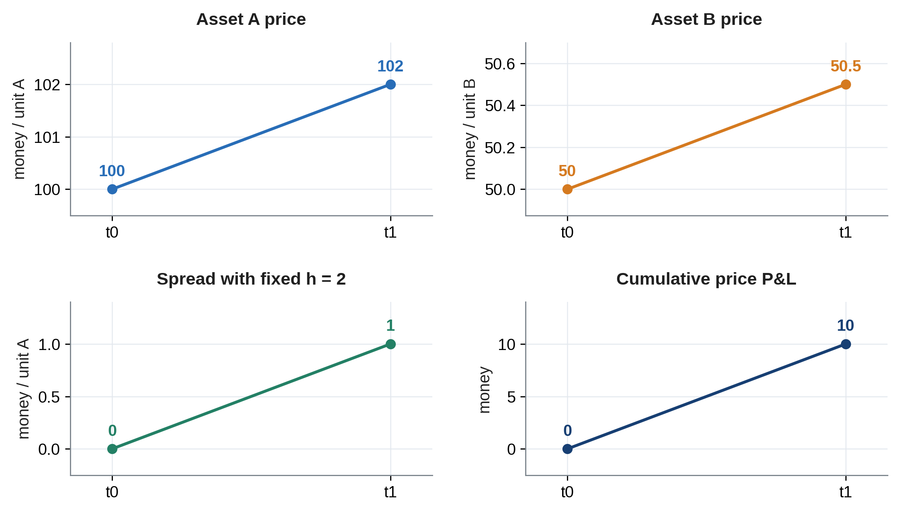

# แม่แบบบทสำหรับ Stat Arb

*ใช้กับชุด Stat Arb for Non Quant — ฉบับ 0.5*

แม่แบบนี้สืบทอด styles ของเล่มเดิม ใช้หัวข้อ เนื้อหา ตาราง ภาพ สมการ และท้ายหน้าชุดเดียวกัน ข้อความในวงเล็บเหลี่ยมเป็นช่องสำหรับแทนเนื้อหาของแต่ละบท

## บทที่ \[เลขบท\] \[ชื่อบท\]

\[คำถามเปิดบทที่เชื่อมกับปัญหาของผู้อ่าน\]

เมื่ออ่านจบ ผู้อ่านควร \[อธิบายอะไร\] \[คำนวณอะไร\] และ \[ตัดสินใจอะไรได้\]

### พื้นฐานที่ควรรู้

\[คำศัพท์หรือแนวคิดที่ต้องใช้ พร้อมบทอ้างกลับ\]

### แนวคิดและตัวอย่าง

\[เริ่มจากตัวอย่างเล็ก อธิบายหน่วยและเหตุผล แล้วเพิ่มตัวอย่างที่เปลี่ยนสมมติฐานหรือมีหลายองค์ประกอบ พร้อมบอกว่าเราเรียนรู้อะไรเกินกว่าผลคำนวณ\]

| **รายการ** | **ค่าเริ่มต้น** | **ค่าถัดไป** |
|------------|-------------|------------|
| ราคา A     | 100         | 102        |
| ราคา B     | 50          | 50.5       |

$$\Pi = 10(102 - 100) - 20(50.5 - 50) = 10$$

อ่านสมการ: กำไรของขา A เท่ากับ 10 คูณราคาที่เพิ่ม 2 ส่วนขา short B ขาดทุน 20 คูณราคาที่เพิ่ม 0.5 รวมกำไรราคา 10 หน่วยเงิน

## ภาพและการอ่านภาพ

ตัวอย่างรูปแบบภาพจากตัวเลขสมมติ

อ่านภาพด้วยกัน: \[อธิบายแกน หน่วย สิ่งที่เปลี่ยน และสิ่งที่ภาพยังสรุปไม่ได้\]

### จากโมเดลสู่การตัดสินใจ

\[คำถามที่ตัวแปรช่วยตอบ สูตร หน่วย เวลาใช้ข้อมูล และเหตุผลที่เลือก plot ค่านี้\]

\[บทบาทของตัวแปรเป็นราคาตะกร้า สัญญาณ ตัวคัดเลือก หรือ risk filter และแปลงเป็นจำนวนที่ถืออย่างไร\]

\[ผลลัพธ์อนาคตที่ใช้ตรวจ ตัวหารทุน ต้นทุน และกราฟที่แยก X ณ เวลาตัดสินใจจากผลภายหลัง\]

### กรณีศึกษาและข้อจำกัด

\[ที่มา คำถาม สมมติฐาน ทางเลือกที่เปรียบเทียบ และสถานะการทำซ้ำ รวมเหตุผลที่เลือกวิธีนี้\]

\[ความเสี่ยงที่รับ หลักฐานหักล้าง และวิธีแยกปัญหาของแนวคิด ข้อมูล สถานะ execution หรือต้นทุน\]

\[เมื่อไม่ผ่าน จะเปลี่ยนโมเดล เปลี่ยนสินทรัพย์ ทดลองกลไกใหม่ หรือพักด้วยเหตุผลใด และเงื่อนไขใดทำให้กลับมาประเมิน\]

\[หากมีสถานะค้าง แยกแผนจัดการสถานะเดิมออกจากการหยุดเปิดสถานะใหม่\]

## ข้อกำหนดของกลยุทธ์และระบบ

\[กรอกให้ผู้อ่านอีกคนตัดสินใจจากข้อมูลเดียวกันได้ ระบุหน่วยและเวลาทุกขั้น\]

| **หัวข้อ**     | **สิ่งที่ต้องระบุ**                                                    |
|--------------|------------------------------------------------------------------|
| กลไกและสถานะ | \[Payoff, forecast, hedge, construction และ execution ทำหน้าที่ใด\] |
| สัญญาณ        | \[สูตร X / target อนาคต / horizon / ช่วง fit / ส่วนเผื่อต้นทุน\]        |
| กฎเข้าและออก  | \[Entry, normal exit, loss budget, time limit และลำดับเหตุการณ์\]   |
| เหตุที่พักหรือลด  | \[Model, data, margin, capital หรือ execution ไม่ผ่าน\]             |
| คำสั่งและบัญชี   | \[เป้าหมาย จำนวน fill partial/reject/timeout และส่วนค้าง\]          |
| สิทธิ์เปิดใหม่    | \[Pause อย่างไร ยังจัดการ inventory อย่างไร และ resume เมื่อใด\]       |
| หลักฐาน       | \[Source ระบุอะไร เราเพิ่มอะไร รันอะไรแล้ว และส่วนใดยังไม่ทำซ้ำ\]         |

\[หากใช้ maker-only ระบุกรณีที่ยังปิดไม่ได้ และแผนที่อนุญาตเมื่อความเสี่ยงเพิ่ม อย่าสมมติการ fill ที่ราคา stop โดยไม่มีหลักฐานรองรับ\]

\[แยกต้นทุนรวมสำหรับรายงาน P&L ออกจากต้นทุนคงเหลือสำหรับตัดสินใจถือต่อ; prediction ที่ดีไม่ทดแทนข้อจำกัด hedge หรือทุน\]

## แบบฝึกหัดและเฉลย

1\. \[คำถามอธิบายความหมายด้วยคำของตัวเอง\]

2\. \[โจทย์เปลี่ยนตัวเลขแล้วคำนวณ\]

3\. \[โจทย์ถ่ายโอนไปสินทรัพย์หรือเงื่อนไขใหม่ และเสนอหลักฐานที่อาจทำให้วิธีนี้ใช้ไม่ได้\]

### เฉลยพร้อมเหตุผล

\[คำตอบตามลำดับ โดยระบุขั้นตอน เหตุผล หน่วย และจุดที่อาจพลาด\]

## ทบทวนหนึ่งหน้า

คำถามหลักของบท: \[คำถาม\]

แนวคิดที่ต้องอธิบายได้: \[แก่นของบท\]

สมการที่จำเป็น: \[สมการพร้อมหน่วยและเงื่อนไข\]

จุดที่ต้องตรวจเมื่อใช้งาน: \[เงื่อนไขและข้อจำกัด\]

คำถามสำหรับทบทวนโดยปิดหนังสือ: \[คำถาม 2–3 ข้อ\]

บทที่เชื่อมต่อ: \[บทก่อนหน้าและบทถัดไป\]
